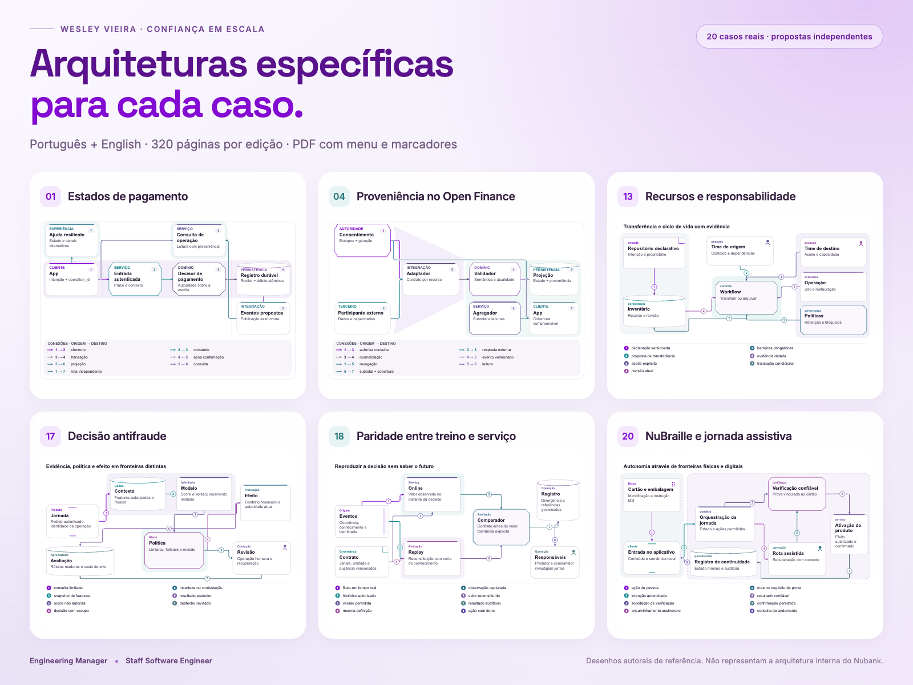

# Confiança em escala · Trust at Scale

**Wesley Vieira — Engineering Manager / Staff Software Engineer**

[Leia em português](https://wesleyvieira99.github.io/nu/) · [Read in English](https://wesleyvieira99.github.io/nu/en.html) · [PDF português](docs/pdf/Nubank_Confianca_em_Escala_PT.pdf) · [English PDF](docs/pdf/Nubank_Trust_at_Scale_EN.pdf)

[](https://github.com/wesleyvieira99/nu/actions/workflows/labs.yml)



## Português

Uma candidatura apresentada como trabalho examinável: vinte estudos sobre jornadas, engenharia e experiência do Nubank, com fontes públicas, propostas de arquitetura, decisões, código e critérios de execução. As duas edições completas têm **320 páginas cada**, **24 desenhos de arquitetura** e **86 blocos de código**.

Este é um estudo independente de Wesley Vieira. Não é uma publicação oficial do Nubank e não representa acesso a sistemas, incidentes ou prioridades internas. Relatos públicos de clientes são sinais para investigação, não reproduções controladas ou diagnósticos confirmados. As propostas e os laboratórios são externos; as fontes, datas e limitações aparecem junto às análises no livro. Logos e fotografias são atribuídos aos respectivos titulares e fontes.

O leitor HTML oferece índice, busca, alternância PT/EN, navegação por página, código copiável e ampliação de imagens. Os PDFs incluem sumário clicável, marcadores por capítulo e subtópico, além de um menu de navegação em todas as páginas. As capturas originais permanecem no idioma da fonte, inclusive na edição em inglês.

### Reproduzir os laboratórios

Os **20 arquivos Python** usam a biblioteca padrão e contêm **205 testes existentes**. Execute a partir da raiz do repositório, com Python 3.12:

```sh
python3 -m unittest discover -s labs -p 'case_*.py' -v
```

Para executar um único caso:

```sh
python3 labs/case_07.py
```

O [núcleo funcional em Clojure](labs/decision_core.clj) contém **11 testes e 22 asserções**. Com Java e Clojure CLI instalados:

```sh
cd labs
clojure -M decision_core.clj
```

O [deps.edn](labs/deps.edn) fixa Clojure 1.12.0; a primeira execução pode baixar a dependência. O conjunto validado contém **216 testes: 205 Python + 11 Clojure**. O workflow deste repositório executa apenas os 205 testes Python; o resultado de Clojure depende do comando separado acima.

São laboratórios didáticos com dados sintéticos. Eles exercitam contratos e invariantes específicos, sem conexão com serviços bancários. Os demais trechos do livro são exemplos ilustrativos e precisam de integração, revisão de segurança e validação no contexto real antes de qualquer uso em produção. A aprovação dos testes não demonstra desempenho nem garantias de sistemas do Nubank.

## English

A candidacy presented as reviewable work: twenty studies of Nubank customer journeys, engineering and experience, with public sources, proposed architectures, decisions, code and delivery criteria. Both complete editions contain **320 pages**, **24 architecture drawings** and **86 code blocks**.

This is an independent study by Wesley Vieira, not an official Nubank publication. It does not imply access to internal systems, incidents or priorities. Public customer reports are investigative signals, not controlled reproductions or confirmed diagnoses. Proposals and labs are external; sources, dates and limitations accompany the analysis in the book. Logos and photographs are credited to their respective owners and sources.

The HTML reader includes contents, search, PT/EN switching, page navigation, copyable code and image zoom. The PDFs contain a clickable contents page, chapter and subtopic bookmarks, and navigation controls on every page. Original source screenshots retain their original language in the English edition.

### Run the labs

The **20 Python files** use the standard library and contain **205 existing tests**. Run from the repository root with Python 3.12:

```sh
python3 -m unittest discover -s labs -p 'case_*.py' -v
```

Run an individual case with `python3 labs/case_07.py`.

The [Clojure functional core](labs/decision_core.clj) contains **11 tests and 22 assertions**. With Java and the Clojure CLI installed:

```sh
cd labs
clojure -M decision_core.clj
```

The [deps.edn](labs/deps.edn) pins Clojure 1.12.0; the first run may download the dependency. The validated suite totals **216 tests: 205 Python + 11 Clojure**. This repository's workflow runs only the 205 Python tests; Clojure is checked separately with the command above.

These educational labs use synthetic data to exercise specific contracts and invariants, without connecting to banking services. Other book snippets are illustrative and require integration, security review and validation in their real context before production use. Passing tests do not establish Nubank system performance or guarantees.

## 20 casos · 20 cases

Each book link opens the corresponding case. Cada link abre o caso correspondente no livro.

| # | Livro em português | Book in English | Executable Python lab |
| --- | --- | --- | --- |
| 01 | [Pix falha e a ajuda falha junto](https://wesleyvieira99.github.io/nu/#01-1) | [When Pix fails, help fails too](https://wesleyvieira99.github.io/nu/en.html#01-1) | [case_01.py](labs/case_01.py) |
| 02 | [Recuperar o acesso quando a câmera frontal não funciona](https://wesleyvieira99.github.io/nu/#02-1) | [Recovering access when the front camera does not work](https://wesleyvieira99.github.io/nu/en.html#02-1) | [case_02.py](labs/case_02.py) |
| 03 | [Uma notificação deve ajudar a decidir](https://wesleyvieira99.github.io/nu/#03-1) | [A notification should help someone decide](https://wesleyvieira99.github.io/nu/en.html#03-1) | [case_03.py](labs/case_03.py) |
| 04 | [Open Finance precisa mostrar o que ainda não está completo](https://wesleyvieira99.github.io/nu/#04-1) | [Open Finance must show what is still incomplete](https://wesleyvieira99.github.io/nu/en.html#04-1) | [case_04.py](labs/case_04.py) |
| 05 | [Próximo vencimento, sem procurar entre meses](https://wesleyvieira99.github.io/nu/#05-1) | [The next due date, without searching across months](https://wesleyvieira99.github.io/nu/en.html#05-1) | [case_05.py](labs/case_05.py) |
| 06 | [Modo Rua: explicar a permissão sem enfraquecer a proteção](https://wesleyvieira99.github.io/nu/#06-1) | [Modo Rua: explain permissions without weakening protection](https://wesleyvieira99.github.io/nu/en.html#06-1) | [case_06.py](labs/case_06.py) |
| 07 | [Um centavo pode quebrar uma integração inteira](https://wesleyvieira99.github.io/nu/#07-1) | [One cent can break an entire integration](https://wesleyvieira99.github.io/nu/en.html#07-1) | [case_07.py](labs/case_07.py) |
| 08 | [A experiência digital também termina na entrega do cartão](https://wesleyvieira99.github.io/nu/#08-1) | [The digital experience also ends with card delivery](https://wesleyvieira99.github.io/nu/en.html#08-1) | [case_08.py](labs/case_08.py) |
| 09 | [Evoluir a fatura sem perder a tarefa principal](https://wesleyvieira99.github.io/nu/#09-1) | [Evolve the statement without losing the primary task](https://wesleyvieira99.github.io/nu/en.html#09-1) | [case_09.py](labs/case_09.py) |
| 10 | [Comprovante no contexto da compra, com significado correto](https://wesleyvieira99.github.io/nu/#10-1) | [A purchase record in context, with the right meaning](https://wesleyvieira99.github.io/nu/en.html#10-1) | [case_10.py](labs/case_10.py) |
| 11 | [Pagamento rápido, sem trocar correção por velocidade](https://wesleyvieira99.github.io/nu/#11-1) | [Fast payments without trading correctness for speed](https://wesleyvieira99.github.io/nu/en.html#11-1) | [case_11.py](labs/case_11.py) |
| 12 | [Capacidade cloud como compromisso de produto](https://wesleyvieira99.github.io/nu/#12-1) | [Cloud capacity as a product commitment](https://wesleyvieira99.github.io/nu/en.html#12-1) | [case_12.py](labs/case_12.py) |
| 13 | [Ownership que sobrevive à reorganização](https://wesleyvieira99.github.io/nu/#13-1) | [Ownership that survives reorganization](https://wesleyvieira99.github.io/nu/en.html#13-1) | [case_13.py](labs/case_13.py) |
| 14 | [BDC: velocidade com contrato de experiência](https://wesleyvieira99.github.io/nu/#14-1) | [BDC: speed with an experience contract](https://wesleyvieira99.github.io/nu/en.html#14-1) | [case_14.py](labs/case_14.py) |
| 15 | [Release mobile guiado pela jornada real](https://wesleyvieira99.github.io/nu/#15-1) | [Mobile releases guided by the actual customer journey](https://wesleyvieira99.github.io/nu/en.html#15-1) | [case_15.py](labs/case_15.py) |
| 16 | [Precog: chegar ao especialista certo](https://wesleyvieira99.github.io/nu/#16-1) | [Precog: reaching the right specialist](https://wesleyvieira99.github.io/nu/en.html#16-1) | [case_16.py](labs/case_16.py) |
| 17 | [Antifraude que responde dentro da jornada](https://wesleyvieira99.github.io/nu/#17-1) | [Fraud prevention that responds within the journey](https://wesleyvieira99.github.io/nu/en.html#17-1) | [case_17.py](labs/case_17.py) |
| 18 | [A mesma feature no treino e na decisão](https://wesleyvieira99.github.io/nu/#18-1) | [The same feature in training and at decision time](https://wesleyvieira99.github.io/nu/en.html#18-1) | [case_18.py](labs/case_18.py) |
| 19 | [Dark Mode: consistência que inclui legibilidade](https://wesleyvieira99.github.io/nu/#19-1) | [Dark Mode: consistency that includes readability](https://wesleyvieira99.github.io/nu/en.html#19-1) | [case_19.py](labs/case_19.py) |
| 20 | [NuBraille: autonomia de ponta a ponta](https://wesleyvieira99.github.io/nu/#20-1) | [NuBraille: end-to-end autonomy](https://wesleyvieira99.github.io/nu/en.html#20-1) | [case_20.py](labs/case_20.py) |

## Organização · Repository layout

| Path | Português | English |
| --- | --- | --- |
| `docs/index.html` | Livro completo em português | Complete Portuguese reader |
| `docs/en.html` | Livro completo em inglês | Complete English reader |
| `docs/pdf/` | PDFs das duas edições | PDFs of both editions |
| `labs/case_01.py` … `case_20.py` | Laboratórios Python e testes | Python labs and tests |
| `labs/decision_core.clj` | Núcleo funcional e testes Clojure | Functional core and Clojure tests |
| `labs/deps.edn` | Dependência Clojure fixada | Pinned Clojure dependency |
| `snippets/` | 86 trechos, índices PT/EN | 86 snippets, PT/EN indexes |
| `evidence/` e `sources.json` | Imagens, diagramas e proveniência | Images, diagrams and provenance |
| `manuscripts/` | Conteúdo editável PT/EN | Editable PT/EN content |
| `fonts/` | Fontes e licenças OFL | Typefaces and OFL licenses |
| `validation/` | Relatórios da edição | Edition validation reports |
| `.github/workflows/labs.yml` | Validação dos testes Python | Python test validation |

## Autor · Author

[Portfólio · Portfolio](https://wesleyvieira99.github.io/WVPortfolio/) · [LinkedIn](https://www.linkedin.com/in/techvieira/) · [GitHub](https://github.com/wesleyvieira99)
