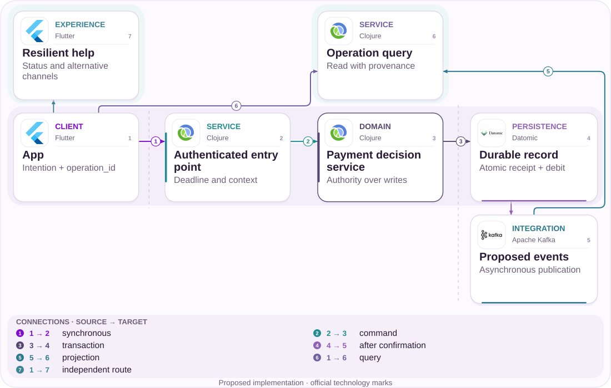
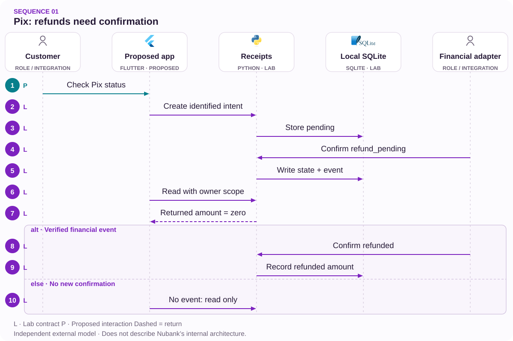

# 01 · BRL 300.00 Pix: clarify the refund

A trustworthy receipt for a failed attempt.

[PT reader](https://wesleyvieira99.github.io/nu/#01-1) · [EN reader](https://wesleyvieira99.github.io/nu/en.html#01-1)

[Executable Python lab](../../labs/case_01.py)

## The record and its outcome


Actual crop of the public source, captured 23 October 2026. The text below includes the company reply and reported outcome.

**Resolved historical case · RA 250462257**

On June 3, 2026, a customer reported receiving BRL 700.00, transferring BRL 200.00 and attempting another BRL 300.00 Pix that failed. More than 24 hours later, she said the money had not returned. On June 9, Nubank acknowledged a localized communication issue, reported an automatic refund and a privately supplied statement. On June 10, she marked the complaint resolved and rated support 9. The exact refund time is not public.

The product question is whether a failed transfer lets a person distinguish the attempt, temporarily unavailable money and a confirmed return. The private statement was not inspected, so this chapter does not reconstruct a balance or a financial timeline beyond the report. The capture documents a public complaint and subsequent resolution; it is not a customer app screen or evidence of a current defect. The proposal preserves that outcome while examining a possible ambiguity in the journey.

- [Reclame AQUI — public complaint and response](https://www.reclameaqui.com.br/nubank/pix-falhou-e-valor-nao-retornou-para-conta-nubank-gerando-atraso-em-contas_M2IN15MxGwipZy9E/)

## Diagnosis before design

A falsifiable hypothesis is that return information reaches the query channel after financial confirmation, extending uncertainty without necessarily extending the hold. I would correlate the attempt, confirmation, posting and first visible query, accounting for clocks and versions. If the information was already available and understood, the hypothesis weakens; investigation moves to presentation or support context.

The team would distinguish transport failure, rejection before settlement and an actual refund. These are different events. The public response identifies no service, database or queue, so attributing this episode to Kafka, caching or distributed architecture would be unsupported. The first deliverable is a map of observed states and owners, not an infrastructure replacement.

Investigation must also separate client time from server time. An attempt may be created offline, sent later and queried from another device. Without this distinction, a dashboard attributes connectivity delay to financial confirmation. I would use timestamps with declared provenance and a per-operation timeline under restricted investigative access. Clock discrepancies should appear as measurement uncertainty rather than negative durations silently discarded. This also makes comparisons between app versions more credible and prevents an apparently faster path from merely using a different clock.

## Architecture boundaries



Independent proposed architecture; suggested technologies, not Nubank internal infrastructure.

The authenticated entry queries the domain, which applies only authorized transitions. The durable record keeps event identity and confirmed state in one transaction. The help path provides guidance without creating another financial instruction.

Asynchronous publication can lag, so the read model declares its latest confirmation and has a reconciliation path. The design does not move authority over money into the interface. The lab verifies a local boundary without simulating settlement in the Pix scheme.

## Executable core

`Idempotent Consumer [lab]` · `Explicit State Machine [lab]`

```python
    def confirm(self, op, event_id, target, trusted=False):
        if trusted is not True or not event_id:
            raise PermissionError("verified adapter required")
        allowed = {"pending": {"settled", "refund_pending"},
                   "refund_pending": {"refunded"}}
        with self.connect() as db:
            db.execute("BEGIN IMMEDIATE")
            prior = db.execute("SELECT op,target FROM events WHERE id=?",
                               (event_id,)).fetchone()
            if prior:
                if prior != (op, target):
                    raise ValueError("event identity conflict")
                return False
            row = db.execute("SELECT state,amount FROM ops WHERE id=?",
                             (op,)).fetchone()
            if not row:
                raise KeyError(op)
            if target not in allowed.get(row[0], set()):
                raise ValueError("illegal transition")
            returned = row[1] if target == "refunded" else 0
            db.execute("UPDATE ops SET state=?,returned=? WHERE id=?",
                       (target, returned, op))
            db.execute("INSERT INTO events VALUES (?,?,?)",
                       (event_id, op, target))
            return True
```

Literal excerpt from the executed independent lab; remaining validation is in the complete file.

An operation starts pending. A failure confirmation allows it to await a refund; only a subsequent authorized event marks the return. BEGIN IMMEDIATE serializes writers in the educational SQLite file. Event identity is compared with its payload, preventing the same key from representing another transition.

The returned amount is recorded in cents and never increases on replay. Ten queries do not change the state. This defines the guarantee: the model records confirmation rather than deciding to return money after a timeout. Signature verification, adapter authenticity and ledger reconciliation remain required integrations.

- [Python — unittest](https://docs.python.org/3/library/unittest.html)
- [Executable case lab on GitHub](https://github.com/wesleyvieira99/nu/blob/main/labs/case_01.py)

## Stack implementation

`Idempotent Consumer [proposal]` · `Explicit State Machine [proposal]`

```clojure
(defn receipt-transition [state event]
  ;; Proposed pure rule; persistence must serialize the decision.
  (let [allowed {:pending #{:settled :refund-pending}
                 :refund-pending #{:refunded}}
        target (:target event)]
    (cond
      (not (true? (:verified event)))
      {:error :untrusted-event}
      (not (contains? (get allowed state #{}) target))
      {:error :illegal-transition}
      :else {:next-state target
             :event-id (:event-id event)})))
```

Proposed integration example, not executed; this is not Nubank internal code.

The Clojure example makes the transition rule inspectable and separates rejection from side effects. In production it must operate on a still-valid version inside an appropriate transaction or with version comparison. A correct pure decision does not eliminate races between reading and writing.

I would start with the existing stack. Choosing PostgreSQL or Datomic depends on the owning domain, transaction mechanisms already operated and migration cost. The Flutter UI would consume explicit states, with copy reviewed so that “awaiting confirmation” does not become “money lost.” This Clojure excerpt was not executed.

- [Clojure — Data Structures](https://clojure.org/reference/data_structures)

## Contracts and ownership

`Idempotent Consumer [proposal]` · `Explicit State Machine [proposal]`

| Field / rule | Owner | Invariant |
| --- | --- | --- |
| operation_id | Pix | Stable intent |
| event_id + payload | Adapter | Conflict rejected |
| owner_scope | Identity | Authorized query |
| returned_cents | Financial domain | Confirmed only |

```json
{
  "schema_version": 1,
  "operation_id": "synthetic-pix-a",
  "event_id": "synthetic-return-a",
  "state": "refunded",
  "amount_cents": 30000,
  "returned_cents": 30000,
  "owner_scope": "authenticated-subject"
}
```

Illustrative proposed contract; synthetic values, not customer data.

The contract distinguishes attempt ID, event identity and authorized account holder. operation_id is not a credential: knowing it does not authorize a query. Schema versioning allows messages to evolve without silently accepting unknown states.

Retention must cover investigation and legitimate replay under a policy approved by the domain and privacy owners. Operational logs would keep minimal correlation; names, Pix keys and statements would not become metric labels. A receipt is historical and must not be presented as the current balance. Migration would preserve existing identities before enabling new consumers.

## Adversarial verification

`Idempotent Consumer [lab]` · `Explicit State Machine [lab]`

```python
    def test_concurrent_refund_replays_once(self):
        self.apply("failed", "refund_pending")
        barrier = threading.Barrier(4)
        def retry(_):
            barrier.wait(timeout=5)
            return self.apply("refund", "refunded")
        with ThreadPoolExecutor(max_workers=4) as pool:
            results = list(pool.map(retry, range(4)))
        self.assertEqual(results.count(True), 1)
        self.assertEqual(self.bank.read("pix-a", "owner-a")[
            "returned_cents"], 30000)

    def test_timeout_is_not_refund_authority(self):
        for _ in range(10):
            self.bank.read("pix-a", "owner-a")
        receipt = self.bank.read("pix-a", "owner-a")
        self.assertEqual(receipt["state"], "pending")
        self.assertEqual(receipt["returned_cents"], 0)
```

Literal lab tests; count and result come from an actual run.

The 12 executed tests cover four concurrent consumers, replay, payload conflict, authorization, invalid money and reopening the file. Repeated queries ensure the application does not hide a financial decision inside a read. The rejected-transition test verifies that an event identity is not consumed before a valid effect exists.

These tests do not validate signed messages, power failure, participant availability or production capacity. Before a pilot, I would add replay of anonymized real messages and publisher recovery tests. The required evidence is preservation of identity and amount, not merely an HTTP 200 response.

- [Python — unittest](https://docs.python.org/3/library/unittest.html)

## Measure the right journey

| Metric | Numerator / denominator | Window and segment |
| --- | --- | --- |
| Trusted-state p 95 | Attempt→confirmation time | 7 days; failure type |
| Contacts /1,000 | Contacts / eligible attempts | 7 days; app version |
| Unintended repeat | Duplicate orders / attempts | Daily; cohort |
| Divergence | Incorrect / audited receipts | Daily; state |

The experiment begins with shadow queries compared against the financial source, without displaying the new receipt. An eligible cohort then receives the explanation while the control retains the previous experience and the same support access. The analysis unit is an unresolved attempt, so retries are not counted as additional customers.

Collection combines confirmed events and support contacts through restricted references, never through a customer’s public text. I would observe each attempt for seven days and segment by app version and failure path. Any false confirmation, cross-account access or duplicate Pix attributable to the receipt stops expansion. The baseline is unknown and must be measured.

## Financial value with assumptions

| Assumed scenario | Main input | Net/month | Payback (months) |
| --- | --- | --- | --- |
| Conservative | 20,000 × 0.05 × BRL 8.00 | BRL 4,000.00 | 30.00 |
| Base | 50,000 × 0.10 × BRL 8.00 | BRL 32,000.00 | 3.75 |
| Ambitious | 100,000 × 0.15 × BRL 8.00 | BRL 105,000.00 | 1.14 |

BRL 300.00 is the principal discussed in the complaint; it is not bank profit and does not enter this calculation. The scenarios assume 20,000 / 50,000 / 100,000 eligible attempts per month, incremental contact reductions of 0.05 / 0.10 / 0.15 and an avoidable marginal cost of BRL 8.00 per contact. Assumed additional monthly operating costs are BRL 4,000.00 / BRL 8,000.00 / BRL 15,000.00.

The calculation is volume × contacts avoided per attempt × marginal cost, less operations. The assumed BRL 120,000.00 investment pays back only when monthly net contribution is positive. The conservative scenario shows that a useful idea may not fund its implementation within the first year at that scale. Released capacity without lower expenditure must be reported as capacity; average salary is not a substitute for marginal cost.

Assumed implementation budget: BRL 120,000.00. Annual net results before implementation: BRL 48,000.00 / BRL 384,000.00 / BRL 1,260,000.00. Every input is an assumption, not a Nubank baseline.

## Accountable roadmap

| Proposed phase | Accountable role | Delivery / exit gate |
| --- | --- | --- |
| Days 0–15 | Pix lead | Map and reconciled sample |
| Days 16–30 | Staff + identity | Contract; scope validated |
| Days 31–60 | Engineering + support | Shadow without divergence |
| Days 61–90 | EM + product | Pilot; economic decision |

The 90-day horizon is a proposal conditional on discovery. The Pix technical owner validates states and evidence; product approves interpretation; support checks that it can explain the same receipt. The EM coordinates dependencies and specialist availability without assuming authority over financial rules.

I would not move directly from design to a broad cohort. The intermediate gate requires reconciling a sample of attempts and proving that a lost response remains queryable later. If the main observed cause is an actual refund delay, the work must include the corresponding financial domain; changing copy alone would be insufficient. The budget can be revised after that diagnosis.

## Rollout and operations

Rollout starts with the observer, then authenticated querying and finally presentation. A flag can remove the new screen but must not delete recognized receipts or events. During rollback, the previous service must still query a compatible record; incompatible versions must be stopped before receiving traffic.

The payments on-call owner receives divergence alerts while support receives approved guidance for unknown states. A drill injects duplicate events, publication lag and unavailable reads. The safe response preserves evidence and initiates reconciliation rather than issuing another transfer. Alerts without an owner or a resolution procedure do not satisfy operational acceptance.

## My contribution

As Staff, I would propose the authority boundary, review invariants and document the choice between querying a projection and reaching the financial source. I would also facilitate review with the owning teams to reduce unnecessary dependencies. The rejected alternative is a timer that turns silence into a refund: it confuses unavailability with a financial decision and may contradict settlement that already occurred.

As EM, I would organize small deliveries, investigation capacity and a shared definition of done involving support and product. These are proposed contributions, not claims that I already led this initiative at Nubank. An interview can explore how I would negotiate reduced scope that preserves correctness when a commercial deadline favors an apparently faster solution.

In an interview, I would ask for an anonymized unresolved attempt and explain which decision each additional piece of evidence would enable. This demonstrates reducing ambiguity before choosing technology. As a leader, I would identify who can authorize a financial-contract change and who owns the customer message. Collaboration prevents a local improvement from merely transferring uncertainty to another team. The result should be a decision record that another engineer can challenge and operate, rather than a design whose correctness depends on its author remaining available.

## Handoff and decision

**Local execution**

python3 labs/case_01.py -v · 12 tests passed.

A reviewer starts with Receipts.create, creates the synthetic attempt and follows confirm through to read. Notice that settled is terminal in this flow; a settled transfer would require a different refund process. The 30,000-cent fixture illustrates the reported amount without reproducing a real account or statement.

The handoff includes code, tests, the contract and integration questions: who authenticates the event, which system confirms the return, and how does publication recover after failure? Further investment depends on these answers and a contact baseline. If ambiguity is not measurable or reconciliation cost exceeds benefit, I would end the pilot while retaining useful instrumentation.

- Replay neither duplicates money nor changes content.
- No holder can query another account’s receipt.
- Rollback preserves identities and history.

- [Executable case lab on GitHub](https://github.com/wesleyvieira99/nu/blob/main/labs/case_01.py)

## Patterns with proof

`Idempotent Consumer [lab]` · `Explicit State Machine [lab]` · `CQRS [proposal]` · `Spring Boot [proposal]`

| Mechanism | Implementation | Evidence |
| --- | --- | --- |
| Idempotent Consumer | Receipts.confirm | a repeated financial event preserves one refund |
| Explicit State Machine | Receipts.confirm | a refund requires an allowed financial transition |
| CQRS / authoritative read model | Production proposal | Adapters keep authority outside the UI. |

**Java integration · proposed**

Spring Boot + transactional repository. Port the invariants and contract tests before replacing the Python model. A process lock is not distributed concurrency control; persistence, authorization and recovery need integration tests.

**AI assessment · deterministic core**

No agent framework is implemented in this lab. Monetary state, authorization and version checks remain deterministic. An assistant would be evaluated separately against a proven support need, without authority to alter balances or identity.

- [P1 · Receipts.confirm](https://github.com/wesleyvieira99/nu/blob/main/labs/case_01.py#L41)
- [P1 · test_concurrent_refund_replays_once](https://github.com/wesleyvieira99/nu/blob/main/labs/case_01.py#L89)
- [P2 · Receipts.confirm](https://github.com/wesleyvieira99/nu/blob/main/labs/case_01.py#L41)
- [P2 · test_refund_without_failure_is_rejected](https://github.com/wesleyvieira99/nu/blob/main/labs/case_01.py#L109)

## Execution sequence



The trusted flag is injected; there is no real Pix call or event signature.

**Authority and failure boundary**

a repeated financial event preserves one refund. a timeout alone leaves the operation inconclusive.

The sequence describes the proposed integration. The linked lab verifies the domain invariant with synthetic data; external services, network retries and deployment remain integration work.

- [confirm](https://github.com/wesleyvieira99/nu/blob/main/labs/case_01.py#L41)
- [read](https://github.com/wesleyvieira99/nu/blob/main/labs/case_01.py#L68)

## Features, stories and acceptance

**F01.1 · Reconciled receipt · D16–30**

As a customer, I want to inspect an inconclusive attempt without repeating the Pix. Acceptance: a repeated financial event preserves one refund.

**F01.2 · Separate timeout from refund · D31–60**

As a reconciliation operator, I want to identify the evidence authorizing a state change. Acceptance: a timeout alone leaves the operation inconclusive.

**F01.3 · Measured rollout · D61–90**

As the product owner, I want an eligible cohort with a comparable control. Acceptance: the case metric, denominator, cost and safety barrier are registered before exposure; reconciliation failures stop expansion.

Linked tests exercise the stated domain acceptance condition, not the complete interface or production integration. D0–15 is discovery: confirm the public report against authorized internal samples, map dependencies and approve contracts. These are incremental planning windows, not a delivery commitment. EM owns coordination; Staff owns cross-domain contracts; Product and the domain owner accept outcomes.

- [Acceptance F01.1](https://github.com/wesleyvieira99/nu/blob/main/labs/case_01.py#L89)
- [Acceptance F01.2](https://github.com/wesleyvieira99/nu/blob/main/labs/case_01.py#L101)

## Method and sensitivity

**Scenario sensitivity · BRL**

All inputs are scenario assumptions, not measured Nubank effects. Capacity equivalent is not cash saved. The realization slider reduces benefit only; all costs remain at their scenario values. This is sensitivity analysis, not a probability or a causal estimate.

period_net = benefit × realization − variable_cost − run_cost; first_year = 12 × period_net − build_cost

Period / Período: `month`. Values / Valores: BRL.

| Scenario / Cenário | Benefit / Benefício | Variable cost / Variável | Run cost / Operação | Build / Implementação |
| --- | ---: | ---: | ---: | ---: |
| Conservative | 8000.00 | 0.00 | 4000.00 | 120000.00 |
| Base | 40000.00 | 0.00 | 8000.00 | 120000.00 |
| Ambitious | 120000.00 | 0.00 | 15000.00 | 120000.00 |

| Scenario / Cenário | Period net at 100% / Líquido | Horizon after build / Horizonte | Horizon at 50% / Estresse |
| --- | ---: | ---: | ---: |
| Conservative | 4000.00 | -72000.00 | -120000.00 |
| Base | 32000.00 | 264000.00 | 24000.00 |
| Ambitious | 105000.00 | 1140000.00 | 420000.00 |

[Reproducible scenario inputs](../../models/normalized-scenarios.json) · [Decimal simulator](../../models/simulate.py)

| Decision | Case-specific method |
| --- | --- |
| Baseline / threat | Baseline: contacts per unresolved attempt. Threat: retries counted as new customers. |
| Unit economics | Eligible attempts × absolute contact reduction × cost per contact; refunded principal is not revenue. |
| Proposed experiment | Run shadow queries before the receipt cohort; follow contacts for seven days and keep support available. |
| Stop rule | Stop for a false confirmation, cross-account access or a receipt-induced duplicate Pix. |

- [Reclame AQUI · ID 250462257](https://www.reclameaqui.com.br/nubank/pix-falhou-e-valor-nao-retornou-para-conta-nubank-gerando-atraso-em-contas_M2IN15MxGwipZy9E/)
- [FinOps Foundation · Unit Economics](https://www.finops.org/framework/capabilities/unit-economics/)
- [Microsoft Research · Pre-experiment design](https://www.microsoft.com/en-us/research/articles/patterns-of-trustworthy-experimentation-pre-experiment-stage/)
