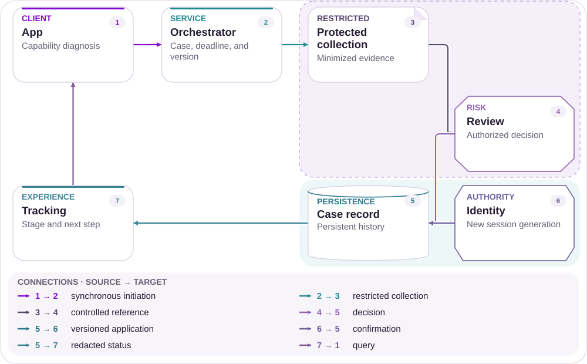
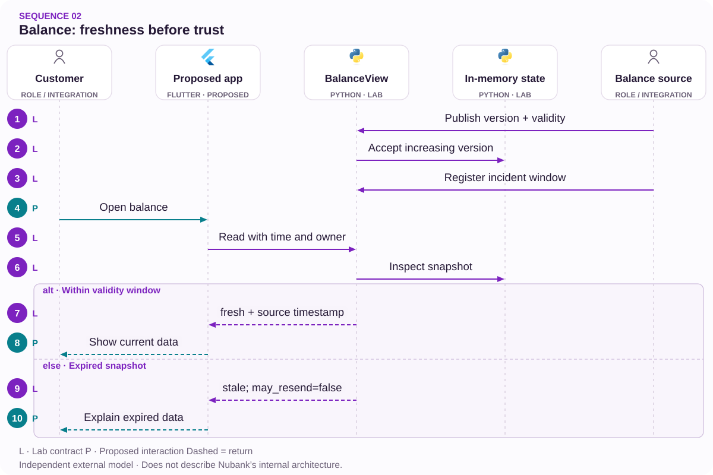

# 02 · Incoming Pix, stale balance

The July 8 incident as an observability test.

[PT reader](https://wesleyvieira99.github.io/nu/#02-1) · [EN reader](https://wesleyvieira99.github.io/nu/en.html#02-1)

[Executable Python lab](../../labs/case_02.py)

## The record and its outcome


Actual crop of the public source, captured 23 October 2026. The text below includes the company reply and reported outcome.

**Historical incident resolved · July 8, 2026**

On July 8, 2026, Canaltech reproduced a Pix sent to Nubank that did not appear in the app. Its test between Nubank accounts did not reproduce the problem. The report described an account-loading notice. Nubank reported temporary instability and recovery around 11:15. The transferred amount, affected population and exact duration were not published.

The evidence combines a newsroom’s own observation with the bank’s response. This is more specific than a mention count but does not replace financial telemetry. The article photograph shows the application’s store listing, so its caption is editorial. It is not presented as an error screenshot. The article quotes posts on X that were not individually verified at their origin. This chapter uses the reported observation and recovery without estimating losses.

- [Canaltech — July 8, 2026 incident](https://canaltech.com.br/apps/recebeu-pix-no-nubank-e-o-dinheiro-nao-caiu-clientes-relatam-problema-no-app/)

## Diagnosis before design

A missing displayed balance permits different hypotheses: unavailable reads, a delayed projection, interrupted integration or an unconfirmed credit. I would begin with the latest known confirmation at each layer without assuming ledger failure. Cross-institution and internal Pix transfers are different probes; the published sample does not establish that only external transfers were affected.

The testable hypothesis is that an old snapshot remained visible without enough validity context. Testing requires source version, source time, query time and displayed message. If the source itself has not confirmed the credit, the product should express uncertainty rather than turn a refreshed screen into financial certainty. Support needs to distinguish these situations.

A snapshot version must be comparable within one account and a defined source. Adding versions from different components creates an artificial order. If a summary combines multiple sources, the response needs coverage and age for each relevant component. I would start with the smallest set that explains the displayed balance rather than turning this case into a rewrite of the entire home screen. This boundary makes correctness demonstrable before broadening composition and gives product a concrete choice about which information remains useful during partial failure.

## Architecture boundaries



Independent proposed architecture; suggested technologies, not Nubank internal infrastructure.

The financial source remains authoritative. The validator accepts increasing versions, and the projection stores validity alongside the amount. Reconciliation compares samples with the origin and returns only confirmed corrections.

Journey status combines two independent facts: freshness of that balance and presence of an incident. Closing a banner does not renew the snapshot. This separation avoids a green interface that conveys confidence without new financial evidence.

## Executable core

`Monotonic Versioning [lab]` · `Freshness Envelope [lab]`

```python
    def read(self, owner, now):
        if owner != self.owner:
            raise PermissionError("account scope")
        integer(now)
        with self.lock:
            snapshot = self.snapshot
            active_incident = now < self.incident_until
            if snapshot is None:
                return {"state": "unknown", "balance_cents": None,
                        "incident": active_incident, "may_resend": False}
            version, cents, observed, valid_until = snapshot
            if now < observed:
                return {"state": "unknown", "balance_cents": None,
                        "incident": active_incident, "may_resend": False}
            fresh = now < valid_until
            return {"state": "fresh" if fresh else "stale",
                    "balance_cents": cents, "version": version,
                    "as_of": observed, "incident": active_incident,
                    "may_resend": False}
```

Literal excerpt from the executed independent lab; remaining validation is in the complete file.

BalanceView.read checks the account holder and clock before building the response. Without a snapshot it returns unknown with an absent amount; zero would be a false financial assertion. A time preceding the observation also yields unknown. At the exact validity boundary, the state becomes stale.

The model permits displaying the last amount with its timestamp but never recommends resending Pix. Its lock protects one process’s memory only. Persistence, authentication and clock synchronization must be implemented outside this core. Integer seconds simplify testing without prescribing the real API’s time format.

- [Python — unittest](https://docs.python.org/3/library/unittest.html)
- [Executable case lab on GitHub](https://github.com/wesleyvieira99/nu/blob/main/labs/case_02.py)

## Stack implementation

`Monotonic Versioning [proposal]` · `Freshness Envelope [proposal]`

```dart
String balanceLabel(Map<String, Object?> view) {
  // Proposed presentation only; never authorizes a transfer.
  switch (view['state']) {
    case 'fresh':
      return 'Confirmed balance';
    case 'stale':
      return 'Last known balance — awaiting update';
    default:
      return 'Balance currently unavailable';
  }
}
bool mayResendPix(Map<String, Object?> view) => false;
```

Proposed integration example, not executed; this is not Nubank internal code.

In the proposed Dart example, a presentation function treats unknown, stale and fresh as explicit states. Incident status arrives separately. The visual layer neither computes balance nor changes validity; it translates contracts into understandable, accessible information.

I would check assistive-technology reading, localized time and reconnection behavior. An endless skeleton can hide an earlier balance; showing that amount without context can mislead. The decision requires comprehension research using real tasks. The example was not compiled, and its messages require product review before use.

- [Dart — Switch statements](https://dart.dev/language/branches)

## Contracts and ownership

`Monotonic Versioning [proposal]` · `Freshness Envelope [proposal]`

| Field / rule | Owner | Invariant |
| --- | --- | --- |
| source_version | Source | Increasing per account |
| observed_at | Financial domain | Validated clock |
| valid_until | Contract | Expires without renewal |
| incident_until | On-call | Does not change balance |

```json
{
  "schema_version": 1,
  "source_version": 8,
  "balance_cents": 12000,
  "observed_at": 100,
  "valid_until": 120,
  "incident_until": 125,
  "state": "stale"
}
```

Illustrative proposed contract; synthetic values, not customer data.

The version belongs to the source, not to the number of client refreshes. Two snapshots with the same version and different amounts are a conflict worth investigating. An older version does not replace a recent one; this model also rejects a newer version whose clock moves backward.

Validity duration must reflect the data contract and be configured by the financial owner rather than chosen arbitrarily by the UI. Telemetry records aggregate age and state without account or amount labels. Reconciliation uses restricted access to investigate samples. Expiration of an incident notice never modifies these contracts.

## Adversarial verification

`Monotonic Versioning [lab]` · `Freshness Envelope [lab]`

```python
    def test_incident_expiry_does_not_refresh_balance(self):
        self.view.incident(125, True)
        result = self.view.read("a", 130)
        self.assertFalse(result["incident"])
        self.assertEqual(result["state"], "stale")
        self.assertFalse(result["may_resend"])

    def test_concurrent_versions_keep_newest(self):
        def publish(version):
            return self.view.publish(version, version * 100, 110, 140, True)
        with ThreadPoolExecutor(max_workers=4) as pool:
            list(pool.map(publish, (5, 2, 4, 3)))
        self.assertEqual(self.view.read("a", 115)["version"], 5)
        self.assertEqual(self.view.read("a", 115)["balance_cents"], 500)
```

Literal lab tests; count and result come from an actual run.

The 14 tests challenge time boundaries, version conflict, unauthorized sources, another account and concurrent publication. The key test lets the banner expire while the balance remains old. Another publishes versions out of order and requires the highest to survive. Testing whether a message appears is insufficient: amount, version and context must remain coherent.

The program does not establish distributed-clock quality or external-system freshness. Integration would add clock-skew simulation, partial reads and delayed probes, alongside accessibility testing. The 12,000-cent fixture is synthetic and does not come from the report.

- [Python — unittest](https://docs.python.org/3/library/unittest.html)

## Measure the right journey

| Metric | Numerator / denominator | Window and segment |
| --- | --- | --- |
| Freshness | Expired reads / reads | 15 min; origin |
| Detection | Failure→alert time | Incident; path |
| Comprehension | Correct tasks / tasks | Research; state |
| Contacts | Contacts / exposed sessions | 24 h; severity |
| False current label | Incorrect / audited labels | Continuous; version |

Collection must separate availability, correctness and freshness. A fast endpoint can return old data; a healthy probe does not represent every originating bank. I would segment by receiving path and app version, using aggregate volumes and a rolling 15-minute operations window.

A communication experiment must compare equivalent incidents or cohorts because severity varies. The hypothesis is fewer contacts and repeated attempts without hiding uncertainty. Expansion stops for a balance labeled current without valid evidence, an amount discrepancy or unsafe retry guidance. I would not set a latency target before measuring the existing path.

## Financial value with assumptions

| Assumed scenario | Main input | Net/month | Payback (months) |
| --- | --- | --- | --- |
| Conservative | 2 × 20,000 × 0.01 | BRL -2,200.00 | None |
| Base | 3 × 40,000 × 0.02 | BRL 8,800.00 | 17.05 |
| Ambitious | 4 × 60,000 × 0.03 | BRL 38,400.00 | 3.91 |

The modeled cost concerns incident handling, not supposedly lost money. Monthly assumptions are 2 / 3 / 4 comparable incidents, 20,000 / 40,000 / 60,000 sessions per incident and incremental contact reductions of 0.01 / 0.02 / 0.03. Each avoidable contact hypothetically costs BRL 7.00; probes and operations add BRL 5,000.00 / BRL 8,000.00 / BRL 12,000.00 per month.

I multiply incidents × sessions × contact-rate difference × cost and subtract operations. Hypothetical implementation investment is BRL 150,000.00. These volumes are sensitivity inputs, not estimates of the July event. Results cannot be transferred automatically to an incident of different severity. The same session must not be counted in both this case and case 01 to add benefits.

Assumed implementation budget: BRL 150,000.00. Annual net results before implementation: BRL -26,400.00 / BRL 105,600.00 / BRL 460,800.00. Every input is an assumption, not a Nubank baseline.

## Accountable roadmap

| Proposed phase | Accountable role | Delivery / exit gate |
| --- | --- | --- |
| Days 0–15 | Finance + SRE | Semantics and probes |
| Days 16–30 | Staff + mobile | Contract and shadow |
| Days 31–60 | Product + support | Comprehension validated |
| Days 61–90 | EM + on-call | Pilot and drill |

During the first weeks, financial engineering and reliability define what each source confirms. Product and support agree on messages for absence, lag and recovery. The probe owner verifies that probes create no unauthorized transfers and do not congest the real path.

The next milestone is an invisible comparison between calculated labels and evidence. Only then does a small cohort receive the interface. The EM coordinates review and on-call coverage; Staff resolves source, projection and client contracts. If freshness cannot be measured reliably, launch remains limited to unavailability guidance rather than simulated precision.

## Rollout and operations

The runbook separates query failure from absent financial confirmation. If the observer loses connectivity, it must not announce that every Pix failed. An incident has an owner, scope, version and expiration; a recovery update must be traceable to its owner.

In the failure drill I freeze the projection, expire the banner and restore only the API. The UI must still recognize old data. Rollback removes new messages while retaining snapshots and instrumentation. Support receives an answer consistent with the technical view and is not instructed to confirm a credit the system has not confirmed.

Lab limitation: incident notices are unversioned, so an old notice can replace a newer one. This does not refresh the balance. Notice ordering belongs to the proposed integration and is not implemented in this example.

## My contribution

My Staff contribution would make validity semantics explicit and review how the client receives a composite response. I would reject a single “system normal” boolean because it mixes global health, local availability and correctness for one account. A richer representation requires product care but explains limits without inventing certainty.

As EM, I would lead a delivery involving reliability, payments, mobile and support with named accountable roles. Stopping can be valuable: a banner that creates confusion or false confirmations should not expand even if it reduces calls. I would bring evidence and alternatives to the team while respecting its decisions and existing stack expertise.

A sound Staff decision also makes the observer’s unknowns explicit. I would discuss with product the difference between reporting unavailability and claiming that an operation did not happen. As EM, I would protect post-incident analysis time and review alert usefulness with the people carrying the pager. This routine reduces pressure to publish a green status without sufficient evidence merely to close an administrative incident. It also gives support a reliable escalation path when the global message and one customer’s experience do not agree.

## Handoff and decision

**Local execution**

python3 labs/case_02.py -v · 14 tests passed.

A reviewer runs the lab, calls publish with different versions and observes read at the validity boundary. Then the incident is closed without updating the balance. This walkthrough demonstrates the central separation without real infrastructure.

Integration must identify who issues the version, how time is obtained, the allowed lag and who confirms recovery. Before expansion, require an audited sample, assistive-technology testing and the ability to reconcile divergent snapshots. If those responsibilities lack owners, keep instrumentation in shadow and resolve ownership before customer exposure.

- An expired banner does not refresh data.
- Unknown balance is not displayed as zero.
- Conflicting versions trigger investigation.

- [Executable case lab on GitHub](https://github.com/wesleyvieira99/nu/blob/main/labs/case_02.py)

## Patterns with proof

`Monotonic Versioning [lab]` · `Freshness Envelope [lab]` · `CQRS [proposal]` · `Spring Boot [proposal]`

| Mechanism | Implementation | Evidence |
| --- | --- | --- |
| Monotonic Versioning | BalanceView.publish | an older version cannot replace the newest one |
| Freshness Envelope | BalanceView.read | at expiry, the snapshot is treated as stale |
| CQRS / stale-aware projection | Production proposal | Adapters keep authority outside the UI. |

**Java integration · proposed**

Spring Boot + typed response DTO. Port the invariants and contract tests before replacing the Python model. A process lock is not distributed concurrency control; persistence, authorization and recovery need integration tests.

**AI assessment · deterministic core**

No agent framework is implemented in this lab. Monetary state, authorization and version checks remain deterministic. An assistant would be evaluated separately against a proven support need, without authority to alter balances or identity.

- [P1 · BalanceView.publish](https://github.com/wesleyvieira99/nu/blob/main/labs/case_02.py#L27)
- [P1 · test_concurrent_versions_keep_newest](https://github.com/wesleyvieira99/nu/blob/main/labs/case_02.py#L84)
- [P2 · BalanceView.read](https://github.com/wesleyvieira99/nu/blob/main/labs/case_02.py#L49)
- [P2 · test_exact_expiry_is_stale](https://github.com/wesleyvieira99/nu/blob/main/labs/case_02.py#L93)

## Execution sequence



Time and source are trusted; the lock covers one process. An incident never refreshes a balance.

**Authority and failure boundary**

an older version cannot replace the newest one. without a snapshot, the read returns unknown.

The sequence describes the proposed integration. The linked lab verifies the domain invariant with synthetic data; external services, network retries and deployment remain integration work.

- [publish](https://github.com/wesleyvieira99/nu/blob/main/labs/case_02.py#L27)
- [read](https://github.com/wesleyvieira99/nu/blob/main/labs/case_02.py#L49)

## Features, stories and acceptance

**F02.1 · Balance with explicit freshness · D16–30**

As a customer, I want to know when the source last confirmed the balance. Acceptance: an older version cannot replace the newest one.

**F02.2 · Missing is not zero · D31–60**

As a customer, I want to distinguish a failed query from an empty balance. Acceptance: without a snapshot, the read returns unknown.

**F02.3 · Measured rollout · D61–90**

As the product owner, I want an eligible cohort with a comparable control. Acceptance: the case metric, denominator, cost and safety barrier are registered before exposure; reconciliation failures stop expansion.

Linked tests exercise the stated domain acceptance condition, not the complete interface or production integration. D0–15 is discovery: confirm the public report against authorized internal samples, map dependencies and approve contracts. These are incremental planning windows, not a delivery commitment. EM owns coordination; Staff owns cross-domain contracts; Product and the domain owner accept outcomes.

- [Acceptance F02.1](https://github.com/wesleyvieira99/nu/blob/main/labs/case_02.py#L84)
- [Acceptance F02.2](https://github.com/wesleyvieira99/nu/blob/main/labs/case_02.py#L118)

## Method and sensitivity

**Scenario sensitivity · BRL**

All inputs are scenario assumptions, not measured Nubank effects. Capacity equivalent is not cash saved. The realization slider reduces benefit only; all costs remain at their scenario values. This is sensitivity analysis, not a probability or a causal estimate.

period_net = benefit × realization − variable_cost − run_cost; first_year = 12 × period_net − build_cost

Period / Período: `month`. Values / Valores: BRL.

| Scenario / Cenário | Benefit / Benefício | Variable cost / Variável | Run cost / Operação | Build / Implementação |
| --- | ---: | ---: | ---: | ---: |
| Conservative | 2800.00 | 0.00 | 5000.00 | 150000.00 |
| Base | 16800.00 | 0.00 | 8000.00 | 150000.00 |
| Ambitious | 50400.00 | 0.00 | 12000.00 | 150000.00 |

| Scenario / Cenário | Period net at 100% / Líquido | Horizon after build / Horizonte | Horizon at 50% / Estresse |
| --- | ---: | ---: | ---: |
| Conservative | -2200.00 | -176400.00 | -193200.00 |
| Base | 8800.00 | -44400.00 | -145200.00 |
| Ambitious | 38400.00 | 310800.00 | 8400.00 |

[Reproducible scenario inputs](../../models/normalized-scenarios.json) · [Decimal simulator](../../models/simulate.py)

| Decision | Case-specific method |
| --- | --- |
| Baseline / threat | Baseline: contacts per exposed session. Threat: comparing incidents of different severity. |
| Unit economics | Incidents × affected sessions × contact reduction × cost; communication does not itself repair the balance. |
| Proposed experiment | Compare similar episodes or cohorts; segment origin, version and freshness while keeping uncertainty visible. |
| Stop rule | Stop for an unsupported fresh-balance label, amount mismatch or unsafe repeat instruction. |

- [Canaltech](https://canaltech.com.br/apps/recebeu-pix-no-nubank-e-o-dinheiro-nao-caiu-clientes-relatam-problema-no-app/)
- [FinOps Foundation · Unit Economics](https://www.finops.org/framework/capabilities/unit-economics/)
- [Microsoft Research · Pre-experiment design](https://www.microsoft.com/en-us/research/articles/patterns-of-trustworthy-experimentation-pre-experiment-stage/)
