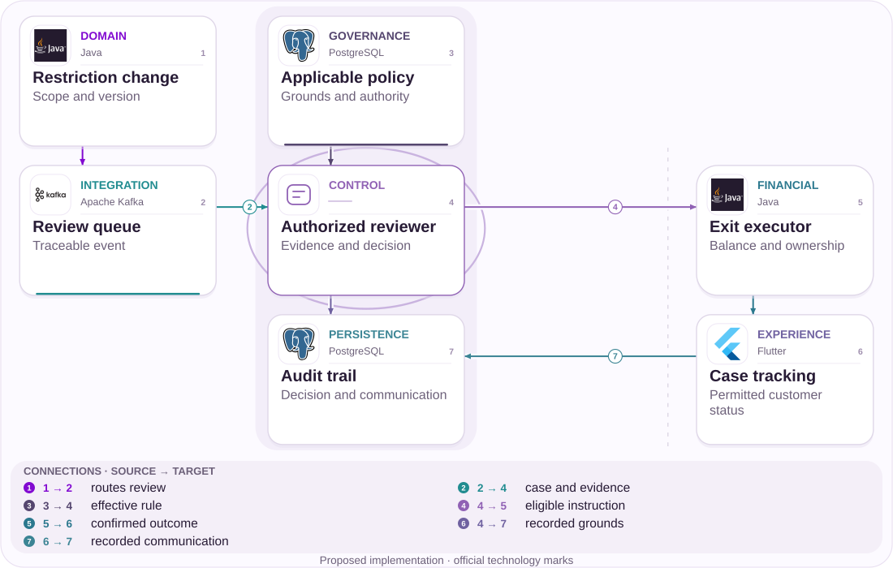
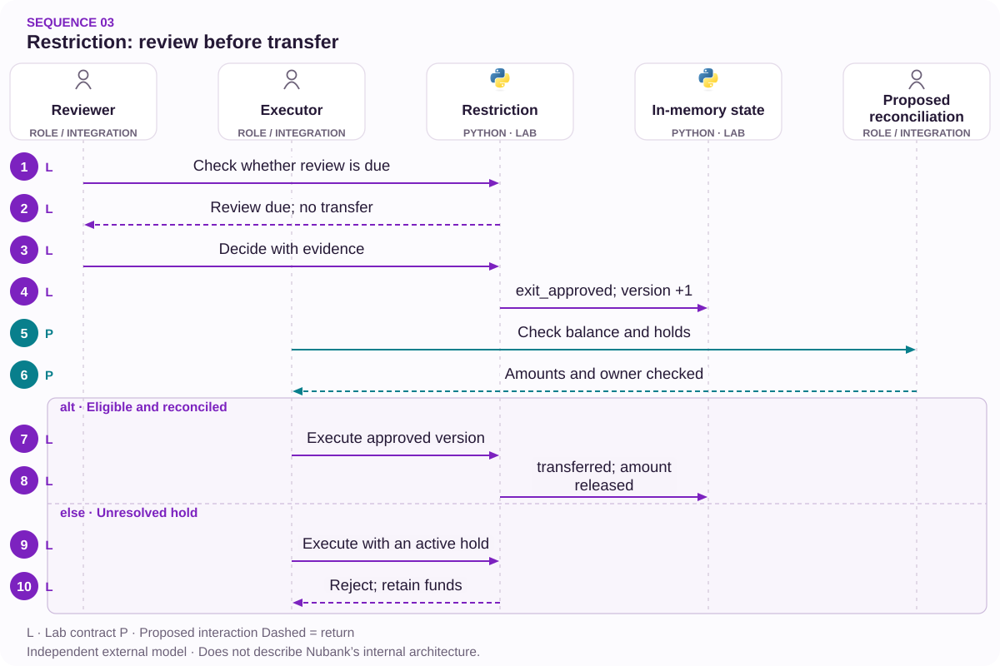

# 03 · Account restriction: review and exit

Evidence, ownership and reconciliation before release.

[PT reader](https://wesleyvieira99.github.io/nu/#03-1) · [EN reader](https://wesleyvieira99.github.io/nu/en.html#03-1)

[Executable Python lab](../../labs/case_03.py)

## The record and its outcome


Actual crop of the public source, captured 23 October 2026. The text below includes the company reply and reported outcome.

**Outcome reported by the press · March 2026**

Metrópoles reported that more than BRL 2,000.00lion belonging to a beauty business was blocked on January 20, 2026, followed by account closure. The article attributes a tax-refund origin to the defense and reports a court order. Nubank cited security and compliance and declined case details on confidentiality grounds. In the March 11 video, the reporter said the money was transferred to another bank. Court records and compliance were not independently verified.

The article and transcript make different contributions. The article describes the dispute; the 06:59–07:23 transcript adds the outcome according to the reporter. I do not claim to have watched the entire video or inspected court records. This proposal does not treat the restriction as current. It also does not transfer compensation from other customers in the article to this episode. The case informs review, explanation and exit design with controls appropriate to each decision’s authority.

- [Metrópoles — restriction and reported outcome](https://www.metropoles.com/colunas/dinheiro-e-negocios/indicios-de-ilicitos-nubank-bloqueia-contas-e-deixa-clientes-sem-acesso-ao-dinheiro)
- [Metrópoles — reported outcome, 06:59–07:23](https://www.youtube.com/watch?v=f6zCNrN1T8Y&t=419s)

## Diagnosis before design


Actual frame from Metrópoles, 11 March 2026. The transcript describes the company case at 02:26 and reports release at 06:59–07:23.

[Source video / Vídeo da fonte](https://www.youtube.com/watch?v=f6zCNrN1T8Y)

The technical question is whether a restriction remains connected to grounds, evidence, an owner and its next review as it crosses support, risk and account closure. This does not determine whether a particular suspicion was valid. A testable hypothesis is lost context between initial restriction and execution of an authorized exit.

I would sample cases by measure type and reconstruct state changes with accountable owners. Decision time would be compared with actual transfer instruction, distinguishing document waits, active legal holds and operational queues. The report does not provide that breakdown. I would not apply a universal 72-hour deadline: the rule depends on the relevant grounds and requires legal validation.

A document submitted by a business may be relevant without being conclusive. The system must record receipt, reviewer and the authorized decision arising from it rather than automating a legal conclusion because a file exists. I would also investigate handoffs: a support task marked complete does not necessarily close risk review. Distinguishing work status from restriction status prevents productivity indicators from hiding operationally unresolved cases. Each transition should expose its prerequisite to the next owner so that progress does not depend on reconstructing a conversation from scattered messages.

- [Watch source video](https://www.youtube.com/watch?v=f6zCNrN1T8Y)

## Architecture boundaries



Independent proposed architecture; suggested technologies, not Nubank internal infrastructure.

Review receives events and consults the effective policy. An eligible decision proceeds to financial execution while the trail retains grounds and communication. The customer receives only approved status information, without antifraud thresholds or third-party data.

The design separates review from execution. Approving an exit does not prove that the balance was transferred. Confirmation depends on reconciliation, an authorized destination and no active impediments, checked again at the execution boundary.

## Executable core

`Separation of Duties [lab]` · `Versioned Decision [lab]`

```python
    def execute_exit(self, expected, role, destination_owner,
                     reconciled_cents, no_active_hold=False):
        with self.lock:
            if role != "executor":
                raise PermissionError("execution scope")
            if type(expected) is not int or expected != self.version:
                raise ValueError("stale execution")
            if self.state != "exit_approved":
                raise ValueError("review required")
            if (not isinstance(destination_owner, str)
                    or not destination_owner.strip()
                    or destination_owner != self.owner):
                raise PermissionError("destination ownership")
            if type(reconciled_cents) is not int:
                raise ValueError("integer cents required")
            if reconciled_cents != self.cents:
                raise ValueError("reconcile before transfer")
            if no_active_hold is not True:
                raise ValueError("legal and risk holds unresolved")
            self.state = "transferred"
            self.released = self.cents
            self.version += 1
            return self.released
```

Literal excerpt from the executed independent lab; remaining validation is in the complete file.

Restriction.execute_exit requires an executor role, expected version, destination ownership, reconciled balance and explicit clearance of active impediments. Each rejection preserves the prior approval without transferring money. The review clock does not authorize execution: an overdue date creates pending work, not technical permission to move funds.

The 200,000,100-cent amount is merely a synthetic fixture above BRL 2,000.00lion, not the case’s exact amount. This model uses an in-memory lock and makes no payments. Real integration requires durable transactional control, operator identity and transfer confirmation by an authorized financial domain.

- [Python — unittest](https://docs.python.org/3/library/unittest.html)
- [Executable case lab on GitHub](https://github.com/wesleyvieira99/nu/blob/main/labs/case_03.py)

## Stack implementation

`Separation of Duties [proposal]` · `Versioned Decision [proposal]`

```sql
-- Illustrative compare-and-write; not executed.
UPDATE restriction_case
SET state = 'exit_approved', version = version + 1,
    decision_ref = :approved_decision
WHERE case_id = :case_id
  AND version = :expected_version
  AND state = 'restricted'
  AND reconciliation_version = :confirmed_version;
-- Require exactly one row; otherwise reload and review.
-- Transfer execution is a separate authorized transaction.
```

Proposed integration example, not executed; this is not Nubank internal code.

The illustrative SQL conditions an update on version, state and reconciliation confirmation. It demonstrates compare-and-write but does not independently implement separation of duties or legal assessment. The service must check identity and policy before the transaction and treat a zero-row update as a conflict.

I would favor integration with the existing restriction record rather than a second decision center. A queue can distribute work; it cannot declare a case eligible because it is old. Permissions should distinguish reviewers, executors and auditors, with documented and reviewed exception paths.

- [PostgreSQL — Transaction Isolation](https://www.postgresql.org/docs/current/transaction-iso.html)

## Contracts and ownership

`Separation of Duties [proposal]` · `Versioned Decision [proposal]`

| Field / rule | Owner | Invariant |
| --- | --- | --- |
| restriction_scope | Risk/legal | Specific grounds |
| decision_version | Reviewer | Conflict invalidates |
| evidence_ref | Custodian | Restricted access |
| exit_instruction | Financial domain | Recheck active holds |

```json
{
  "schema_version": 1,
  "case_id": "synthetic-restriction",
  "restriction_scope": "account_exit",
  "decision_version": 2,
  "evidence_ref": "restricted-object-reference",
  "state": "exit_approved",
  "execution_confirmed": false
}
```

Illustrative proposed contract; synthetic values, not customer data.

A restriction should not be a context-free boolean. Its contract must represent scope, grounds, version and an evidence reference while keeping sensitive documents out of broadly distributed events. A reference can remain auditable without exposing its contents to general support.

An exit instruction retains the authorizing decision but rechecks impediments before execution. A new restriction between review and transfer invalidates the earlier version. Approved communication explains the stage and permitted appeal channel without revealing detection signals. Retention and access to court or supporting documents follow specific policies rather than generic logging defaults.

## Adversarial verification

`Separation of Duties [lab]` · `Versioned Decision [lab]`

```python
    def test_overdue_review_does_not_release_money(self):
        self.assertTrue(self.case.due(999))
        self.assertEqual(self.case.state, "restricted")
        self.assertEqual(self.case.released, 0)

    def test_reconciliation_failure_preserves_approval(self):
        self.approve()
        with self.assertRaises(ValueError):
            self.execute(reconciled_cents=1)
        self.assertEqual(self.case.state, "exit_approved")
        self.assertEqual(self.case.released, 0)
        self.assertEqual(self.execute(), 200000100)
```

Literal lab tests; count and result come from an actual run.

The 14 tests show that overdue review does not release money, failed reconciliation blocks execution and a reviewer does not automatically hold the executor role. They also cover another owner’s destination, missing evidence, stale version, replay and invalid values. A second execution cannot increase the transferred total.

The suite does not validate a policy’s legal correctness or document authenticity. The next level requires role-integration tests and simulation of a new restriction arriving between approval and sending. The goal is to prove that operational simplification creates no unauthorized release while retaining an auditable path for eligible cases.

- [Python — unittest](https://docs.python.org/3/library/unittest.html)

## Measure the right journey

| Metric | Numerator / denominator | Window and segment |
| --- | --- | --- |
| Age p 95 | Time per open case | Daily; grounds |
| Unowned | Unowned / active cases | Daily; category |
| Confirmed exit | Approval→execution time | Weekly; impediment |
| Control failure | Failures / audited executions | Continuous; version |

Queue age must be segmented by grounds; mixing a document request with a court order can hide distinct priorities. The dashboard measures cases without an owner or scheduled review and tracks approval-to-confirmed-execution time. Individual case data remains restricted.

I would compare equivalent cohorts by category and complexity while preserving human review. Fewer contacts are beneficial only if they do not result from obstructed appeals. Unauthorized release, exposure of detection signals or unreconciled execution immediately stops the pilot. Baselines and operating limits must be set with risk, legal and operations rather than inferred from the reported amount.

## Financial value with assumptions

| Assumed scenario | Main input | Net/month | Payback (months) |
| --- | --- | --- | --- |
| Conservative | 1,000 × 10 min × 25% | BRL -1,250.00 | None |
| Base | 2,500 × 15 min × 40% | BRL 12,500.00 | 14.40 |
| Ambitious | 4,000 × 20 min × 50% | BRL 42,000.00 | 4.29 |

The calculation does not treat held funds as a benefit. Assumptions are 1,000 / 2,500 / 4,000 monthly reviews, 10 / 15 / 20 minutes saved per review and BRL 90.00 per hour. Only 25% / 40% / 50% of released capacity is assumed to become avoidable expenditure. Monthly operations of BRL 5,000.00 / BRL 10,000.00 / BRL 18,000.00 and a hypothetical BRL 180,000.00 implementation are deducted.

The formula is cases × minutes / 60 × hourly cost × realizable share, less operations. That share must be demonstrated through an actual spending change; without it, the corresponding financial benefit is zero even if the queue improves. Avoided compensation is excluded because no verifiable causal probability or cost supports it.

Assumed implementation budget: BRL 180,000.00. Annual net results before implementation: BRL -15,000.00 / BRL 150,000.00 / BRL 504,000.00. Every input is an assumption, not a Nubank baseline.

## Accountable roadmap

| Proposed phase | Accountable role | Delivery / exit gate |
| --- | --- | --- |
| Days 0–15 | Legal + risk | Approved taxonomy |
| Days 16–30 | Staff + operations | Roles and evidence |
| Days 31–60 | Financial engineering | Reconciled shadow |
| Days 61–90 | EM + governance | Limited pilot; review |

Planning begins with a taxonomy of measures and named legal and operational owners. Architecture follows understanding where each team’s authority ends. A closed account needs an exit path as explicit as the path that created its restriction.

Staff coordinates contracts and revalidation points; the EM secures legal, risk and support capacity at acceptance milestones. Shadow mode must reproduce previous decisions without executing them. Cases with unapproved grounds or no owner remain outside the pilot until resolved. The horizon is proposed rather than a commitment made by Nubank.

## Rollout and operations

The initial canary covers a small set of restriction types and does not automate the substantive decision. Overdue-review alerts go to category owners; execution-divergence alerts go to the financial domain. Customers receive stage information rather than a calendar-based promise of release.

The operations drill includes a new restrictive order after approval, changed destination ownership and failure after sending an instruction. In the latter case, query and reconciliation precede any resend. Rollback freezes new executions through the new version and preserves audit history. A faster queue that loses grounds, evidence or appeal access is unacceptable.

## My contribution

As Staff, I would help turn implicit states into a traceable protocol for appeals, review and execution. The rejected alternative is automatic release when a timer expires. It appears to solve delay but ignores active impediments and confuses a work deadline with financial authority.

As EM, I would organize specialist collaboration without promising that engineering alone can decide a regulatory question. This includes review capacity, support training and stopping criteria backed by accountable owners. My proposed value is connecting technical quality with operational responsibility, not presenting this external proposal as a past achievement.

In a leadership assessment, I would explain how to handle tension between customer urgency and a restriction that remains valid. The response is permitted information, accountable review and correct execution when authorized. I would ask the team to discuss an edge case and record its decision, including why a particular step should remain manual. This makes the project reviewable by specialists beyond engineering and avoids implying that faster software can substitute for the authority or evidence needed to make a substantive decision.

## Handoff and decision

**Local execution**

python3 labs/case_03.py -v · 14 tests passed.

The reviewer follows due, decide and execute_exit in that order, observing that the first function does not change money. Then inject a mismatched balance and confirm that approval remains available for a later correct execution. The lab demonstrates a control; it is neither legal advice nor a banking closure system.

To proceed, the domain must provide a valid taxonomy, operator identity, destination-ownership confirmation and a reconciliation source. Investment depends on eligible volume and genuinely avoidable expenditure. If those contracts cannot be established, delivery should remain focused on tracking and queue quality while preserving existing execution.

- A timer does not authorize a transfer.
- A new restriction invalidates an old approval.
- Audit separates decision from execution.

- [Executable case lab on GitHub](https://github.com/wesleyvieira99/nu/blob/main/labs/case_03.py)

## Patterns with proof

`Separation of Duties [lab]` · `Versioned Decision [lab]` · `Hexagonal Architecture [proposal]` · `Spring Boot [proposal]` · `LangGraph [proposal]`

| Mechanism | Implementation | Evidence |
| --- | --- | --- |
| Separation of Duties | Restriction.execute_exit | the reviewer cannot execute the financial exit |
| Versioned Decision | Restriction.decide | a decision based on an old version is rejected |
| Hexagonal Architecture / policy boundary | Production proposal | Adapters keep authority outside the UI. |

**Java integration · proposed**

Spring Boot + Spring Security. Port the invariants and contract tests before replacing the Python model. A process lock is not distributed concurrency control; persistence, authorization and recovery need integration tests.

**AI assessment · LangGraph**

Proposed experiment: LangGraph to organize authorized evidence for human review. Read-only tools, source citations, a token budget and human approval are required. It cannot authorize money, eligibility or identity. No LLM integration is claimed by the Python tests.

- [P1 · Restriction.execute_exit](https://github.com/wesleyvieira99/nu/blob/main/labs/case_03.py#L39)
- [P1 · test_review_role_cannot_execute](https://github.com/wesleyvieira99/nu/blob/main/labs/case_03.py#L88)
- [P2 · Restriction.decide](https://github.com/wesleyvieira99/nu/blob/main/labs/case_03.py#L27)
- [P2 · test_stale_review_rejected](https://github.com/wesleyvieira99/nu/blob/main/labs/case_03.py#L104)
- [LangGraph · persistence](https://docs.langchain.com/oss/python/langgraph/persistence)

## Execution sequence



Roles, eligibility and absence of holds are trusted inputs; no real transfer is made.

**Authority and failure boundary**

the reviewer cannot execute the financial exit. an overdue deadline cannot release money automatically.

The sequence describes the proposed integration. The linked lab verifies the domain invariant with synthetic data; external services, network retries and deployment remain integration work.

- [decide](https://github.com/wesleyvieira99/nu/blob/main/labs/case_03.py#L27)
- [execute_exit](https://github.com/wesleyvieira99/nu/blob/main/labs/case_03.py#L39)

## Features, stories and acceptance

**F03.1 · Owned review · D16–30**

As a customer, I want to track the next review and its owner. Acceptance: the reviewer cannot execute the financial exit.

**F03.2 · Authorized and reconciled exit · D31–60**

As an authorized execution operator, I want to execute an approved decision without ignoring holds. Acceptance: an overdue deadline cannot release money automatically.

**F03.3 · Measured rollout · D61–90**

As the product owner, I want an eligible cohort with a comparable control. Acceptance: the case metric, denominator, cost and safety barrier are registered before exposure; reconciliation failures stop expansion.

Linked tests exercise the stated domain acceptance condition, not the complete interface or production integration. D0–15 is discovery: confirm the public report against authorized internal samples, map dependencies and approve contracts. These are incremental planning windows, not a delivery commitment. EM owns coordination; Staff owns cross-domain contracts; Product and the domain owner accept outcomes.

- [Acceptance F03.1](https://github.com/wesleyvieira99/nu/blob/main/labs/case_03.py#L88)
- [Acceptance F03.2](https://github.com/wesleyvieira99/nu/blob/main/labs/case_03.py#L74)

## Method and sensitivity

**Scenario sensitivity · BRL**

All inputs are scenario assumptions, not measured Nubank effects. Capacity equivalent is not cash saved. The realization slider reduces benefit only; all costs remain at their scenario values. This is sensitivity analysis, not a probability or a causal estimate. The original realizable-capacity factor is already included; the slider applies an additional stress.

period_net = benefit × realization − variable_cost − run_cost; first_year = 12 × period_net − build_cost

Period / Período: `month`. Values / Valores: BRL.

| Scenario / Cenário | Benefit / Benefício | Variable cost / Variável | Run cost / Operação | Build / Implementação |
| --- | ---: | ---: | ---: | ---: |
| Conservative | 3750.00 | 0.00 | 5000.00 | 180000.00 |
| Base | 22500.00 | 0.00 | 10000.00 | 180000.00 |
| Ambitious | 60000.00 | 0.00 | 18000.00 | 180000.00 |

| Scenario / Cenário | Period net at 100% / Líquido | Horizon after build / Horizonte | Horizon at 50% / Estresse |
| --- | ---: | ---: | ---: |
| Conservative | -1250.00 | -195000.00 | -217500.00 |
| Base | 12500.00 | -30000.00 | -165000.00 |
| Ambitious | 42000.00 | 324000.00 | -36000.00 |

[Reproducible scenario inputs](../../models/normalized-scenarios.json) · [Decimal simulator](../../models/simulate.py)

| Decision | Case-specific method |
| --- | --- |
| Baseline / threat | Baseline: working minutes per case. Threat: mixing document restrictions and court orders. |
| Unit economics | Cases × minutes released / 60 × hourly cost × realizable share; released funds belong to the customer. |
| Proposed experiment | Match category and complexity while preserving human review, ownership and exit reconciliation. |
| Stop rule | Stop for an improper release, exposed risk signals or an unreconciled execution. |

- [Metrópoles](https://www.metropoles.com/colunas/dinheiro-e-negocios/indicios-de-ilicitos-nubank-bloqueia-contas-e-deixa-clientes-sem-acesso-ao-dinheiro)
- [FinOps Foundation · Unit Economics](https://www.finops.org/framework/capabilities/unit-economics/)
- [Microsoft Research · Pre-experiment design](https://www.microsoft.com/en-us/research/articles/patterns-of-trustworthy-experimentation-pre-experiment-stage/)
