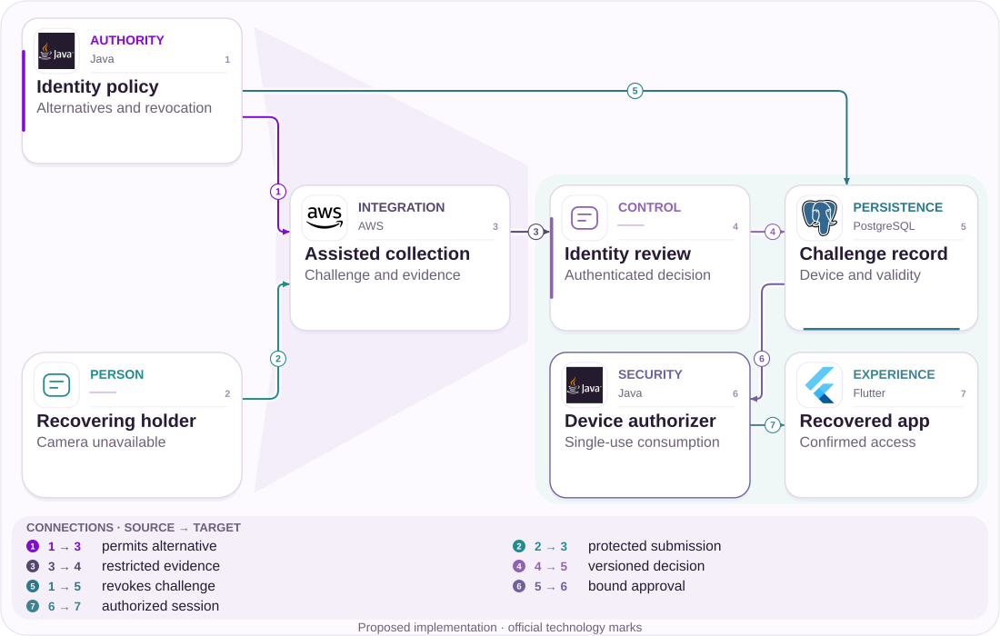
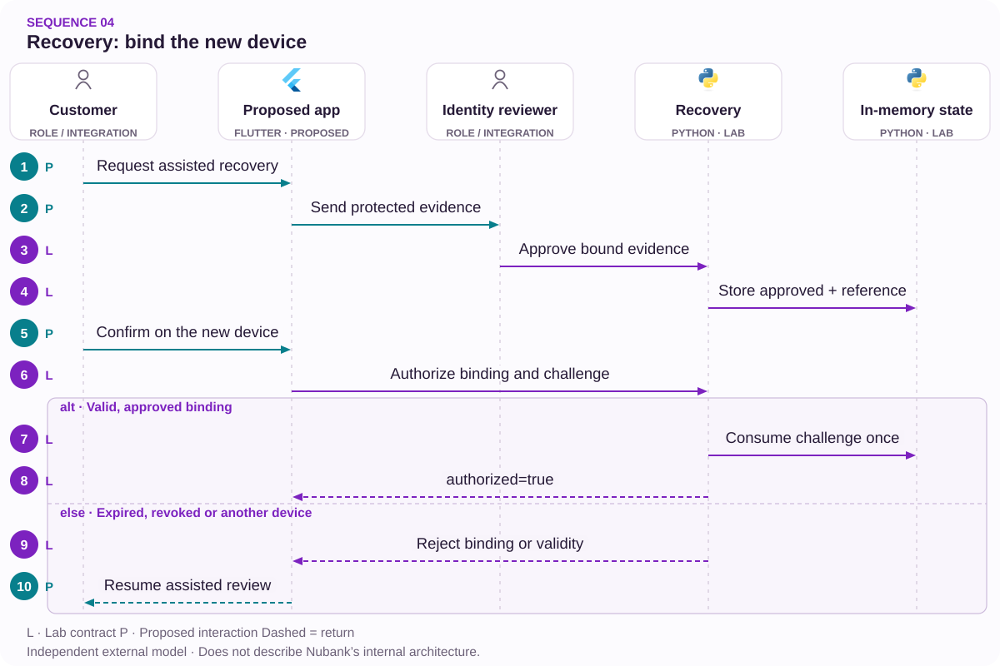

# 04 · Broken camera, secure recovery

An assisted path that preserves identity controls.

[PT reader](https://wesleyvieira99.github.io/nu/#04-1) · [EN reader](https://wesleyvieira99.github.io/nu/en.html#04-1)

[Executable Python lab](../../labs/case_04.py)

## The record and its outcome


Actual crop of the public source, captured 23 October 2026. The text below includes the company reply and reported outcome.

**Resolved · RA 230743513**

On October 31, 2025, a customer reported being unable to access the account because facial authorization depended on a broken camera. On November 3, Nubank said it had received a selfie with a code, internally validated the device and enabled its features. The customer marked the problem resolved. The source does not disclose exact duration, unavailable funds or how the alternative photo was captured.

This case does not establish a facial-recognition error. The reported barrier is physical inability to capture an image, and the response shows an assisted solution already existed. The proposal improves discovery, routing and tracking of that alternative without claiming Nubank lacked it. There is no public biometric photograph to reproduce; the capture documents the complaint and resolution. The technical discussion begins when repeating the same instruction is no longer useful.

- [Reclame AQUI — public complaint and response](https://www.reclameaqui.com.br/nubank/dificuldade-de-acesso-a-conta-devido-a-necessidade-de-autorizacao-facial-com-camera-quebrada_lwa1QFYSkYw-6gtU/)

## Diagnosis before design

Denied permission, unavailable camera and unconfirmed identity are different reasons. Combining them in a generic message creates attempts that do not change device capability. The hypothesis is that diagnosing the barrier before capture reduces repeated routing while retaining the same identity requirement.

I would investigate local error sequences, attempts and contacts per journey without storing images in analytics. A sample of assisted recoveries would reveal where people abandon or restart. If routing is already clear and waiting occurs in specialist analysis, priority shifts to review capacity and quality. The complaint alone does not measure that distribution.

Local diagnosis must be treated as an untrusted signal. A modified client can declare that no camera exists, so this result only selects a guidance path and never lowers identity requirements. I would also investigate whether the alternative is usable by someone without another device, keeping that limitation explicit in research. The resolved case does not identify what enabled alternative capture, so the same option cannot be assumed for everyone. Accessibility review should examine actual available resources rather than treating successful completion by one person as universal usability.

## Architecture boundaries



Independent proposed architecture; suggested technologies, not Nubank internal infrastructure.

The person submits evidence through a protected channel while policy determines acceptable alternatives. Review produces a decision bound to the challenge and intended device. Policy can also revoke the record before consumption.

The authorizer does not interpret a photograph or a support message; it consumes a valid approval once. The interface declares recovery only after authorization is confirmed. People and reviewers are roles, not branded software components.

## Executable core

`One-time Capability [lab]` · `Device Binding [lab]`

```python
    def authorize(self, owner, device, challenge, now):
        with self.lock:
            if owner != self.owner or device != self.device:
                raise PermissionError("recovery binding")
            if type(now) is not int or now < 0:
                raise ValueError("invalid clock")
            if now >= self.expires_at:
                raise ValueError("challenge expired")
            if challenge != self.challenge:
                raise PermissionError("challenge mismatch")
            if self.state != "approved" or not self.evidence:
                raise ValueError("review required or challenge consumed")
            self.state = "authorized"
            self.challenge = None
            return {"device": self.device, "authorized": True}
```

Literal excerpt from the executed independent lab; remaining validation is in the complete file.

Recovery.authorize requires binding to the holder, device and challenge, plus a valid deadline and prior approval. Completion consumes the challenge and prevents reuse. Invalidation occurs under the same lock as precondition checking, so two concurrent calls cannot authorize using the same local evidence.

The code neither recognizes faces nor decides whether a person is legitimate. review receives an identity decision already validated by a trusted adapter in the model. This boundary matters: testing a state machine does not prove biometric security. Production evidence, operators and sessions need appropriate authentication and persistence.

- [Python — unittest](https://docs.python.org/3/library/unittest.html)
- [Executable case lab on GitHub](https://github.com/wesleyvieira99/nu/blob/main/labs/case_04.py)

## Stack implementation

`One-time Capability [proposal]` · `Device Binding [proposal]`

```dart
String nextStep(String capability, String verification) {
  // Proposed copy routing; never grants account access.
  if (capability == 'camera_unavailable') {
    return 'Open the approved assisted recovery path';
  }
  if (capability == 'permission_denied') {
    return 'Review camera permission instructions';
  }
  if (verification == 'not_confirmed') {
    return 'Follow the identity review instructions';
  }
  return 'Continue the approved capture flow';
}
```

Proposed integration example, not executed; this is not Nubank internal code.

The illustrative Dart separates hardware inability from verification failure. The experience should explain the next available action without recommending shortcuts that remove controls. A person without a working camera may need an assisted channel or another approved method whose eligibility belongs to identity policy.

I would review accessibility from the first screen: predictable focus, spoken instructions and preserved progress after interruption. The alternative should not require discovering a support contact through trial and error. The excerpt was not compiled and requests no real permissions; integration requires representative-device testing and security review.

- [Dart — Branches](https://dart.dev/language/branches)

## Contracts and ownership

`One-time Capability [proposal]` · `Device Binding [proposal]`

| Field / rule | Owner | Invariant |
| --- | --- | --- |
| challenge_id | Identity | Single use |
| device_binding | Authorizer | Immutable context |
| evidence_ref | Review | No biometrics in logs |
| expires_at | Policy | Exclusive deadline |

```json
{
  "schema_version": 1,
  "challenge_id": "synthetic-one-use",
  "device_binding": "synthetic-device",
  "evidence_ref": "restricted-reference",
  "expires_at": 100,
  "state": "approved",
  "authorized": false
}
```

Illustrative proposed contract; synthetic values, not customer data.

A challenge needs identity, validity, intended device and a decision reference. The contract does not carry selfies or documents into the general UI; it transmits the minimum necessary state. Revocation must override an approval not yet consumed, and queries must reflect that without silently restarting the case.

Retention policy distinguishes biometric material, review decisions and operational logs. Each category needs appropriate access and duration. Evidence storage should not become a permanent archive for technical convenience. Ownership comes from a verified session, not a value chosen in a public request body, even though the lab accepts strings directly.

## Adversarial verification

`One-time Capability [lab]` · `Device Binding [lab]`

```python
    def test_parallel_authorization_consumes_once(self):
        self.approve()
        def attempt(_):
            try:
                return self.auth()["authorized"]
            except (ValueError, PermissionError):
                return False
        with ThreadPoolExecutor(max_workers=4) as pool:
            result = list(pool.map(attempt, range(4)))
        self.assertEqual(result.count(True), 1)

    def test_camera_problem_is_not_identity_proof(self):
        with self.assertRaises(ValueError):
            self.auth()
        self.assertEqual(self.r.state, "collecting")
```

Literal lab tests; count and result come from an actual run.

The 14 tests verify single use under concurrency, exact expiration, a different device, wrong holder, revocation, missing evidence and misleading truthy values. The most important test confirms that declaring a camera problem authorizes nothing. Another shows that an incorrect challenge does not make a later attempt succeed without review.

Real capture, liveness, accessibility and storage tests are still missing. Those belong to different layers with their own criteria. I would add network-interruption and device-change drills during recovery, checking that an approved decision remains bound to the correct context rather than moving to another device.

- [Python — unittest](https://docs.python.org/3/library/unittest.html)

## Measure the right journey

| Metric | Numerator / denominator | Window and segment |
| --- | --- | --- |
| Legitimate completion | Valid / eligible recoveries | 7 days; barrier |
| Redundant attempt | Unchanged attempts / journeys | Session; device |
| Queue p 95 | Time to review | Daily; alternative |
| Account takeover | Confirmed cases / recoveries | Risk window; cohort |

Legitimate completion and account takeover must be read together. Higher conversion that authorizes the wrong people is a regression even if support volume falls. Collection segments physical barriers, permissions and review without making raw biometrics an analytics dimension.

The pilot retains a comparable cohort of eligible journeys and observes repeat contacts for seven days, plus fraud signals over the identity team’s chosen window. Comprehension testing includes people with capture limitations. Any confirmed increase in unauthorized access stops expansion; longer review time also requires checking whether the flow merely moved work to specialists.

## Financial value with assumptions

| Assumed scenario | Main input | Net/month | Payback (months) |
| --- | --- | --- | --- |
| Conservative | 3,000; 0.2 contact; 10% review | BRL -3,000.00 | None |
| Base | 8,000; 0.4 contact; 8% review | BRL 11,280.00 | 9.75 |
| Ambitious | 15,000; 0.6 contact; 5% review | BRL 57,500.00 | 1.91 |

Assumptions are 3,000 / 8,000 / 15,000 monthly recoveries, 0.2 / 0.4 / 0.6 contacts avoided per journey and BRL 9.00 per contact. The alternative may add review: assume 0.10 / 0.08 / 0.05 additional reviews per journey at BRL 18.00. Operations add BRL 3,000.00 / BRL 6,000.00 / BRL 10,000.00 monthly, with hypothetical implementation of BRL 110,000.00.

The formula deducts additional review before operations. Better routing is therefore not automatically cheaper. No customer balance enters the calculation because none was published. Residual fraud must be measured as a guardrail and budgeted if an attributable difference exists; no unsupported antifraud benefit is assumed. Support capacity becomes cash savings only when realizable spending falls.

Assumed implementation budget: BRL 110,000.00. Annual net results before implementation: BRL -36,000.00 / BRL 135,360.00 / BRL 690,000.00. Every input is an assumption, not a Nubank baseline.

## Accountable roadmap

| Proposed phase | Accountable role | Delivery / exit gate |
| --- | --- | --- |
| Days 0–15 | Identity + accessibility | Approved alternatives |
| Days 16–30 | Mobile + privacy | Reasons without biometrics |
| Days 31–60 | Staff + review | Binding and revocation |
| Days 61–90 | EM + support | Pilot with capacity |

The first milestone aligns identity, mobile and accessibility on alternatives already available. The second instruments barrier reasons without collecting sensitive material. The third builds resumability and tracking in a controlled environment. Only then does a pilot measure whether people reach the correct channel with fewer repeated attempts.

The EM must reserve human-review capacity before increasing intake. Staff defines binding and revocation contracts with device owners. More routing without review capacity can worsen waiting, so acceptance covers queue quality rather than screens alone. The proposed timeline may change after discovery.

## Rollout and operations

Rollout does not begin by disabling facial recognition. It begins by making an approved alternative discoverable and trackable. Identity on-call receives alerts for repeated use, mismatched context and consumption failures; support is instructed not to request material through improvised channels.

Drills include a challenge expiring during review, holder revocation and approval followed by connection loss. Resumption queries existing state before opening another case. Rollback preserves decisions and retains previous assisted channels. If evidence-to-device binding is uncertain, the response is renewed authorized review rather than release for convenience.

## My contribution

As Staff, I would separate device capability from identity confidence so a UI simplification cannot contaminate authorization. I would reject a rule accepting any photograph after a camera error: a physical problem does not make evidence more trustworthy. A sound alternative requires policy, review and single-use binding.

As EM, I would coordinate mobile, identity, privacy and support around a journey the organization can operate. This includes specialist capacity and training as well as code. My proposed contribution makes security and accessibility joint quality criteria while remaining transparent about what the lab demonstrates and what requires further validation.

I would also avoid a conversion target that pressures reviewers to approve uncertain cases. The EM should track decision quality, workload and escalation while Staff keeps the protocol capable of representing waiting and additional review. Recovery may legitimately take longer when evidence is missing. The desired improvement removes unproductive repetition and improves guidance while preserving the security decision the case requires. That distinction helps a team discuss tradeoffs honestly and prevents a convenient completion metric from becoming the only definition of success.

## Handoff and decision

**Local execution**

python3 labs/case_04.py -v · 14 tests passed.

The reviewer first calls authorize without review and observes rejection. Next approve a synthetic reference, change the device and observe another rejection; only the correct context consumes the challenge. This walkthrough demonstrates that capture capability and authorization are separate contracts.

Handoff requires an approved alternative-method policy, session service, restricted storage and retention plan. It also requires real-hardware testing, interruption support and fraud monitoring. Progress depends on better legitimate recovery without weakened identity. If review capacity dominates the problem, I prioritize the queue before adding more app steps.

- An unavailable camera is not identity proof.
- Expired or revoked challenges cannot authorize.
- Sensitive material stays out of analytics.

- [Executable case lab on GitHub](https://github.com/wesleyvieira99/nu/blob/main/labs/case_04.py)

## Patterns with proof

`One-time Capability [lab]` · `Device Binding [lab]` · `Ports & Adapters [proposal]` · `Spring Security [proposal]`

| Mechanism | Implementation | Evidence |
| --- | --- | --- |
| One-time Capability | Recovery.authorize | two concurrent attempts consume authorization once |
| Device Binding | Recovery.authorize | another device cannot consume the approval |
| Ports & Adapters / identity boundary | Production proposal | Adapters keep authority outside the UI. |

**Java integration · proposed**

Spring Security + Bean Validation. Port the invariants and contract tests before replacing the Python model. A process lock is not distributed concurrency control; persistence, authorization and recovery need integration tests.

**AI assessment · deterministic core**

No agent framework is implemented in this lab. Monetary state, authorization and version checks remain deterministic. An assistant would be evaluated separately against a proven support need, without authority to alter balances or identity.

- [P1 · Recovery.authorize](https://github.com/wesleyvieira99/nu/blob/main/labs/case_04.py#L37)
- [P1 · test_parallel_authorization_consumes_once](https://github.com/wesleyvieira99/nu/blob/main/labs/case_04.py#L63)
- [P2 · Recovery.authorize](https://github.com/wesleyvieira99/nu/blob/main/labs/case_04.py#L37)
- [P2 · test_other_device_rejected](https://github.com/wesleyvieira99/nu/blob/main/labs/case_04.py#L83)

## Execution sequence



No biometrics are performed; approval comes from the reviewer. State and consumption are in memory.

**Authority and failure boundary**

a camera problem is not identity proof. two concurrent attempts consume authorization once.

The sequence describes the proposed integration. The linked lab verifies the domain invariant with synthetic data; external services, network retries and deployment remain integration work.

- [review](https://github.com/wesleyvieira99/nu/blob/main/labs/case_04.py#L23)
- [authorize](https://github.com/wesleyvieira99/nu/blob/main/labs/case_04.py#L37)

## Features, stories and acceptance

**F04.1 · Accessible assisted recovery · D16–30**

As a customer, I want to recover access when the camera does not work. Acceptance: a camera problem is not identity proof.

**F04.2 · Single-use authorization · D31–60**

As a customer, I want to use the authorization bound to my device exactly once. Acceptance: two concurrent attempts consume authorization once.

**F04.3 · Measured rollout · D61–90**

As the product owner, I want an eligible cohort with a comparable control. Acceptance: the case metric, denominator, cost and safety barrier are registered before exposure; reconciliation failures stop expansion.

Linked tests exercise the stated domain acceptance condition, not the complete interface or production integration. D0–15 is discovery: confirm the public report against authorized internal samples, map dependencies and approve contracts. These are incremental planning windows, not a delivery commitment. EM owns coordination; Staff owns cross-domain contracts; Product and the domain owner accept outcomes.

- [Acceptance F04.1](https://github.com/wesleyvieira99/nu/blob/main/labs/case_04.py#L74)
- [Acceptance F04.2](https://github.com/wesleyvieira99/nu/blob/main/labs/case_04.py#L63)

## Method and sensitivity

**Scenario sensitivity · BRL**

All inputs are scenario assumptions, not measured Nubank effects. Capacity equivalent is not cash saved. The realization slider reduces benefit only; all costs remain at their scenario values. This is sensitivity analysis, not a probability or a causal estimate.

period_net = benefit × realization − variable_cost − run_cost; first_year = 12 × period_net − build_cost

Period / Período: `month`. Values / Valores: BRL.

| Scenario / Cenário | Benefit / Benefício | Variable cost / Variável | Run cost / Operação | Build / Implementação |
| --- | ---: | ---: | ---: | ---: |
| Conservative | 5400.00 | 5400.00 | 3000.00 | 110000.00 |
| Base | 28800.00 | 11520.00 | 6000.00 | 110000.00 |
| Ambitious | 81000.00 | 13500.00 | 10000.00 | 110000.00 |

| Scenario / Cenário | Period net at 100% / Líquido | Horizon after build / Horizonte | Horizon at 50% / Estresse |
| --- | ---: | ---: | ---: |
| Conservative | -3000.00 | -146000.00 | -178400.00 |
| Base | 11280.00 | 25360.00 | -147440.00 |
| Ambitious | 57500.00 | 580000.00 | 94000.00 |

[Reproducible scenario inputs](../../models/normalized-scenarios.json) · [Decimal simulator](../../models/simulate.py)

| Decision | Case-specific method |
| --- | --- |
| Baseline / threat | Baseline: contacts and review per eligible recovery. Threat: shifting work to specialists. |
| Unit economics | Avoided contacts minus additional reviews and operation; improper authorization is harm, not conversion. |
| Proposed experiment | Match capture limitations; follow seven-day repeat contacts and the identity-fraud observation window. |
| Stop rule | Stop for improper authorization; investigate a longer queue before expanding. |

- [Reclame AQUI · ID 230743513](https://www.reclameaqui.com.br/nubank/dificuldade-de-acesso-a-conta-devido-a-necessidade-de-autorizacao-facial-com-camera-quebrada_lwa1QFYSkYw-6gtU/)
- [FinOps Foundation · Unit Economics](https://www.finops.org/framework/capabilities/unit-economics/)
- [Microsoft Research · Pre-experiment design](https://www.microsoft.com/en-us/research/articles/patterns-of-trustworthy-experimentation-pre-experiment-stage/)
