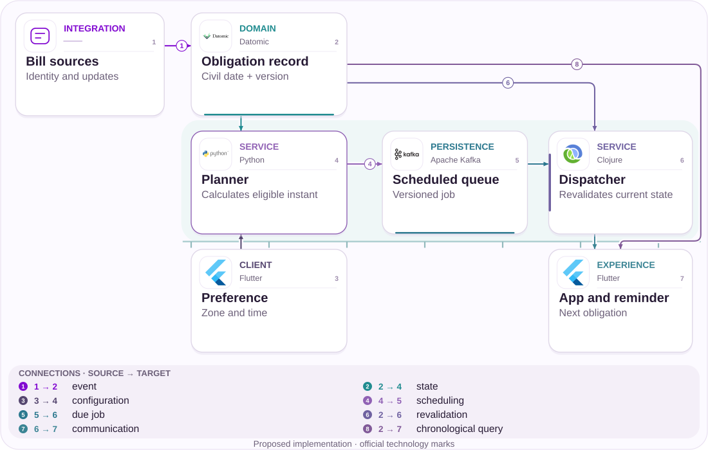

# 05 · New phone, missing verification code

Recover contact without confusing email proof with authorization.

[PT reader](https://wesleyvieira99.github.io/nu/#05-1) · [EN reader](https://wesleyvieira99.github.io/nu/en.html#05-1)

[Executable Python lab](../../labs/case_05.py)

## The record and its outcome


Actual crop of the public source, captured 23 October 2026. The text below includes the company reply and reported outcome.

**Answered · RA 242544191**

On March 6, 2026, a customer reported changing phones, not knowing or accessing the previous email and receiving no code at a newly supplied address. On March 13, Nubank explained additional checks and said a device had been authorized on March 9. It was awaiting a reply to private guidance. The record is answered, with no public final confirmation from the customer. The cause of delivery failure is unproven.

An authorized device does not by itself prove that the person completed the entire reported journey. The response may indicate meaningful progress, but it does not turn answered into resolved. This case concerns email, not SMS or a broken camera. Private messages were not inspected. The proposal uses the reported barrier to examine the contract between updated contact, delivered code, validated code and a new-device session.

- [Reclame AQUI — public complaint and response](https://www.reclameaqui.com.br/nubank/dificuldade-de-acesso-a-conta-nubank-apos-troca-de-celular-devido-a-problemas-com-codigo-de-verificacao-por-e-mail_FO6cRDkD3xp9govT/)

## Diagnosis before design

The report supports investigation of delivery, generation binding and journey comprehension, but identifies no provider, bounce or spam filter. I would trace a recovery_id across change request, issuance, provider acceptance, delivery feedback and validation. SMTP acceptance means neither reading nor identity proof.

One hypothesis is that the customer cannot distinguish the active contact from the challenge that remains valid after resending. Logs and research can refute this: if contact and challenge are consistent, the bottleneck may lie elsewhere. I would not claim a root cause from a “did not arrive” message alone.

Delivery investigation must acknowledge incomplete feedback. Some providers report acceptance without delivery confirmation; others produce delayed or duplicated events. I would document which signals are observations and which are inferences, keeping customer messages consistent with that distinction. A newly supplied address still requires identity validation before changing account contact. Research should observe whether people understand that confirming contact and recovering access can require different steps. Otherwise, a technically accurate delivery message may create the false expectation that the account should already be available.

## Architecture boundaries



Independent proposed architecture; suggested technologies, not Nubank internal infrastructure.

The versioned contact feeds issuance and verification. Policy sets limits while the record retains the current challenge. The verifier rechecks generation before consuming a code, preventing a concurrent change from leaving an old challenge usable.

The app receives contact progress separately from access. Confirming an address is only one step; device authorization remains in the identity domain. The diagram does not treat the delivery provider as an authority on account ownership.

## Executable core

```python
    def verify(self, owner, generation, code, now):
        if owner != self.owner:
            raise PermissionError("recovery scope")
        if type(now) is not int or now < 0 or not isinstance(code, str):
            raise ValueError("invalid request")
        with self.lock:
            current = self.challenge
            if current is None:
                raise ValueError("challenge unavailable")
            issued_generation, digest, issued_at, expiry, attempts = current
            if type(generation) is not int or generation != self.generation:
                raise ValueError("obsolete contact generation")
            if generation != issued_generation or not issued_at <= now < expiry:
                raise ValueError("challenge expired or not yet valid")
            if attempts >= 3:
                raise ValueError("attempt budget exhausted")
            current[4] += 1
            candidate = hashlib.sha256(code.encode()).digest()
            if not hmac.compare_digest(candidate, digest):
                raise PermissionError("invalid code")
            self.verified, self.challenge = True, None
            return True
```

Literal excerpt from the executed independent lab; remaining validation is in the complete file.

ContactRecovery.verify rejects obsolete generation, invalid time, missing challenge and exhausted attempt budget. A hash compares the code without retaining its plain text in the educational record. Success consumes the challenge and sets verified to true; device_authorized remains false.

The lab accepts fixed codes for reproducible tests. A real service must generate random secrets, limit distributed abuse and protect storage. A simple hash of a short code is insufficient against database extraction; appropriate secret and key design is required. The purpose is lifecycle and binding verification rather than a production-ready authentication service.

- [Python — unittest](https://docs.python.org/3/library/unittest.html)
- [Executable case lab on GitHub](https://github.com/wesleyvieira99/nu/blob/main/labs/case_05.py)

## Stack implementation

```typescript
// Proposed presentation contract; validate network input separately.
type RecoveryView =
  | { state: 'contact_pending'; generation: number }
  | { state: 'contact_verified'; generation: number }
  | { state: 'device_authorized'; deviceRef: string };
function accessReady(view: RecoveryView): boolean {
  return view.state === 'device_authorized';
}
function contactReady(view: RecoveryView): boolean {
  return view.state === 'contact_verified'
      || view.state === 'device_authorized';
}
```

Proposed integration example, not executed; this is not Nubank internal code.

The TypeScript contract uses an explicit union to distinguish pending contact, confirmed contact and authorized device. This helps UI review, but static types do not validate network input. The adapter must still validate schema, origin and scope before constructing the object.

Messages neither expose a complete email address nor reveal account existence to unauthenticated requesters. Resend displays a policy-consistent deadline and preserves the journey. I would reuse the existing delivery provider where possible, adding correlation and event handling instead of assuming that switching providers solves an unknown cause.

- [TypeScript — Narrowing](https://www.typescriptlang.org/docs/handbook/2/narrowing.html)

## Contracts and ownership

| Field / rule | Owner | Invariant |
| --- | --- | --- |
| recovery_id | Identity | Holder scope |
| contact_generation | Contact | Authorized changes only |
| challenge_hash | Security | Never log code |
| delivery_state | Adapter | Accepted ≠ read |

```json
{
  "schema_version": 1,
  "recovery_id": "synthetic-recovery",
  "contact_generation": 2,
  "delivery_state": "accepted",
  "contact_verified": false,
  "device_authorized": false,
  "expires_at": 160
}
```

Illustrative proposed contract; synthetic values, not customer data.

Generation changes only after an authorized contact update. Each issuance replaces the prior challenge within that generation and applies cooldown. TTL belongs to the challenge while attempt limits belong to abuse policy. Production needs additional account, device and source limits that survive restarts and multiple instances.

Delivery events should distinguish accepted, bounced and expired without concluding that a message was read. The public record provides none of these events. Logs exclude codes and full addresses; investigation uses protected references. Contact change must not allow an attacker to choose a destination freely and become the holder by receiving their own code.

## Adversarial verification

```python
    def test_contact_change_invalidates_old_code(self):
        self.r.change_contact("a", "other@example.test", True)
        self.r.issue("a", "654321", 110, 60)
        with self.assertRaises(ValueError):
            self.r.verify("a", 1, "123456", 120)
        self.assertTrue(self.r.verify("a", 2, "654321", 120))

    def test_contact_proof_does_not_authorize_device(self):
        self.assertTrue(self.r.verify("a", 1, "123456", 120))
        self.assertTrue(self.r.verified)
        self.assertFalse(self.r.device_authorized)
```

Literal lab tests; count and result come from an actual run.

The 14 tests cover contact change with an old code, resend, attempt limits, expiration, future clock, replay and wrong holder. The state-separation test confirms that email validation does not authorize a device. This invariant prevents a delivery mechanism from becoming complete identity proof.

The suite sends no email and measures no deliverability. Provider events, cross-process limits and timing-based enumeration tests remain missing. Before production, I would add coordinated resend attacks and two sessions changing contact concurrently, plus integration with the real identity-recovery policy.

- [Python — unittest](https://docs.python.org/3/library/unittest.html)

## Measure the right journey

| Metric | Numerator / denominator | Window and segment |
| --- | --- | --- |
| Confirmed contact | Confirmations / journeys | 7 days; provider |
| Resumption | Completed / started resumptions | Session; version |
| Repeat contact | Repeat contacts / recovery_id | 7 days; reason |
| Obsolete code | Invalid accepts / verifications | Continuous; generation |
| Abuse | Confirmed cases / journeys | Risk window |

The funnel must show issuance, observable delivery, contact validation and authorization without treating them as equivalent. I would measure repeat contacts per recovery and time per stage, segmented by provider and app version where volume is sufficient to preserve privacy.

The experiment compares eligible journeys of similar complexity and observes legitimate recovery, messages sent and review load. Better delivery accompanied by more abuse does not pass acceptance. Expansion stops for accepted obsolete codes, account-data leakage or account takeover attributable to the flow. Baselines remain unknown until instrumentation and identity-team validation.

## Financial value with assumptions

| Assumed scenario | Main input | Net/month | Payback (months) |
| --- | --- | --- | --- |
| Conservative | 10,000; Δ 0.05; 15,000 sends | BRL -450.00 | None |
| Base | 30,000; Δ 0.12; 45,000 sends | BRL 20,450.00 | 4.89 |
| Ambitious | 60,000; Δ 0.18; 90,000 sends | BRL 71,700.00 | 1.39 |

Assumptions are 10,000 / 30,000 / 60,000 monthly journeys, repeat-contact reductions of 0.05 / 0.12 / 0.18 and BRL 8.00 marginal cost per contact. Additional messages are 15,000 / 45,000 / 90,000 at BRL 0.03 each, plus BRL 4,000.00 / BRL 7,000.00 / BRL 12,000.00 monthly operations. Hypothetical implementation costs BRL 100,000.00.

Net benefit is journeys × avoided repeat contacts × cost, less messages and operations. Global average revenue per customer is not used to value recovered access; that would require causal incremental revenue and margin evidence unavailable in this complaint. The conservative scenario may be negative, showing that sending more messages without sufficiently reducing confusion does not justify investment through avoided cost.

Assumed implementation budget: BRL 100,000.00. Annual net results before implementation: BRL -5,400.00 / BRL 245,400.00 / BRL 860,400.00. Every input is an assumption, not a Nubank baseline.

## Accountable roadmap

| Proposed phase | Accountable role | Delivery / exit gate |
| --- | --- | --- |
| Days 0–15 | Identity + delivery | Event map |
| Days 16–30 | Staff + security | Generation and limits |
| Days 31–60 | Mobile + product | Shadow resumption |
| Days 61–90 | EM + support | Pilot without new abuse |

The roadmap starts with an inventory of available events and contact-recovery methods. Identity validates which changes require review; the delivery owner explains what callbacks actually mean. Product defines progress messages that do not reveal account data.

Shadow mode compares issued and consumed generations before changing resend or experience. The EM coordinates provider dependencies and review capacity; Staff resolves concurrency and policy persistence. If observability reveals a predominantly external problem, the plan should prioritize the adapter and communication instead of unnecessarily rebuilding authentication.

## Rollout and operations

During canary rollout, old and new issuers must share generation control. A UI flag cannot stop an incompatible backend from accepting an old code. Migration requires compatibility or explicit exclusion of versions that do not understand the new identity.

The drill includes late delivery feedback, concurrent resend and contact change while a code is in transit. Operations must distinguish provider delay from an already-revoked challenge. Rollback preserves generations and limits rather than reactivating old secrets. Abuse alerts go to identity; aggregate delivery failures go to the channel owner.

## My contribution

As Staff, I would propose generation binding and the separation between contact possession and device authorization. I would reject accepting any unexpired code: two contacts and two resends can leave several contradictory proofs apparently valid. The challenge must be current in the correct context.

As EM, I would organize delivery across security, messaging and mobile, including abuse tests in the definition of done. I would also ensure support sees the same progress without accessing secrets. These are proposed technical and coordination actions, not claims of authority or prior results inside Nubank.

The technical decision must withstand pressure to remove steps without understanding their purpose. I would explain which controls are necessary for risk and which repetitions result only from poorly preserved state. As EM, I would organize a support review using anonymized journeys so the people receiving customer questions participate in design. This produces a more operable solution and avoids adding another resend button without fixing context. The review should end with concrete examples of what the interface can truthfully say at each stage and when a specialist must intervene.

## Handoff and decision

**Local execution**

python3 labs/case_05.py -v · 14 tests passed.

The reviewer starts with change_contact, issues a code, changes contact again and attempts to consume the previous generation. Then verify that the new contact can be confirmed without authorizing the device. Tests use example.test addresses and synthetic codes; they make no real delivery or access requests.

Handoff requires identity service, secret generation, protected storage, delivery callbacks and durable rate limiting. Proceeding requires measurable legitimate recovery and abuse guardrails. If only provider acceptance improves, without completion or fewer repeat contacts, the pilot has not demonstrated the intended value and needs renewed diagnosis.

- Verified contact does not authorize a device.
- Resend invalidates the previous challenge.
- No code appears in logs.

- [Executable case lab on GitHub](https://github.com/wesleyvieira99/nu/blob/main/labs/case_05.py)
