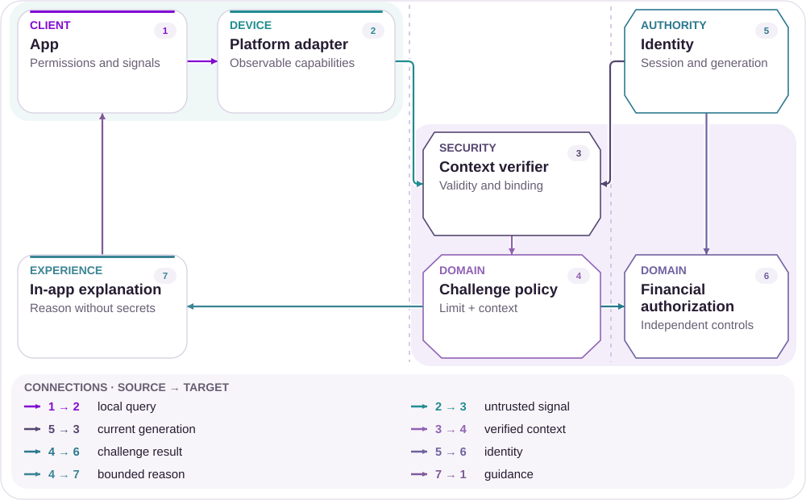
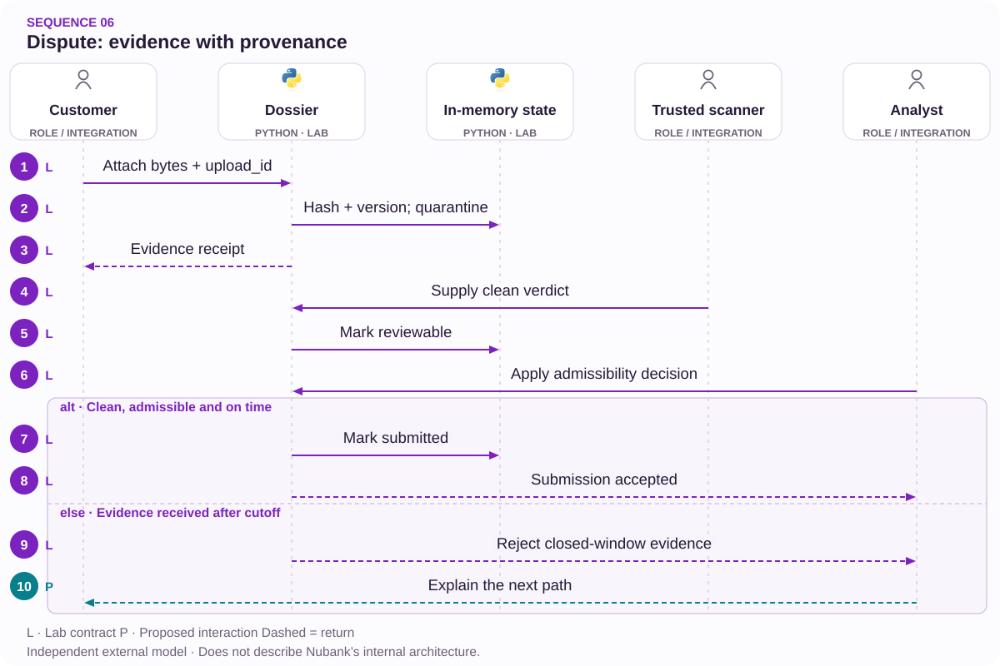

# 06 · New evidence during a dispute

Receive, scan and assess admissibility as separate stages.

[PT reader](https://wesleyvieira99.github.io/nu/#06-1) · [EN reader](https://wesleyvieira99.github.io/nu/en.html#06-1)

[Executable Python lab](../../labs/case_06.py)

## The record and its outcome


Actual crop of the public source, captured 23 October 2026. The text below includes the company reply and reported outcome.

**Answered · RA 240394695**

On February 10, 2026, a customer reported disputing an unrecognized Airbnb purchase and being unable to add evidence while it was under review. On February 18, Nubank reported provisional credit, a dispute opened on February 11, cancellation of the virtual card and disabling the automatic updater. Amounts are masked. There is no public final outcome or confirmation that the attachment channel was reopened.

The concrete barrier is adding material after opening the case, not proving here whether the purchase was fraudulent. The confirmation attributed to Airbnb is in private material that was not examined. Provisional credit must remain distinct from the dispute outcome. The proposal does not promise that a card network will accept every late document; it aims to preserve material, explain its stage and provide a traceable admissibility decision.

- [Reclame AQUI — public complaint and response](https://www.reclameaqui.com.br/nubank/compra-nao-reconhecida-contestacao-em-analise-e-impossibilidade-de-enviar-novos-comprovantes_Rud6eWI8D-puvZac/)

## Diagnosis before design

An “under review” state may be blocking every edit even though adding evidence and changing the original claim carry different risks. This is a hypothesis, not a proven app cause. I would map internal stages and external deadlines to identify where additional evidence can still be considered.

Investigation compares upload attempts, contacts requesting submission and analyst decisions. It must distinguish UI restrictions, format limits, quarantine and network cutoffs. If material was already outside the applicable deadline, improvement may mean an explanation and an allowed route rather than implying engineering can unilaterally reopen the dispute.

I would also distinguish supplementary evidence from correcting the disputed transaction itself. The former may be appended without changing case identity; the latter may require reviewing the object of the dispute. If both use one generic edit button, it becomes difficult to explain what was actually received. The proposed design records submission intent and traceability so an analyst can determine its relationship to earlier material. This avoids treating every later document as either a harmless addition or an unauthorized change when its meaning requires judgment.

## Architecture boundaries



Independent proposed architecture; suggested technologies, not Nubank internal infrastructure.

Upload enters quarantine and retains identity before reaching the dossier. Holder scope protects both intake and submission. Dossier policy determines what can proceed after review without deleting earlier evidence.

The app response distinguishes received, being checked, available for analysis and submitted. Receiving bytes does not confirm merit or external acceptance. The design also keeps this state separate from provisional credit or a final financial decision.

## Executable core

`Append-only Evidence [lab]` · `Quarantine Gate [lab]`

```python
    def append(self, owner, upload_id, content, now):
        if owner != self.owner:
            raise PermissionError("dispute scope")
        if not upload_id or type(content) is not bytes:
            raise ValueError("upload identity and bytes required")
        if not 0 < len(content) <= 1024 * 1024:
            raise ValueError("attachment size")
        if type(now) is not int or now < 0:
            raise ValueError("clock")
        digest = hashlib.sha256(content).hexdigest()
        with self.lock:
            if upload_id in self.seen:
                previous = self.items[self.seen[upload_id]]
                if previous["digest"] != digest:
                    raise ValueError("upload identity conflict")
                return dict(previous)
            item = dict(version=len(self.items) + 1, digest=digest,
                        received_at=now, state="quarantined",
                        late=now >= self.cutoff)
            self.seen[upload_id] = len(self.items)
            self.items.append(item)
            return dict(item)
```

Literal excerpt from the executed independent lab; remaining validation is in the complete file.

Dossier.append checks scope, size and upload identity before creating a version. Repeating the same key and content returns the previous record; reusing the key with different bytes creates a conflict. A copy is returned so callers cannot accidentally mutate internal state.

Material received after cutoff is retained as late, but submit does not promise submission in that window. The scanner is a simulated boundary: a trusted boolean represents an already-verified external verdict. The lab neither scans malware nor stores cloud files. Its contract preserves versions and separates receipt from eligibility.

- [Python — unittest](https://docs.python.org/3/library/unittest.html)
- [Executable case lab on GitHub](https://github.com/wesleyvieira99/nu/blob/main/labs/case_06.py)

## Stack implementation

`Append-only Evidence [proposal]` · `Quarantine Gate [proposal]`

```typescript
// Proposed metadata only; no storage permissions implemented here.
type EvidenceRecord = {
  dossierId: string;
  uploadId: string;
  version: number;
  originalObjectRef: string;
  digest: string;
  state: 'quarantined' | 'reviewable' | 'rejected' | 'submitted';
  late: boolean;
};
function readyForReview(item: EvidenceRecord): boolean {
  return item.state === 'reviewable';
}
```

Proposed integration example, not executed; this is not Nubank internal code.

The storage example defines references and states rather than complete permissions. In an S 3 integration, I would design restricted upload, quarantine, content assessment and release to authorized analysts. Original objects and derivatives need distinct identities so metadata removal does not destroy the original evidentiary reference.

The dispute service decides admissibility and deadline; storage does not assume that authority. Temporary URLs must not become public history links. The UI can show a safe name, size and receipt without rendering active content. This TypeScript example is illustrative and was neither executed nor connected to AWS services.

- [Amazon S3 — User Guide](https://docs.aws.amazon.com/AmazonS3/latest/userguide/Welcome.html)

## Contracts and ownership

`Append-only Evidence [proposal]` · `Quarantine Gate [proposal]`

| Field / rule | Owner | Invariant |
| --- | --- | --- |
| upload_id + digest | Ingestion | No replacement |
| dossier_version | Dispute | Preserved history |
| scan_state | Security | Quarantine first |
| cutoff + rule | Operations | Receive ≠ submit |

```json
{
  "schema_version": 1,
  "dossier_id": "synthetic-dispute",
  "upload_id": "synthetic-upload",
  "dossier_version": 2,
  "digest": "sha256-reference",
  "state": "quarantined",
  "late": false,
  "provisional_credit_is_final": false
}
```

Illustrative proposed contract; synthetic values, not customer data.

The contract associates upload_id, dossier version, digest and receipt time. A digest detects changed bytes but does not establish that content is truthful. Substantive review remains necessary and may reject technically intact material.

The model does not allow silent attachment replacement. Corrections become new versions with an explicit relationship to the previous one. Deadlines need a source, time zone and applicable rule reviewed with card-network operations. Privacy requires separating receipt visibility from document access. Retention must consider dispute and relevant obligations rather than defaulting to unlimited storage.

## Adversarial verification

`Append-only Evidence [lab]` · `Quarantine Gate [lab]`

```python
    def test_late_evidence_is_retained_without_submission_promise(self):
        item = self.upload(now=101)
        self.d.scan(item["version"], True, True)
        with self.assertRaises(ValueError):
            self.d.submit(item["version"], "dispute-analyst", True)
        self.assertEqual(len(self.d.items), 1)
        self.assertEqual(self.d.items[0]["state"], "reviewable")

    def test_reused_upload_id_cannot_replace_evidence(self):
        original = self.upload()
        with self.assertRaises(ValueError):
            self.upload(data=b"replacement")
        self.assertEqual(self.d.items[0]["digest"], original["digest"])
```

Literal lab tests; count and result come from an actual run.

The 14 tests verify retained late material without a submission promise, identity conflict, quarantine, rejected content, scope, replay and mutation of returned data. The exact cutoff is considered late in this model and must be checked against the real rule before integration.

The replacement test protects earlier evidence while the quarantine test prevents completed upload from appearing immediately usable. The suite does not validate real file types, antivirus, accessibility or network rules. I would add malformed-file and interrupted-upload tests, plus restoring the relationship after a temporary URL expires.

- [Python — unittest](https://docs.python.org/3/library/unittest.html)

## Measure the right journey

| Metric | Numerator / denominator | Window and segment |
| --- | --- | --- |
| Valid receipt | Linked / eligible uploads | Daily; stage |
| Review p 95 | Receipt→admissibility time | Weekly; cutoff |
| Repeat contact | Attachment contacts / dossiers | 7 days; reason |
| Integrity | Failures / audited attachments | Continuous; version |
| Triage cost | Minutes / eligible dossier | Weekly; material |

Success is not simply more attachments. The main metric tracks eligible material received with a receipt and reviewed within a useful window. More irrelevant documents can increase cost and delay decisions, so analyst time and admissibility must also be observed.

The pilot compares disputes at similar stages and with similar reasons, reviewed by analysts familiar with deadlines. Repeat contacts are measured per dossier over seven days. No chargeback result is attributed to the improvement without an appropriate comparison because merit and merchant behavior affect outcomes. Document exposure, evidence substitution or a missed deadline immediately stops expansion.

## Financial value with assumptions

| Assumed scenario | Main input | Net/month | Payback (months) |
| --- | --- | --- | --- |
| Conservative | 2,000 × 4 min × 25% | BRL -1,100.00 | None |
| Base | 6,000 × 6 min × 40% | BRL 10,200.00 | 13.73 |
| Ambitious | 12,000 × 8 min × 50% | BRL 46,400.00 | 3.02 |

The financial model uses analyst rework without inventing the masked purchase amount. Assumptions are 2,000 / 6,000 / 12,000 monthly dossiers, 4 / 6 / 8 minutes saved per dossier, BRL 75.00 per hour and realizable shares of 25% / 40% / 50%. Additional uploads are 3,000 / 9,000 / 18,000 at BRL 0.20 each, plus BRL 3,000.00 / BRL 6,000.00 / BRL 10,000.00 monthly operations. Hypothetical implementation costs BRL 140,000.00.

The calculation deducts file checks and operations from monetizable capacity. If capacity does not lower spending, I report hours rather than cash. Principal potentially recovered to the customer stays outside this formula. Improved dispute outcomes enter a separate analysis only after causality and the actual beneficiary are established.

Assumed implementation budget: BRL 140,000.00. Annual net results before implementation: BRL -13,200.00 / BRL 122,400.00 / BRL 556,800.00. Every input is an assumption, not a Nubank baseline.

## Accountable roadmap

| Proposed phase | Accountable role | Delivery / exit gate |
| --- | --- | --- |
| Days 0–15 | Dispute operations | Stages and cutoffs |
| Days 16–30 | Security + privacy | Custody and access |
| Days 31–60 | Staff + mobile | Receipt and quarantine |
| Days 61–90 | EM + analysts | Pilot; triage cost |

Dispute operations leads the stage and cutoff map; security defines the upload boundary; privacy reviews custody and retention. Staff connects these contracts so an apparently small app change does not create an ungoverned document channel.

The first prototype receives synthetic attachments, generates a receipt and shows analysts only released material. A limited cohort then validates usefulness and cost. The EM secures training and capacity for greater intake. If an external cutoff prevents consideration, delivery is limited to a permitted route and explanation without promising that every piece of evidence changes the result.

## Rollout and operations

Rollout enables receipt before automating any external submission. Analysts remain accountable for admissibility; a flag cannot make every attachment accepted evidence. Security on-call watches quarantine failures while dispute operations tracks material near cutoff.

The drill injects duplicate upload, an unavailable scanner and a delayed callback. The safe state keeps the file restricted and explains pending work. Rollback closes new intake through the new flow while preserving receipts and authorized access to received material. Preserving evidence is as important as avoiding improper submission.

## My contribution

As Staff, I would propose immutable additional evidence rather than freely reopening the entire form. This preserves the original claim and makes changes auditable. The rejected alternative is overwriting the earlier attachment: it simplifies the screen but loses context and may confuse review.

As EM, I would coordinate dispute operations, mobile, security and privacy, placing analyst capacity and training in the same plan as development. The proposed contribution turns a concrete barrier into an operable flow without promising chargeback success or attributing financial results to a code example.

A hiring discussion can explore how I would negotiate minimum scope with operations: the first gain may be a receipt and routing before automated submission. As Staff, I would document that boundary to reduce risk; as EM, I would ensure the team is not held accountable for a network outcome it does not control. The commitment would cover intact receipt, review within the applicable window and correct information, measured separately from financial victory. This helps prioritize a useful first delivery without disguising external dependencies as implementation details.

## Handoff and decision

**Local execution**

python3 labs/case_06.py -v · 14 tests passed.

A reviewer submits synthetic bytes, repeats the upload and attempts to reuse its identity with different content. Then observe quarantine, review and submission as separate states. A late document remains recorded but does not automatically cross the cutoff.

Production handoff requires protected storage, a real scanner, format validation, retention policy and a card-network adapter. Acceptance covers holder-scoped access, historical integrity and messages that distinguish provisional credit from final resolution. If additional triage costs exceed avoided rework, the next step is better evidence guidance before expanding intake.

- Upload receipt does not promise external acceptance.
- A new attachment never erases the earlier one.
- Quarantined documents are not submitted.

- [Executable case lab on GitHub](https://github.com/wesleyvieira99/nu/blob/main/labs/case_06.py)

## Patterns with proof

`Append-only Evidence [lab]` · `Quarantine Gate [lab]` · `Event-driven dossier [proposal]` · `Spring Boot [proposal]` · `LangGraph [proposal]`

| Mechanism | Implementation | Evidence |
| --- | --- | --- |
| Append-only Evidence | Dossier.append | reusing an identifier with different content conflicts |
| Quarantine Gate | Dossier.submit | an unsafe file cannot pass the submission gate |
| Event-driven dossier / anti-corruption layer | Production proposal | Adapters keep authority outside the UI. |

**Java integration · proposed**

Spring Boot + object-storage adapter. Port the invariants and contract tests before replacing the Python model. A process lock is not distributed concurrency control; persistence, authorization and recovery need integration tests.

**AI assessment · LangGraph**

Proposed experiment: LangGraph to extract and summarize already-admitted documents with source references. Read-only tools, source citations, a token budget and human approval are required. It cannot authorize money, eligibility or identity. No LLM integration is claimed by the Python tests.

- [P1 · Dossier.append](https://github.com/wesleyvieira99/nu/blob/main/labs/case_06.py#L21)
- [P1 · test_reused_upload_id_cannot_replace_evidence](https://github.com/wesleyvieira99/nu/blob/main/labs/case_06.py#L81)
- [P2 · Dossier.submit](https://github.com/wesleyvieira99/nu/blob/main/labs/case_06.py#L55)
- [P2 · test_malware_cannot_submit](https://github.com/wesleyvieira99/nu/blob/main/labs/case_06.py#L91)
- [LangGraph · persistence](https://docs.langchain.com/oss/python/langgraph/persistence)

## Execution sequence



clean is a trusted fixture, not antivirus. A hash proves neither admissibility nor a favorable outcome.

**Authority and failure boundary**

reusing an identifier with different content conflicts. an unsafe file cannot pass the submission gate.

The sequence describes the proposed integration. The linked lab verifies the domain invariant with synthetic data; external services, network retries and deployment remain integration work.

- [append](https://github.com/wesleyvieira99/nu/blob/main/labs/case_06.py#L21)
- [submit](https://github.com/wesleyvieira99/nu/blob/main/labs/case_06.py#L55)

## Features, stories and acceptance

**F06.1 · Preserved additional evidence · D16–30**

As a customer, I want to add a document without replacing its earlier version. Acceptance: reusing an identifier with different content conflicts.

**F06.2 · Admissibility before submission · D31–60**

As a customer, I want to know whether a document was received or actually submitted. Acceptance: an unsafe file cannot pass the submission gate.

**F06.3 · Measured rollout · D61–90**

As the product owner, I want an eligible cohort with a comparable control. Acceptance: the case metric, denominator, cost and safety barrier are registered before exposure; reconciliation failures stop expansion.

Linked tests exercise the stated domain acceptance condition, not the complete interface or production integration. D0–15 is discovery: confirm the public report against authorized internal samples, map dependencies and approve contracts. These are incremental planning windows, not a delivery commitment. EM owns coordination; Staff owns cross-domain contracts; Product and the domain owner accept outcomes.

- [Acceptance F06.1](https://github.com/wesleyvieira99/nu/blob/main/labs/case_06.py#L81)
- [Acceptance F06.2](https://github.com/wesleyvieira99/nu/blob/main/labs/case_06.py#L91)

## Method and sensitivity

**Scenario sensitivity · BRL**

All inputs are scenario assumptions, not measured Nubank effects. Capacity equivalent is not cash saved. The realization slider reduces benefit only; all costs remain at their scenario values. This is sensitivity analysis, not a probability or a causal estimate. The original realizable-capacity factor is already included; the slider applies an additional stress.

period_net = benefit × realization − variable_cost − run_cost; first_year = 12 × period_net − build_cost

Period / Período: `month`. Values / Valores: BRL.

| Scenario / Cenário | Benefit / Benefício | Variable cost / Variável | Run cost / Operação | Build / Implementação |
| --- | ---: | ---: | ---: | ---: |
| Conservative | 2500.00 | 600.00 | 3000.00 | 140000.00 |
| Base | 18000.00 | 1800.00 | 6000.00 | 140000.00 |
| Ambitious | 60000.00 | 3600.00 | 10000.00 | 140000.00 |

| Scenario / Cenário | Period net at 100% / Líquido | Horizon after build / Horizonte | Horizon at 50% / Estresse |
| --- | ---: | ---: | ---: |
| Conservative | -1100.00 | -153200.00 | -168200.00 |
| Base | 10200.00 | -17600.00 | -125600.00 |
| Ambitious | 46400.00 | 416800.00 | 56800.00 |

[Reproducible scenario inputs](../../models/normalized-scenarios.json) · [Decimal simulator](../../models/simulate.py)

| Decision | Case-specific method |
| --- | --- |
| Baseline / threat | Baseline: minutes per eligible dossier. Threat: treating more irrelevant attachments as success. |
| Unit economics | Realizable triage capacity minus upload scanning and operation; no chargeback win is modeled. |
| Proposed experiment | Match dispute stage and reason; track admissibility and seven-day repeat contacts. |
| Stop rule | Stop for an exposed document, substituted evidence or a missed deadline. |

- [Reclame AQUI · ID 240394695](https://www.reclameaqui.com.br/nubank/compra-nao-reconhecida-contestacao-em-analise-e-impossibilidade-de-enviar-novos-comprovantes_Rud6eWI8D-puvZac/)
- [FinOps Foundation · Unit Economics](https://www.finops.org/framework/capabilities/unit-economics/)
- [Microsoft Research · Pre-experiment design](https://www.microsoft.com/en-us/research/articles/patterns-of-trustworthy-experimentation-pre-experiment-stage/)
