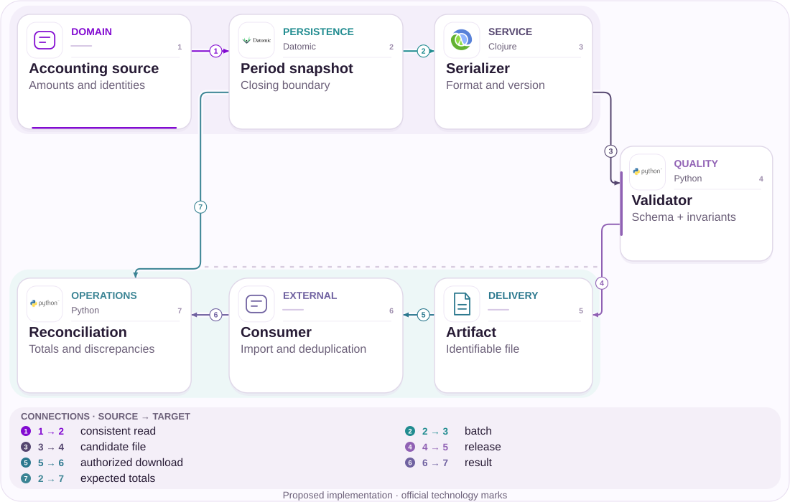

# 07 · MED: track progress without promising a refund

Three Pix total BRL 478.55; information needs an explicit state too.

[PT reader](https://wesleyvieira99.github.io/nu/#07-1) · [EN reader](https://wesleyvieira99.github.io/nu/en.html#07-1)

[Executable Python lab](../../labs/case_07.py)

## The record and its outcome


Actual crop of the public source, captured 23 October 2026. The text below includes the company reply and reported outcome.

**Answered · RA 228360515**

On October 2, 2025, a customer reported three Pix transfers totaling BRL 478.55 for CCXP 25 tickets and said she notified Nubank within two hours of recognizing a scam. She requested MED updates. Nubank reported starting the process and described seven calendar days plus four for conditional reimbursement. No individual outcome or recovered amount was published. This is a historical 2025 response, not a complete description of current rules.

The public response associates absent email with an unaccepted claim or unavailable funds but does not identify which outcome occurred in this case. A customer needs an explicit outcome when evidence exists and ongoing tracking when it does not. Police reports, receipts and private chat were not inspected. The quoted amount is alleged customer exposure, not independently verified final loss or potential bank revenue.

- [Reclame AQUI — public complaint and response](https://www.reclameaqui.com.br/nubank/solicitacao-de-informacoes-sobre-med-mecanismo-especial-de-devolucao-para-via-pix_8_pzeovlbbFJyohm/)

## Diagnosis before design

Diagnosis separates interbank progress from message delivery to the customer. Missing email does not reveal whether a case is under analysis, rejected, unfunded or affected by a communication failure. The engineering hypothesis is that explicit states and a next update reduce uncertainty-driven contacts.

I would reconstruct received events, available projection and emitted notifications per case without inferring that delay caused the receiving account to be emptied. The source does not demonstrate that causality. The episode occurred in 2025; a current implementation must map 2026 contracts and rules with Pix, risk and legal rather than judging historical conduct against later requirements.

The timeline should explain partial recovery without turning the remainder into a debt owed by the bank. It must also distinguish operational closure from definitive impossibility of any future recovery under the applicable contract. I would not fill event gaps with a probable outcome merely to simplify the screen. When information is unconfirmed, the next action is investigation and communication of the limitation, preserving the ability to update state when authorized evidence arrives. This makes uncertainty visible without inventing either a positive or negative financial promise.

## Architecture boundaries



Independent proposed architecture; suggested technologies, not Nubank internal infrastructure.

The adapter verifies origin before persistence. The normalizer translates the effective version into an internal contract; the validator protects transitions and amounts before publishing the timeline. App and support share that authorized view.

Reconciliation compares expected history with the state explained to the customer. The lab’s sequence is internal to its adapter and does not claim to reproduce official DICT fields. A gap blocks progress and requires recovery rather than inventing an outcome.

## Executable core

```python
    def apply(self, event_id, sequence, state, cents=0, trusted=False):
        if trusted is not True:
            raise PermissionError("verified MED adapter required")
        if type(sequence) is not int or sequence <= 0 or not event_id:
            raise ValueError("event identity")
        if type(cents) is not int or cents < 0:
            raise ValueError("integer cents required")
        payload = (sequence, state, cents)
        with self.lock:
            if event_id in self.events:
                if self.events[event_id] != payload:
                    raise ValueError("event conflict")
                return False
            if sequence != self.sequence + 1:
                raise ValueError("sequence gap or obsolete event")
            allowed = {"reported": {"analyzing"},
                       "analyzing": {"partial", "closed"},
                       "partial": {"partial", "closed"}}
            if state not in allowed.get(self.state, set()):
                raise ValueError("state transition")
            if state != "partial" and cents != 0:
                raise ValueError("refund must be explicit")
            if state == "partial" and not 0 < cents <= self.claimed - self.recovered:
                raise ValueError("invalid recovery amount")
            self.recovered += cents
            self.sequence, self.state = sequence, state
            self.events[event_id] = payload
            return True
```

Literal excerpt from the executed independent lab; remaining validation is in the complete file.

RecoveryTimeline.apply preserves each event’s identity and payload. It accepts only the next sequence; delayed events or gaps require reconciliation and controlled retry. A partial return must be positive and cannot exceed the remaining claimed amount. Closing a case adds no money.

The function checks authority before recognizing replay and rejects booleans as monetary values. The model neither blocks accounts nor calls participants and does not implement every regulatory state. It demonstrates a communication projection that conserves cents. Reopening or new rules require an explicit additional contract rather than an improvised transition.

- [Python — unittest](https://docs.python.org/3/library/unittest.html)
- [Executable case lab on GitHub](https://github.com/wesleyvieira99/nu/blob/main/labs/case_07.py)

## Stack implementation

```clojure
(defn recovery-event [current event]
  ;; Proposed local rule, not a DICT payload specification.
  (let [amount (:cents event)
        remaining (- (:claimed current) (:recovered current))]
    (cond
      (not (true? (:verified event))) {:error :untrusted}
      (not (integer? amount)) {:error :invalid-money}
      (not (<= 1 amount remaining)) {:error :amount-out-of-range}
      (not= (:sequence event) (inc (:sequence current)))
      {:error :sequence-gap}
      :else {:next-recovered (+ (:recovered current) amount)
             :next-sequence (:sequence event)})))
```

Proposed integration example, not executed; this is not Nubank internal code.

The proposed Clojure validates a financial event without making an external call. Its result describes a possible update; persistence must compare versions and atomically store the event and projection. A Kafka consumer, if chosen, must recognize replays and have a gap-recovery strategy.

The real adapter requires authentication and mapping to the effective official contract, reviewed with the Pix domain. Synthetic names are not presented as production fields. In Flutter, the timeline would separate confirmed amount, analysis state and next update. I would not use a progress percentage that suggests recovery probability without a validated, explainable model.

- [Banco Central — DICT API, integration reference](https://aprendervalor.bcb.gov.br/content/estabilidadefinanceira/pix/API-DICT.html)

## Contracts and ownership

| Field / rule | Owner | Invariant |
| --- | --- | --- |
| contract_version | Pix + legal | Explicit effective date |
| event_id + sequence | Adapter | Gap blocks progress |
| recovered_cents | Financial domain | Never exceeds claim |
| next_update | Operations | No refund promise |

```json
{
  "schema_version": 1,
  "contract_version": "synthetic-adapter-v1",
  "case_id": "synthetic-med",
  "event_id": "synthetic-partial-return",
  "sequence": 2,
  "state": "partial",
  "confirmed_cents": 20000,
  "claimed_cents": 47855
}
```

Illustrative proposed contract; synthetic values, not customer data.

The contract declares schema version and rule effective date alongside identity, sequence and confirmed amount. A case identifier grants no access; queries are bound to the holder and support’s operational scope. Events carry minimal references rather than complete recipient-account data.

For partial returns, the total must reconcile with the financial source and previous events. Duplicate messages do not increase recovered money; an amount correction needs explicit semantics and approval rather than a negative number sent casually. Official deadlines and states require validation before integration; the lab is independent of that certification.

## Adversarial verification

```python
    def test_partial_refund_replay_never_doubles_money(self):
        self.event("analysis", 1, "analyzing")
        self.event("refund-a", 2, "partial", 20000)
        self.assertFalse(self.event("refund-a", 2, "partial", 20000))
        self.event("refund-b", 3, "partial", 27855)
        self.assertEqual(self.t.read("a")["recovered_cents"], 47855)

    def test_gap_retries_after_missing_event(self):
        with self.assertRaises(ValueError):
            self.event("refund", 2, "partial", 100)
        self.event("analysis", 1, "analyzing")
        self.assertTrue(self.event("refund", 2, "partial", 100))
```

Literal lab tests; count and result come from an actual run.

The 14 tests cover replayed partial returns, totals above the claim, sequence gaps, closure without recovery, attempted reopening, event conflict and wrong scope. The gap test shows that rejection does not consume the event: after its predecessor arrives, the same event can be accepted.

The lab also prevents silence from closing a case. It does not test actual recipient funds, scheme communication or regulatory deadlines. Integration would add replay of anonymized messages, comparison with the financial source and adapter-outage drills. The relevant guarantee is never communicating recovered money that has not been confirmed.

- [Python — unittest](https://docs.python.org/3/library/unittest.html)

## Measure the right journey

| Metric | Numerator / denominator | Window and segment |
| --- | --- | --- |
| Update p 95 | Event→query time | Daily; stage |
| Missing next update | Cases without date / eligible | Daily; owner |
| Progress uncertainty | Contacts / active cases | 7 days; cohort |
| Amount mismatch | Mismatches / audited cases | Continuous; version |
| Observed recovery | Returned / eligible amount | Closure; profile |

The main indicator measures delay between a confirmed event and queryable state, segmented by stage and contract version. I also track cases without a next update, uncertainty-driven contacts and displayed-versus-confirmed amount discrepancies. These signals differ from the financial recovery rate.

Evaluation uses comparable case cohorts, accounting for reporting time, profile and recoverability. A clearer timeline may reduce contacts without recovering one additional cent; that can still be useful but must be described accurately. Expansion stops for false promises, data exposure or mismatched totals. Baselines are not public and must be collected before setting targets.

## Financial value with assumptions

| Assumed scenario | Main input | Net/month | Payback (months) |
| --- | --- | --- | --- |
| Conservative | 3,000 × 0.3 × BRL 9.00 | BRL 3,100.00 | 51.61 |
| Base | 8,000 × 0.6 × BRL 9.00 | BRL 33,200.00 | 4.82 |
| Ambitious | 15,000 × 0.8 × BRL 9.00 | BRL 90,000.00 | 1.78 |

The financial scenario measures case handling without counting BRL 478.55 as a benefit. Assumptions are 3,000 / 8,000 / 15,000 monthly active cases, 0.3 / 0.6 / 0.8 contacts avoided per case and BRL 9.00 marginal cost. Assumed additional operations cost BRL 5,000.00 / BRL 10,000.00 / BRL 18,000.00 monthly, with hypothetical implementation of BRL 160,000.00.

The calculation is cases × contacts avoided × cost, less operations. Additional customer recovery is a separate measure with no assumed value in this calculation. If communication does not change the recovery mechanism, I do not attribute increased returns to it. This scenario is not added to general support or Pix scenarios because the contacts may belong to the same journeys.

Assumed implementation budget: BRL 160,000.00. Annual net results before implementation: BRL 37,200.00 / BRL 398,400.00 / BRL 1,080,000.00. Every input is an assumption, not a Nubank baseline.

## Accountable roadmap

| Proposed phase | Accountable role | Delivery / exit gate |
| --- | --- | --- |
| Days 0–15 | Pix + risk + legal | Effective contract |
| Days 16–30 | Staff + operations | Semantics and reconciliation |
| Days 31–60 | Mobile + support | Shadow timeline |
| Days 61–90 | EM + product | Pilot; measured clarity |

Discovery brings Pix, risk and legal together to map the effective contract and communication policy. The initial milestone is an event table with authority, interpretation and information permitted to the holder. Staff resolves semantics and reconciliation; product determines how to explain incomplete states without promising outcomes.

The projection runs in shadow before serving queries. Operations compares samples of partial returns and closed cases; support validates usefulness. The EM coordinates capacity and regulatory dependencies. If the adapter cannot guarantee origin or completeness, the pilot remains limited to approved general guidance and better observability rather than a speculative individual timeline.

## Rollout and operations

The canary begins with reads and communication without changing interbank actions. An operational owner handles gaps; another confirms financial discrepancies. A next update is a planned information commitment, not a refund guarantee. If it cannot be met, the case needs a revised update time and escalation rather than silence.

The drill injects duplicated partial returns, out-of-order events, an unavailable adapter and closure with zero recovered funds. Rollback preserves history and lets the previous query path explain known states. Coexisting contract versions must be identifiable; mixing historical and current rules without effective dates creates interpretation and operating risk.

## My contribution

As Staff, I would propose a protocol in which state and amount have supporting evidence and evolve by effective date. I would reject inferring rejection from email silence because message delivery and process decisions are different domains. I would also avoid an unsupported recovery percentage that could resemble a financial promise.

As EM, I would align Pix, risk, legal, support and mobile around a measurable goal of clarity and less rework. The priority would be making each stage explainable and operable rather than demonstrating sophisticated architecture. These are proposed contributions to the role, not claims of internal experience or gains already achieved at Nubank.

In team collaboration, I would separate communication goals from recovery goals to avoid misleading attribution of credit. The EM can encourage timely updates without demanding returns that depend on funds and other participants. Staff can help establish evidence of completeness and consistency. This alignment lets engineering demonstrate real value even when an individual financial outcome is limited by external factors. It also supports a more honest investment decision: better clarity may justify its operating cost without being presented as proof that the underlying recovery mechanism became more effective.

## Handoff and decision

**Local execution**

python3 labs/case_07.py -v · 14 tests passed.

The reviewer starts analysis, applies two synthetic partial returns and replays one. The total must remain 47,855 cents. Next attempt to exceed the claim and close a case without a return; the model clearly separates completion from recovered money.

Handoff depends on a validated official contract, event authentication, persistence, reconciliation and communication policy. No local test replaces scheme certification. Proceeding requires financial coherence and measurably less uncertainty. If the project merely produces more notifications without comprehension or fewer repeat contacts, revise the experience before increasing volume.

- A duplicated return is never counted twice.
- Email silence does not close the case.
- Historical and current contracts stay separate.

- [Executable case lab on GitHub](https://github.com/wesleyvieira99/nu/blob/main/labs/case_07.py)
