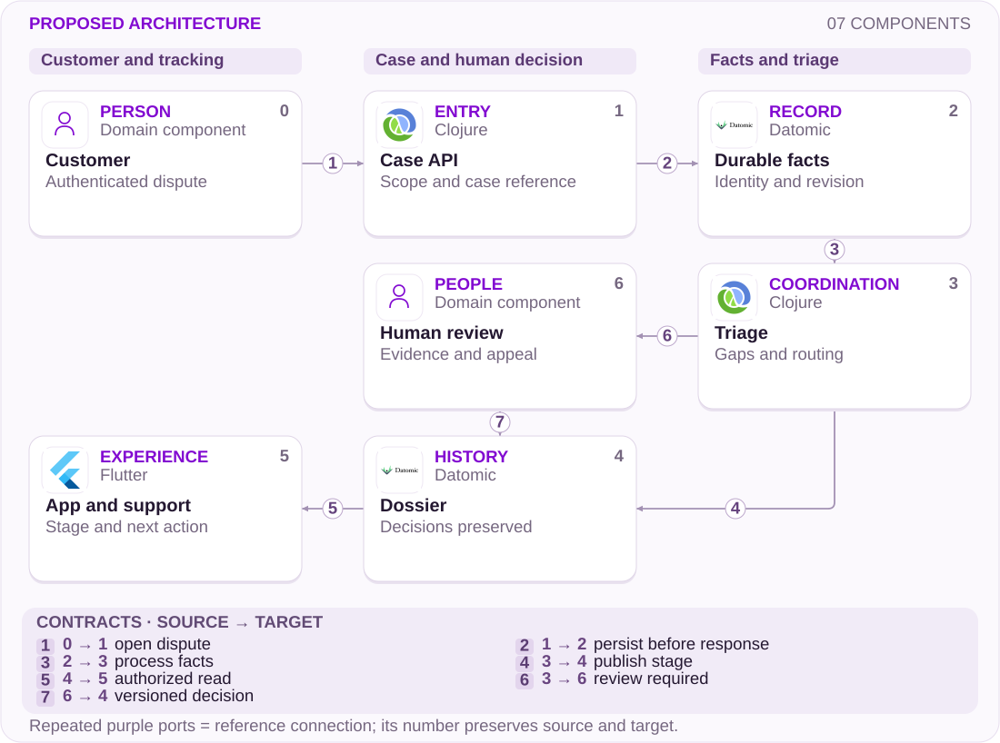

# 08 · Disputed loan: a decision must remain reviewable

From access evidence to a dossier, appeal and accountable ownership

[PT reader](https://wesleyvieira99.github.io/nu/#08-1) · [EN reader](https://wesleyvieira99.github.io/nu/en.html#08-1)

[Executable Python lab](../../labs/case_08.py)

## 08 · The dispute and the response


Actual crop of the public source, captured 23 October 2026. The text below includes the company reply and reported outcome.

On 14 January 2026, complaint 237674561 described an unrecognized loan discovered after three overdue installments. Nubank replied that the loan had been contracted in March 2024 using an authorized device and password, with no irregularity identified. It maintained its refusal. The customer closed the case on 31 January as Not resolved. These are public accounts from parties in disagreement; they do not establish fraud or consent.

**What this evidence supports**

An opportunity to make investigation understandable and reviewable. The loan amount, individual agreement and complete signals are not public. The capture documents the complaint and response; it is not a forensic finding.

- [Reclame AQUI — case 08 · 2026-01-14](https://www.reclameaqui.com.br/nubank/emprestimo-nao-reconhecido-e-falta-de-suporte-do-nubank-apos-3-meses_gejzPKG3_RfQy5qv/)

## Observed access does not settle consent

The engineering question starts at the boundary between evidence and conclusion. A record of an authorized device may matter to an investigation, but it should not be stored as a synonym for the account holder’s intent. This proposal separates access facts, the policy version applied, the reviewer’s interpretation and the communicated decision. A customer can then challenge a specific premise without restarting the entire conversation.

The falsifiable hypothesis is that some rework comes from incomplete dossiers or decisions whose reviewable reasoning is unclear. I would compare an authorized sample of cases with repeat contacts against what the agent could see at that time. If dossiers were already complete and understandable, the hypothesis weakens; the intervention may belong in policy, communication or another stage.

The study does not propose publishing fraud-control secrets or refunding every disputed loan. Financial decisions remain subject to approved authority and policy. The objective is consistent analysis with an owner, minimized evidence and a defined appeal. Legal and operational complexity requires specialist validation before setting deadlines or interim measures.

## A dossier with independent review



Proposed external architecture; not Nubank’s internal implementation.

The API authenticates the account holder and scopes access to the case. The durable record preserves actions before acknowledgment; triage organizes gaps without deciding fraud. The dossier supplies different customer and support projections with a shared revision reference.

Human review records the decision and policy in history. An appeal adds a stage rather than erasing the first decision. The exception path requires an independent reviewer in the model. Real identity, authorization and evidence retention are necessary integrations outside the laboratory.

## Core: revision and action identity

```python
    def append(self, action_id, expected, actor, role, kind, evidence):
        if not isinstance(action_id, str) or not action_id.strip():
            raise ValueError('nonempty action identity required')
        event = dict(actor=actor, role=role, kind=kind, evidence=evidence)
        payload = json.dumps(event, sort_keys=True)
        with self.db:
            self.db.execute('BEGIN IMMEDIATE')
            old = self.db.execute('SELECT payload FROM events WHERE action_id=?',
                                  (action_id,)).fetchone()
            if old:
                if old[0] != payload:
                    raise ValueError('idempotency conflict')
                return self.history()
            history = self.history()
            if expected != len(history):
                raise ValueError('stale revision')
            allowed = {'evidence': 'analyst', 'decision': 'reviewer',
                       'appeal': 'customer', 'review': 'reviewer'}
            if kind not in allowed or allowed[kind] != role:
                raise PermissionError('role not authorized')
            if kind == 'decision' and not any(
                    e['kind'] == 'evidence' for e in history):
                raise ValueError('no evidence dossier')
            validate_transition(history, event)
            self.db.execute('INSERT INTO events VALUES(?,?,?)',
                            (expected + 1, action_id, payload))
        return self.history()
```

Literal excerpt from labs/case_08.py; exercised by local tests.

The transaction checks expected revision, action identity and authorized role. An identical retry returns history without duplicating the event; reusing the key with different content is a conflict. This contract prevents two concurrent decisions from advancing the same revision.

The laboratory represents one case and receives roles from trusted context. It neither authenticates people nor determines whether the loan is legitimate. validate_transition requires evidence before a decision and protects appeal independence. The local database demonstrates persistence; it does not represent the institution’s actual storage.

- [Executable case lab on GitHub](https://github.com/wesleyvieira99/nu/blob/main/labs/case_08.py)

## Make the policy explicit

```clojure
(defn reviewable? [{:keys [evidence decision policy]}]
  (and (seq evidence)
       (string? policy)
       (every? #(contains? % :source-ref) evidence)
       (not= :device-access-only decision)))

(defn appeal-command [case-id revision reviewer]
  {:case-id case-id
   :expected-revision revision
   :action :independent-review
   :reviewer reviewer})
```

Illustrative Clojure example, not executed; integration and policy require validation.

A pure function can check structural completeness before routing the dossier. It cannot turn the presence of data into a correct verdict. The example rejects a simplified decision category based only on device access; this is a proposed rule for the study, not a known Nubank rule.

In the service, the reviewer identifier must come from authenticated identity rather than the customer’s request body. Policy has an immutable version, effective period and owner. Policy changes need approved examples and operational review, because a technically correct deployment can still produce inappropriate decisions. Kafka would carry minimized references; sensitive attachments would remain in restricted storage.

## Evidence and access contracts

| Object | Owner | Rule |
| --- | --- | --- |
| Evidence reference | Security | Hash and source; no password |
| Decision | Authorized reviewer | Policy and revision required |
| Appeal | Operations | Preserves earlier decision |
| Customer projection | Product | Useful reason, no secrets |

```json
{
  "case_id": "synthetic-08",
  "revision": 3,
  "evidence": [{"category": "device_access", "digest": "sha256:..."}],
  "decision": {"policy": "v1", "reviewer_ref": "reviewer-1"},
  "appeal": {"status": "pending", "independent_reviewer": true},
  "customer_projection": {"stage": "under_review"}
}
```

Synthetic illustrative contract; not a payload captured from the app.

A hash helps identify evidence but does not prove its truth or replace chain of custody. Retention policy determines how long the object can be consulted; the projection should not retain unnecessary copies. Administrative access needs a recorded purpose and must be auditable by an independent team.

## Test appeal and recovery

```python
    def test_appeal_requires_independent_reviewer(self):
        self.seed()
        self.d.append('a', 2, 'owner', 'customer', 'appeal', {})
        with self.assertRaises(PermissionError):
            self.d.append('r', 3, 'r1', 'reviewer', 'review', {'policy': 'v2'})
        self.assertEqual(len(self.d.history()), 3)
        self.d.append('r', 3, 'r2', 'reviewer', 'review', {'policy': 'v2'})
        self.assertEqual(self.d.history()[1]['evidence']['policy'], 'v1')

    def test_restart_and_retry_preserve_one_evidence(self):
        self.d.append('e', 0, 'a', 'analyst', 'evidence', self.ev)
        self.d.close()
        self.d = Dispute(self.path)
        result = self.d.append('e', 0, 'a', 'analyst', 'evidence', self.ev)
        self.assertEqual(len(result), 1)
        self.assertNotIn('consent', result[0]['evidence'])
```

Literal excerpts; the complete local suite passed 9 tests.

The first assertion protects appeal independence and verifies that rejection does not change history. The second closes and reopens the database, retries an action and confirms a single record. Other tests attack stale revisions, incorrect roles, missing evidence and sensitive payloads.

Tests do not assess human quality, evidence authenticity or policy fairness. Production work would add blinded sample review, cross-account access tests, permission expiry, export auditing and tool-outage exercises. A system that perfectly preserves a poor decision still needs process correction.

## Measure useful review and human effort

| Metric | Definition | Window / segment |
| --- | --- | --- |
| Useful review | Cases with reasoned action / opened | Weekly; dispute type |
| Rework | Repeated minutes / eligible dossier | Monthly sample; team |
| Repeat contact | Repeated contacts / cases | 30 days; stage |
| Disagreement | Materially corrected decisions / audited | Monthly; policy |

The baseline is unknown. I would instrument transitions with pseudonymized case_id, revision and timestamp; work time requires operational sampling rather than queue duration alone. Case age and actual effort are different measures. Unauthorized access and audit failures are additional guardrails.

The pilot would compare equivalent teams or periods using predefined eligibility, avoiding selection of easy cases only. Independent reviewers would assess samples from both groups. Expansion would stop for data exposure, lost evidence or a material deterioration in decision consistency, even if average handling time improved.

## Value: recovered capacity, not profit

| Assumed scenario | Potential/year | Operations/year | Year 1 after cost |
| --- | --- | --- | --- |
| Conservative | R$ 144,000 | R$ 60,000 | R$ -156,000 |
| Base | R$ 504,000 | R$ 90,000 | R$ 174,000 |
| Ambitious | R$ 1,080,000 | R$ 120,000 | R$ 720,000 |

Every input is assumed: 12,000, 24,000 or 40,000 annual dossiers; 8, 14 or 18 rework minutes saved; R$ 90 fully loaded hourly cost. Valued capacity is N × minutes ÷ 60 × 90. Implementation is assumed at R$ 240,000 and annual operations at R$ 60,000, 90,000 or 120,000. The final column subtracts both in year 1 and does not represent realized cash.

In the base case, 24,000 × 14 ÷ 60 × 90 = R$ 504,000; subtracting R$ 90,000 and R$ 240,000 leaves R$ 174,000 in modeled net capacity. Year-one break-even requires approximately 15,715 equivalent dossiers. Redistributing hours does not automatically save cash. Investment depends on confirming avoidable rework and identifying a concrete use for the released capacity.

**Keep financial categories separate**

Disputed principal and possible fraud are excluded. Loss estimates require verified exposure, confirmation and recovery. Do not aggregate benefits with other chapters that cover the same contacts.

## A 90-day plan with accountable roles

| Proposed phase | Deliverable and owner | Exit gate |
| --- | --- | --- |
| Days 0–15 | Risk + operations: taxonomy and sample | Facts separated from inference |
| Days 16–30 | Staff + privacy: contract and access | Access review approved |
| Days 31–60 | EM + operations: shadow and training | Independent sample consistent |
| Days 61–90 | Product + risk: limited pilot | Guardrails and capacity validated |

The calendar is a planning assumption. The critical dependency is authorized access to a sufficient sample, not building a screen. If evidence sources are incompatible, the first deliverable becomes identifying those gaps and assigning owners to resolve them.

The Engineering Manager coordinates capacity across lending, fraud, support and privacy; the Staff Engineer defines contracts and technical criteria. Policy review remains with its owners. Every phase ends with observable evidence and a recorded decision to continue, narrow or stop. The schedule does not promise changes dependent on external validation.

## Operate without abandoning the queue

Deployment starts in shadow mode: the new tool prepares dossiers while the existing operation continues making decisions. Completeness, preparation time and discrepancies are compared without automatically changing collections or credit. The next canary exposes tracking and review to a limited cohort, with human capacity reserved for appeals.

Alerts distinguish aging queues, unavailable evidence and authorization failure. Operations owns queue response; security owns exposure; the service team owns lost or duplicated events. A projection outage neither closes the case nor deletes its trail. Customers receive an honest stage and next action.

Rollback disables the new projection and automatic routing while preserving history and active cases. An exercise should simulate database failure after a decision, permission revocation during access and return of an old revision. The runbook must explain pending-work reconciliation and continuity communication without exporting dossiers to unprotected spreadsheets.

## My contribution to the decision

As Staff, I would define the evidence model, authorization boundaries and review invariants. I would lead the consistency, retention and signal-exposure discussion using concrete disagreements. The most important decision would be to keep access records separate from interpretation of consent, preventing a technical field from carrying a conclusion it cannot support.

As Engineering Manager, I would establish joint delivery with operations and risk, an end-to-end owner and reserved review time. I would first prioritize the most frequent demonstrated rework, with explicit criteria for choosing product changes, integration or training as the next investment. These are proposed actions, not claims that I have managed Nubank teams or policies.

I would reject automatic refusal merely because the dossier contains a known device. I would also avoid exposing every signal to support. The proposal balances useful review with minimized access and accepts higher operational effort when needed to protect the quality of a sensitive decision.

## Handoff for technical and operational review

- Run: python3 labs/case_08.py. The complete suite contains 9 tests and accesses no external service.
- Review Dispute.append and validate_transition, then inspect history before and after an appeal.
- Confirm that retry, key conflict, stale revision and incorrect role cannot create another decision.
- Before production: identity, account scope, retention, policy, audit and independent human review.

The laboratory supports a joint review: engineering explains the contract; operations checks whether history reconstructs the work; risk evaluates decisions needing supervision; privacy evaluates exposure. Local execution validates only the modeled invariants, not the merits of a dispute.

The final gate is straightforward: proceed only if the sample shows a correctable gap, independent review maintains quality and released capacity has a destination. Otherwise retain the learning and choose another intervention. The intended result is a better-grounded decision that is easier to review, without promising automatic resolution of financial disputes.

- [Executable case lab on GitHub](https://github.com/wesleyvieira99/nu/blob/main/labs/case_08.py)
