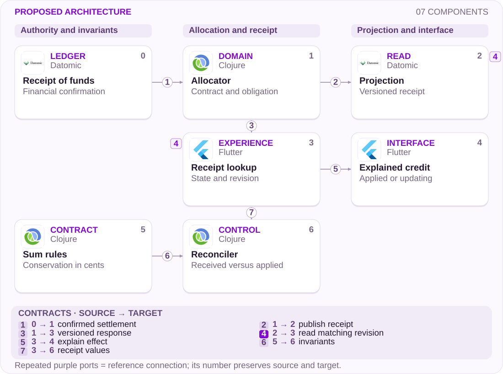

# 09 · Paid statement, uncertain credit: follow every cent

Receipt, allocation and projection need a shared contract

[PT reader](https://wesleyvieira99.github.io/nu/#09-1) · [EN reader](https://wesleyvieira99.github.io/nu/en.html#09-1)

[Executable Python lab](../../labs/case_09.py)

## 09 · Paid does not explain allocation


Actual crop of the public source, captured 23 October 2026. The text below includes the company reply and reported outcome.

Complaint 242838873, dated 10 March 2026, describes a statement marked paid while credit was not fully restored, after three support tickets. On 17 March, Nubank reported correcting the statement, recognizing the payment and settling advanced installments. It explained credit restoration through processing and financed balances. The public status is Responded; no final customer confirmation is visible. Individual amounts are masked.

**Evidence boundary**

The response reports a correction but does not expose the ledger, event order or technical cause. This study proposes allocation traceability rather than diagnosing the responsible system.

- [Reclame AQUI — case 09 · 2026-03-10](https://www.reclameaqui.com.br/nubank/pagamento-de-fatura-nao-processado-e-limite-nao-liberado_DSi3KqzKEFj9hHIa/)

## Three states, different consequences

Receiving money, applying money and refreshing a credit-limit view are separate stages. An interface can correctly report a payment while leaving unanswered which obligations were settled. With financing, the effect on available credit depends on rules that a single label cannot explain. The receipt must connect receipt of funds, destination and consequence rather than merely replace a word on screen.

My hypothesis is that some repeat contact comes from the absence of this verifiable link across channels. Investigation would use the payment identifier to reconstruct confirmation, allocations, compensating entries and projection updates. I would compare what the customer saw against support and ledger records at the same revision. If obligation calculation is wrong, improved presentation is insufficient and financial correction takes priority.

The responsibility boundary includes contractual financing rules and settlement recognition. The app cannot independently choose where to move money. It should also avoid inviting a second payment while the first allocation is uncertain. The proposal makes the pending state explicit and provides tracking under the same identifier.

## A receipt linked to the ledger



Proposed external architecture; not Nubank’s internal implementation.

The allocator receives financial confirmation and applies a validated plan. The canonical receipt and its projection share a revision. The reconciler compares receipt values against independent invariants; a discrepancy is not solved by hiding cents in presentation.

Available-credit updates may run at a different pace, but must expose their revision and state. The diagram summarizes responsibilities, not every integration. Financial correction requires authorized compensating entries in the ledger; the reconciler detects and routes discrepancies without independently editing balances.

## Core: allocate or change nothing

```python
    def apply(self, ident, amount, plan, crash=False):
        if not isinstance(ident, str) or not ident.strip():
            raise ValueError('nonempty payment identity required')
        if type(amount) is not int or amount <= 0:
            raise ValueError('positive integer cents required')
        if any(type(v) is not int or v <= 0 for v in plan.values()):
            raise ValueError('invalid allocation')
        encoded = json.dumps(plan, sort_keys=True)
        with self.db:
            self.db.execute('BEGIN IMMEDIATE')
            old = self.db.execute('SELECT amount,plan FROM payments WHERE id=?',
                                  (ident,)).fetchone()
            if old:
                if old != (amount, encoded):
                    raise ValueError('payment conflict')
                return self.receipt(ident)
            if sum(plan.values()) > amount:
                raise ValueError('allocation exceeds received amount')
            for target, value in plan.items():
                changed = self.db.execute('UPDATE obligations SET due=due-? '
                    'WHERE id=? AND due>=?', (value, target, value)).rowcount
                if changed != 1:
                    raise ValueError('unknown or overpaid obligation')
                self.db.execute('INSERT INTO allocations VALUES(?,?,?)',
                                (ident, target, value))
            if crash:
                raise RuntimeError('crash before commit')
            self.db.execute('INSERT INTO payments VALUES(?,?,?,?)',
                            (ident, amount, encoded, amount - sum(plan.values())))
        return self.receipt(ident)
```

Literal excerpt from labs/case_09.py; SQLite represents one local authority.

The conditional write prevents applying more than an obligation owes. Allocations and receipt share a transaction: if the second destination is invalid, the first returns to its prior state as well. Unapplied funds remain explicit.

The example receives a preselected plan and does not implement Nubank’s contractual priority. Production selection requires versioned policy, account authorization and settlement evidence. A retry is accepted only when amount and plan are identical. Reusing the key to change destination requires a different authorized action, never a silent update.

- [Executable case lab on GitHub](https://github.com/wesleyvieira99/nu/blob/main/labs/case_09.py)

## Pure rules, transactional writes

```clojure
(defn allocation-valid? [{:keys [received allocations unapplied]}]
  (and (pos-int? received)
       (every? pos-int? (vals allocations))
       (<= 0 unapplied)
       (= received (+ unapplied (reduce + (vals allocations))))))

(defn allocation-event [payment-id revision plan]
  {:event-type :payment-applied
   :payment-id payment-id
   :revision revision
   :allocations plan})
```

Illustrative Clojure example, not executed; the Python laboratory is the tested artifact.

The function checks conservation but cannot prove that each obligation is eligible. That validation belongs inside the transactional boundary that knows balance, account holder and contract. Separating pure calculation from persistence helps test rules and review changes without attributing database guarantees to the function.

Event integration should persist allocation and publication intent atomically. The projection consumer deduplicates by identifier and financial revision. Transport ordering alone is insufficient: replay, reprocessing and consumer changes can redeliver the same fact. Publication failure leaves identifiable pending work, not permission to apply the payment again.

## Conserve money and identity

| Field | Meaning | Owner |
| --- | --- | --- |
| payment_id | Stable receipt identity | Settlement |
| allocations | Destination in cents | Credit/statements |
| unapplied | Funds without a destination | Operations |
| revision | Source financial fact | Ledger |

```json
{
  "payment_id": "synthetic-payment-09",
  "currency": "BRL",
  "received_cents": 15001,
  "allocations": {"bill": 10000, "installment": 5000},
  "unapplied_cents": 1,
  "ledger_revision": 42,
  "limit_projection_revision": 41,
  "limit_state": "updating"
}
```

Synthetic example: 15,001 received, 15,000 applied and 1 unapplied.

A credit projection behind the financial revision explains that the view is still updating, without asserting that credit is already available. Identifiers must not expose accounts or contracts in public URLs. Support receives what is needed to explain allocation; third-party details and unrelated obligations remain protected. Rectification should reference the earlier fact and preserve the trail.

## Partial failure must not partially settle

```python
    def test_failure_after_first_write_rolls_everything_back(self):
        with self.assertRaises(ValueError):
            self.l.apply('p', 20000, {'bill': 10000, 'installment': 6000})
        self.assertEqual(self.l.due('bill'), 10000)
        self.assertEqual(self.l.due('installment'), 5000)
        self.assertEqual(self.l.db.execute(
            'SELECT COUNT(*) FROM allocations').fetchone()[0], 0)

    def test_restart_retry_does_not_apply_twice(self):
        first = self.l.apply('p', 12000, {'bill': 10000})
        self.l.close()
        self.l = Ledger(self.path)
        self.assertEqual(self.l.apply('p', 12000, {'bill': 10000}), first)
        self.assertEqual(first['unapplied'], 2000)
        self.assertEqual(self.l.due('bill'), 0)
```

Literal suite excerpts; 9 tests passed.

The partial-failure test attempts to settle one obligation and exceed another, verifying full rollback. The recovery test reopens the database and confirms that the same receipt cannot apply money twice. The suite also checks a residual cent, conflicting plan, fractional amount and payment against an already settled obligation.

Interest, fees, currency, reversals and cross-account authorization remain outside scope. An integration test should observe outbox and projection after failure between commit and publication, checking the receipt against an independent source. Local conservation is necessary but does not replace settlement-system reconciliation.

## Metrics that follow the payment

| Metric | Numerator / denominator | Window and segment |
| --- | --- | --- |
| Late application | Payments beyond threshold / eligible | Daily; debt type |
| Unallocated funds | Unapplied cents / received cents | Daily; age |
| Repeat contact | Allocation contacts / payments | 30 days; contract |
| Discrepancy | Unreconciled receipts / checked | Continuous; revision |

Baselines and internal deadlines are unknown. I would first define each timestamp’s origin: external confirmation, allocation commit and projection publication. Network delay must not be confused with settlement delay. Contact classification needs sampled review to distinguish a presentation question from a real financial error.

The experiment releases an explainable receipt without changing allocation rules. It compares equivalent cohorts by product, financing and amount. Expansion stops for any conservation violation, increased repeated payments or cross-account context leakage. Reducing contact must never incentivize hiding access to help.

## A financial case with two cost components

| Assumed scenario | Potential/year | Operations/year | Year 1 after cost |
| --- | --- | --- | --- |
| Conservative | R$ 70,800 | R$ 60,000 | R$ -249,200 |
| Base | R$ 240,000 | R$ 60,000 | R$ -80,000 |
| Ambitious | R$ 676,800 | R$ 60,000 | R$ 356,800 |

Every input is hypothetical: 60,000, 120,000 or 240,000 eligible payments/year; 0.06, 0.10 or 0.14 fewer contacts per payment; R$ 18 per contact. I additionally assume 1, 2 or 3 reconciliation hours saved per thousand payments at R$ 100/hour. Implementation: R$ 260,000; annual operations: R$ 60,000. Contacts and reconciliation hours must represent different work.

The base case is 120,000 × 0.10 × 18 + 120 × 2 × 100 = R$ 240,000 in annual capacity. Year one is R$ 240,000 − 60,000 − 260,000 = −R$ 80,000. Break-even requires 160,000 payments equivalent to the base assumption. This supports a pilot or reuse of components rather than automatic approval of the full project.

**Do not convert balances into revenue**

Restored credit and received principal are not profit. Capacity becomes cash only through concrete spending reductions. Exclude anticipation rework already measured in case 14.

## A reconciliation-led roadmap

| Proposed phase | Owner and deliverable | Gate |
| --- | --- | --- |
| Days 0–15 | Statements + credit: allocation map | Synthetic cases reconcile |
| Days 16–30 | Staff: receipt and outbox | Failures do not duplicate application |
| Days 31–60 | Operations: shadow reconciliation | Differences classified |
| Days 61–90 | EM + product: receipt canary | Contacts fall; integrity holds |

The main dependency is a trustworthy financial reference against which to compare the new view. Without it, a dashboard can merely make an error more persuasive. In the first phase, accounting and credit approve examples for partial payments, financing, anticipation and compensation, with amounts in cents and explicit revisions.

The 90-day calendar is a planning scenario. The EM reserves support and operations capacity during the canary; the Staff Engineer defines failure tests and the correction contract. If reference quality fails the gate, the next delivery is reconciliation and remediation rather than visual expansion. Every exception needs an owner and a destination for unapplied funds.

## Rollback preserves financial writes

Launch starts with shadow reading. The projection calculates a receipt and compares it with the ledger without guiding customers or changing allocations. A canary then exposes the allocation explanation to eligible accounts. The old view remains an identified fallback, without mixing total and detail revisions.

Alerts combine unapplied-fund age, projection delay and sum violations. Platform owns publication; credit and statements own financial interpretation; operations coordinates customer resolution. An error queue should carry IDs and reasons rather than unnecessary complete financial data in broadly accessible logs.

Disabling the new receipt does not undo confirmed payments. Rollback affects presentation and routing, followed by reconciliation of pending work. Exercises include crashes before and after commit, a delayed consumer and concurrent correction. Throughout recovery, the tool must distinguish received from applied money for customers and support alike.

## My contribution on two fronts

As Staff, I would center the design on conservation and identity. I would choose the transaction boundary, define compensation and document which reads may be eventually consistent. I would reject inferring available credit from a paid-statement label because it replaces a financial contract with a visual approximation.

As Engineering Manager, I would bring together teams that may see different parts of the same payment. I would establish an end-to-end resolution owner and an investigation agreement using shared IDs. The plan must include support training and exception-handling capacity, not only a mobile component.

I would also advocate an economic decision proportional to the evidence. The base scenario does not recover implementation cost in the assumed first year. If an existing receipt API can be extended, the cost changes and must be recalculated. My role is to expose that tradeoff and protect journey integrity without presenting potential capacity as realized savings.

## A receipt review walkthrough

- Run python3 labs/case_09.py: 9 local tests, with no banking integration.
- Read Ledger.apply and receipt; reproduce two-destination allocation with one residual cent.
- Fail the second destination and confirm that the first does not remain settled.
- Before production: real settlement, account scope, contractual rules, outbox and compensating entries.

A reviewer must be able to explain where every cent came from and where it went. A receipt showing only a total does not satisfy the contract. The local demonstration permits direct inspection of payments, obligations and allocations, but does not cover all rules of a real card or financing product.

Proceeding requires a reconciled sample, demonstrated customer understanding and operations able to resolve differences. If conservation breaks, the gate is to stop and correct the financial authority. If writes are correct and only the view is confusing, the explanation pilot can proceed with lower risk and cost.

- [Executable case lab on GitHub](https://github.com/wesleyvieira99/nu/blob/main/labs/case_09.py)
