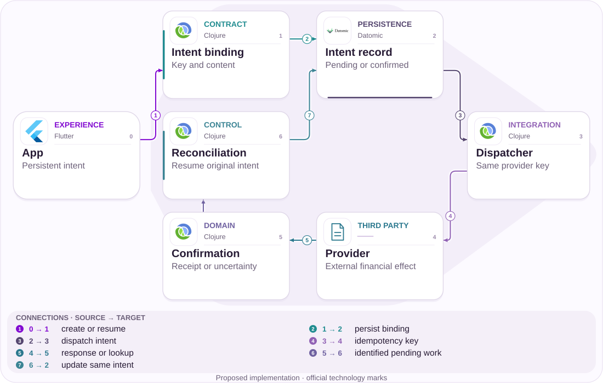
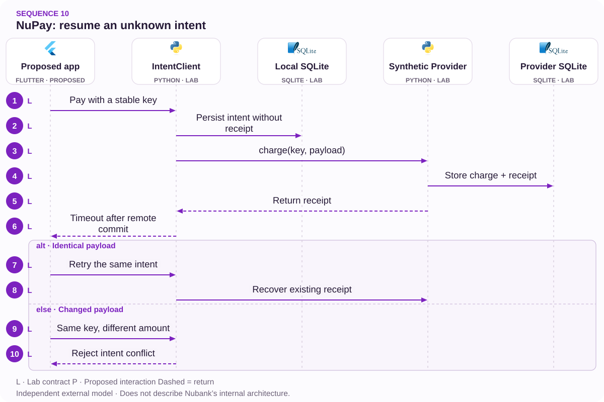

# 10 · NuPay after an error message: recover intent before retrying

An unknown outcome is a financial state, not an invitation to charge again

[PT reader](https://wesleyvieira99.github.io/nu/#10-1) · [EN reader](https://wesleyvieira99.github.io/nu/en.html#10-1)

[Executable Python lab](../../labs/case_10.py)

## 10 · Duplication with confirmed resolution


Actual crop of the public source, captured 23 October 2026. The text below includes the company reply and reported outcome.

In complaint 241843991, dated 27 February 2026, the customer described an error message and repeated NuPay payment, followed by two R$ 900 transactions and R$ 81.17 interest. On 4 March, Nubank reported crediting the duplicate and interest; the customer confirmed resolution. The technical cause is not established.

| Public figure | Interpretation caution |
| --- | --- |
| 4 installments of R$ 245.29 | Stated sum: R$ 981.16 |
| R$ 900 + R$ 81.17 | Analytical sum: R$ 981.17 |
| Difference: R$ 0.01 | Do not invent a rounding adjustment |

**Resolved historical case**

The one-cent discrepancy belongs to the account. The exact adjustment entry was not published; the response confirms categories rather than a numeric total.

- [Reclame AQUI — case 10 · 2026-02-27](https://www.reclameaqui.com.br/nubank/cobranca-duplicada-e-juros-indevidos-por-falha-no-nupay_YLMPdqVkdlSKVq-X/)

## Timeout is not definitive failure

An interruption can occur after a partner accepts payment but before the app receives confirmation. During that interval, saying that nothing happened can induce another financial intent. This chapter hypothesizes that an explicit unknown-outcome state, paired with lookup of the original attempt, reduces unintended repetition without preventing legitimate new purchases.

Investigation must reconstruct identifiers, timestamps and contracts across client, service and provider. Retrying one intent must be distinguished from a deliberate second purchase. Amount, merchant and temporal proximity support analysis but are insufficient identity: two equal purchases may be legitimate. The public source cannot establish which mechanism was present or absent in the incident.

Control should begin before dispatch: create and persist intent, bind content to a key and recover state after app restart. If the provider lacks idempotency or reliable lookup, the guarantee weakens. The experience must then acknowledge uncertainty and initiate reconciliation rather than promise exactly one distributed execution.

## One intent crosses uncertainty



Proposed external architecture; not Nubank’s internal implementation.

The record binds key, amount, currency and recipient before dispatch. The provider retains the same key across attempts. Confirmation and reconciliation update the original intent, allowing the app to recover the receipt after losing the response.

The model uses two databases to represent the service/provider boundary. No distributed transaction spans them. The property explicitly depends on provider deduplication; without that capability, the design requires a different operational strategy and cannot retain the same promise.

## Core: persist before dispatch

`Idempotency Key [lab]` · `Intent / Effect Separation [lab]`

```python
    def pay(self, key, amount, merchant, timeout_after_provider=False):
        if not isinstance(key, str) or not key.strip():
            raise ValueError('nonempty intent identity required')
        if type(amount) is not int or amount <= 0 or not merchant:
            raise ValueError('invalid intent')
        payload = json.dumps([amount, merchant])
        with self.db:
            self.db.execute('BEGIN IMMEDIATE')
            old = self.db.execute('SELECT payload,receipt FROM intents WHERE key=?',
                                  (key,)).fetchone()
            if old and old[0] != payload:
                raise ValueError('intent conflict')
            if old and old[1]:
                return old[1]
            self.db.execute('INSERT OR IGNORE INTO intents VALUES(?,?,NULL)',
                            (key, payload))
        receipt = self.provider.charge(key, payload)
        if timeout_after_provider:
            raise TimeoutError('provider committed; local outcome unknown')
        with self.db:
            self.db.execute('UPDATE intents SET receipt=? WHERE key=?',
                            (receipt, key))
        return receipt

    def state(self, key):
        row = self.db.execute('SELECT receipt FROM intents WHERE key=?',
                              (key,)).fetchone()
        return 'absent' if row is None else ('confirmed' if row[0] else 'unknown')
```

Literal excerpt from labs/case_10.py; two local databases and a synthetic provider.

Intent is recorded before the external call. The injected timeout occurs after provider commit but before the local receipt is saved. Recovery uses the same key and receives the existing receipt, demonstrating that missing a response does not authorize another effect.

A local transaction should not remain open while waiting on the network: this creates locks without making the partner an atomic participant. The laboratory exposes that separation. In production, payload includes account scope and contract; integration must address key retention, expiry and provider compatibility.

- [Executable case lab on GitHub](https://github.com/wesleyvieira99/nu/blob/main/labs/case_10.py)

## State should guide the next action

`Idempotency Key [proposal]` · `Intent / Effect Separation [proposal]`

```dart
sealed class PaymentState {}
class Unknown extends PaymentState {
  final String intentId;
  Unknown(this.intentId);
}
class Confirmed extends PaymentState {
  final String receiptId;
  Confirmed(this.receiptId);
}

String nextAction(PaymentState state) => switch (state) {
  Unknown() => 'Check the existing payment',
  Confirmed() => 'Open receipt',
  _ => 'Continue',
};
```

Illustrative Dart, not executed; states and copy require product and accessibility review.

The interface offers lookup of the existing attempt when the outcome is unknown. The wording is only an example: it must explain what is being checked without asserting debit or failure before confirmation. A new-purchase button must represent explicit new intent rather than a disguised retry.

Local persistence helps app recovery, but the server remains the reference. Reinstallation, device changes or cleared storage must not automatically create another charge. After session recovery, the client queries authorized recent intents. Recipient information should enable recognition while minimizing sensitive detail and never exposing integration credentials.

## Identity before heuristics

`Idempotency Key [proposal]` · `Intent / Effect Separation [proposal]`

| Contract | Invariant | Boundary |
| --- | --- | --- |
| Same key | Same content and receipt | Defined scope and retention |
| Different content | Explicit conflict | No silent update |
| New intent | May repeat the amount | Own consent |
| Correction | Principal/charge linkage | Policy and reconciliation |

```json
{
  "intent_id": "synthetic-intent-10",
  "currency": "BRL",
  "amount_cents": 90000,
  "merchant_ref": "synthetic-merchant",
  "payload_digest": "sha256:...",
  "provider_key": "synthetic-intent-10",
  "state": "unknown",
  "next_action": "query_existing_intent"
}
```

Synthetic contract in cents; not a NuPay capture.

A digest does not replace field validation and must not serve as the sole authorization. Financial correction is a separate operation linked to the original effect; it neither deletes intent nor turns a confirmed attempt into an event that never occurred. Interest and principal need distinct trails for complete, auditable resolution.

## Fail after the external effect

`Idempotency Key [lab]` · `Intent / Effect Separation [lab]`

```python
    def test_timeout_restart_and_retry_produce_one_charge(self):
        with self.assertRaises(TimeoutError):
            self.c.pay('intent1', 90000, 'merchant', True)
        self.assertEqual(self.c.state('intent1'), 'unknown')
        self.assertEqual(self.charges(), 1)
        self.c.db.close()
        self.c = IntentClient(self.path / 'client.db', self.p)
        self.assertEqual(self.c.pay('intent1', 90000, 'merchant'),
                         'provider:intent1')
        self.assertEqual(self.charges(), 1)
        self.assertEqual(self.c.state('intent1'), 'confirmed')

    def test_same_amount_can_be_two_explicit_purchases(self):
        self.c.pay('intent1', 90000, 'merchant')
        self.c.pay('intent2', 90000, 'merchant')
        self.assertEqual(self.charges(), 2)
```

Literal excerpts; 9 tests passed, including recovery after timeout.

The most important adverse scenario has already produced a provider effect. The assertion verifies one charge after reopening the client and repeating the call. Another test permits two equal purchases with different intents, preventing a protection that indiscriminately blocks legitimate payments.

The suite also checks amount conflicts, changed recipients, repeated timeouts and invalid cents. It does not cover a real network, partner key retention, interest or merchant cancellation. The integration contract must test these behaviors with the provider, especially a late response after the journey has moved to support.

## Measure ambiguity and confirmed effects

| Metric | Definition | Collection / segment |
| --- | --- | --- |
| Unknown outcome | Intents without outcome / eligible | Events; provider and version |
| Confirmed duplicate | Unintended repetitions / intents | Review; reason |
| Reconciliation time | p95 to definitive outcome | By age and partner |
| False block | Legitimate purchases blocked / reviewed | Independent sample |

Current rates are unknown. A network exception cannot automatically count as duplication. Confirmation requires linking intents and examining effects while preserving legitimate equal purchases. Complete-correction measurement checks principal and associated charges without assuming that every adjustment is a bank loss.

The experiment begins with shadow intent recovery and failure tests. The canary compares mobile versions and compatible partners while holding authorization policy constant. Any new duplication caused by the control, blocked legitimate payment or lost traceability stops expansion. Conversion alone is insufficient evidence of success.

## A strong case does not prove high ROI

| Assumed scenario | Potential/year | Operations/year | Year 1 after cost |
| --- | --- | --- | --- |
| Conservative | R$ 4,050 | R$ 36,000 | R$ -211,950 |
| Base | R$ 27,000 | R$ 36,000 | R$ -189,000 |
| Ambitious | R$ 108,000 | R$ 36,000 | R$ -108,000 |

Annual assumptions: 30,000, 60,000 or 100,000 ambiguous intents; confirmed duplication in 0.5%, 1% or 2%; incremental prevention of 30%, 50% or 60%. This yields 45, 300 or 1,200 avoided incidents. I assume R$ 50 in support/reconciliation and R$ 40 in irrecoverable charges per incident, totaling R$ 90. The complaint’s amounts are not used as average bank cost.

Assumed implementation: R$ 180,000; annual operations: R$ 36,000. In the base case, 300 × 90 = R$ 27,000; year one is R$ 27,000 − 36,000 − 180,000 = −R$ 189,000. Break-even requires 2,400 actually prevented incidents in year one. None of these scenarios independently justifies full investment. A smaller correction reused across a platform may have different economics and needs a separate estimate.

**Separate flows from losses**

Refunded principal is not automatically a bank expense. Operational capacity, absorbed charges and customer money are distinct categories. The real incident supplies neither population frequency nor realized benefit.

## A partner-dependent roadmap

| Proposed phase | Owner and deliverable | Gate |
| --- | --- | --- |
| Days 0–15 | Payments: provider contract | Idempotency/lookup verified |
| Days 16–30 | Staff + mobile: persistent intent | Restart resumes same operation |
| Days 31–60 | Operations: failures and shadow | External effect reconciled |
| Days 61–90 | EM + product: partner canary | No duplicates or false blocks |

The key dependency is knowing what the partner actually guarantees and how long it retains a key. If lookup cannot distinguish pending from absent, the design must preserve that ambiguity. The 90-day schedule is proposed planning, not a commitment by Nubank or its provider.

The EM negotiates integration, testing and support capacity; the Staff Engineer documents guarantees for each failure scenario. Mobile delivery must wait for the server contract. Better wording without state recovery can merely conceal the issue. The economic gate is explicit too: start with a limited change when scenarios do not support a new platform.

## Operate uncertainty without repetition

The canary needs an unknown-intent queue with age, partner and next step. Alerts carry authorized investigation references rather than complete payment data. Payments owns the effect, integration owns the external contract and support owns continuity of customer communication.

The runbook starts by looking up existing intent and provider evidence. It does not tell an operator to create another charge to see whether it works. Late confirmation must update the same case and prevent duplicate correction. A refund request requires its own authorized workflow; it is not an automatic consequence of timeout.

Rollback disables the new experience but preserves recorded intents and confirmations. I would simulate response loss, duplicate callbacks, reordered responses and unavailable lookup. I would also test recovery after app reinstallation. The stopping condition is any scenario in which the displayed state induces a financial action incompatible with what is known.

## My contribution to the contract

As Staff, I would make local guarantees and external dependencies explicit. I would reject exactly-once as a slogan for the entire journey. The design must identify transaction boundaries, deduplication and uncertainty. I would also define retry versus new intent so duplicate prevention does not obstruct legitimate purchases.

As Engineering Manager, I would coordinate mobile, payments, partner and support around reproducible failure scenarios. The team needs time for exercises and reconciliation, not merely a visual delivery target. I would put project cost and evidence of incidence into the same prioritization decision.

The rejected alternative is automatically blocking any payment with the same amount and recipient within a short window. That rule can create false positives and does not solve response loss. Identified intent offers a more precise contract when the partner cooperates. Where it does not, that limitation must remain visible in the design and operational plan.

## Review a single effect under an assumption

- Run python3 labs/case_10.py: 9 local tests with no financial calls.
- Inspect Provider.charge and IntentClient.pay; identify the two separate commits.
- Inject timeout_after_provider = True and observe unknown state with an existing charge.
- Resume with the same key; then create a separate explicit intent and verify two legitimate purchases.

The demonstrated guarantee depends on correct deduplication by the synthetic provider. The laboratory does not prove that a real partner offers equivalent retention, scope or lookup. Production requires contractual tests, authentication, currency, expiry rules and independent effect reconciliation.

Proceed only when the external contract is confirmed, messaging guides the correct action and the pilot demonstrates fewer repeats without blocking valid purchases. Otherwise limit the change to information recovery and assisted operations. The contribution is to make uncertainty manageable and prevent a lost response from becoming another financial obligation.

- [Executable case lab on GitHub](https://github.com/wesleyvieira99/nu/blob/main/labs/case_10.py)

## Patterns with proof

`Idempotency Key [lab]` · `Intent / Effect Separation [lab]` · `Ports & Adapters [proposal]` · `Spring Boot [proposal]`

| Mechanism | Implementation | Evidence |
| --- | --- | --- |
| Idempotency Key | IntentClient.pay | restart and retry preserve one provider effect |
| Intent / Effect Separation | IntentClient.pay | different keys represent different intentions |
| Ports & Adapters / payment provider | Production proposal | Adapters keep authority outside the UI. |

**Java integration · proposed**

Spring Boot + resilient HTTP adapter. Port the invariants and contract tests before replacing the Python model. A process lock is not distributed concurrency control; persistence, authorization and recovery need integration tests.

**AI assessment · deterministic core**

No agent framework is implemented in this lab. Monetary state, authorization and version checks remain deterministic. An assistant would be evaluated separately against a proven support need, without authority to alter balances or identity.

- [P1 · IntentClient.pay](https://github.com/wesleyvieira99/nu/blob/main/labs/case_10.py#L45)
- [P1 · test_timeout_restart_and_retry_produce_one_charge](https://github.com/wesleyvieira99/nu/blob/main/labs/case_10.py#L92)
- [P2 · IntentClient.pay](https://github.com/wesleyvieira99/nu/blob/main/labs/case_10.py#L45)
- [P2 · test_same_amount_can_be_two_explicit_purchases](https://github.com/wesleyvieira99/nu/blob/main/labs/case_10.py#L104)

## Execution sequence



Two local databases. Provider idempotency is an explicit assumption; network exactly-once is not claimed.

**Authority and failure boundary**

restart and retry preserve one provider effect. different keys represent different intentions.

The sequence describes the proposed integration. The linked lab verifies the domain invariant with synthetic data; external services, network retries and deployment remain integration work.

- [pay](https://github.com/wesleyvieira99/nu/blob/main/labs/case_10.py#L45)
- [state](https://github.com/wesleyvieira99/nu/blob/main/labs/case_10.py#L69)

## Features, stories and acceptance

**F10.1 · Persisted intent · D16–30**

As a customer, I want to retry after a timeout without charging again. Acceptance: restart and retry preserve one provider effect.

**F10.2 · Explicit distinct purchases · D31–60**

As a customer, I want to make two legitimate purchases of the same amount. Acceptance: different keys represent different intentions.

**F10.3 · Measured rollout · D61–90**

As the product owner, I want an eligible cohort with a comparable control. Acceptance: the case metric, denominator, cost and safety barrier are registered before exposure; reconciliation failures stop expansion.

Linked tests exercise the stated domain acceptance condition, not the complete interface or production integration. D0–15 is discovery: confirm the public report against authorized internal samples, map dependencies and approve contracts. These are incremental planning windows, not a delivery commitment. EM owns coordination; Staff owns cross-domain contracts; Product and the domain owner accept outcomes.

- [Acceptance F10.1](https://github.com/wesleyvieira99/nu/blob/main/labs/case_10.py#L92)
- [Acceptance F10.2](https://github.com/wesleyvieira99/nu/blob/main/labs/case_10.py#L104)

## Method and sensitivity

**Scenario sensitivity · BRL**

All inputs are scenario assumptions, not measured Nubank effects. Capacity equivalent is not cash saved. The realization slider reduces benefit only; all costs remain at their scenario values. This is sensitivity analysis, not a probability or a causal estimate.

period_net = benefit × realization − variable_cost − run_cost; first_year = period_net − build_cost

Period / Período: `year`. Values / Valores: BRL.

| Scenario / Cenário | Benefit / Benefício | Variable cost / Variável | Run cost / Operação | Build / Implementação |
| --- | ---: | ---: | ---: | ---: |
| Conservative | 4050.00 | 0.00 | 36000.00 | 180000.00 |
| Base | 27000.00 | 0.00 | 36000.00 | 180000.00 |
| Ambitious | 108000.00 | 0.00 | 36000.00 | 180000.00 |

| Scenario / Cenário | Period net at 100% / Líquido | Horizon after build / Horizonte | Horizon at 50% / Estresse |
| --- | ---: | ---: | ---: |
| Conservative | -31950.00 | -211950.00 | -213975.00 |
| Base | -9000.00 | -189000.00 | -202500.00 |
| Ambitious | 72000.00 | -108000.00 | -162000.00 |

[Reproducible scenario inputs](../../models/normalized-scenarios.json) · [Decimal simulator](../../models/simulate.py)

| Decision | Case-specific method |
| --- | --- |
| Baseline / threat | Baseline: confirmed duplicates per intent. Threat: treating every network error as duplication. |
| Unit economics | Ambiguous intents × confirmed rate × prevention × incident cost; principal is not a gain. |
| Proposed experiment | Use shadow recovery and fault tests before an app/partner canary, keeping authorization policy constant. |
| Stop rule | Stop for a new duplicate, blocked legitimate purchase or lost traceability. |

- [Reclame AQUI · ID 241843991](https://www.reclameaqui.com.br/nubank/cobranca-duplicada-e-juros-indevidos-por-falha-no-nupay_YLMPdqVkdlSKVq-X/)
- [FinOps Foundation · Unit Economics](https://www.finops.org/framework/capabilities/unit-economics/)
- [Microsoft Research · Pre-experiment design](https://www.microsoft.com/en-us/research/articles/patterns-of-trustworthy-experimentation-pre-experiment-stage/)
