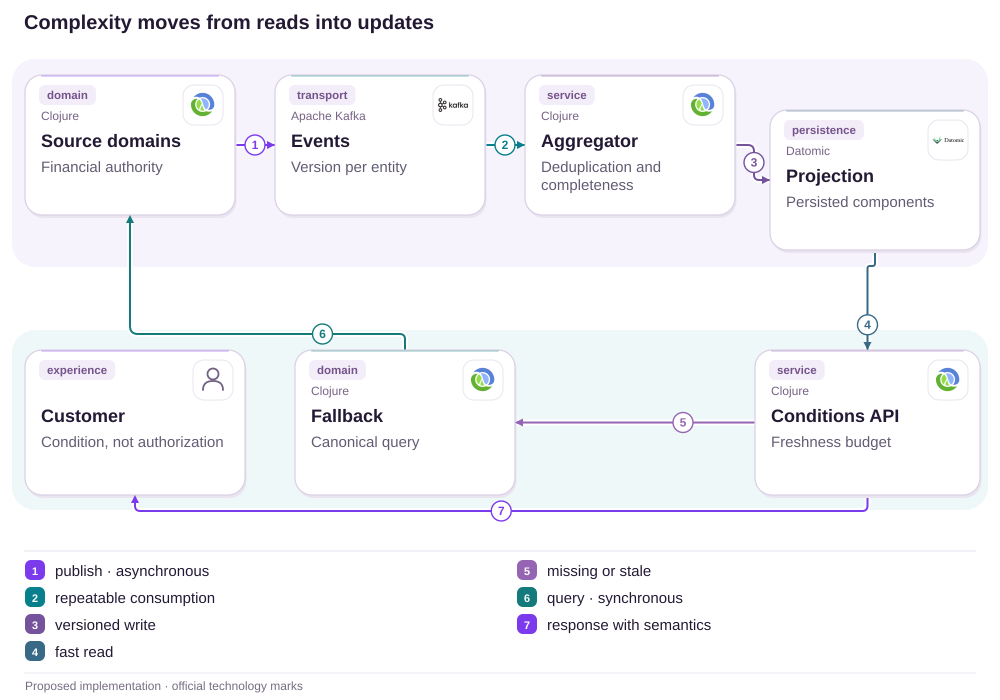

# 11 · A refund in three entries: the statement must explain its own sum

Provenance, revision and accessibility before assuming an accounting defect

[PT reader](https://wesleyvieira99.github.io/nu/#11-1) · [EN reader](https://wesleyvieira99.github.io/nu/en.html#11-1)

[Executable Python lab](../../labs/case_11.py)

## 11 · Visible credit, disputed balance


Actual crop of the public source, captured 23 October 2026. The text below includes the company reply and reported outcome.

In complaint 213597411, dated 31 March 2025, the customer described three refunds whose sum seemed correct but whose deduction from the bill was unclear. Nubank said they were correctly applied and explained purchases minus early payments minus refunds. The customer confirmed resolution on 8 April. The source establishes neither an accounting defect nor the specific action that resolved it.

**Chapter scope**

Investigate understanding and read consistency. Individual amounts are not public. The proposal does not presume withheld money; it starts with explaining every credit and its corresponding balance.

- [Reclame AQUI — case 11 · 2025-03-31](https://www.reclameaqui.com.br/nubank/estorno-nao-abatido-da-fatura_yqEaE2DaZR8JYUSd/)

## A correct total can remain opaque

Customers need to recognize the original purchase, identify all associated credits and understand the difference between an open balance and a closed document. Three green rows do not necessarily explain how much the amount due changed. The proposal is a navigable calculation breakdown with explicit links between refund, purchase and statement revision.

The falsifiable hypothesis is that decomposition reduces interpretation errors when credit has already been correctly recorded. I would test concrete tasks: finding the canceled purchase, adding partial refunds and explaining the balance after an early payment. If participants still struggle, I would investigate language, grouping or revision discrepancies rather than automatically blame customer attention.

There is also an accounting boundary: a presentation model cannot correct the ledger to make its sum look consistent. The financial source retains authority. The app should demonstrate the calculation for the queried revision and offer investigation when it cannot reconcile it. Closing documents and open views need reference dates without promising identical values across different periods.

## Total and detail share a revision



Proposed external architecture; not Nubank’s internal implementation.

Events preserve ledger identity and revision. The aggregator links refunds to purchases and builds a snapshot whose total and detail share one revision. Customers can expand the explanation without receiving a second sum computed by independent rules.

Canonical lookup handles missing or inconsistent data; it is not permission to mix values from different revisions. The interface indicates when the reference changes. The design does not cover interest, currency exchange or every entry in a real product; these require integration with financial authority.

## Core: identity and refund boundaries

```python
    def append(self, entry):
        if not isinstance(entry.id, str) or not entry.id.strip():
            raise ValueError('nonempty entry identity required')
        if type(entry.cents) is not int or entry.cents <= 0:
            raise ValueError('positive integer cents required')
        if entry.kind not in {'purchase', 'refund', 'payment'}:
            raise ValueError('unknown entry type')
        with self.lock:
            old = self.entries.get(entry.id)
            if old:
                if old != entry:
                    raise ValueError('entry identity conflict')
                return
            if entry.kind == 'refund':
                purchase = self.entries.get(entry.parent)
                if not purchase or purchase.kind != 'purchase':
                    raise ValueError('missing purchase provenance')
                used = sum(e.cents for e in self.entries.values()
                           if e.kind == 'refund' and e.parent == entry.parent)
                if used + entry.cents > purchase.cents:
                    raise ValueError('refund exceeds purchase')
            elif entry.parent:
                raise ValueError('unexpected parent')
            self.entries[entry.id] = entry

    def snapshot(self):
        with self.lock:
            return tuple(self.entries.values())
```

Literal excerpt from labs/case_11.py; an in-memory model with a local lock.

Each entry has immutable identity. A refund must reference an existing purchase, and principal refunds cannot exceed that purchase in the model. Identical retries do not create a second reduction. A snapshot returns a tuple of immutable objects.

That boundary is deliberate: additional compensation, interest and other categories need their own types rather than a disguised oversized refund. The laboratory has no disk persistence or distributed consumption. The lock demonstrates exclusion within one local authority; a real service needs an equivalent transaction or conditional write.

- [Executable case lab on GitHub](https://github.com/wesleyvieira99/nu/blob/main/labs/case_11.py)

## One shared sum function

```clojure
(defn explain-statement [entries]
  (let [sum-kind (fn [kind]
                   (reduce + (map :cents
                     (filter #(= kind (:kind %)) entries))))
        purchases (sum-kind :purchase)
        refunds (sum-kind :refund)
        payments (sum-kind :payment)
        signed (- purchases refunds payments)]
    {:purchases purchases
     :refunds refunds
     :payments payments
     :amount-due (max 0 signed)
     :credit-balance (max 0 (- signed))}))
```

Illustrative, unexecuted Clojure; simplified rules equivalent to the laboratory.

The reducer separates purchases, refunds and payments. When the signed balance is negative, it presents a statement credit balance rather than a negative amount due. This preserves financial meaning when the visible payable total is bounded at zero. Both quantities remain reconcilable.

App, PDF and support should consume the same projection or a shared calculation contract with an explicit revision. Copying the formula across three clients increases divergence risk. Real implementation must add accounting-approved categories and cross-channel parity tests. The function does not decide posting dates or whether a merchant actually returned funds.

## Provenance is part of the contract

| Element | Rule | Privacy |
| --- | --- | --- |
| entry_id | Stable identity | No account in public ID |
| parent | Original purchase for refund | Authorized owner only |
| revision | Consistent total and detail | Avoid excess history |
| credit_balance | Credit distinct from amount due | Accessible text |

```json
{
  "statement_id": "synthetic-statement-11",
  "revision": 4,
  "currency": "BRL",
  "purchases_cents": 10000,
  "refunds_cents": 10000,
  "payments_cents": 0,
  "amount_due_cents": 0,
  "refund_entries": ["r0", "r1", "r2"],
  "source_purchase": "p"
}
```

Synthetic three-refund example; no amount was extracted from the complainant’s account.

A many-to-one relationship is necessary when money returns in parts. Purchase and credit totals must not be duplicated merely because they appear in both summary and detail. A short support reference locates the same revision without asking customers to resend every document or expose unrelated purchase information.

## Test sums, revisions and concurrency

```python
    def test_three_refunds_reduce_exactly_once(self):
        for i, cents in enumerate((3333, 3333, 3334)):
            refund = Entry('r' + str(i), 'refund', cents, 'p')
            self.s.append(refund)
            self.s.append(refund)
        result = explain(self.s.snapshot())
        self.assertEqual(result['refunds'], 10000)
        self.assertEqual(result['amount_due'], 0)
        self.assertEqual(result['revision'], 4)

    def test_old_snapshot_does_not_change_after_new_credit(self):
        old = self.s.snapshot()
        self.s.append(Entry('r', 'refund', 5000, 'p'))
        self.assertEqual(explain(old)['amount_due'], 10000)
        self.assertEqual(explain(self.s.snapshot())['amount_due'], 5000)
```

Literal excerpts; 9 local tests passed.

The synthetic split 3,333 + 3,333 + 3,334 demonstrates exact conservation of 10,000 cents. Replaying each credit leaves the result unchanged. An old snapshot stays stable after a new refund, explaining why two legitimate revisions can display different balances.

Other tests reject missing purchase provenance, excess refund, identity conflict and invalid cents. The concurrency test attempts two 6,000 refunds against 10,000 and accepts only one. Real contractual rules, closing, tax and interest are not tested. These limits should be visible before using the example as an implementation reference.

## Success means demonstrated understanding

| Metric | Numerator / denominator | Window and segment |
| --- | --- | --- |
| Understanding | Correctly answered tasks / tasks | Sessions; accessibility |
| Interpretive contact | Questions on applied credit / refunds | 30 days; refund type |
| Parity | Reconciled snapshots / compared | Daily; channel and revision |
| Provenance | Credits with valid origin / credits | Continuous; integration |

Baselines are unknown. The experiment uses equivalent tasks and comparable groups with the same financial calculation. It measures accuracy and time without confusing a faster screen with better understanding. Screen readers must announce sign, value and linkage; color cannot be the sole signal of credit.

Contact classification is audited so a financial error is not mislabeled as customer confusion. The canary stops for sum divergence, mixed revisions or worse understanding among assistive-technology users. Detail clicks indicate use rather than success. Final validation asks participants to explain the balance in their own words.

## Economics depend on avoided questions

| Assumed scenario | Potential/year | Operations/year | Year 1 after cost |
| --- | --- | --- | --- |
| Conservative | R$ 16,000 | R$ 24,000 | R$ -128,000 |
| Base | R$ 120,000 | R$ 24,000 | R$ -24,000 |
| Ambitious | R$ 400,000 | R$ 24,000 | R$ 256,000 |

Annual assumptions: 200,000, 500,000 or 1 million eligible refunds; 0.005, 0.015 or 0.025 fewer interpretive contacts per refund; R$ 16 per contact. Assumed implementation: R$ 120,000; operations: R$ 24,000/year. The calculation values support capacity, not credit returned to the customer.

In the base case, 500,000 × 0.015 × 16 = R$ 120,000. After operations and implementation, year one is −R$ 24,000. Break-even requires 600,000 refunds equivalent to the base assumption. If the product already has a common projection, incremental investment may be lower; the estimate must be redone without automatically carrying over the assumed benefit.

**Do not count the same journey twice**

Exclude duplication contacts covered in case 10 and allocation contacts in 09. Released hours become cash only through concrete spending changes. This study has observed no Nubank incidence rate or saving.

## A calculation-and-language roadmap

| Proposed phase | Owner and deliverable | Gate |
| --- | --- | --- |
| Days 0–15 | Accounting + design: scenarios | Sums and questions approved |
| Days 16–30 | Staff: projection and links | Total/detail share revision |
| Days 31–60 | Mobile + accessibility: prototype | Assistive understanding validated |
| Days 61–90 | EM + product: experiment | Accuracy improves; sums hold |

The 90-day period is a planning assumption. Representative examples of partial refunds, payments and closing are needed first, using authorized access or synthetic data. Without that coverage, an attractive screen may work only for the simple case and fail on the journey that generates contact.

Staff defines revision and invariants; accounting approves semantics; design validates language; the EM protects research and iteration capacity. Acceptance is not a checklist of rendered components. Customers must recognize credit origin and understand balance, while support reproduces the explanation using the same reference.

## Operations with an identifiable fallback

The projection first runs in shadow and compares sums with the financial reference. During the canary, calculation detail appears on demand for a limited cohort. If revision changes during lookup, the interface announces the update and recomputes the complete set rather than replacing only the total while retaining old details.

Alerts cover orphan credits, excess principal refunds and cross-channel revision divergence. The projection team investigates processing; accounting resolves semantics; support distinguishes questions from errors. Logs carry references rather than complete purchase descriptions or personal documents.

Rollback hides the new breakdown and retains the canonical balance, preserving IDs for investigation. An exercise should simulate repeated events, refund arrival before purchase and an older PDF revision. Reconciliation must explain why an event was rejected or awaited a dependency. A credit must never be silently discarded because it arrived out of order.

## My contribution to trust in the sum

As Staff, I would define a financial representation preserving sign, origin and revision. I would avoid three independent calculations for app, PDF and support. The technical choice is an explainable projection with a canonical source and explicit out-of-order policy, without making the interface a financial authority.

As Engineering Manager, I would organize delivery with accounting, experience, accessibility and operations. I would reserve time to observe users interpreting difficult scenarios, because understanding does not automatically emerge from a correct table. The backlog would cover language and support as well as processing and telemetry.

I would reject solving the issue solely by changing refund color or adding an applied badge. That strengthens a claim without making it verifiable. The tradeoff is enough detail without overwhelming the initial screen: a simple summary, progressive explanation and a total rigorously linked to revision. These are proposed contributions, not claims of previous work at the bank.

## Handoff: reproduce the explanation

- Run python3 labs/case_11.py: 9 tests with synthetic in-memory data.
- Read Entry, Statement.append, snapshot and explain; observe debit, credit and payable balance.
- Repeat three refunds, retain an old revision and compare it with the new one.
- Before production: persistence, event ordering, accounting categories, authorization and cross-channel parity.

A reviewer should explain why a credit reduces balance and why an old revision remains different. The solution does not depend on hiding history or teaching customers to manually redo every accounting calculation. The laboratory demonstrates a small contract that product and accounting can discuss.

Proceed only if the projection reconciles, language improves understanding and assistive guardrails hold. Financial error requires ledger correction first. If the issue is interpretive, an experiment can validate a smaller improvement. The case is stronger when it respects that distinction, including the fact that the historical complaint was resolved.

- [Executable case lab on GitHub](https://github.com/wesleyvieira99/nu/blob/main/labs/case_11.py)
