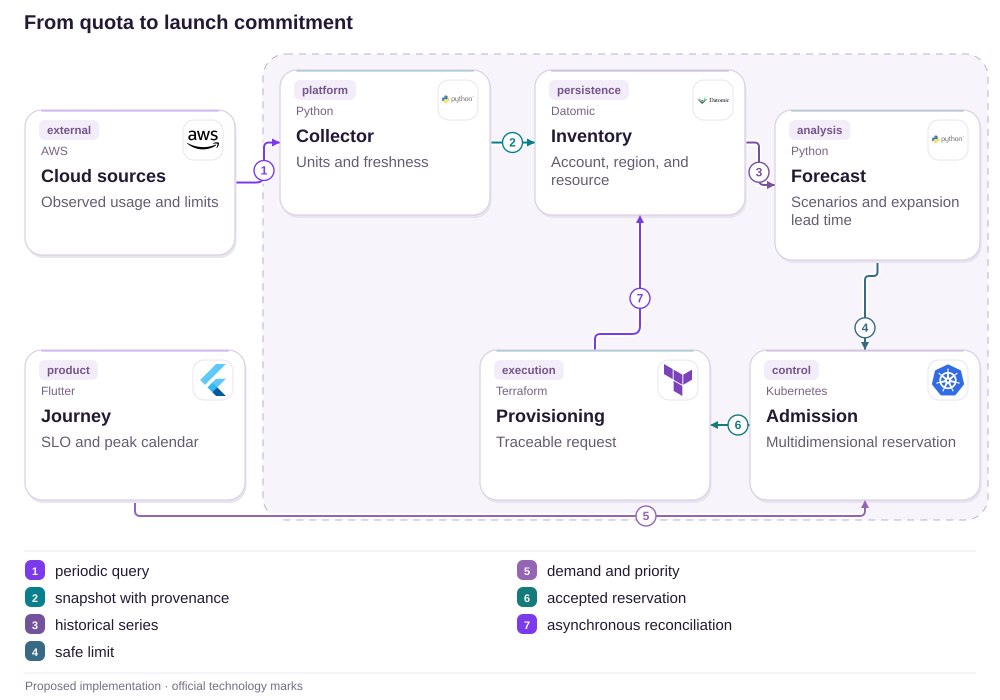

# 12 · Delivered in tracking, missing in hand: separate delivery from possession

Card generations, source evidence and an exception with an owner

[PT reader](https://wesleyvieira99.github.io/nu/#12-1) · [EN reader](https://wesleyvieira99.github.io/nu/en.html#12-1)

[Executable Python lab](../../labs/case_12.py)

## 12 · The later response changes the context


Actual crop of the public source, captured 23 October 2026. The text below includes the company reply and reported outcome.

Complaint 230126691, dated 23 October 2025, describes delivery messages without receipt and later a fourth unsuccessful attempt. Nubank reports canceling unreceived cards and, on 10 November, a new delivery, activation and use. The page remains In reply, without final customer confirmation. The card must not be described as still missing.

**Media and evidence**

The customer mentions home video, but no public URL was verified in the captures. The book uses the real page as documentary evidence; it invents no recording, signature or delivery photo.

- [Reclame AQUI — case 12 · 2025-10-23](https://www.reclameaqui.com.br/nubank/nao-recebimento-de-cartao-nubank-solicitado-apos-cancelamento-por-perda-e-falhas-sucessivas-na-entrega_CERudU76NRiJiJM_/)

## A supplier states a fact; the product decides a state

A carrier event may reliably record what the carrier declared while remaining insufficient to establish possession by the recipient. The journey should preserve that distinction. Declared delivery, disputed delivery and secure activation have different authorities; collapsing them into one status prevents handling disagreement without overwriting information.

The hypothesis is that some repeated reissues can be avoided when events, card issues and shipments have their own identities and an end-to-end exception owner. I would reconstruct authorized journeys by card generation, distinguishing initial loss, replacement order, reissue and late events. If recurrence has another origin, such as address or route performance, the plan must address that demonstrated operational cause.

The study does not conclude that a supplier falsified delivery or that the bank used a particular integration. Investigation should seek proof, provenance, time and escalation policy with minimum access. Customers should not need to publicly expose an address, signature or home video to obtain tracking and support.

## The old card cannot govern the new one



Proposed external architecture; not Nubank’s internal implementation.

The gateway preserves event identity and shipment reference. The record links each shipment to a card generation. Consistency checks route old events and disputes to controlled decisions without silently changing the current card.

The customer disputes receipt through an authenticated channel. Reissue creates a new generation and cancels the earlier card under policy; it is not an automatic consequence of any delay. Secure activation remains a separate contract. The external provider receives neither an internal technology logo nor authority to activate the card.

## Core: generation and persistent dispute

```python
    def event(self, ident, generation, kind, scope):
        if not isinstance(ident, str) or not ident.strip():
            raise ValueError('nonempty event identity required')
        if type(generation) is not int or generation < 1:
            raise ValueError('positive integer generation required')
        required = {'delivered': 'carrier', 'dispute': 'customer',
                    'activate': 'customer_verified'}
        if kind not in required or required[kind] != scope:
            raise PermissionError('scope mismatch')
        payload = json.dumps([generation, kind, scope])
        with self.db:
            self.db.execute('BEGIN IMMEDIATE')
            old = self.db.execute('SELECT payload FROM events WHERE id=?',
                                  (ident,)).fetchone()
            if old:
                if old[0] != payload:
                    raise ValueError('event conflict')
                return self.state()
            current, carrier, disputed, active = self.state()
            if generation > current:
                raise ValueError('future generation; event not consumed')
            if generation == current:
                if kind == 'delivered':
                    carrier = 'delivered'
                elif kind == 'dispute':
                    disputed, active = 1, 0
                elif kind == 'activate':
                    if disputed:
                        raise ValueError('dispute requires separate resolution')
                    active = 1
                self.db.execute('UPDATE card SET carrier=?,disputed=?,active=? '
                                'WHERE id=1', (carrier, disputed, active))
            self.db.execute('INSERT INTO events VALUES(?,?)', (ident, payload))
        return self.state()
```

Literal excerpt from labs/case_12.py; synthetic local state for one account.

An old-generation event is recorded but cannot alter the current card. Repeated delivery also cannot clear a dispute. The model distinguishes carrier declaration, dispute and activation, preventing a webhook from automatically turning delivery into authorized use.

The supplied scope is trusted context injected by the server, not a freely submitted user credential. Partner signatures and real activation factors are not implemented. A dispute blocks activation in this model; operational resolution needs a separate workflow, while reissue creates another controlled generation.

- [Executable case lab on GitHub](https://github.com/wesleyvieira99/nu/blob/main/labs/case_12.py)

## Normalize without losing provenance

```clojure
(defn accept-delivery [state event]
  (cond
    (not= (:generation state) (:generation event))
    (assoc state :last-event-result :old-generation)

    (= :delivered (:type event))
    (assoc state :carrier-state :delivered)

    (= :customer-dispute (:type event))
    (assoc state :disputed? true :active? false)

    :else state))
;; Carrier delivery does not clear :disputed? or set :active?.
```

Illustrative Clojure, not executed; not carrier or Nubank code.

The reducer does not discover physical truth from a status. It applies precedence and preserves the dispute. Normalization should retain the original event under restricted access alongside the common product state. Otherwise, details needed for investigation disappear during translation across suppliers.

Integration authenticates origin, limits replay and validates shipment/account linkage. An incoming timestamp cannot order the entire card lifecycle: clocks differ and suppliers may resend old information. Generation and identity provide stronger protection against an update for a canceled card appearing to confirm the new one.

## A physical-to-digital contract

| Field | Authority | Rule |
| --- | --- | --- |
| carrier_state | Carrier | Declaration with provenance |
| customer_disputed | Authenticated customer | Replay cannot clear it |
| card_generation | Card management | Old issue cannot overwrite |
| card_active | Secure activation | Independent from delivery |

```json
{
  "card_generation": 2,
  "shipment_ref": "synthetic-shipment-12",
  "carrier_state": "delivered",
  "customer_disputed": true,
  "card_active": false,
  "event_id": "carrier-event-17",
  "evidence_ref": null,
  "next_action": "investigate_delivery"
}
```

Synthetic state: declared delivery, open dispute and inactive card.

Delivery evidence may contain an address, signature or third-party image. Its reference should support purpose-bound access, expiry and auditing. The app presents enough information for customer action without publishing recipient data. Logistics remains responsible for obtaining partner evidence rather than transferring that integration burden to the customer.

## Replays cannot close the exception

```python
    def test_old_delivery_does_not_replace_new_generation(self):
        self.d.event('d1', 1, 'delivered', 'carrier')
        self.d.reissue(1, 'operator')
        self.d.event('late', 1, 'delivered', 'carrier')
        self.assertEqual(self.d.state(), (2, 'pending', 0, 0))

    def test_replayed_delivery_cannot_clear_dispute(self):
        self.d.event('d1', 1, 'delivered', 'carrier')
        self.d.event('c1', 1, 'dispute', 'customer')
        self.d.event('d1', 1, 'delivered', 'carrier')
        self.d.event('d2', 1, 'delivered', 'carrier')
        self.assertEqual(self.d.state(), (1, 'delivered', 1, 0))
        with self.assertRaises(ValueError):
            self.d.event('a1', 1, 'activate', 'customer_verified')
```

Literal excerpts; 10 laboratory tests passed.

The first test shows that old confirmation cannot mark generation two as delivered. The second replays the original webhook and sends another delivery event: the dispute remains open and activation blocked. That property matters more than a happy sequence of messages.

The suite also checks restart, event conflict, incorrect role, stale-generation reissue and cancellation of previous activation. It does not test physical delivery, cryptographic signatures or possession evidence. Integration exercises must validate real suppliers, expiry policies and failures between canceling an old card and issuing a new one.

## Measure possession and exceptions, not just dispatch

| Metric | Numerator / denominator | Window and segment |
| --- | --- | --- |
| Disputed delivery | Disputes / declared deliveries | Weekly; route and partner |
| Repeated reissue | New cards / replacement journey | 30 days; generation |
| Exception time | p95 to an owned decision | Daily; reason |
| Invalid card active | Canceled-card activations / attempts | Continuous; integration |

The baseline is unknown. Operational data should connect journey, shipment and generation without exporting addresses to general telemetry. Time to confirmed possession may depend on activation or another approved secure signal; it should not be inferred solely from a carrier event.

The pilot compares equivalent routes and suppliers while controlling seasonality and shipping changes. Fewer reissues count as improvement only if possession or resolution is confirmed. Expansion stops for unauthorized activation, automatic dispute closure or excessive personal-data collection. Cutting cost by refusing necessary replacement is an adverse outcome, not success.

## Avoided shipping has an economic boundary

| Assumed scenario | Potential/year | Operations/year | Year 1 after cost |
| --- | --- | --- | --- |
| Conservative | R$ 3,900 | R$ 24,000 | R$ -110,100 |
| Base | R$ 15,600 | R$ 24,000 | R$ -98,400 |
| Ambitious | R$ 46,800 | R$ 24,000 | R$ -67,200 |

Annual assumptions: 50,000, 100,000 or 150,000 eligible shipments; avoided reissues in 0.2%, 0.4% or 0.8% of journeys. That means 100, 400 or 1,200 avoided reissues. I assume R$ 9 per card, R$ 18 shipping and R$ 12 incremental support, totaling R$ 39. No unit cost comes from the complaint.

Assumed implementation: R$ 90,000; operations: R$ 24,000/year. In the base case, 400 × 39 = R$ 15,600; year one is R$ 15,600 − 24,000 − 90,000 = −R$ 98,400. Break-even requires approximately 2,924 avoided reissues in year one. These scenarios do not independently support broad investment; they favor a focused pilot or extension of an existing workflow.

**Benefit remains unproven**

One customer’s reported count is not a population rate. Do not treat every dispute as fraud or every reissue as avoidable. Support already included in full logistics cost cannot be added again.

## A roadmap with supplier and operations

| Proposed phase | Owner and deliverable | Gate |
| --- | --- | --- |
| Days 0–15 | Logistics: events and route map | Identities and sources checked |
| Days 16–30 | Staff + cards: generation contract | Old issue cannot alter current |
| Days 31–60 | Operations + partner: investigation | Exception has owner and evidence |
| Days 61–90 | EM: limited-route pilot | Possession improves; security holds |

The calendar is a 90-day hypothesis. The critical dependency is supplier cooperation, including event quality and evidence access. If that source is unavailable, the first delivery should expose the gap and define an alternative rather than create false certainty in the app.

The EM coordinates logistics, cards, support and partner capacity. Staff defines generation, identity and transitions. Replacement policy needs operational approval and must not emerge as a side effect of a technical retry. Every gate includes a disputed journey, legitimate delivery and a late event for a canceled card.

## A disputed-delivery runbook

Support opens a case linked to shipment and generation, preserving the customer’s statement. The operator checks provenance and the next authorized action. Reissue without diagnosis is not the only button: investigation, an alternative channel and cancellation of an exposed card require clear policy and ownership.

Alerts separate missing updates, aging disputes and generation-incompatible events. Logistics owns partner follow-up; cards owns cancellation and activation; the service team owns event loss. Sensitive information stays in restricted tools rather than broadly visible tickets.

Rollback disables new interpretation while retaining generation and dispute history. It never reactivates canceled cards. Exercises include a repeated webhook after reissue, delivery assigned to the wrong card and unavailable proof. Reconciliation keeps customers informed without treating a tracking status as conclusive possession evidence.

## My contribution crosses the physical boundary

As Staff, I would define identity that survives reissue, carrier changes and late events. The central decision is separating declared delivery from secure activation while preserving dispute as its own fact. Architecture must tolerate an imperfect physical world without pretending message ordering resolves delivery truth.

As Engineering Manager, I would establish an owner for the complete exception and an operational forum with the supplier. The team must track resolution and cost per journey, not just cards dispatched. I would reserve capacity for exceptions and align the evidence required to move between stages.

I would reject automatically closing a case when a carrier resends delivered. I would also avoid collecting home videos as a default requirement. The tradeoff is sufficient investigation with minimal data and proportionate cost. Investment should follow verified routes and causes without extrapolating one complaint to the entire operation.

## Handoff: review the current generation

- Run python3 labs/case_12.py: 10 tests with a local database and synthetic events.
- Read Delivery.event and reissue; identify who may declare delivery, dispute and activate.
- Create generation two and resend a generation-one event; the current card must remain unchanged.
- Before production: partner signature, identity, possession evidence, retention and dispute resolution.

The local demonstration verifies precedence and persistence, not whether a parcel arrived. Reviewers should recognize that boundary and request supplier contract tests before approving integration. They should also verify that support can reconstruct every card issue without confusing a canceled card with the current one.

Proceed only when investigation has an owner, events are correctly linked and activation security remains intact. If operational evidence shows a route problem, the intervention may be logistical. Engineering’s contribution is ensuring that the product represents that reality clearly rather than hiding it behind one status.

- [Executable case lab on GitHub](https://github.com/wesleyvieira99/nu/blob/main/labs/case_12.py)
