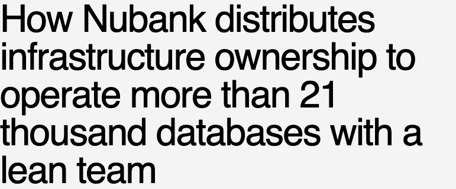
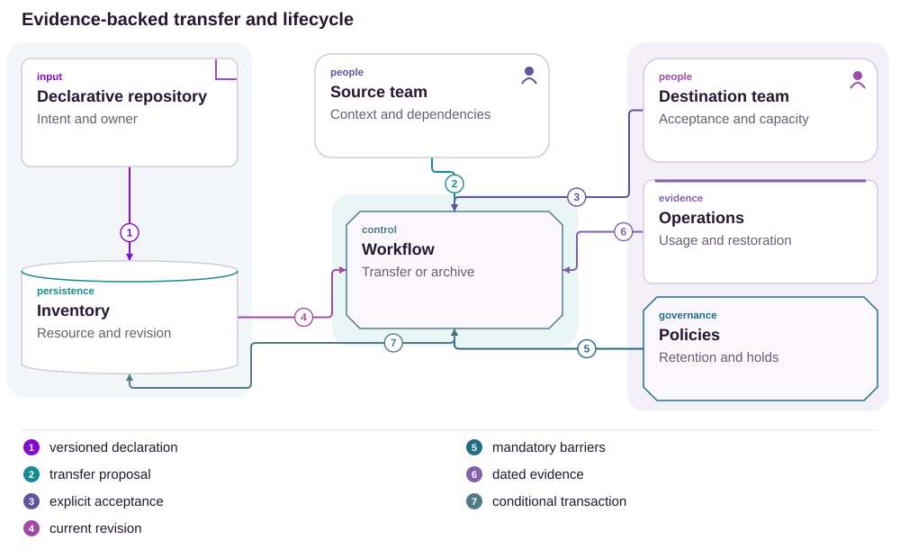
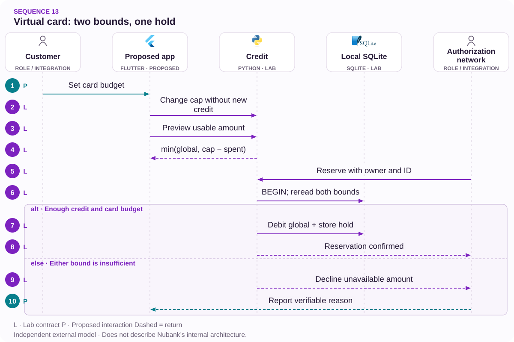

# 13 · A virtual card cap is not available credit

Explain the constraint without weakening financial authorization

[PT reader](https://wesleyvieira99.github.io/nu/#13-1) · [EN reader](https://wesleyvieira99.github.io/nu/en.html#13-1)

[Executable Python lab](../../labs/case_13.py)

## 13 · Two amounts, different interpretations



Actual crop of the public source, captured 23 October 2026. The text below includes the company reply and reported outcome.

Complaint 244706833, dated 30 March 2026, describes a declined R$ 300 purchase despite a displayed R$ 800 value. Nubank replied that the image showed a configured virtual-card cap, not approved credit, and that purchases consumed the global line. Status is Responded. The source does not establish a 3DS failure or improper authorization.

**Image referenced, not available**

The response mentions a customer screenshot, but public AX exposes no address. Published evidence is the real page. The response’s R$ 400/R$ 100 example is hypothetical, not this account’s balance.

- [Reclame AQUI — case 13 · 2026-03-30](https://www.reclameaqui.com.br/nubank/recusa-de-transacao-com-limite-disponivel-e-fatura-em-dia_ef3HnxyEcUpqSZLk/)

## Setting a cap does not grant credit

The product combines at least three concepts: approved credit, remaining global availability and a restriction chosen for a virtual card. A configurable number can look like a purchase promise when wording and hierarchy fail to explain what it controls. This proposal separates those facts and explains the tighter constraint without suggesting that moving a control grants more credit.

The falsifiable hypothesis is that some attempts and contacts result from this confusion rather than an authorization defect. I would observe users explaining what happens when they increase the virtual cap and compare their explanation with subsequent action. I would also investigate freshness: a correct view can become stale when another card consumes shared credit.

Authorization remains independent. Even with available credit, other controls may decline a purchase. The interface should provide current, sufficient information rather than an absolute approval guarantee. The study does not recommend removing risk controls, increasing credit or changing policy to manufacture a better conversion rate.

## Credit is shared; reservation is atomic



Proposed external architecture; not Nubank’s internal implementation.

The credit source defines the grant; global balance records shared reservations. Card budget adds a restriction while policy and context retain separate controls. The authorizer validates scope and reserves against current authority.

The screen is not a participant in that transaction: its preview can age. The diagram emphasizes authorization, while explainable reads consume versioned projections. Editing a virtual cap never changes global credit. Real risk validation is outside the laboratory and remains necessary for production.

## Core: two cards, one balance

`Transactional Revalidation [lab]` · `Shared Budget Invariant [lab]`

```python
    def reserve(self, owner, ident, card, cents):
        if not isinstance(ident, str) or not ident.strip():
            raise ValueError('nonempty reservation identity required')
        if type(cents) is not int or cents <= 0:
            raise ValueError('integer cents required')
        with self.db:
            self.db.execute('BEGIN IMMEDIATE')
            available = self.preview(owner, card)
            old = self.db.execute('SELECT card,cents FROM holds WHERE id=?',
                                  (ident,)).fetchone()
            if old:
                if old != (card, cents):
                    raise ValueError('reservation conflict')
                return ident
            if cents > available:
                raise ValueError('insufficient global credit or card budget')
            self.db.execute('UPDATE account SET free=free-? WHERE owner=?',
                            (cents, owner))
            self.db.execute('UPDATE cards SET spent=spent+? WHERE id=?',
                            (cents, card))
            self.db.execute('INSERT INTO holds VALUES(?,?,?)', (ident, card, cents))
        return ident

    def set_cap(self, owner, card, cap):
        if type(cap) is not int or cap < 0:
            raise ValueError('integer cap required')
        with self.db:
            if self.db.execute('UPDATE cards SET cap=? WHERE id=? AND owner=?',
                               (cap, card, owner)).rowcount != 1:
                raise PermissionError('not owned')
```

Literal excerpt from labs/case_13.py; local SQLite reservations with integer cents.

The transaction reads global credit and card budget, checks reservation identity and only then reduces both. Concurrent purchases on different cards cannot spend the same balance. Account-holder authorization precedes return of an idempotent receipt, preventing a key from becoming a way to inspect another person’s operation.

The cap is separate configuration. The laboratory models a synthetic cumulative budget rather than the real product’s period. Reservation expiry, settlement, reversal and risk analysis are not implemented. Preview helps explain, but the financial decision revalidates everything inside the transaction.

- [Executable case lab on GitHub](https://github.com/wesleyvieira99/nu/blob/main/labs/case_13.py)

## An honest app preview

`Transactional Revalidation [proposal]` · `Shared Budget Invariant [proposal]`

```dart
class CreditView {
  final int globalAvailableCents;
  final int virtualCapCents;
  final int virtualSpentCents;
  final DateTime asOf;
  CreditView(this.globalAvailableCents, this.virtualCapCents,
      this.virtualSpentCents, this.asOf);

  int get previewCents {
    final remaining = virtualCapCents - virtualSpentCents;
    final bounded = remaining < globalAvailableCents
        ? remaining : globalAvailableCents;
    return bounded < 0 ? 0 : bounded;
  }
  // A display estimate never replaces server authorization.
}
```

Illustrative, unexecuted Dart; the Python laboratory validates authority, not this component.

Preview takes the smaller of global credit and remaining card budget, bounded at zero. The formula is meaningful only when units, currency and periods are compatible. A real implementation must state those conditions and display its reference time rather than combine a monthly budget with usage from another window.

The component must distinguish chosen cap from available credit in text, without relying on color. Decline messages use safe, actionable reasons without exposing fraud controls. An estimate must not become a guaranteed-approval statement. Server revalidation protects against concurrency; state explanation prevents that protection from appearing arbitrary.

## Credit and budget contracts

`Transactional Revalidation [proposal]` · `Shared Budget Invariant [proposal]`

| Field | What it represents | What it does not |
| --- | --- | --- |
| global_available | Credit after reservations | Approval promise |
| virtual_cap | Configured restriction | New credit grant |
| virtual_spent | Usage in defined window | All financed balances |
| as_of | Read reference | Permanent state |

```json
{
  "account_ref": "synthetic-account-13",
  "card_ref": "virtual-a",
  "currency": "BRL",
  "global_available_cents": 20000,
  "virtual_cap_cents": 80000,
  "virtual_spent_cents": 30000,
  "preview_cents": 20000,
  "as_of": "synthetic-revision-2",
  "authorization_guaranteed": false
}
```

Synthetic values; not the private balance from the complaint.

The interface must not present one account’s data under another session. Cache scope needs account holder, card and revision. Safe decline reasons form a contract between risk and product; detailed logs remain restricted. Public disclosure of fraud signals is unnecessary to explain that virtual cap and approved credit are different concepts.

## Concurrency attacks the authority

`Transactional Revalidation [lab]` · `Shared Budget Invariant [lab]`

```python
    def test_two_cards_cannot_overspend_shared_credit(self):
        barrier = threading.Barrier(2)
        results = []
        def attempt(card):
            client = Credit(self.path)
            barrier.wait()
            try:
                client.reserve('owner', 'hold-' + card, card, 30000)
                results.append('ok')
            except ValueError:
                results.append('declined')
            finally:
                client.db.close()
        threads = [threading.Thread(target=attempt, args=(c,)) for c in ('a', 'b')]
        for thread in threads:
            thread.start()
        for thread in threads:
            thread.join()
        self.assertCountEqual(results, ['ok', 'declined'])
        self.assertEqual(self.c.preview('owner', 'a'), 20000)
```

Literal test; the full suite passed 10 tests.

Two threads open separate connections and compete for a synthetic R$ 500, attempting R$ 300 reservations each. Only one can complete. The result does not depend on whether a screen showed enough credit beforehand. This demonstrates why mobile calculation cannot replace financial authority.

Other tests cover increasing a cap without creating credit, lowering budget, retry, incorrect owner, stale preview, key conflict and restart recovery. The suite does not test risk, card networks or reservation expiry. Those controls require their own tests and cannot be removed to reproduce the simplified example.

## Understanding without weaker controls

| Metric | Definition | Window and segment |
| --- | --- | --- |
| Understanding | Users explaining cap correctly / tested | Sessions; accessibility |
| Confusion contacts | Contacts for this reason / eligible | 30 days; mobile version |
| Decline after lookup | Credit declines / post-read attempts | Daily; read age |
| Outside policy | Incompatible approvals / audited | Continuous; risk control |

Baselines are unknown. The first metric needs a comprehension task rather than a satisfaction question. The third distinguishes legitimately changed balances from stale reads. I would collect only necessary events and categories without recording sensitive purchase details in experience telemetry.

The experiment holds authorization policy constant and changes explanation only. Cohorts are segmented by virtual-card use and version. Expansion stops for cross-account leakage, misleading approval promises or increased approvals outside policy. Fewer attempts can be positive when customers now understand that a purchase does not fit available credit.

## Value without treating declined purchases as revenue

| Assumed scenario | Potential/year | Operations/year | Year 1 after cost |
| --- | --- | --- | --- |
| Conservative | R$ 6,400 | R$ 12,000 | R$ -65,600 |
| Base | R$ 32,000 | R$ 12,000 | R$ -40,000 |
| Ambitious | R$ 96,000 | R$ 12,000 | R$ 24,000 |

Annual assumptions: 100,000, 250,000 or 500,000 eligible users; 0.004, 0.008 or 0.012 fewer contacts per user; R$ 16 per contact. Assumed implementation: R$ 60,000; operations: R$ 12,000/year. The calculation covers support capacity only, without converting purchase volume into margin.

The base case is 250,000 × 0.008 × 16 = R$ 32,000. Year one is R$ 32,000 − 12,000 − 60,000 = −R$ 40,000. Break-even requires 562,500 users equivalent to the base assumption. The ambitious scenario yields R$ 24,000 modeled net capacity in year one, but depends on an unmeasured effect and cohort.

**The calculation I do not make**

I do not treat R$ 300 attempted as lost revenue or R$ 800 as approved credit. Purchase contribution analysis would require verified eligibility and margin plus a separate causal experiment. Group ARPAC cannot replace those inputs.

## A terminology-and-consistency roadmap

| Proposed phase | Owner and deliverable | Gate |
| --- | --- | --- |
| Days 0–15 | Design + credit: terms and tasks | User separates cap from credit |
| Days 16–30 | Staff + mobile: projection and revision | Cache respects account and period |
| Days 31–60 | Risk + engineering: reserve tests | Concurrency preserves balance |
| Days 61–90 | EM + product: limited experiment | Understanding improves; policy unchanged |

The 90-day horizon is proposed planning. A small wording change can be validated before broader integration if it does not conceal staleness. The financial dependency is understanding card-usage semantics and reservation authority; product must not invent a simplified calculation without that agreement.

The EM coordinates design, mobile, cards, credit and risk. Staff defines which data may be eventually consistent and which decision must be atomic. Each phase includes accessibility and session-switch behavior. Success combines correct interpretation and security rather than seeking approval at any cost.

## Stale reads must not become fictional credit

Deployment starts with shadow comparison between preview and authority, recording age and reason for differences. The canary changes presentation for a limited cohort. When lookup fails, the interface retains an identified reference or reports unavailability; it does not substitute configured cap as an equivalent value.

Alerts separate projection delay, scope error and reservation inconsistency. The financial team owns balance; mobile owns associating responses with the correct session; risk owns permitted communication reasons. Support receives an explanation consistent with the same revision without unrestricted access to internal signals.

Rollback restores the visual experience while preserving confirmed reservations. Exercises include concurrent cards, a cap lowered below usage, account switching during lookup and an old response arriving after a new one. Authorization must never depend on rendering order. Any committed balance needs reconciliation, not cache clearing as a financial correction.

## My contribution: clarity with authority

As Staff, I would separate configuration, projection and authorization. I would define reservation identity, global consistency and read scope. The central technical decision is keeping shared credit in an authority that arbitrates concurrency while experience provides an honest, understandable estimate.

As Engineering Manager, I would align product, credit and risk on terminology and experiment before delivery. The team needs to observe users rather than merely approve screenshots. I would protect accessibility, support and decline-reason analysis time, because improvement depends on language as much as integration.

I would reject relaxing controls to offset poor explanation with a higher approval rate. I would also avoid showing only the minimum number without its origin: that can solve one attempt while leaving confusion intact. The tradeoff is enough information for understanding while preserving risk boundaries and visual simplicity. No proposed contribution assumes my authority over bank policy.

## Handoff: prove a cap cannot create balance

- Run python3 labs/case_13.py: 10 local tests, including two concurrent connections.
- Inspect Credit.preview, reserve and set_cap; raise the cap and observe unchanged global credit.
- Retry a reservation and query as another owner; no duplicate debit or receipt leakage is allowed.
- Before production: risk, card networks, expiry, settlement, reversals and real authorization.

Laboratory amounts are synthetic examples. The complaint’s real account remains private and must not be reconstructed by inference from a configured cap. A reviewer should verify the financial property and separately check that the interface explains constraints without promising success.

The final decision requires improved understanding, semantically correct projections and no policy regression. If evidence shows wording alone is poor, prioritize a small improvement. If concurrent balance contention exists, address authority before presentation. The project is strongest when intervention matches the demonstrated problem rather than maximizing new services.

- [Executable case lab on GitHub](https://github.com/wesleyvieira99/nu/blob/main/labs/case_13.py)

## Patterns with proof

`Transactional Revalidation [lab]` · `Shared Budget Invariant [lab]` · `Aggregate boundary [proposal]` · `Spring Transactions [proposal]`

| Mechanism | Implementation | Evidence |
| --- | --- | --- |
| Transactional Revalidation | Credit.reserve | the reservation revalidates current credit instead of trusting the preview |
| Shared Budget Invariant | Credit.reserve | two cards cannot exceed their shared budget |
| Aggregate boundary / credit domain | Production proposal | Adapters keep authority outside the UI. |

**Java integration · proposed**

Spring Transactions + optimistic locking. Port the invariants and contract tests before replacing the Python model. A process lock is not distributed concurrency control; persistence, authorization and recovery need integration tests.

**AI assessment · deterministic core**

No agent framework is implemented in this lab. Monetary state, authorization and version checks remain deterministic. An assistant would be evaluated separately against a proven support need, without authority to alter balances or identity.

- [P1 · Credit.reserve](https://github.com/wesleyvieira99/nu/blob/main/labs/case_13.py#L39)
- [P1 · test_stale_preview_cannot_authorize](https://github.com/wesleyvieira99/nu/blob/main/labs/case_13.py#L126)
- [P2 · Credit.reserve](https://github.com/wesleyvieira99/nu/blob/main/labs/case_13.py#L39)
- [P2 · test_two_cards_cannot_overspend_shared_credit](https://github.com/wesleyvieira99/nu/blob/main/labs/case_13.py#L84)

## Execution sequence



No risk, 3DS, real network or hold expiry is modeled. The synthetic budget has no product billing period.

**Authority and failure boundary**

the reservation revalidates current credit instead of trusting the preview. two cards cannot exceed their shared budget.

The sequence describes the proposed integration. The linked lab verifies the domain invariant with synthetic data; external services, network retries and deployment remain integration work.

- [preview](https://github.com/wesleyvieira99/nu/blob/main/labs/case_13.py#L30)
- [reserve](https://github.com/wesleyvieira99/nu/blob/main/labs/case_13.py#L39)

## Features, stories and acceptance

**F13.1 · Usable-limit preview · D16–30**

As a customer, I want to understand the card cap and shared credit. Acceptance: the reservation revalidates current credit instead of trusting the preview.

**F13.2 · Single shared reservation · D31–60**

As a customer, I want to prevent simultaneous use above available credit. Acceptance: two cards cannot exceed their shared budget.

**F13.3 · Measured rollout · D61–90**

As the product owner, I want an eligible cohort with a comparable control. Acceptance: the case metric, denominator, cost and safety barrier are registered before exposure; reconciliation failures stop expansion.

Linked tests exercise the stated domain acceptance condition, not the complete interface or production integration. D0–15 is discovery: confirm the public report against authorized internal samples, map dependencies and approve contracts. These are incremental planning windows, not a delivery commitment. EM owns coordination; Staff owns cross-domain contracts; Product and the domain owner accept outcomes.

- [Acceptance F13.1](https://github.com/wesleyvieira99/nu/blob/main/labs/case_13.py#L126)
- [Acceptance F13.2](https://github.com/wesleyvieira99/nu/blob/main/labs/case_13.py#L84)

## Method and sensitivity

**Scenario sensitivity · BRL**

All inputs are scenario assumptions, not measured Nubank effects. Capacity equivalent is not cash saved. The realization slider reduces benefit only; all costs remain at their scenario values. This is sensitivity analysis, not a probability or a causal estimate.

period_net = benefit × realization − variable_cost − run_cost; first_year = period_net − build_cost

Period / Período: `year`. Values / Valores: BRL.

| Scenario / Cenário | Benefit / Benefício | Variable cost / Variável | Run cost / Operação | Build / Implementação |
| --- | ---: | ---: | ---: | ---: |
| Conservative | 6400.00 | 0.00 | 12000.00 | 60000.00 |
| Base | 32000.00 | 0.00 | 12000.00 | 60000.00 |
| Ambitious | 96000.00 | 0.00 | 12000.00 | 60000.00 |

| Scenario / Cenário | Period net at 100% / Líquido | Horizon after build / Horizonte | Horizon at 50% / Estresse |
| --- | ---: | ---: | ---: |
| Conservative | -5600.00 | -65600.00 | -68800.00 |
| Base | 20000.00 | -40000.00 | -56000.00 |
| Ambitious | 84000.00 | 24000.00 | -24000.00 |

[Reproducible scenario inputs](../../models/normalized-scenarios.json) · [Decimal simulator](../../models/simulate.py)

| Decision | Case-specific method |
| --- | --- |
| Baseline / threat | Baseline: contacts caused by ceiling confusion. Threat: mixing legitimate balance changes with stale reads. |
| Unit economics | Eligible users × avoided contacts × cost; credit and transaction volume are not revenue. |
| Proposed experiment | Change explanation only, keeping authorization policy; match virtual-card usage and version. |
| Stop rule | Stop for cross-account leakage, promised approval or out-of-policy authorization. |

- [Reclame AQUI · ID 244706833](https://www.reclameaqui.com.br/nubank/recusa-de-transacao-com-limite-disponivel-e-fatura-em-dia_ef3HnxyEcUpqSZLk/)
- [FinOps Foundation · Unit Economics](https://www.finops.org/framework/capabilities/unit-economics/)
- [Microsoft Research · Pre-experiment design](https://www.microsoft.com/en-us/research/articles/patterns-of-trustworthy-experimentation-pre-experiment-stage/)
