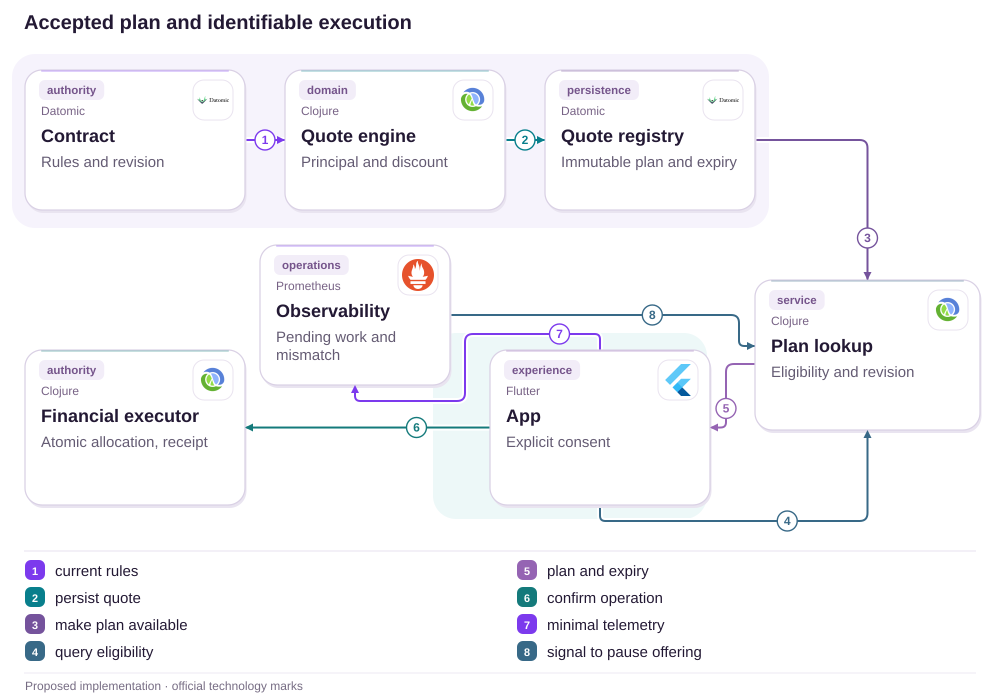
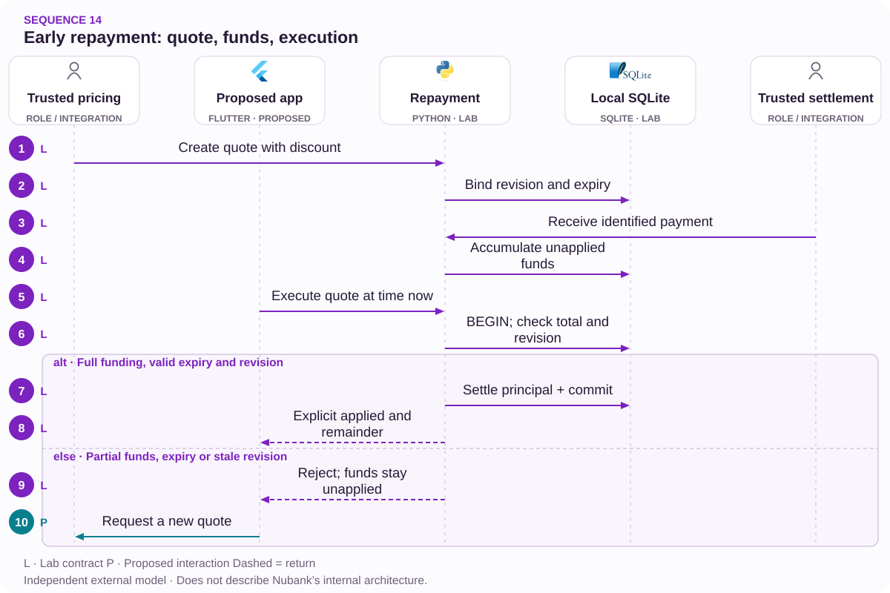

# 14 · Early repayment received, execution delayed: make the plan verifiable

Quote, expiry, allocation and discount with a single receipt

[PT reader](https://wesleyvieira99.github.io/nu/#14-1) · [EN reader](https://wesleyvieira99.github.io/nu/en.html#14-1)

[Executable Python lab](../../labs/case_14.py)

## 14 · The company acknowledges late execution


Actual crop of the public source, captured 23 October 2026. The text below includes the company reply and reported outcome.

In complaint 238574883, dated 23 January 2026, the customer describes difficulty advancing installments and conflicting guidance. Nubank acknowledges receiving payment and executing late; it reports applying installment 23 on 2 February, with 13 remaining. It explains payment conditions and says support met its deadline. Status is Responded, without final customer confirmation.

**What remains unknown**

No amount, rate, calculation breakdown or technical cause is public. The acknowledgment concerns late execution; it does not establish that every attempt or insufficient-funds rule was wrong.

- [Reclame AQUI — case 14 · 2026-01-23](https://www.reclameaqui.com.br/nubank/dificuldade-em-antecipar-parcelas-e-divergencia-de-informacoes-no-nubank_tFpS34o-ncejc1a3/)

## Receiving funds is not executing early repayment

An early-repayment journey involves a discount offer, installment selection, payment and financial application. These events can occur at different times under different rules. The product must distinguish a request, a valid quote, received funds and an obligation actually settled. Without that distinction, a debit can appear to complete an operation still awaiting allocation.

The hypothesis is that a versioned quote linked to the final receipt and exception queue reduces funded operations without understandable execution. I would reconstruct a sample by quote_id and payment_id, comparing rules, validity, receipt and application. I would not assume an interface-only problem: calculation or execution discrepancies belong at the financial authority.

The laboratory proposes a synthetic atomic package of current bill and early repayment. It does not describe Nubank’s current contractual priority. Real rules for partial application, cancellation and discount reversal need validation before implementation. The model supports discussion of the boundary between received money, consent to a plan and an obligation actually settled.

## A quote is a contract with expiry



Proposed external architecture; not Nubank’s internal implementation.

The quote engine uses contract rules and revision to publish an immutable plan. The app queries validity and confirms an identified operation. The financial executor revalidates and applies within its authority, producing its own receipt; lookup does not replace that decision.

Observability signals pending work and discrepancies to the responsible operation, which may pause new offers. The diagram does not authorize a monitor to edit balances. Real settlement, contractual pricing and ledger integration remain necessary; the laboratory reduces them to one account and synthetic amounts.

## Core: revalidate before applying

`Quote / Commit [lab]` · `Versioned Aggregate [lab]`

```python
    def execute(self, ident, now, crash=False):
        with self.db:
            self.db.execute('BEGIN IMMEDIATE')
            row = self.db.execute('SELECT revision,bill,principal,discount,'
                'expires,received,executed FROM quotes WHERE id=?',
                (ident,)).fetchone()
            if not row:
                raise ValueError('unknown quote')
            revision, bill, principal, discount, expires, received, done = row
            needed = bill + principal - discount
            if done:
                return dict(applied=needed, unapplied=received - needed)
            current = self.db.execute('SELECT revision FROM contract').fetchone()[0]
            if now >= expires or revision != current:
                raise ValueError('expired or stale quote; funds remain unapplied')
            if received < needed:
                raise ValueError('full quoted amount not received')
            self.db.execute('UPDATE contract SET revision=revision+1,'
                            'settled=settled+?', (principal,))
            self.db.execute('UPDATE quotes SET executed=1 WHERE id=?', (ident,))
            if crash:
                raise RuntimeError('crash before commit')
        return dict(applied=needed, unapplied=received - needed)
```

Literal excerpt from labs/case_14.py; transactional execution in cents.

A quote is applied only when revision, validity and received amount agree. Failure before commit rolls back the complete execution. Once completed, a retry returns the original receipt even after expiry; it does not execute another early repayment.

Funds received against an expired or insufficiently funded quote remain recorded for resolution rather than disappearing or silently moving to another price. The laboratory does not implement automatic refunds. Clock and settlement facts must come from trusted server sources, and the supplied discount needs approved contractual calculation.

- [Executable case lab on GitHub](https://github.com/wesleyvieira99/nu/blob/main/labs/case_14.py)

## Pure calculation does not replace a transaction

`Quote / Commit [proposal]` · `Versioned Aggregate [proposal]`

```clojure
(defn executable? [quote contract now received]
  (let [required (+ (:bill-cents quote)
                    (- (:principal-cents quote)
                       (:discount-cents quote)))]
    (and (= (:revision quote) (:revision contract))
         (< now (:expires-at quote))
         (>= received required))))

;; Run this check inside the same authority as financial application.
;; The clock, contract and settlement evidence are server-owned.
;; A completed operation returns its original receipt on retry.
```

Illustrative, unexecuted Clojure; synthetic rules for contract review.

The function expresses execution conditions, but evaluating it outside the transaction leaves a window for contract change. The service must compare revision and apply the change within the same authority. Required value must include all approved components rather than omit the current bill to make the offer look cheaper.

A material price or plan change requires renewed confirmation. Revalidation does not mean silently recalculating and debiting. History retains the accepted quote, cancellation reason and application receipt. Clojure can keep calculation deterministic; financial integration and event publication remain responsible for atomicity, durability and reconciliation.

## Separate plan, funding and receipt

`Quote / Commit [proposal]` · `Versioned Aggregate [proposal]`

| Object | Identity | Invariant |
| --- | --- | --- |
| Quote | quote_id + revision | Immutable plan and expiry |
| Funding | payment_id | Same payment never adds twice |
| Execution | quote_id | One application after validation |
| Exception | Linked case | Funds always have an explicit destination |

```json
{
  "quote_id": "synthetic-quote-14",
  "contract_revision": 1,
  "currency": "BRL",
  "current_bill_cents": 5000,
  "principal_cents": 10000,
  "discount_cents": 1000,
  "required_cents": 14000,
  "received_cents": 14000,
  "execution_state": "pending",
  "expires_at": 100
}
```

Synthetic example: R$ 50 current bill + R$ 100 principal −R$ 10 discount = R$ 140.

The discount is not a bank saving to maximize; it is part of the contractual obligation to the customer. Presentation should separate principal, charges, discount and required total. Identifiers support investigation without exposing a complete contract in logs. The financial owner defines retention and compensation; support receives an accessible calculation and next action.

## Crash and expiry challenge the plan

`Quote / Commit [lab]` · `Versioned Aggregate [lab]`

```python
    def test_received_is_not_executed_and_crash_rolls_back(self):
        self.r.receive('p', 'q', 14000)
        with self.assertRaises(RuntimeError):
            self.r.execute('q', 90, crash=True)
        self.assertEqual(self.r.db.execute('SELECT settled FROM contract')
                         .fetchone()[0], 0)
        self.r.db.close()
        self.r = Repayment(self.path)
        self.assertEqual(self.r.execute('q', 90)['applied'], 14000)
        self.assertEqual(self.r.execute('q', 200)['applied'], 14000)
        self.assertEqual(self.r.db.execute('SELECT settled FROM contract')
                         .fetchone()[0], 10000)
```

Literal test; the complete suite passed 9 tests.

The test receives funds and fails after writes but before commit. The obligation remains unsettled; after restart, execution completes once. Retrying after expiry returns the same result, demonstrating the difference between recovering a receipt and accepting an expired quote.

Other tests cover partial funding, expiry, duplicate funding, conflict, a quote made stale by another execution, one-cent overpayment and invalid discount. Real interest, external automatic debit and refund are not implemented. An integration suite must validate entries against accounting and exercise compensation for operations that cannot execute.

## Measure the interval customers cannot see

| Metric | Definition | Window and segment |
| --- | --- | --- |
| Execution time | p95 from eligible funding to application | Daily; payment type |
| Funded but pending | Funded unexecuted operations / eligible | Daily; age and reason |
| Discount mismatch | Cents differing from approved plan | Continuous; contract version |
| Explained cancellation | Cases with reason and destination / canceled | Weekly; channel |

Baselines are unknown. Funding needs a financial timestamp rather than the moment a button was tapped. Quotes expiring before payment must also be distinguished from delayed execution after confirmed eligibility. This segmentation prevents one indicator from combining behaviors with different causes and owners.

The pilot retains approved contractual calculation and compares previous tracking against explicit plan and receipt. Expansion into new execution requires independent financial validation. I would stop for duplicate application, incorrect discount, funds without traceable destination or misleading cancellation communication. Faster completion cannot compensate for a cent applied to the wrong contract.

## Value rework, not removed discounts

| Assumed scenario | Potential/year | Operations/year | Year 1 after cost |
| --- | --- | --- | --- |
| Conservative | R$ 14,400 | R$ 30,000 | R$ -165,600 |
| Base | R$ 67,200 | R$ 30,000 | R$ -112,800 |
| Ambitious | R$ 192,000 | R$ 30,000 | R$ 12,000 |

Annual assumptions: 30,000, 70,000 or 120,000 eligible early repayments; absolute incident reduction of 0.3%, 0.6% or 1%. I assume R$ 140 rework and R$ 20 incremental support per incident, totaling R$ 160. That yields 90, 420 or 1,200 avoided occurrences. Implementation: R$ 150,000; operations: R$ 30,000/year, both assumed.

In the base case, 420 × 160 = R$ 67,200. Year one is R$ 67,200 − 30,000 − 150,000 = −R$ 112,800. Break-even requires 187,500 early repayments equivalent to the base assumption. The ambitious scenario yields R$ 12,000 modeled net capacity, but incidence and effect must be measured. The plan should start small without evidence of sufficient scale.

**Calculation boundaries**

Do not infer loss from installment counts in the complaint. A correct contractual discount is not avoidable cost. Exclude incidents and contacts already counted in case 09; released capacity is not guaranteed cash.

## A roadmap starting with accounting

| Proposed phase | Owner and deliverable | Gate |
| --- | --- | --- |
| Days 0–15 | Credit + accounting: rules | Calculation examples approved |
| Days 16–30 | Staff: quote and execution | Atomic expiry/revision checks |
| Days 31–60 | Operations: shadow reconciliation | Received funds have traceable destination |
| Days 61–90 | EM + product: limited pilot | Correct discounts; fewer repeat contacts |

The 90-day horizon is proposed planning. The critical dependency is agreement on contractual rules, rounding and application priority. Mobile teams should not infer those conditions from support messages. Approved examples must include insufficiency, expiry, overpayment and contract changes between offer and execution.

The EM brings financing, statements, automatic debit, support and accounting into one delivery. Staff defines technical boundaries and compensation strategy. Every phase ends with evidence that communicated state matches financial state. If calculation is unvalidated, the next step is closing that gap rather than accelerating rollout.

## Operate a quote that did not complete

The canary starts with shadow quotes and receipts compared against the financial source. The team follows funded-but-unexecuted operations segmented by expiry, insufficiency and stale revision. Every category has an owner and next action; a generic processing status does not replace a resolution plan.

Alerts cover age, amount and discount discrepancy. Credit owns rules; financial platform owns application; operations owns resolution; product owns communication. The runbook forbids applying payment under another plan without authorization. Any refund or compensation remains linked to original funding and quote.

Rollback pauses new offers or the new experience while preserving receipts and received funds. Exercises include crash after commit, expiry during payment, concurrent automatic debit and an old response. Recovery begins with financial authority rather than the screen. Every pending operation must end in valid application or an approved, traceable destination for the money.

## My contribution: make the promise executable

As Staff, I would define what accepting a quote means and which authority guarantees execution. I would separate pure calculation, consent, funding and application, with identity and revision at every boundary. I would reject a fix that only changes visual status while the financial operation remains unexecuted.

As Engineering Manager, I would coordinate the teams sharing this journey and expose dependencies in the plan. Support needs the accepted plan and exception reason; accounting needs reconcilable entries; mobile needs stable explanatory semantics. Delivery finishes only when all three work together.

The central tradeoff is offer validity versus friction. Keeping a quote indefinitely can undermine financial rules; unexplained expiry can frustrate customers. I would choose transparent revalidation with renewed consent for material changes. Cost and opportunity would be reassessed in the pilot without claiming gains or authority I do not possess.

## Handoff: received funds have a destination

- Run python3 labs/case_14.py: 9 local tests and synthetic values.
- Review quote, receive and execute; observe funding separately from application.
- Inject a pre-commit crash, reopen and retry; principal can settle only once.
- Before production: contractual pricing, trusted clock, authorization, settlement, ledger and controlled refunds.

Reviewers should inspect both the happy path and an operation that cannot complete. The laboratory preserves received money in an explicit pending state; it does not claim that this is enough for a real experience. Resolution needs policy, a validated deadline and communication as well as a transaction.

Proceed only when plan, execution and receipt reconcile, the customer understands the required total and operations can handle expiry and insufficiency. If automation is unsupported, retain traceable human assistance. The desired result is a financial promise that can be explained and fulfilled, and an exception that does not disappear between teams.

- [Executable case lab on GitHub](https://github.com/wesleyvieira99/nu/blob/main/labs/case_14.py)

## Patterns with proof

`Quote / Commit [lab]` · `Versioned Aggregate [lab]` · `Transactional orchestration [proposal]` · `Spring Boot [proposal]`

| Mechanism | Implementation | Evidence |
| --- | --- | --- |
| Quote / Commit | Repayment.execute | execution failure preserves funds for resolution |
| Versioned Aggregate | Repayment.execute | a concurrent quote becomes stale after execution |
| Transactional orchestration / quote contract | Production proposal | Adapters keep authority outside the UI. |

**Java integration · proposed**

Spring Boot + transactional command handler. Port the invariants and contract tests before replacing the Python model. A process lock is not distributed concurrency control; persistence, authorization and recovery need integration tests.

**AI assessment · deterministic core**

No agent framework is implemented in this lab. Monetary state, authorization and version checks remain deterministic. An assistant would be evaluated separately against a proven support need, without authority to alter balances or identity.

- [P1 · Repayment.execute](https://github.com/wesleyvieira99/nu/blob/main/labs/case_14.py#L61)
- [P1 · test_received_is_not_executed_and_crash_rolls_back](https://github.com/wesleyvieira99/nu/blob/main/labs/case_14.py#L99)
- [P2 · Repayment.execute](https://github.com/wesleyvieira99/nu/blob/main/labs/case_14.py#L61)
- [P2 · test_second_quote_becomes_stale_after_execution](https://github.com/wesleyvieira99/nu/blob/main/labs/case_14.py#L137)

## Execution sequence



The discount is an approved input, not an interest calculation. Refunds need a separate authorized flow.

**Authority and failure boundary**

a concurrent quote becomes stale after execution. execution failure preserves funds for resolution.

The sequence describes the proposed integration. The linked lab verifies the domain invariant with synthetic data; external services, network retries and deployment remain integration work.

- [quote](https://github.com/wesleyvieira99/nu/blob/main/labs/case_14.py#L27)
- [execute](https://github.com/wesleyvieira99/nu/blob/main/labs/case_14.py#L61)

## Features, stories and acceptance

**F14.1 · Verifiable quote · D16–30**

As a customer, I want to confirm discount, installments and validity before repayment. Acceptance: a concurrent quote becomes stale after execution.

**F14.2 · Receipt is not execution · D31–60**

As a customer, I want to know whether funds arrived and installments were settled. Acceptance: execution failure preserves funds for resolution.

**F14.3 · Measured rollout · D61–90**

As the product owner, I want an eligible cohort with a comparable control. Acceptance: the case metric, denominator, cost and safety barrier are registered before exposure; reconciliation failures stop expansion.

Linked tests exercise the stated domain acceptance condition, not the complete interface or production integration. D0–15 is discovery: confirm the public report against authorized internal samples, map dependencies and approve contracts. These are incremental planning windows, not a delivery commitment. EM owns coordination; Staff owns cross-domain contracts; Product and the domain owner accept outcomes.

- [Acceptance F14.1](https://github.com/wesleyvieira99/nu/blob/main/labs/case_14.py#L137)
- [Acceptance F14.2](https://github.com/wesleyvieira99/nu/blob/main/labs/case_14.py#L99)

## Method and sensitivity

**Scenario sensitivity · BRL**

All inputs are scenario assumptions, not measured Nubank effects. Capacity equivalent is not cash saved. The realization slider reduces benefit only; all costs remain at their scenario values. This is sensitivity analysis, not a probability or a causal estimate.

period_net = benefit × realization − variable_cost − run_cost; first_year = period_net − build_cost

Period / Período: `year`. Values / Valores: BRL.

| Scenario / Cenário | Benefit / Benefício | Variable cost / Variável | Run cost / Operação | Build / Implementação |
| --- | ---: | ---: | ---: | ---: |
| Conservative | 14400.00 | 0.00 | 30000.00 | 150000.00 |
| Base | 67200.00 | 0.00 | 30000.00 | 150000.00 |
| Ambitious | 192000.00 | 0.00 | 30000.00 | 150000.00 |

| Scenario / Cenário | Period net at 100% / Líquido | Horizon after build / Horizonte | Horizon at 50% / Estresse |
| --- | ---: | ---: | ---: |
| Conservative | -15600.00 | -165600.00 | -172800.00 |
| Base | 37200.00 | -112800.00 | -146400.00 |
| Ambitious | 162000.00 | 12000.00 | -84000.00 |

[Reproducible scenario inputs](../../models/normalized-scenarios.json) · [Decimal simulator](../../models/simulate.py)

| Decision | Case-specific method |
| --- | --- |
| Baseline / threat | Baseline: incidents per eligible early repayment. Threat: mixing expired quotes and delayed execution. |
| Unit economics | Avoided incidents × (rework + support cost); a correct contractual discount is not new revenue. |
| Proposed experiment | Compare tracking with an explicit plan/receipt, retaining calculation; independently validate execution. |
| Stop rule | Stop for double application, an incorrect discount or funds without a traceable destination. |

- [Reclame AQUI · ID 238574883](https://www.reclameaqui.com.br/nubank/dificuldade-em-antecipar-parcelas-e-divergencia-de-informacoes-no-nubank_tFpS34o-ncejc1a3/)
- [FinOps Foundation · Unit Economics](https://www.finops.org/framework/capabilities/unit-economics/)
- [Microsoft Research · Pre-experiment design](https://www.microsoft.com/en-us/research/articles/patterns-of-trustworthy-experimentation-pre-experiment-stage/)
