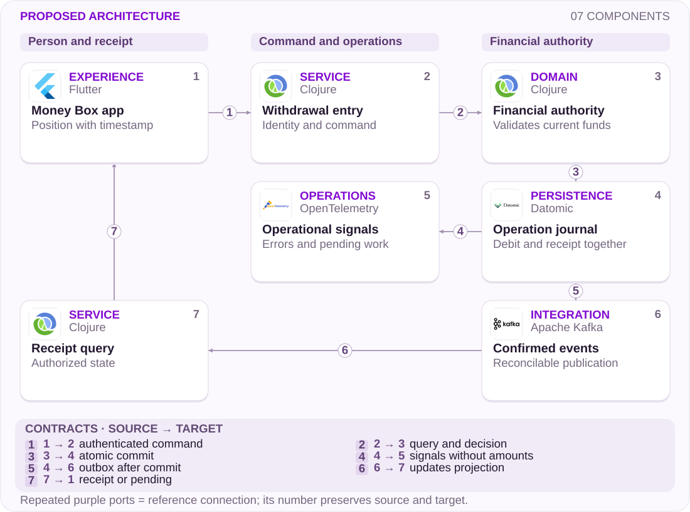

# 15 · Money Boxes: visible money, reliable withdrawal

Resilience · Financial authority

[PT reader](https://wesleyvieira99.github.io/nu/#15-1) · [EN reader](https://wesleyvieira99.github.io/nu/en.html#15-1)

[Executable Python lab](../../labs/case_15.py)

## The incident and its outcome


Actual crop of the public source, captured 23 October 2026. The text below includes the company reply and reported outcome.

On April 28, 2026, complaint 247218209 described missing Money Boxes and unavailable withdrawals, without a useful support estimate. In its April 30 response, Nubank acknowledged a temporary disruption affecting some customers, stated that assets remained protected, and reported a successful withdrawal from the account on April 28 at 20:46:01. The public status is Answered, with no final customer evaluation. No amount, verified individual duration or evidence of lost assets is disclosed.

The engineering question is how to preserve trustworthy guidance while a dependency is degraded. Olhar Digital reproduced an incomplete screen during this episode and reported recovery; that does not identify an internal cause or quantify affected customers. The following design is my proposal, not a reconstruction of the incident.

- [Reclame AQUI · 247218209](https://www.reclameaqui.com.br/nubank/indisponibilidade-de-resgate-de-dinheiro-em-caixinhas-e-falta-de-comunicacao-do-banco_Nc3yoYhKbC1BpbqL/)
- [Olhar Digital · 28/04/2026](https://olhardigital.com.br/2026/04/28/internet-e-redes-sociais/nubank-app-enfrenta-instabilidades-nesta-terca-feira-28/)

## Reading a balance does not authorize withdrawal

I would separate three questions often compressed into one screen: does the investment exist, which position was last verified, and can a withdrawal execute now? A failed query does not answer the other two negatively. Displaying zero because a position did not load confuses availability with ownership; allowing withdrawal against stale information creates another risk. The degraded state must explain the distinction without exposing internal details.

My falsifiable hypothesis is that an auxiliary read could still provide a dated position when withdrawal authority is unavailable. I would inspect existing contracts, shared dependencies, latency budgets and correlated failure history. If reads and writes share an unavoidable outage, an isolated cache may help guidance but cannot restore liquidity. That distinction determines the investment and belongs in the product review.

Investigation would start with synthetic attempts and authorized traces: query started, result unknown, command accepted and receipt confirmed. I would not request customer statements to reproduce the problem. The journey ends when the person receives financial confirmation or an honest explanation of unavailability, with a tracking path and a next update.

## The receipt closes the loop



Proposed external architecture; technologies illustrate choices, not confirmed internal systems.

Only the financial authority may commit a debit. The journal must persist the result and command identity in one transaction. The proposed outbox publishes already confirmed facts; if transport stops, the customer queries the receipt through an authorized path. Observability receives reduced signals, without amounts or account identifiers in labels.

The dated interface position remains advisory and never crosses this boundary as authorization. The lab represents only local commitment and receipt replay. Custody, settlement, partial outages and service-to-service authorization still require their own contracts and distributed tests.

## One attempt, one commitment

```python
    def withdraw(self, actor, key, cents, snapshot, now, ledger_online=True):
        with self.lock:
            for value in (actor, key, snapshot.owner):
                identifier(value)
            if type(now) is not int or now < 0:
                raise ValueError('invalid clock')
            if actor != self.owner or snapshot.owner != actor:
                raise PermissionError('account scope')
            if not key or type(cents) is not int or cents <= 0:
                raise ValueError('invalid command')
            command = (actor, cents)
            if key in self.receipts:
                prior_command, receipt = self.receipts[key]
                if prior_command != command:
                    raise ValueError('idempotency conflict')
                return receipt
            if not ledger_online:
                raise RuntimeError('authority unavailable')
            if not 0 <= now - snapshot.observed_at <= 30:
                raise ValueError('snapshot expired')
            if snapshot.version != self.version:
                raise ValueError('refresh required')
            if cents > self.balance:
                raise ValueError('insufficient funds')
            self.balance -= cents
            self.version += 1
            receipt = (key, cents, self.version)
            self.receipts[key] = (command, receipt)
            return receipt
```

Literal excerpt from the executed lab; imports and initialization are in the full file.

The operation requires a matching owner, positive integer amount and a recent snapshot of the same version. The 30-second clock is an educational assumption, not a Nubank deadline. The advisory balance does not replace authority: with the ledger unavailable, no debit occurs. After success, replaying the same key retrieves the receipt even if the snapshot expired; this prevents a lost response becoming a second withdrawal.

The lock covers one process. In production I would replace this section with a conditional transaction in the durable authority, preserving the same observable semantics. The app does not manufacture trusted snapshots; the test object represents a service-issued read. A receipt also requires access control before deduplication.

- [Executable case lab on GitHub](https://github.com/wesleyvieira99/nu/blob/main/labs/case_15.py)

## Dart for an understandable state

```dart
enum WithdrawalState { loading, datedPosition, unavailable, confirmed }

String guidance(WithdrawalState state, String observedAt) {
  return switch (state) {
    WithdrawalState.loading => 'Loading current position',
    WithdrawalState.datedPosition => 'Last verified: $observedAt',
    WithdrawalState.unavailable => 'Withdrawal unavailable; track status',
    WithdrawalState.confirmed => 'Withdrawal confirmed; view receipt',
  };
}

bool mayRequestFreshAuthorization(WithdrawalState state) =>
    state == WithdrawalState.datedPosition;
```

Illustrative Dart example, unexecuted; demonstration copy requires localization.

The interface may offer another authorization attempt without claiming that withdrawal is available. I would present verified amount, timestamp and unavailability as separate facts; screen readers would receive the same distinction. Confirmed state comes from a receipt, not a completed animation. Text and color should reinforce meaning, never carry the explanation alone.

The proposed Clojure service owns the decision while Flutter presents the contract. I would assess existing components before introducing any technology. Deployment starts with unknown state and a queryable receipt, because a new screen without a consistent financial contract merely moves confusion elsewhere in the journey.

## Identities that survive a retry

| Field | Rule | Owner |
| --- | --- | --- |
| operation_id | Unique per intent | Financial service |
| position_version | Monotonic per position | Custody |
| observed_at | Verifiable instant | Read source |
| receipt_id | Only after commit | Ledger |

```json
{
  "schema": "withdrawal-status.v1",
  "operation_id": "synthetic-operation",
  "state": "UNKNOWN",
  "position_version": 42,
  "observed_at": "2026-01-01T12:00:00Z",
  "receipt_id": null,
  "next_action": "QUERY_RECEIPT"
}
```

Proposed contract, synthetic data; schema unexecuted.

UNKNOWN is neither rejection nor confirmation. A consumer can query the same identifier without creating a new financial intent. A changed amount requires a new key; reusing the previous one must fail explicitly. I would define receipt retention against existing obligations and use a much shorter cache lifetime, avoiding deletion of durable evidence when a projection expires.

The owner is resolved from authenticated identity, not supplied as authority in JSON. Logs retain an opaque reference, error class and version. Reconciliation compares committed commands and published events, with restricted permission to investigate discrepancies and without copying balances into operational dashboards.

## Failures that must not become debits

```python
    def test_cache_does_not_authorize(self):
        with self.assertRaises(RuntimeError):
            self.w.withdraw(self.s.owner, 'a', 1000, self.s, 101, False)
        self.assertEqual(self.w.balance, 10_000)
        self.assertEqual(self.w.receipts, {})

    def test_retry_after_commit_returns_receipt(self):
        first = self.w.withdraw(self.s.owner, 'a', 1000, self.s, 101)
        retry = self.w.withdraw(self.s.owner, 'a', 1000, self.s, 900, False)
        self.assertEqual(first, retry)
        self.assertEqual(self.w.balance, 9000)

    def test_parallel_commands_cannot_spend_same_version(self):
        def attempt(key):
            try:
                return self.w.withdraw(self.s.owner, key, 7000, self.s, 101)
            except ValueError:
                return None
        with ThreadPoolExecutor(max_workers=2) as pool:
            results = list(pool.map(attempt, ['a', 'b']))
        self.assertEqual(sum(x is not None for x in results), 1)
        self.assertEqual(self.w.balance, 3000)
```

Literal test excerpt; all 13 lab tests passed locally.

All thirteen tests passed locally. Beyond these excerpts, the suite covers a wrong owner, conflicting key, future timestamp, exact validity boundary, insufficient funds and invalid monetary types. The race uses two intents against one version; only one may commit funds. The replay test distinguishes an already completed operation from a new request during unavailability.

In the integrated environment I would add a crash after commit but before response, a delayed outbox and replica recovery. The criterion would be one financial movement and a recoverable receipt. This suite measures neither availability, network latency nor custody capacity, and a green run does not authorize real money.

## Metrics that include unknown state

The business baseline is unknown. I would measure confirmed completion: receipts within 60 seconds divided by valid intents, daily, segmented by app version and product. The 60-second window is proposed for discussion, not a published SLA. An intent without a receipt remains unknown until reconciliation and is reported separately, preventing it from disappearing from the denominator.

The second metric is useful guidance: degraded attempts showing a dated position and next step divided by degraded attempts, hourly. The third is repeat contact within 24 hours per affected intent, using pseudonymous linkage and limited retention. The fourth is receipt conflict per committed command; any confirmed financial discrepancy stops the pilot. Sampled traces explain failures without high-cardinality labels.

The experiment compares equivalent journeys under simulated failures, then a small cohort, without deliberately causing financial unavailability. The initial proposed target is reduced contact without increasing unknown outcomes or delaying confirmation. If messaging reduces contact through abandonment or prevents assisted access, the result does not count as success.

## Value without treating balances as revenue

The public case does not disclose an amount. The proposed financial evaluation considers support capacity, not Money Box assets. Exclusively for planning, I assume 20,000 affected intents per month, eight minutes per avoided contact, BRL 60 per loaded hour, BRL 5,000 monthly operating cost and BRL 120,000 implementation cost. None of these inputs is Nubank data.

| Assumed scenario | Absolute reduction | Hours/month | Net value/month |
| --- | --- | --- | --- |
| Conservative | 2 pp | 53.33 | −BRL 1,800 |
| Base | 5 pp | 133.33 | BRL 3,000 |
| Ambitious | 10 pp | 266.67 | BRL 11,000 |

Monthly formula: intents × absolute contact reduction × minutes ÷ 60 × hourly cost, less operations. Operating break-even requires a 3.125-percentage-point reduction, equivalent to 625 avoided contacts. Recovering implementation would require 40 months in the base scenario and 10.91 in the ambitious scenario, only if freed capacity converts fully into cash; the conservative scenario has no payback under these assumptions.

Finance would need to validate marginal cost, seasonality and how freed hours are used. Redeployed capacity may improve support without reducing expense. I would not add this benefit to other support cases without eliminating overlapping contacts, nor estimate asset loss or recovered revenue from the complaint.

## A 90-day plan with verifiable exits

Days 0–15: the Investments Staff owner maps withdrawal authority with Custody and SRE; Product defines messages for stale positions and unknown outcomes. The deliverable is a contract with failure examples and data classification. Exit requires agreement on who may declare completion, including external dependencies and states without a trustworthy estimate.

Days 16–30: backend implements idempotent lookup and a journal in a test environment while Mobile validates assisted reading and safe retries. QA injects response loss after commitment. Days 31–60: SRE runs state shadowing and reconciliation; expansion requires no discrepancy in the known dataset, complete telemetry and reviewed support documentation.

Days 61–90: the Engineering Manager coordinates a journey-level pilot, cost review and training. Investments accepts integrity; Product accepts comprehension; SRE accepts recovery. Ninety days is a proposed horizon, conditional on existing contracts. Lack of reliable transactional authority blocks pilot writes even if the visual experience is ready.

## Operating when a dependency fails

I would start in shadow mode, calculating the state that would be shown without changing financial authorization. The first cohort receives only queries and explanations; writes progress once receipt recovery has been exercised. A kill switch may remove the new presentation, but must never erase committed operations or turn receipts into generic errors.

The Investments on-call handles differences between journal and position; SRE handles availability and publication lag; Support receives a readable state and the agreed next update. One drill stops the projection while keeping authority available; another stops authority while preserving reads. Both must preserve the distinction between a known position and the current ability to withdraw.

I would stop expansion for an incompatible receipt, another owner’s position, or unknown attempts rising beyond a limit agreed after baseline measurement. Reconciliation gives each pending operation an owner and deadline. A service-restored announcement would not substitute for individual confirmation that a command completed.

## My contribution: trust under failure

As Staff, I would document authority, freshness and idempotency decisions before choosing mechanisms. I would bring the team together to compare three alternatives: a global incident message alone, an advisory cache with receipts, and a withdrawal queue for later execution. My initial preference would be the second because it improves guidance while keeping authorization close to current state. A queue changes timing expectations and requires specific consent; it would not enter scope silently.

As Engineering Manager, I would negotiate capacity across Mobile, Investments, SRE and Support, preventing each team from shipping a different state. Weekly review would examine unknown operations, blocked dependencies and test learning, with documented decisions and explicit owners. The contribution I propose is reduced ambiguity between teams, not perfect availability.

I would present a reproducible test, a known limitation and an economic hypothesis to the review group one at a time. This proposal demonstrates my decision and coordination method; it does not claim involvement in the incident or privileged knowledge of Nubank architecture.

## Handoff: from lab to decision

Run python3 labs/case_15.py -v. Start at Withdrawals.withdraw and follow snapshot, receipts and the ownership check. Change the service from available to unavailable and observe that the balance does not change; then replay a completed operation with the clock advanced and verify that the receipt remains identical. These steps make the key boundary auditable within minutes.

The acceptance checklist includes: no debit without current authority; no duplicate execution on retry; no cross-owner receipt lookup; clearly dated stale positions; trackable unknown outcomes; and reconciliation of delayed publication. Integration still requires real authentication, transactional persistence, custody and settlement policies, trusted clocks, migration and disaster tests.

I would recommend moving only to an integrated prototype if the authority owner accepts this contract and failure tests are reproducible. If a dated query leads people to believe withdrawal is guaranteed, communication design returns to research. Delivery quality includes knowing when to stop an apparent improvement that creates an incorrect financial interpretation.

- [Executable case lab on GitHub](https://github.com/wesleyvieira99/nu/blob/main/labs/case_15.py)
