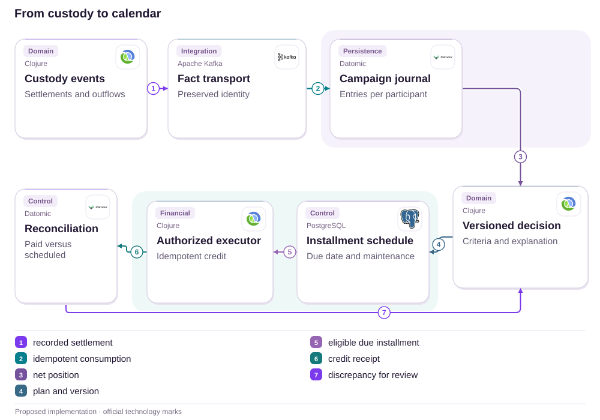
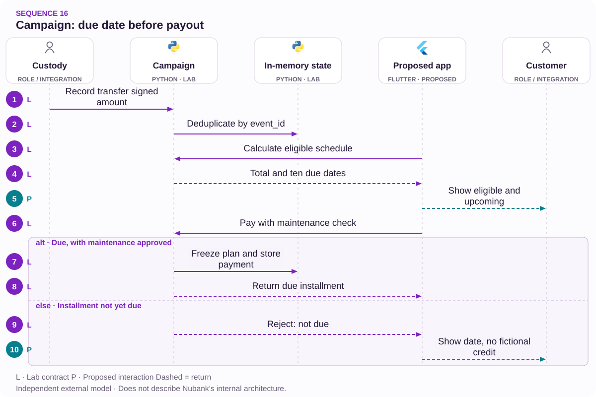

# 16 · Portability: eligible does not mean overdue

Campaigns · Explainability · Custody

[PT reader](https://wesleyvieira99.github.io/nu/#16-1) · [EN reader](https://wesleyvieira99.github.io/nu/en.html#16-1)

[Executable Python lab](../../labs/case_16.py)

## A contradictory answer, a calendar


Actual crop of the public source, captured 23 October 2026. The text below includes the company reply and reported outcome.

Complaint 250210183, dated June 1, 2026: a Nu+ customer said she transferred investments and was told by chat that she was ineligible, without explanation. On June 9, Nubank confirmed the Treasury investment transfer and eligibility, explaining ten installments starting in June. Status: Answered, with no public confirmation of the first credit. The complaint precedes the first scheduled due date, June 10, so it does not establish overdue cashback.

The consulted rules define a window, net amount and maintenance conditions. The opportunity is to give the customer and Support the same time-aware, versioned explanation. We do not know the individual transferred amount or the original record consulted by the agent; this proposal does not attribute the disagreement to a particular engine.

- [Reclame AQUI · 250210183](https://www.reclameaqui.com.br/nubank/campanha-de-portabilidade-enganosa-ou-cometeram-um-erro-na-minha-conta_2DQdhvJ76VJIOMDb/)
- [Regulamento oficial da campanha](https://cdn.nubank.com.br/investments/portability/regulamento-campanha-cvm210.pdf)

## Three questions before declaring an error

I would distinguish eligibility, due date and completed payment. Someone can be eligible in June, have an installment that is not yet due and have no posted credit. If these states become one flag, Support may interpret absent credit as exclusion from the campaign. The hypothesis to test is inconsistent meaning across channels, without assuming that the financial calculation was wrong.

Investigation would follow a synthetic example from custody completion to benefit. It would establish which date counts for the campaign, how outflows offset inflows and which rule revision was accepted. A transfer requested within the window but completed later may need a different answer; the system should show the event used and a review path without exposing third-party holdings.

I would interview Investment Operations and Support about exceptions before modeling automation. The aim is not to turn every complaint into a credit, but to provide a challengeable decision with reproducible facts. Channel disagreement should open a review of the same evidence rather than start another conversation without context.

## An explainable benefit projection



Proposed external architecture; technologies illustrate choices, not confirmed internal systems.

The source supplies custody facts; the decision component applies a campaign revision; the schedule separates due dates from payments. The executor produces credit only with authorization and current conditions. Reconciliation returns discrepancies for plan review without retroactively changing issued receipts. App and Support would query the same projection, omitted here to keep the main flow visible.

Kafka and Datomic are illustrative choices. An existing implementation may fulfill these responsibilities with other components. The lab represents simplified Nu+ rules only, not every asset, exception or actual maintenance criterion.

## Calendar before the complaint

`Specification-like Predicate [lab]` · `Idempotent Installment [lab]`

```python
    def schedule(self, actor, active_subscription):
        with self.lock:
            identifier(actor)
            if actor != self.owner:
                raise PermissionError('account scope')
            if active_subscription is not True:
                return {'state': 'INELIGIBLE', 'total_cents': 0, 'dues': ()}
            net = sum(e.signed_cents for e in self.events.values()
                      if date(2026, 3, 1) <= e.settled <= date(2026, 5, 29))
            total = min(max(net, 0) // 3_000_000 * 18_000, 180_000)
            dues = tuple(date(2026 + (5 + i) // 12, (5 + i) % 12 + 1, 10)
                         for i in range(10)) if total else ()
            return {'state': 'ELIGIBLE' if total else 'BELOW_THRESHOLD',
                    'total_cents': total, 'dues': dues}
    def pay(self, actor, installment, today, balance_maintained=True,
            active_subscription=True):
        with self.lock:
            plan = self.schedule(actor, active_subscription)
            if type(installment) is not int or not 0 <= installment < 10:
                raise ValueError('installment range')
            if installment in self.paid:
                return self.paid[installment]
            if type(today) is not date or not plan['dues']:
                raise ValueError('date or eligibility invalid')
            if today < plan['dues'][installment]:
                raise ValueError('not due')
            if balance_maintained is not True:
                raise ValueError('maintenance review required')
            if self.frozen_total not in (None, plan['total_cents']):
                raise ValueError('plan changed; reconcile')
            self.frozen_total = plan['total_cents']
            self.paid[installment] = self.frozen_total // 10
            return self.paid[installment]
```

Literal excerpt from the executed lab; imports and initialization are in the full file.

The calculation uses integer cents, net settled inflows within the window and ten due dates. The Nu+ example applies BRL 180 per BRL 30,000 block, capped at BRL 1,800, following the consulted rules. The complaint’s individual amount remains unknown. No payment is allowed before its due date or without explicit subscription and maintenance checks.

After the first credit, a change in the calculated total blocks a new installment and requires reconciliation. Replaying the same installment returns its previous receipt without another effect. The model does not implement retroactive corrections or proportional benefit suspension: those policies must be agreed before replacing its conservative block.

- [Regulamento oficial](https://cdn.nubank.com.br/investments/portability/regulamento-campanha-cvm210.pdf)
- [Executable case lab on GitHub](https://github.com/wesleyvieira99/nu/blob/main/labs/case_16.py)

## One explanation shared by channels

`Specification-like Predicate [proposal]` · `Idempotent Installment [proposal]`

```clojure
(defn explain-installment [{:keys [eligible due paid today]}]
  (cond
    paid {:state :paid :next-action :view-receipt}
    (not eligible) {:state :review :next-action :view-reasons}
    (.isBefore today due)
    {:state :scheduled :next-action :view-calendar :due due}
    :else {:state :due :next-action :track-payment}))

;; Inputs come from authorized, versioned domain services.
;; This function explains; it never posts a financial credit.
```

Illustrative Clojure, unexecuted; not Nubank’s rules engine.

The explanation should show the reason and next action, not just a green or red color. Before the due date, the calendar explains absent credit. After the due date, a missing receipt moves into tracking. When eligibility is challenged, the review should receive the events and rule used without asking the person to retell the story.

I would deploy this function in a domain presentation layer consumed by the app and an authorized support console. Financial authority would remain separate. Copy would be localized and tested for not-yet-due, below-minimum and under-review scenarios. The interface must not infer fraud, noncompliance or customer error from incomplete data.

## Identifiable rule, event and installment

`Specification-like Predicate [proposal]` · `Idempotent Installment [proposal]`

| Record | Identity | Protection |
| --- | --- | --- |
| Custody | event_id + owner | Authenticated source |
| Decision | rule_version + cutoff | Historical replay |
| Installment | campaign + account + index | Unique credit |
| Review | decision_id + reason | Restricted access |

```json
{
  "schema": "campaign-decision.v1",
  "rule_version": "nuplus-demo-v1",
  "eligibility": "ELIGIBLE",
  "installment": 0,
  "due_date": "2026-06-10",
  "payment_state": "NOT_YET_DUE",
  "receipt_id": null
}
```

Proposed contract; synthetic fixture, not a real API response.

Each decision records the factual cutoff. Late events are not silently backdated over paid installments; they trigger an identified review with impact analysis. Maintaining investments is a condition separate from subscription. The campaign owner defines the rule and Operations validates custody evidence; engineering ensures reproducible execution.

The rules available today may differ from historical communication. I would archive the applicable revision and its hash with appropriate legal access. This chapter restricts its example to Nu+, avoiding mixed Ultravioleta figures that differ between the response and public material versions.

## Test the date, not only the sum

`Specification-like Predicate [lab]` · `Idempotent Installment [lab]`

```python
    def test_complaint_date_is_before_first_due_date(self):
        plan = self.c.schedule('owner', True)
        self.assertEqual(plan['state'], 'ELIGIBLE')
        self.assertEqual(plan['dues'][0], date(2026, 6, 10))
        with self.assertRaises(ValueError):
            self.c.pay('owner', 0, date(2026, 6, 1))
        self.assertEqual(self.c.paid, {})

    def test_outflow_changes_net_eligibility(self):
        out = Transfer('out', 'owner', date(2026, 5, 29), -1)
        self.c.record(out, 'custody')
        self.assertEqual(self.c.schedule('owner', True)['total_cents'], 0)

    def test_concurrent_payment_is_once_per_installment(self):
        def pay(_):
            return self.c.pay('owner', 0, date(2026, 6, 10))
        with ThreadPoolExecutor(max_workers=4) as pool:
            results = list(pool.map(pay, range(20)))
        self.assertEqual(set(results), {1800})
        self.assertEqual(sum(self.c.paid.values()), 1800)
```

Literal test excerpt; all 15 lab tests passed locally.

The executed suite also tests custody origin, conflicting identity, window, cap, negative net balance, inactive subscription and maintenance. The complaint date does not authorize the first installment. Event reads and writes share the lock; a concurrent test exercises that contract. A late change after the first credit requires plan review instead of silently recalculating payments.

The lab does not demonstrate full compliance with the rules or verify any real person’s eligibility. In the integrated environment I would test custody replay, subscription changes near the due date and executor response loss. Finance and Investments must approve exception fixtures before the suite can act as a delivery gate.

## Observable agreement and punctuality

All baselines are unknown. The primary metric would be channel agreement: simultaneous queries returning the same decision and version divided by comparable pairs, daily and by campaign. Another would be explanation completeness: decisions with a reason, rule and next action divided by served decisions. Collection occurs in the domain without recording holdings in app analytics.

Timeliness requires eligible due installments as the denominator: reconciled credits within an agreed operating window divided by those installments, per due date. Repeat contact within seven days per challenged decision measures effort, segmented by reason. Duplicate payment per installment is the financial guardrail: any confirmed occurrence pauses expansion and opens reconciliation even if screen agreement is excellent.

I would first propose a comprehension test using synthetic dates and cross-channel shadowing. The initial aim would be to remove contradictions explained by the calendar, not increase eligibility. Expansion depends on financial reconciliation and a sufficient sample of challenged cases; absence of complaints does not prove understanding.

## A promised benefit is an obligation, not profit

BRL 180 per BRL 30,000 describes a public Nu+ rule, not this complaint’s individual benefit or bank revenue. To evaluate the proposal, I assume 12,000 participants per month, 1.5 repeat contacts avoided per removed dispute, a BRL 18 loaded cost per contact, BRL 4,000 monthly operations and BRL 90,000 implementation. All are hypothetical inputs.

| Scenario | Absolute reduction | Avoided contacts | Net value/month |
| --- | --- | --- | --- |
| Conservative | 1 pp | 180 | −BRL 760 |
| Base | 3 pp | 540 | BRL 5,720 |
| Ambitious | 6 pp | 1,080 | BRL 15,440 |

The formula is participants × absolute dispute reduction × contacts per case × cost per contact, less operations. Monthly break-even requires a 1.235-percentage-point dispute reduction. If all capacity value became cash, implementation would pay back in 15.73 months in the base scenario and 5.83 in the ambitious scenario; there is no conservative payback. A finite campaign may end sooner, requiring assessment of reuse without counting it in advance.

I would not treat denied bonuses as savings or transferred assets as profit. The decision depends on actual marginal cost, remaining campaign duration and demonstrated ability to reuse the service for other offers.

## Deliver a decision that can be reviewed

Days 0–15: Investment Product and the campaign owner assemble applicable rules, boundary examples and the payment calendar. Operations confirms custody settlement semantics; Legal validates communication without delegating contractual interpretation to code. Exit is an approved scenario matrix including a request before the due date and a transfer settled outside the window.

Days 16–30: backend publishes versioned decisions in a sandbox; Support tests the same result in its console. Days 31–60: the Staff engineer monitors shadowing against existing decisions, classifies discrepancies and requires resolution before touching payments. Data validates denominators; Security reviews access to holdings and documents.

Days 61–90: the EM coordinates a limited offer, first in explanations and then the executor, with Finance accepting reconciled installments. This is a proposed horizon, not a Nubank commitment. Without a reliable rule revision or custody proof, the decision remains under human review; a project deadline does not justify inferring eligibility.

## Rule changes without rewriting history

A new version starts in shadow mode over fixtures and authorized facts. Differences are classified as correction, policy change or late data. The campaign owner approves the category; engineering does not apply a new rule to previous credits for technical convenience. A rollback removes the new decision component but preserves decisions, receipts and open cases.

Investments on-call receives custody discrepancies, Finance receives duplicate installments or incompatible amounts, and Support receives incomplete explanations. I would exercise out-of-order events, two executors on a due date and subscription changes between query and payment. Review must record which condition was valid at the financial decision time.

Operations also needs a human calendar: holidays, closing and exception owners. The lab uses calendar dates and does not claim to resolve that policy. If the operating contract does not exist, showing a precise estimate creates a false promise; the interface should present an approved deadline and its scope.

## My contribution: reduce interpretations

As Staff, I would lead the design of a reproducible decision record with a rule, factual cutoff and shared explanation. I would reject a solution based solely on copying the rules into chat: that helps reference but does not explain which participant facts were considered. I would also reject automatic bonuses when channels disagree; contradiction requires review, not improvised financial authorization.

As Engineering Manager, I would organize one backlog across Product, Custody, Finance and Support while separating rule and execution owners. I would measure time blocked on policy decisions and remove dependencies before pushing implementation speed. The central artifact would be a small set of scenarios accepted by everyone, traceable to the contract.

This is a contribution I propose bringing to the role: translating commercial ambiguity into testable contracts without pretending engineering alone decides customer entitlements. I do not claim to have implemented campaigns at Nubank or to know its internal operations.

## A guided benefit review

Run python3 labs/case_16.py -v. Start with Campaign.record, move to schedule and compare June 1 with June 10 in pay. Insert a one-cent outflow into the threshold example and observe the decision; then try processing the same installment in parallel. Finally change the position after the first payment and confirm that the next installment requires review.

Acceptance includes authenticated origin, event deduplication, a defined inclusive window, no credit before due date, checked subscription and maintenance, unique installment identity and changed-plan review. Persistence, complete asset rules, real event signatures, banking payments, an operating calendar and correction policies remain missing. The Clojure and JSON excerpts are unexecuted proposals.

I would proceed if the campaign and Finance owners accept the matrix and can reproduce a challenged decision. I would stop if the team can explain only the current balance without reconstructing the applied rule. The ability to answer why a decision occurred is part of the product, especially when an offer has a deadline and installment payments.

- [Executable case lab on GitHub](https://github.com/wesleyvieira99/nu/blob/main/labs/case_16.py)

## Patterns with proof

`Specification-like Predicate [lab]` · `Idempotent Installment [lab]` · `Policy versioning [proposal]` · `Spring Boot [proposal]` · `Spring AI [proposal]`

| Mechanism | Implementation | Evidence |
| --- | --- | --- |
| Specification-like Predicate | Campaign.schedule | a request before the due date is not a late payment |
| Idempotent Installment | Campaign.pay | concurrency cannot duplicate an installment |
| Policy versioning / campaign boundary | Production proposal | Adapters keep authority outside the UI. |

**Java integration · proposed**

Spring Boot + explicit policy predicates. Port the invariants and contract tests before replacing the Python model. A process lock is not distributed concurrency control; persistence, authorization and recovery need integration tests.

**AI assessment · Spring AI**

Proposed experiment: Spring AI to explain the rules engine decision and applicable calendar. Read-only tools, source citations, a token budget and human approval are required. It cannot authorize money, eligibility or identity. No LLM integration is claimed by the Python tests.

- [P1 · Campaign.schedule](https://github.com/wesleyvieira99/nu/blob/main/labs/case_16.py#L49)
- [P1 · test_complaint_date_is_before_first_due_date](https://github.com/wesleyvieira99/nu/blob/main/labs/case_16.py#L92)
- [P2 · Campaign.pay](https://github.com/wesleyvieira99/nu/blob/main/labs/case_16.py#L63)
- [P2 · test_concurrent_payment_is_once_per_installment](https://github.com/wesleyvieira99/nu/blob/main/labs/case_16.py#L105)
- [Spring AI · MCP integration](https://docs.spring.io/spring-ai/reference/api/mcp/mcp-overview.html)

## Execution sequence



signed_cents is a signed amount, not a digital signature. This bounded illustration sends no real money.

**Authority and failure boundary**

a request before the due date is not a late payment. concurrency cannot duplicate an installment.

The sequence describes the proposed integration. The linked lab verifies the domain invariant with synthetic data; external services, network retries and deployment remain integration work.

- [schedule](https://github.com/wesleyvieira99/nu/blob/main/labs/case_16.py#L49)
- [pay](https://github.com/wesleyvieira99/nu/blob/main/labs/case_16.py#L63)

## Features, stories and acceptance

**F16.1 · Explainable eligibility · D16–30**

As a customer, I want to see the applicable rule, date and next installment. Acceptance: a request before the due date is not a late payment.

**F16.2 · Reconciled installment · D31–60**

As a customer, I want to receive each eligible benefit exactly once. Acceptance: concurrency cannot duplicate an installment.

**F16.3 · Measured rollout · D61–90**

As the product owner, I want an eligible cohort with a comparable control. Acceptance: the case metric, denominator, cost and safety barrier are registered before exposure; reconciliation failures stop expansion.

Linked tests exercise the stated domain acceptance condition, not the complete interface or production integration. D0–15 is discovery: confirm the public report against authorized internal samples, map dependencies and approve contracts. These are incremental planning windows, not a delivery commitment. EM owns coordination; Staff owns cross-domain contracts; Product and the domain owner accept outcomes.

- [Acceptance F16.1](https://github.com/wesleyvieira99/nu/blob/main/labs/case_16.py#L92)
- [Acceptance F16.2](https://github.com/wesleyvieira99/nu/blob/main/labs/case_16.py#L105)

## Method and sensitivity

**Scenario sensitivity · BRL**

All inputs are scenario assumptions, not measured Nubank effects. Capacity equivalent is not cash saved. The realization slider reduces benefit only; all costs remain at their scenario values. This is sensitivity analysis, not a probability or a causal estimate.

period_net = benefit × realization − variable_cost − run_cost; first_year = 12 × period_net − build_cost

Period / Período: `month`. Values / Valores: BRL.

| Scenario / Cenário | Benefit / Benefício | Variable cost / Variável | Run cost / Operação | Build / Implementação |
| --- | ---: | ---: | ---: | ---: |
| Conservative | 3240.00 | 0.00 | 4000.00 | 90000.00 |
| Base | 9720.00 | 0.00 | 4000.00 | 90000.00 |
| Ambitious | 19440.00 | 0.00 | 4000.00 | 90000.00 |

| Scenario / Cenário | Period net at 100% / Líquido | Horizon after build / Horizonte | Horizon at 50% / Estresse |
| --- | ---: | ---: | ---: |
| Conservative | -760.00 | -99120.00 | -118560.00 |
| Base | 5720.00 | -21360.00 | -79680.00 |
| Ambitious | 15440.00 | 95280.00 | -21360.00 |

[Reproducible scenario inputs](../../models/normalized-scenarios.json) · [Decimal simulator](../../models/simulate.py)

| Decision | Case-specific method |
| --- | --- |
| Baseline / threat | Baseline: repeat contacts per disputed decision. Threat: confusing eligibility with a due installment. |
| Unit economics | Participants × absolute dispute reduction × repeat contacts × cost; the credited benefit is not bank profit. |
| Proposed experiment | Test comprehension with synthetic dates and cross-channel shadowing; measure agreement and due-installment timing. |
| Stop rule | Stop for a duplicate credit; matching screens or absent complaints alone do not justify expansion. |

- [Reclame AQUI · ID 250210183](https://www.reclameaqui.com.br/nubank/campanha-de-portabilidade-enganosa-ou-cometeram-um-erro-na-minha-conta_2DQdhvJ76VJIOMDb/)
- [FinOps Foundation · Unit Economics](https://www.finops.org/framework/capabilities/unit-economics/)
- [Microsoft Research · Pre-experiment design](https://www.microsoft.com/en-us/research/articles/patterns-of-trustworthy-experimentation-pre-experiment-stage/)
