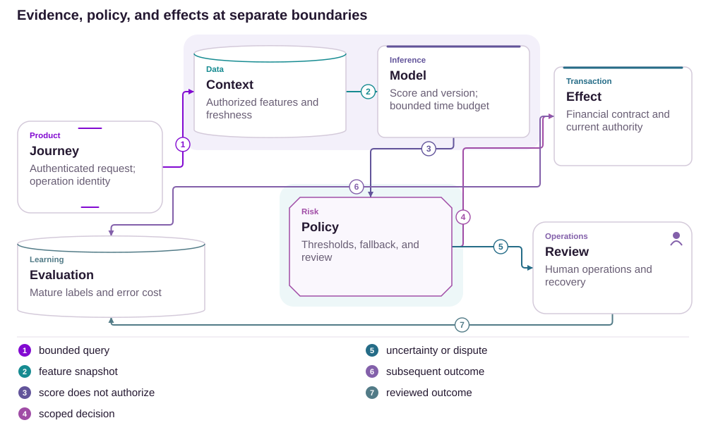

# 17 · Ultravioleta: one choice, one balance

Benefits · Consent · Units

[PT reader](https://wesleyvieira99.github.io/nu/#17-1) · [EN reader](https://wesleyvieira99.github.io/nu/en.html#17-1)

[Executable Python lab](../../labs/case_17.py)

## Confirmed redemption, disputed understanding


Actual crop of the public source, captured 23 October 2026. The text below includes the company reply and reported outcome.

In complaint 245086475, dated April 3, 2026, the customer said she understood points and cashback as separate benefits and requested reversal after redeeming cash. On April 6, Nubank stated that the balance was unified and the choice confirmed and irreversible, with 19,071.36 points redeemed for BRL 577.91 on April 1, 2026. It denied an operational failure. Status: Answered, without final evaluation. The page proves neither unauthorized activity nor the interface used.

My proposal addresses interpretation risk before confirmation while respecting the public irreversibility constraint. It does not promise to undo the transaction or treat the received amount as proven loss. The technical challenge is to bind an understandable explanation to the balance and quote that will be consumed.

- [Reclame AQUI · 245086475](https://www.reclameaqui.com.br/nubank/cliente-ultravioleta-se-sente-prejudicado-por-confusao-entre-cashback-e-pontos-no-app-nubank_L00uI85JWvpRpJLL/)
- [Termos Ultravioleta](https://nubank.com.br/contratos/termos-e-condicoes-nubank-ultravioleta)

## Two units do not create two assets

The public fact is a disagreement between expectation and the company’s stated rule. The interface cause is unknown: without the historical screen, we cannot assert labels, hierarchy or missing confirmation. My hypothesis is that presenting alternatives as two independent quantities can create an additive mental model. It is testable with prototypes and tasks without attributing that design to the actual app version.

I would start by asking participants to explain what will remain after each choice before allowing a simulated redemption. The correct outcome is understanding exclusivity, destination, quantity consumed and remaining balance, not merely locating a button. Research would include screen-reader users and different familiarity levels with points, avoiding a sample limited to experienced loyalty-program users.

In the domain I would look for a canonical unit and an identified quote. Switching presentation between cash and points should not duplicate a balance, and changing the quote during confirmation must not silently change the commitment. Comprehension evidence informs the experience; only current financial authorization permits benefit consumption.

## The preview is part of the commitment



Proposed external architecture; technologies illustrate choices, not confirmed internal systems.

Confirmation receives a quote from an authorized service, including balance version and expiry. Redemption consumes the canonical unit and persists a receipt atomically. Assisted review may explain or route an exception under policy; it receives no connection that automatically recreates points. The record combines decision and outcome under restricted access.

The lab deliberately executes only the cash alternative. Miles would require another contract and partner confirmation, not an improvised multiplication. Logos represent proposed responsibility choices without claiming where Nubank holds its benefit balance.

## Consume exactly the accepted preview

```python
    def redeem(self, actor, quote_id, choice, key, now):
        with self.lock:
            for value in (actor, quote_id, key):
                identifier(value)
            if type(now) is not int or now < 0:
                raise ValueError('invalid clock')
            if actor != self.owner:
                raise PermissionError('account scope')
            if choice != 'cash' or not key:
                raise ValueError('explicit supported choice required')
            command = (quote_id, choice)
            if key in self.receipts:
                old, receipt = self.receipts[key]
                if old != command:
                    raise ValueError('idempotency conflict')
                return receipt
            quote = self.quotes[quote_id]
            if now >= quote.expires_at:
                raise ValueError('quote expired')
            if quote.balance_version != self.version:
                raise ValueError('balance changed; preview again')
            if quote.points_minor > self.points:
                raise ValueError('insufficient points')
            self.points -= quote.points_minor
            self.cash += quote.cash_cents
            self.version += 1
            receipt = (quote_id, quote.points_minor, quote.cash_cents)
            self.receipts[key] = (command, receipt)
            return receipt
```

Literal excerpt from the executed lab; imports and initialization are in the full file.

Points use hundredths of a point and reais use cents, both integers. The fixture reproduces only the quantities published by the company, without inferring a universal commercial rate. The quote service is a simulated trusted dependency; the client cannot supply an arbitrary conversion value. An expired quote, changed version or unsupported choice produces no financial effect.

The same key returns the same receipt after commitment. Another key for the same quote encounters an incompatible balance version and fails. This is an execution property, not proof of informed consent: understanding the choice requires product and accessibility evaluation as well as backend atomicity.

- [Executable case lab on GitHub](https://github.com/wesleyvieira99/nu/blob/main/labs/case_17.py)

## Dart: consequence before the button

```dart
class RedemptionPreview {
  final int pointsConsumedMinor;
  final int cashReceivedCents;
  final int pointsRemainingMinor;
  final String quoteId;
  final DateTime expiresAt;
  const RedemptionPreview(this.pointsConsumedMinor,
      this.cashReceivedCents, this.pointsRemainingMinor,
      this.quoteId, this.expiresAt);
}

String consequenceLabel(RedemptionPreview preview) =>
    "This choice consumes the same benefit balance. "
    "Review the amount and remaining points before confirming.";
```

Illustrative Dart, unexecuted; monetary formatting and localization omitted.

I would organize the preview around one main sentence and three quantities: what leaves, what arrives and what remains. The unselected alternative appears as a use of the same balance, without presenting itself as a second asset. Confirmation must keep this information available when a keyboard, enlarged text or screen reader changes navigation.

A repeated generic warning can become noise. I would compare a concrete consequence with an additional confirmation box, measuring comprehension and errors rather than clicks. When the quote expires, the interface returns to preview and requires fresh confirmation; it does not update numbers behind an already accepted button. Irreversibility must be communicated without promising an operational exception.

## Units the contract cannot confuse

| Field | Unit | Invariant |
| --- | --- | --- |
| points_minor | 1/100 point | Nonnegative integer |
| cash_cents | 1/100 BRL | Authorized quote |
| balance_version | Revision | Revalidated at commit |
| quote_id | Opaque reference | Single financial use |

```json
{
  "schema": "redemption-preview.v1",
  "quote_id": "synthetic-quote",
  "choice": "cash",
  "points_consumed_minor": 1907136,
  "cash_received_cents": 57791,
  "points_remaining_minor": 0,
  "balance_version": 1,
  "irreversible_after_confirmation": true
}
```

Explanatory fixture of reported quantities; proposed contract unexecuted.

Point representation must state unit and precision at every boundary. A decimal without a unit can be interpreted as reais by a generic consumer. I would version the contract and reject unknown write fields while maintaining planned read compatibility. The quote includes an authorized destination and owner in the protected layer, not analytics.

The confirmation record should be sufficient to review which preview was presented without capturing an entire screen or travel data. Retention and access follow a policy agreed with Privacy. Reconstructing a decision does not require storing every gesture; it requires quote identity, copy revision and the financial result.

## The test separates UX from atomicity

```python
    def test_same_balance_cannot_be_spent_twice(self):
        self.b.redeem('owner', 'q1', 'cash', 'a', 100)
        with self.assertRaises(ValueError):
            self.b.redeem('owner', 'q1', 'cash', 'b', 101)
        self.assertEqual(self.b.points, 0)
        self.assertEqual(self.b.cash, 57_791)

    def test_retry_preserves_original_receipt(self):
        first = self.b.redeem('owner', 'q1', 'cash', 'a', 100)
        retry = self.b.redeem('owner', 'q1', 'cash', 'a', 900)
        self.assertEqual(first, retry)
        self.assertEqual(self.b.cash, 57_791)

    def test_expired_preview_has_no_financial_effect(self):
        with self.assertRaises(ValueError):
            self.b.redeem('owner', 'q1', 'cash', 'a', 200)
        self.assertEqual(self.b.points, 1_907_136)
        self.assertEqual(self.b.cash, 0)
        self.assertEqual(self.b.receipts, {})
```

Literal test excerpt; all 13 lab tests passed locally.

All thirteen tests passed. The suite includes concurrent contention, an unauthorized quote attempt, a wrong owner, conflicting key and an invalid clock, including NaN. These tests demonstrate no effect for rejected inputs and single consumption in the model. They do not demonstrate that a person understood the copy or that the quote reproduces real loyalty rules.

I would combine the suite with assisted tasks: choose cash, explain the remaining balance and recognize that miles are no longer available for that same quantity. Integration tests would cover confirmation after a balance change and response loss after commit. Review must accept technical evidence and comprehension separately; neither replaces the other.

## Measure understanding, preserve choice

Baseline is unknown. The proposed primary metric is correct comprehension: participants who explain remaining balance and exclusivity without help divided by participants reaching preview, per research round and access mode. A second measures attempts to use an already consumed alternative per completed redemption over seven days, with minimal collection and no automatic inference of regret.

Reversal-related contacts per thousand redemptions, split by preview version and modality, measure observed effort. Expiry followed by abandonment per expired preview measures friction cost. Duplicate consumption per quote is the financial guardrail: any confirmed occurrence suspends the pilot. All windows and segments would be fixed before comparison, with sufficient accessibility samples.

I would initially target improved comprehension without reducing legitimate completion through unnecessary barriers. Research comes first, followed by a controlled experiment on presentation only. Rates, entitlements and reversibility are not randomized. Fewer contacts without better comprehension may mean people stopped seeking help and do not justify expansion.

## Cost of understanding, not point value

BRL 577.91 is the credit reported in the individual response; it is neither proven loss nor proposal benefit. I assume 40,000 monthly redemptions, 1% with a material misunderstanding, BRL 45 handling per case and BRL 100 approved discretionary remediation in 15% of them. This yields BRL 60 per potentially avoidable case. I also assume BRL 4,500 monthly operations and BRL 150,000 implementation; no parameter is observed at Nubank.

| Scenario | Assumed prevention | Cases/month | Net potential |
| --- | --- | --- | --- |
| Conservative | 25% | 100 | BRL 1,500 |
| Base | 50% | 200 | BRL 7,500 |
| Ambitious | 75% | 300 | BRL 13,500 |

Monthly break-even is 75 avoided cases, or 18.75% of the assumed 400. Hypothetical investment recovery is 100, 20 and 11.11 months respectively, if those costs are genuinely avoidable. The remediation component assumes neither an entitlement nor an existing practice. Finance must separate variable cost from redeployed capacity; the latter does not automatically become cash.

The model should be rejected if research shows the issue is rare or the new flow does not change understanding. I do not monetize remaining points or extrapolate the complaint to the Ultravioleta population.

## From language hypothesis to integration

Days 0–15: Design Research runs tasks with alternative presentations; Benefits Product validates rules and destinations. The Staff engineer records units, quotes, versions and terminal states. Exit requires reproducing the comprehension problem in research without assuming the complaint proves a general cause.

Days 16–30: Mobile prototypes consequences and accessibility, backend creates bound quotes in a sandbox and Security reviews scope. Days 31–60: QA exercises expiry, concurrency and response loss; Privacy approves the minimal record. The technical exit is single consumption with a recoverable receipt; the product exit is demonstrated task comprehension.

Days 61–90: the EM coordinates a presentation cohort with Support monitoring and Finance review. Any benefit-contract change requires its own governance before rollout. This proposed horizon does not promise a product change within 90 days; it makes dependencies that could prevent the decision explicit.

## Fail before consumption, explain afterward

Rollout begins with preview in a controlled environment and quote shadowing. The financial path changes only after the service demonstrates atomic revalidation. I would simulate expiry while someone reads, a balance change in another session and response loss after credit. In every case, the app must show an honest state and prevent confirmation on different terms.

Benefits owns unit reconciliation; SRE monitors quote expiry and failures; Support receives the authorized preview record. Rollback may restore the previous presentation but must preserve lookup of receipts issued under the new version. No flag should make a confirmed transaction appear cancellable.

Expansion to miles would be a separate integration project with partner-confirmation semantics and pending-state handling. I would keep that boundary explicit so a copy improvement does not carry a new reversal promise or an unapproved economic change.

## My contribution: precision and empathy

As Staff, I would make unit, quote and version explicit domain concepts. One important decision would be to keep the canonical balance independent of display forms. I would reject maintaining two balances adjusted by separate events to represent one benefit because that increases reconciliation and permits divergent interpretations. The specific storage choice would depend on the existing system and migration cost.

As Engineering Manager, I would bring Research, Mobile, Benefits and Support together around the same task instead of distributing screen requirements alone. I would protect time for accessibility participants and failure drills, which often disappear when deadlines tighten. Delivery review would require one comprehension demonstration and one integrity demonstration.

The proposal combines respect for published rules with attention to the disputed experience. I do not need to assume a systemic defect to propose a verifiable improvement. This is the judgment I would bring to the role: separating what evidence supports, what code guarantees and what still requires validation with people.

## Handoff: review the full consequence

Run python3 labs/case_17.py -v. Inspect Quote and Benefits.issue before redeem: quote authority is part of the guarantee. Reproduce the fixture and confirm point reduction and a single credit. Advance the clock to expiry, change the replay key and try another owner; each path must preserve the stated boundary.

Acceptance requires explicit units, an authority-issued quote, revalidated balance, understood exclusivity, one effect and a receipt accessible after response loss. Financial integration, an actual expiry policy, signed or authenticated quote transport, persistence and copy review remain missing. The local test certifies neither legal compliance nor airline-partner redemption.

I would proceed if the preview improves understanding without inventing contractual flexibility. I would stop if the solution depends on promising a reversal the domain does not offer. The final reviewer demonstration should make it possible to explain aloud, without jargon, the balance before, the choice and the balance afterward.

- [Executable case lab on GitHub](https://github.com/wesleyvieira99/nu/blob/main/labs/case_17.py)
