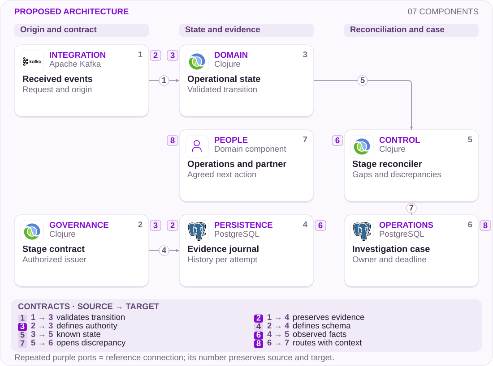

# 18 · NuCel: confirmation across two carriers

Number portability · Events · Accountability

[PT reader](https://wesleyvieira99.github.io/nu/#18-1) · [EN reader](https://wesleyvieira99.github.io/nu/en.html#18-1)

[Executable Python lab](../../labs/case_18.py)

## Cancellation did not resolve portability


Actual crop of the public source, captured 23 October 2026. The text below includes the company reply and reported outcome.

Complaint 254143071, dated July 17, 2026: the customer said she answered Vivo’s SMS, could not complete portability to NuCel and was charged. On July 24, Nubank stated that the donor had no recorded confirmation, and reported cancellation of the provisional line and adjustment of possible charges. The customer disputed the explanation, marked Not resolved and gave a zero score. No amount or independent evidence attributes the failure to either carrier.

The proposal focuses on confirmation traceability and responsibility for the next step. It does not confuse administrative closure with completion of the original intent. Cancellation may be a valid customer choice; it is not equivalent to porting the number, and the displayed state should preserve that distinction.

- [Reclame AQUI · 254143071](https://www.reclameaqui.com.br/nubank/falha-na-portabilidade-da-linha-vivo-pre-pago-para-nubanknucel-com-cobranca-indevida_6p5gIX1MMyDPSDus/)

## What each confirmation actually proves


Official Nubank tutorial, 10 October 2025. Product context; this is not a recording of the complaint.

Answering a message, the carrier recording the response and the number becoming active are distinct events. My falsifiable hypothesis is that a correlated journal could locate the boundary lacking evidence and reduce circular handoffs. I would inspect shared identifiers, callback contracts, clocks and retry policy with the partner without assuming that a specific webhook caused this episode.

Nubank’s official video about portability with physical and virtual SIMs, published October 10, 2025, provides product context. It is neither a record of this incident nor proof that confirmation reached the donor. I would use it to align self-service instructions with observable states and validate whether someone can identify who should act next.

- [Nubank · Portabilidade NuCel · vídeo oficial](https://www.youtube.com/watch?v=0-Sftqs-plI)
- [Guia oficial de portabilidade](https://blog.nubank.com.br/portabilidade-celular-como-funciona/)

## Compare occurrence and confirmation



Proposed external architecture; technologies illustrate choices, not confirmed internal systems.

The contract defines who may declare each stage. Operational state and journal receive the same event, but reconciliation compares what was applied with what was observed. A gap creates an investigation with an owner, reference and next deadline; it does not invent confirmation. The people node has no technology logo because it represents coordination rather than software.

The proposed journal does not include SMS content. Donor authorization and recipient activation remain distinct. Provisional billing requires its own integration and policy; this design assumes no refund entitlement and changes no telecommunications contract.

## Origin is part of the event

```python
    def apply(self, event, authenticated_source):
        with self.lock:
            for value in (event.event_id, event.request_id, event.kind, event.source):
                identifier(value)
            if event.request_id != self.request_id:
                raise ValueError('request scope')
            if event.source != authenticated_source:
                raise PermissionError('untrusted source')
            if self.SOURCES.get(event.kind) != event.source:
                raise PermissionError('event authority')
            if type(event.sequence) is not int or event.sequence < 1:
                raise ValueError('invalid sequence')
            if event.event_id in self.seen:
                if self.seen[event.event_id] != event:
                    raise ValueError('event identity conflict')
                return self.state
            if event.sequence <= self.sequences.get(event.source, 0):
                raise ValueError('out-of-order; reconcile')
            allowed = {'sms_sent': ('REQUESTED',),
                       'donor_authorized': ('WAIT_DONOR',),
                       'activated': ('AUTHORIZED',),
                       'cancelled': ('REQUESTED', 'WAIT_DONOR', 'AUTHORIZED')}
            if self.state not in allowed[event.kind]:
                raise ValueError('invalid transition; reconcile')
            self.state = {'sms_sent': 'WAIT_DONOR', 'donor_authorized':
                          'AUTHORIZED', 'activated': 'ACTIVE',
                          'cancelled': 'CANCELLED'}[event.kind]
            self.seen[event.event_id] = event
            self.sequences[event.source] = event.sequence
            self.journal.append(event)
            return self.state
```

Literal excerpt from the executed lab; imports and initialization are in the full file.

The model accepts donor authorization only from its corresponding issuer, and activation only after that authorization. A report of an answered SMS can open an investigation but cannot simulate intercompany confirmation. Repeated events are deduplicated; reusing identity with different content fails. Sequence is per issuer, avoiding comparison of different systems’ numbers as if they formed a global clock.

Cancellation is terminal for that attempt. A late activation cannot resurrect the request: it requires reconciliation. The source parameter represents an already authenticated adapter; a string sent by the app would not be production authentication. Cryptographic validation, holder binding and durable storage still need to exist outside this lab.

- [Executable case lab on GitHub](https://github.com/wesleyvieira99/nu/blob/main/labs/case_18.py)

## Dart: show dependency without blame

```dart
enum PortState { requested, waitingDonor, authorized, active, cancelled }

String nextStep(PortState state) => switch (state) {
  PortState.requested => "Follow the verified confirmation instructions",
  PortState.waitingDonor => "Confirmation pending; track investigation",
  PortState.authorized => "Authorization received; activation pending",
  PortState.active => "Portability completed",
  PortState.cancelled => "This attempt was cancelled; review billing status",
};

// Billing status is a separate authorized projection.
// A customer tap does not produce donor authorization.
```

Illustrative Dart, unexecuted; final copy requires research and localization.

I would avoid showing only pending. People need to distinguish an instruction they can perform, confirmation dependent on another organization and an ongoing investigation. The interface offers an update and help channel using the same identifier, without telling them to repeat a cancelled process or switch carriers blindly. Copy explains the known state without assigning unproven blame.

Billing and portability appear as separate dimensions. A financial adjustment under review cannot become an active line, and a cancelled line does not prove a completed credit. Mobile consumes authorized, accessible projections; the domain decides transitions. I would require joint NuCel Operations and Support review before publishing labels.

## Attempts do not share confirmation

| Field | Meaning | Owner |
| --- | --- | --- |
| request_id | One attempt | Recipient |
| issuer | Who asserts the fact | Authenticated adapter |
| sequence | Order per issuer | Issuing partner |
| billing_case_id | Separate review | Financial operations |

```json
{
  "schema": "portability-event.v1",
  "event_id": "synthetic-donor-confirmation",
  "request_id": "synthetic-attempt-2",
  "issuer": "donor",
  "kind": "donor_authorized",
  "sequence": 7,
  "billing_effect": "NONE"
}
```

Illustrative contract, unexecuted; no phone number or SMS content.

A second attempt receives a new identity. Evidence from the first may help Support but does not automatically authorize the second. I would retain occurrence and receipt timestamps to investigate delay without ordering all partners by one clock. The lab rejects an early event for review; a real system may park it in a durable queue and replay it after filling the gap.

The customer-facing tracking record uses an opaque reference and stage, without a full phone number. The identity-resolution table has stricter access and defined retention. The integration owner reviews schema breaks with the partner; Support should neither interpret raw payloads nor turn an absent event into an accusation against the customer.

## Reproduce the intercompany gap

```python
    def test_user_sms_claim_cannot_authorize_donor(self):
        event = Event('d', 'request-a', 'donor_authorized', 'owner', 1)
        with self.assertRaises(PermissionError):
            self.p.apply(event, 'owner')
        self.assertEqual(self.p.state, 'WAIT_DONOR')

    def test_late_activation_cannot_revive_cancelled_request(self):
        cancel = Event('c', 'request-a', 'cancelled', 'owner', 1)
        self.p.apply(cancel, 'owner')
        late = Event('a', 'request-a', 'activated', 'recipient', 2)
        with self.assertRaises(ValueError):
            self.p.apply(late, 'recipient')
        self.assertEqual(self.p.state, 'CANCELLED')

    def test_early_activation_requires_reconciliation(self):
        event = Event('a', 'request-a', 'activated', 'recipient', 2)
        with self.assertRaises(ValueError):
            self.p.apply(event, 'recipient')
        self.assertNotIn('a', self.p.seen)
        self.assertEqual(self.p.state, 'WAIT_DONOR')
```

Literal test excerpt; all 12 lab tests passed locally.

All twelve tests passed. The suite covers the complete path, duplicates, a different request, spoofed issuer, stale sequence and replay after the missing authorization arrives. The central scenario is adverse: activation received before the necessary evidence cannot become success. Cancellation retains its meaning even when delayed events arrive.

In the integrated environment I would test signed callbacks, partner unavailability and diverging clocks. I would also simulate Support querying two similar attempts to verify isolation. These tests prove neither SMS delivery, network quality nor regulatory compliance. Those require partners, devices and telecommunications specialists with their own test plan and evidence.

## Measure completion and limbo separately

Baseline is unknown. Completion should count effectively active numbers divided by started eligible attempts, in weekly cohorts segmented by donor and SIM type. Cancellations appear as a separate outcome. The second metric is confirmation wait time: distribution from request to authorized event, including open cases as censored rather than treating them as instantaneous or excluding them.

The third measures investigations with a next step and owner divided by open discrepancies, daily. The fourth measures disputed billing without a decision per cancelled attempt over seven days; it does not presume improper billing. The fifth is transitions without authorized evidence per applied transition, with a proposed zero-tolerance expansion guardrail. Sensitive data stays out of labels and aggregate dashboards.

I would compare equivalent cohorts after observing seasonality and carrier mix. The improvement must increase actual completion or reduce limbo without pushing cancellations. If the average improves because difficult cases are closed earlier, the pilot has failed the original intent and requires review.

## Value of a genuinely activated line

The complaint publishes neither charge nor refund amounts. The proposed scenario uses a hypothetical cohort of 5,000 eligible requests, six active months per incremental line and BRL 12 contribution per active month after assumed variable costs. I include BRL 5,000 pilot operations and BRL 20,000 incremental implementation using existing infrastructure. This budget does not estimate a complete telecom rebuild; every input is assumed.

| Scenario | Absolute uplift | Extra lines | Six-month net |
| --- | --- | --- | --- |
| Conservative | 2 pp | 100 | −BRL 17,800 |
| Base | 5 pp | 250 | −BRL 7,000 |
| Ambitious | 8 pp | 400 | BRL 3,800 |

The formula is requests × absolute activation uplift × active months × monthly contribution, less BRL 25,000 costs. Break-even requires approximately 347.22 equivalent lines, or at least 348 whole lines, 6.96 percentage points for 348 lines. The conservative and base scenarios do not pay for the pilot; that is decision information, not a flaw to conceal.

Revenue is not margin, and activation without retention does not realize six months of contribution. Finance would need to validate churn, subsidy, Support and partner cost. I use neither banking ARPAC as telecom margin nor disputed charges as benefit.

## Dependencies that determine the schedule

Days 0–15: NuCel Operations and the donor-integration owner catalog events, authorizations and terminal states. The Staff engineer identifies correlation gaps; Product defines completion from the customer’s perspective. Exit requires a stage-level responsibility contract and an investigation path both organizations can execute.

Days 16–30: backend builds a journal and reconciler in a sandbox, Mobile tests messages and Finance separates billing tracking. Days 31–60: QA injects missing, duplicate and delayed events with the partner; Support rehearses a second attempt without losing context. Exit is locating the pending boundary without exposing a full number or SMS content.

Days 61–90: the EM coordinates a pilot limited by operational capacity and reviews investigation cost. Expansion depends on partner acceptance, reconciliation and actual completion, not closed tickets. The schedule is conditional; if no verifiable donor response exists, no team should pretend a screen alone has solved the problem.

## Operate discrepancies without losing the customer

I would start the journal in shadow mode without changing transitions or billing. Reconciliation would surface cases to a small team with a queue limit and next-update deadline. Only after validation would the new state reach customers. A sudden increase in discrepancies may indicate a broken contract rather than a real increase in portability failures.

The integration owner receives missing-confirmation and unexpected-sequence alerts; Operations decides the donor handoff; Finance tracks authorized adjustments separately. The main drill is activation after cancellation: a line cannot be considered desired merely because a callback arrived. Resolution must verify the actual state on both sides.

Rollback disables new automated decisions while keeping the journal for investigation. It neither deletes evidence nor reopens cancelled requests. The customer receives an explanation of what is known, what is missing and the next update, without a deadline promise the partner has not accepted.

## My contribution: coordinate boundaries

As Staff, I would separate authorization evidence, operational state and support interpretation. I would reject advancing portability solely on a claim that the SMS was answered because that crosses donor authority. I would also reject treating every timeout as final failure: delay requires investigation and may be reconciled. Explicit states prevent implementation convenience becoming a product rule.

As Engineering Manager, I would organize work with an owner per contract and next action, including the partner in the dependency plan. Review would locate missing evidence and who can obtain it rather than assign blame. Protecting that discipline lets the team respond to customers without creating pressure to manufacture confirmation.

I would bring a definition of done that includes support continuity and billing reconciliation. I claim no internal NuCel experience; I demonstrate how I would investigate a distributed journey where one party’s technical success can still leave the customer’s intent unfinished.

## Handoff: show who may assert what

Run python3 labs/case_18.py -v. Follow Portability.apply and the SOURCES table. Send activation before authorization, confirm no progress, add the missing evidence and replay the event. Then cancel another attempt and send a late activation. The contrast demonstrates why arrival order, authority and current intent must be assessed separately.

The checklist requires isolation between attempts, authenticated issuers, deduplication, unexpected-order reconciliation, respected cancellation and independent financial state. Real callbacks, signatures, persistence, partner investigation, consents and device testing remain missing. The lab includes neither billing nor refunds and cannot certify real number portability.

I would recommend proceeding when the organizations can resolve a synthetic discrepancy using a shared reference and response deadline. I would stop if the solution depends on hiding absent confirmation or redefining cancellation as success. The reviewer should be able to point to each diagram edge and identify which contract authorizes the next state.

- [Executable case lab on GitHub](https://github.com/wesleyvieira99/nu/blob/main/labs/case_18.py)
