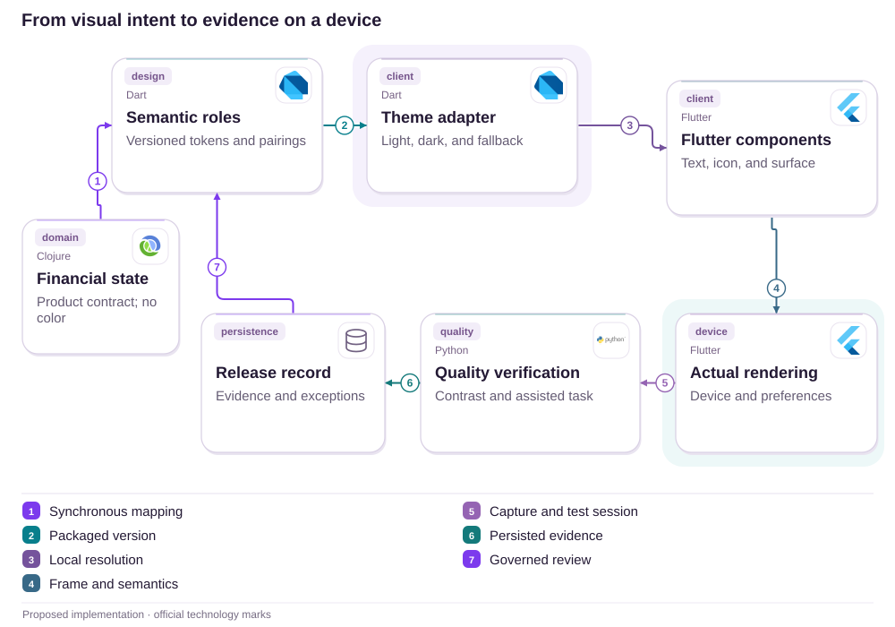
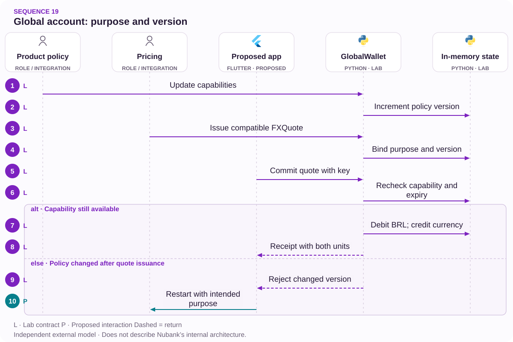

# 19 · Global Account: purpose before FX

Capabilities · Quotes · Expectations

[PT reader](https://wesleyvieira99.github.io/nu/#19-1) · [EN reader](https://wesleyvieira99.github.io/nu/en.html#19-1)

[Executable Python lab](../../labs/case_19.py)

## A limitation, an acknowledged resolution


Actual crop of the public source, captured 23 October 2026. The text below includes the company reply and reported outcome.

Complaint 243002037, dated March 11, 2026: the customer said he converted approximately BRL 50,000 to euros for an external transfer and alleged BRL 1,600 in taxes and fees upon discovering the limitation. On March 18, Nubank explained purchases and withdrawals, without external transfers in that product, and reported a private solution. On March 21, the customer marked Resolved, scored service 10 and continued the relationship. Final resolution terms and amounts were not published.

The proposal identifies purpose before creating a costly conversion. It does not suggest the complaint remains open or turn an expectation into proof of a promised feature. The technological integration mentioned in the complaint does not mean every capability of another product is present.

- [Reclame AQUI · 243002037](https://www.reclameaqui.com.br/nubank/conversao-para-euro-na-conta-global-nubank-gerou-prejuizo-de-r1600-por-limitacao-nao-clara-do-servico_hPjBF5ut2RIkdhxz/)

## Capability is product-specific

A euro balance answers which currency someone holds, not which actions they can perform. The design hypothesis is that asking purpose before quotation exposes mismatches early: card spending, withdrawal and sending to others are different tasks. I would test whether the question is understandable without requiring knowledge of infrastructure or the underlying partner.

Investigation would map capabilities by product, currency, destination and applicable version. The reported facts are the unmet expectation and acknowledged resolution; we do not know the historical screen or exact contracting sequence. I would therefore not attribute the cause to missing copy. A prototype must demonstrate that the new sequence prevents incompatible conversion without blocking legitimate uses.

The official international-transfer article provides scope context but does not replace historical review of an individual contract. I would keep a versioned catalog and decision provenance rather than present current capability as proof of what was available on another date.

- [Nubank · Transferência internacional](https://blog.nubank.com.br/transferencia-internacional-o-que-e-e-como-fazer/)

## Capability travels with the quote



Proposed external architecture; technologies illustrate choices, not confirmed internal systems.

The catalog permits or rejects purpose before issuing a quote. The preview carries the considered revision, but commit checks current policy again: a capability removed during reading invalidates execution. Reconciliation validates the financial effect; the record may support an approved catalog revision without a complaint automatically changing capabilities.

The design does not create international remittances. It prevents a remittance intent from proceeding as conversion in another product. The lab models only one synthetic card-spending, currency and country combination; supporting new combinations requires separate decisions and integrations.

## A quote does not outlive policy

`Capability Preflight [lab]` · `Version-bound Quote [lab]`

```python
    def commit(self, actor, quote_id, key, now):
        with self.lock:
            for value in (actor, quote_id, key):
                identifier(value)
            if type(now) is not int or now < 0:
                raise ValueError('invalid clock')
            if actor != self.owner:
                raise PermissionError('account scope')
            if not key:
                raise ValueError('idempotency key required')
            if key in self.receipts:
                if self.receipts[key][0] != quote_id:
                    raise ValueError('idempotency conflict')
                return self.receipts[key]
            quote = self.quotes[quote_id]
            capability = (quote.purpose, quote.currency, quote.country)
            if quote.capability_version != self.version:
                raise ValueError('capability changed; start again')
            if capability not in self.allowed or now >= quote.expires_at:
                raise ValueError('not executable')
            if quote.debit_cents > self.balance:
                raise ValueError('insufficient funds')
            if any(r[0] == quote_id for r in self.receipts.values()):
                raise ValueError('quote already consumed')
            self.balance -= quote.debit_cents
            self.foreign[quote.currency] = self.foreign.get(quote.currency, 0) + \
                quote.foreign_minor
            receipt = (quote_id, quote.debit_cents, quote.foreign_minor)
            self.receipts[key] = receipt
            return receipt
```

Literal excerpt from the executed lab; imports and initialization are in the full file.

The quote binds purpose, currency, country, amount and capability version. The write checks owner, validity and balance, consuming the quote once. Replaying the same key retrieves the committed receipt even after policy changes; a new execution encounters an incompatible revision and stops. Expiry does not trigger automatic reverse conversion: nothing was debited before commit.

Test values are synthetic and represent neither a historical exchange rate nor taxation. The catalog is local and issuer authorization is simulated. In production, a durable financial authority must preserve atomicity across debit, foreign balance and receipt, alongside approved pricing and product rules.

- [Executable case lab on GitHub](https://github.com/wesleyvieira99/nu/blob/main/labs/case_19.py)

## An explicit capability contract

`Capability Preflight [proposal]` · `Version-bound Quote [proposal]`

```typescript
type Purpose = "card_spend" | "cash_withdrawal" | "external_transfer";

type Capability = {
  product: "global-demo";
  purpose: Purpose;
  currency: "EUR" | "USD";
  country: string;
  revision: number;
  allowed: boolean;
  explanationCode: string;
};

function canRequestQuote(c: Capability): boolean {
  return c.allowed && c.revision > 0;
}
// The backend revalidates capability at financial commit.
```

Illustrative TypeScript, unexecuted; types do not replace runtime validation.

The contract makes rejection specific: this product does not support this purpose under the queried conditions. The interface can explain the limitation before showing a price, without suggesting that someone convert first and find out later. I would avoid a huge on-device catalog; the service responds only to the current intent with a revision and publishable reason.

Product owns capability; Pricing owns quotation; financial authority owns the effect. These boundaries allow a feature to change without rewriting FX calculations. The service must treat missing responses as unknown, not permission. Compile-time typing helps development, but external data requires its own validation and authentication.

## Retain intent, minimize exposure

`Capability Preflight [proposal]` · `Version-bound Quote [proposal]`

| Record | Minimum fields | Use |
| --- | --- | --- |
| Capability | purpose + revision | Explain decision |
| Quote | amounts + expiry | Revalidate preview |
| Commitment | quote_id + receipt | Prevent duplication |
| Review | reason + reference | Investigate exception |

```json
{
  "schema": "capability-check.v1",
  "product": "global-demo",
  "purpose": "external_transfer",
  "currency": "EUR",
  "country": "IE",
  "revision": 1,
  "allowed": false,
  "quote_id": null
}
```

Proposed synthetic contract; no conversion should originate from this rejection.

Purpose should support the decision without collecting unnecessary family history, travel details or documents. Country in the model is a technical capability dimension, not an inference of nationality. Privacy review defines retention and permitted use. A support reference allows rejection investigation without copying financial data into the ticket.

The contract evolves through explicit revisions. An incompatible change can invalidate an open preview and require new confirmation; it does not change an issued receipt. I would retain the version used to explain historical decisions without indefinitely freezing a permission the product no longer offers.

## Reject before charging

`Capability Preflight [lab]` · `Version-bound Quote [lab]`

```python
    def test_unsupported_transfer_never_debits(self):
        q = FXQuote('no', 'owner', 'external_transfer', 'EUR', 'IE',
                    10_000, 1500, 1, 200)
        with self.assertRaises(ValueError):
            self.w.issue(q, 'pricing')
        self.assertEqual(self.w.balance, 100_000)
        self.assertNotIn('no', self.w.quotes)

    def test_capability_change_invalidates_old_preview(self):
        self.w.update_capabilities(set(), 'product-policy')
        with self.assertRaises(ValueError):
            self.w.commit('owner', 'q', 'a', 100)
        self.assertEqual(self.w.foreign, {})

    def test_expiry_does_not_trigger_reverse_conversion(self):
        with self.assertRaises(ValueError):
            self.w.commit('owner', 'q', 'a', 200)
        self.assertEqual(self.w.balance, 100_000)
        self.assertEqual(self.w.receipts, {})
```

Literal test excerpt; all 14 lab tests passed locally.

All fourteen tests passed, including invalid clocks, concurrent replay, a second key for the same quote, wrong owner and unauthorized capability changes. The first test deliberately targets incompatible intent: rejection happens before quote issuance and does not modify balance. The expiry test proves absence of debit, not a later refund.

Integration would need to test policy changes between quote and commit across separate processes, partial ledger failure and receipt lookup after timeout. I would also assess whether screen readers identify the limitation before price. No local test calculates taxes, validates rates or asserts that the historical product should have offered external transfers.

## Success means a compatible purpose

Baseline is unknown. I would measure incompatibility discovered before FX: unsupported intents identified before quotation divided by unsupported intents confirmed through research or review, weekly. This denominator requires a reviewed sample; it cannot be inferred only from people clicking help. Another metric is limitation comprehension among exposed participants, segmented by access mode.

Conversion followed by a capability-related contact within seven days per completed conversion measures a friction signal without proving causality. Incorrect blocking of a supported purpose per reviewed intent measures catalog harm. Commit with an invalid capability version per commit is the technical guardrail. Collection uses reason codes, version and aggregate counts without recipient data.

The proposed experiment changes information order, not prices or entitlements. Expansion considers comprehension and false negatives alongside conversion, avoiding rewards for a flow that reduces problems simply by blocking everything. Any debit following capability rejection or data exposure stops the pilot.

## An avoided conversion also has a cost

The approximately BRL 50,000 converted and BRL 1,600 costs are individual allegations; the case was resolved without disclosing compensation. They are not recovered revenue. For planning I assume 10,000 monthly intents, 2% mismatched, BRL 30 handling and BRL 100 remediation in 20% of cases. I subtract BRL 3 forgone contribution per avoided conversion, BRL 3,000 monthly operations and BRL 80,000 implementation.

| Scenario | Assumed prevention | Avoided cases | Net potential/month |
| --- | --- | --- | --- |
| Conservative | 25% | 50 | −BRL 650 |
| Base | 50% | 100 | BRL 1,700 |
| Ambitious | 75% | 150 | BRL 4,050 |

Each avoided case is hypothetically worth BRL 30 + 20% × BRL 100 − BRL 3 = BRL 47 before operations. Break-even is 63.83 cases per month, or 31.915% of the assumed 200. Implementation recovery would take 47.06 months in the base scenario and 19.75 in the ambitious scenario if costs materialize as savings; it does not occur in the conservative scenario.

All business inputs are assumed. Tax is not bank margin; costs spared to customers are another dimension and are not added to company results. I would revisit the project if required prevention exceeds research evidence or integration requires materially greater investment.

## Owners of capability and price

Days 0–15: Global Product identifies capabilities and revisions with the partner; Research validates the purpose question. The Staff engineer documents the capability-versus-price boundary. Exit requires a small authorized catalog with negative examples, not a list inferred from marketing or another company’s features.

Days 16–30: backend implements queries and preview in a sandbox; Mobile evaluates accessibility and localization. Days 31–60: QA exercises policy-change races, expiry and receipt lookup after timeout; Pricing and Finance accept revalidation. The gate requires rejection without debit while supported uses remain possible.

Days 61–90: the EM coordinates a presentation pilot and reviews false-blocking cost. Support receives consistent reasons and Product accepts comprehension metrics. The schedule is proposed and integration-dependent; actually adding international transfers is a different initiative with its own risks and contracts, not a shortcut in this plan.

## Change the catalog safely

The first stage runs the catalog in shadow mode and compares decisions with current policy. Differences need Product review rather than automatic adjustment to increase conversion. A new revision is published with identity, regression examples and an owner. If the catalog does not respond, the system reports an unavailable query and does not issue an authorized quote by assumption.

SRE monitors availability and revision age; Product owns false negatives and incorrect capabilities; Finance reconciles effects. I would exercise capability removal during confirmation and restoration of the previous version. Rollback must consider open quotes: compatibility policy determines which remain valid without reinterpreting committed receipts.

Incident communication distinguishes query failure from product unavailability. A potentially costly reverse conversion should not be offered as an automatic alternative. An assisted case queries authorized history and applies approved policy, keeping an individual resolution separate from a general refund promise.

## My contribution: model the intent

As Staff, I would bring purpose into the contract before pricing, with a revision bound through commit. I would reject a generic footer warning alone: it does not prevent an incompatible journey from advancing and makes comprehension difficult to verify. I would also avoid encoding capability rules in multiple clients because a product change would leave older versions making different promises.

As Engineering Manager, I would organize agreement across Product, the partner, Pricing, Mobile and Support, exposing early the decisions engineering cannot make alone. Priority would be a small journey slice with comprehension evidence before catalog expansion. I would track contract dependencies and research quality, not merely the number of screens delivered.

The resolved case also shows value in support acknowledged by the customer. My proposal does not erase that outcome: it tries to move explanation earlier so fewer people need a later resolution. That balance between learning and precision is the contribution I propose for the role.

## Handoff: follow a rejection without effect

Run python3 labs/case_19.py -v. Start at GlobalWallet.issue with external_transfer and observe that no quote is recorded. Then use the card_spend fixture, change capabilities before commit and confirm no movement. Finally complete a valid operation and replay the key after changing policy: the original receipt remains queryable without another effect.

Acceptance: explicit purpose, rejection before cost, revalidated version, a quote consumed once, valid clock and protected balance. Production still requires real pricing, applicable tax rules, transactional authority, authentication, reconciliation and a product-authorized catalog. The model is not an FX implementation and determines neither the rate nor the remedy appropriate to the public case.

I would proceed if someone understands the limitation before committing funds and the backend preserves it during an update race. I would stop if the catalog lacks an owner or depends on inferences about another product. Final review must show both an allowed path and a useful rejection without a debit.

- [Executable case lab on GitHub](https://github.com/wesleyvieira99/nu/blob/main/labs/case_19.py)

## Patterns with proof

`Capability Preflight [lab]` · `Version-bound Quote [lab]` · `Policy boundary [proposal]` · `Spring Boot [proposal]` · `Spring AI [proposal]`

| Mechanism | Implementation | Evidence |
| --- | --- | --- |
| Capability Preflight | GlobalWallet.issue | an unsupported purpose cannot cause a debit |
| Version-bound Quote | GlobalWallet.commit | a capability change invalidates the previous quote |
| Policy boundary / capability catalog | Production proposal | Adapters keep authority outside the UI. |

**Java integration · proposed**

Spring Boot + versioned capability service. Port the invariants and contract tests before replacing the Python model. A process lock is not distributed concurrency control; persistence, authorization and recovery need integration tests.

**AI assessment · Spring AI**

Proposed experiment: Spring AI to present approved catalog capabilities without inventing functions. Read-only tools, source citations, a token budget and human approval are required. It cannot authorize money, eligibility or identity. No LLM integration is claimed by the Python tests.

- [P1 · GlobalWallet.issue](https://github.com/wesleyvieira99/nu/blob/main/labs/case_19.py#L41)
- [P1 · test_unsupported_transfer_never_debits](https://github.com/wesleyvieira99/nu/blob/main/labs/case_19.py#L107)
- [P2 · GlobalWallet.commit](https://github.com/wesleyvieira99/nu/blob/main/labs/case_19.py#L60)
- [P2 · test_capability_change_invalidates_old_preview](https://github.com/wesleyvieira99/nu/blob/main/labs/case_19.py#L115)
- [Spring AI · MCP integration](https://docs.spring.io/spring-ai/reference/api/mcp/mcp-overview.html)

## Execution sequence



No FX, tax or remittance is executed. A synthetic capability does not prove a Nubank product offering.

**Authority and failure boundary**

an unsupported purpose cannot cause a debit. a capability change invalidates the previous quote.

The sequence describes the proposed integration. The linked lab verifies the domain invariant with synthetic data; external services, network retries and deployment remain integration work.

- [issue](https://github.com/wesleyvieira99/nu/blob/main/labs/case_19.py#L41)
- [commit](https://github.com/wesleyvieira99/nu/blob/main/labs/case_19.py#L60)

## Features, stories and acceptance

**F19.1 · Purpose before conversion · D16–30**

As a customer, I want to confirm whether the intended operation is supported. Acceptance: an unsupported purpose cannot cause a debit.

**F19.2 · Revalidated capability · D31–60**

As a customer, I want to commit against the capability shown in the preview. Acceptance: a capability change invalidates the previous quote.

**F19.3 · Measured rollout · D61–90**

As the product owner, I want an eligible cohort with a comparable control. Acceptance: the case metric, denominator, cost and safety barrier are registered before exposure; reconciliation failures stop expansion.

Linked tests exercise the stated domain acceptance condition, not the complete interface or production integration. D0–15 is discovery: confirm the public report against authorized internal samples, map dependencies and approve contracts. These are incremental planning windows, not a delivery commitment. EM owns coordination; Staff owns cross-domain contracts; Product and the domain owner accept outcomes.

- [Acceptance F19.1](https://github.com/wesleyvieira99/nu/blob/main/labs/case_19.py#L107)
- [Acceptance F19.2](https://github.com/wesleyvieira99/nu/blob/main/labs/case_19.py#L115)

## Method and sensitivity

**Scenario sensitivity · BRL**

All inputs are scenario assumptions, not measured Nubank effects. Capacity equivalent is not cash saved. The realization slider reduces benefit only; all costs remain at their scenario values. This is sensitivity analysis, not a probability or a causal estimate. Variable cost is the assumed forgone contribution; it also remains fixed in this stress test.

period_net = benefit × realization − variable_cost − run_cost; first_year = 12 × period_net − build_cost

Period / Período: `month`. Values / Valores: BRL.

| Scenario / Cenário | Benefit / Benefício | Variable cost / Variável | Run cost / Operação | Build / Implementação |
| --- | ---: | ---: | ---: | ---: |
| Conservative | 2500.00 | 150.00 | 3000.00 | 80000.00 |
| Base | 5000.00 | 300.00 | 3000.00 | 80000.00 |
| Ambitious | 7500.00 | 450.00 | 3000.00 | 80000.00 |

| Scenario / Cenário | Period net at 100% / Líquido | Horizon after build / Horizonte | Horizon at 50% / Estresse |
| --- | ---: | ---: | ---: |
| Conservative | -650.00 | -87800.00 | -102800.00 |
| Base | 1700.00 | -59600.00 | -89600.00 |
| Ambitious | 4050.00 | -31400.00 | -76400.00 |

[Reproducible scenario inputs](../../models/normalized-scenarios.json) · [Decimal simulator](../../models/simulate.py)

| Decision | Case-specific method |
| --- | --- |
| Baseline / threat | Baseline: mismatches identified before exchange. Threat: improving the metric by blocking every operation. |
| Unit economics | Avoidable cost minus forgone contribution and operation; the converted amount is not profit. |
| Proposed experiment | Change information order, not price or rights; measure understanding, false negatives and completion. |
| Stop rule | Stop for a debit after capability denial or exposed data. |

- [Reclame AQUI · ID 243002037](https://www.reclameaqui.com.br/nubank/conversao-para-euro-na-conta-global-nubank-gerou-prejuizo-de-r1600-por-limitacao-nao-clara-do-servico_hPjBF5ut2RIkdhxz/)
- [FinOps Foundation · Unit Economics](https://www.finops.org/framework/capabilities/unit-economics/)
- [Microsoft Research · Pre-experiment design](https://www.microsoft.com/en-us/research/articles/patterns-of-trustworthy-experimentation-pre-experiment-stage/)
