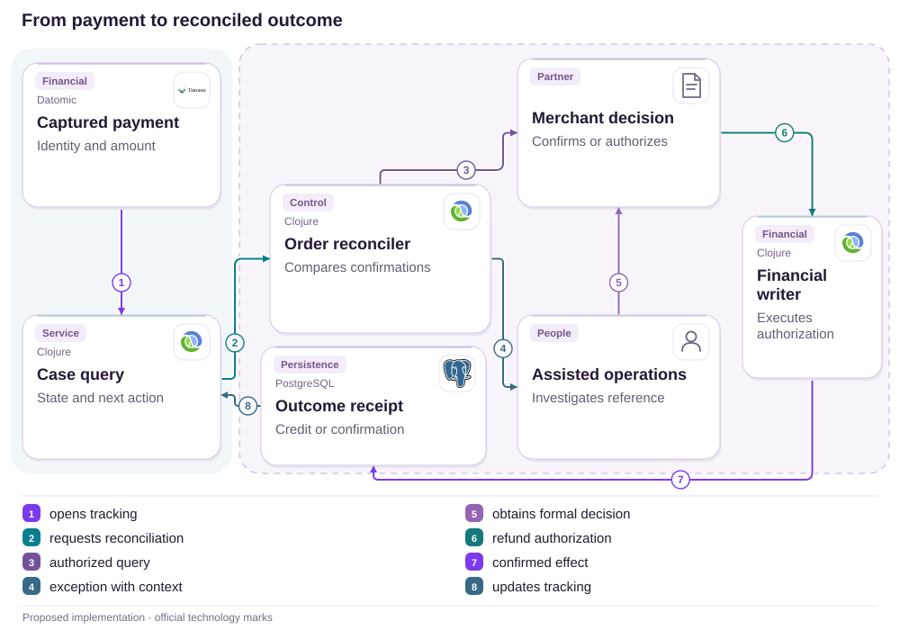

# 20 · NuPay: confirmed payment, missing order

Reconciliation · Partners · Continuity

[PT reader](https://wesleyvieira99.github.io/nu/#20-1) · [EN reader](https://wesleyvieira99.github.io/nu/en.html#20-1)

[Executable Python lab](../../labs/case_20.py)

## Refund completed, waiting time disputed


Actual crop of the public source, captured 23 October 2026. The text below includes the company reply and reported outcome.

Complaint 255046021, dated July 28, 2026: the customer said a May purchase from Cobasi paid through NuPay was charged without a processed order. On August 3, Nubank reported contacting the store, which found the payment and refunded it fully on July 30. On August 4, the customer marked Resolved but scored service zero for support and delay. The amount and technical cause are not public; no final loss is established.

The response also separates payment intermediation from the purchase-cancellation decision. My proposal preserves that authority while improving gap detection, tracking and reconciliation. It assumes neither a lost webhook nor unilateral refunds as the solution to every timeout.

- [Reclame AQUI · 255046021](https://www.reclameaqui.com.br/nubank/pagamento-nupay-aprovado-pedido-nao-processado-e-meu-dinheiro-nao-foi-devo_zWbyC-MKbLgrVXSU/)

## Two systems can disagree without lying

Captured payment and acknowledged order are different facts. A customer sees one purchase, but payment and fulfillment authorities may confirm stages at different times. The design hypothesis is that early identification of payments without order acknowledgment, using a shared reference, reduces time to useful investigation. The complaint does not reveal where the inconsistency originated.

I would start with the merchant contract: transaction identity, order reference, terminal states and an authorized query method. An absent order in customer history does not prove absence in the commercial system; reconciliation must seek evidence from authorized sources. The app should show what is confirmed and what is under review without making the customer arbitrate competing accounts between companies.

I would also investigate support continuity: who owned the case and when was the next update? Resolution with a zero score shows that financial recovery and the waiting experience deserve separate metrics. We cannot infer exact operating duration from the score, but we can define a better contract that prevents ownerless investigations.

## Investigation does not create refund authority



Proposed external architecture; technologies illustrate choices, not confirmed internal systems.

A pending case opens reconciliation and, if necessary, assisted investigation. Both seek the merchant’s authorized decision. Only the financial writer applies the credit with a receipt and idempotent identity. Case queries receive the confirmed result to explain the outcome to the customer. People and the partner company have no software-component logos.

The diagram shows the refund branch; order acknowledgment may close the gap without a credit. The lab sends no real cancellation, implements no chargeback and determines no customer entitlement. Those paths require separate contracts and policies with appropriate auditability.

## Timeout opens a case, not a money movement

```python
    def authorize_refund(self, merchant, payment_id, authorization_id):
        with self.lock:
            for value in (merchant, payment_id, authorization_id):
                identifier(value)
            if merchant != self.p.merchant or payment_id != self.p.payment_id:
                raise PermissionError('merchant/payment scope')
            if not authorization_id:
                raise ValueError('authorization required')
            if self.refund_authority not in (None, authorization_id):
                raise ValueError('conflicting authority')
            self.refund_authority = authorization_id

    def refund(self, actor, authorization_id, key):
        with self.lock:
            identifier(authorization_id)
            identifier(key)
            if actor != 'financial-writer':
                raise PermissionError('financial writer required')
            if not key or not authorization_id:
                raise ValueError('identity required')
            if self.refund_authority != authorization_id:
                raise PermissionError('merchant authorization missing')
            if self.credits:
                old_key, receipt = next(iter(self.credits.items()))
                if old_key != key:
                    raise ValueError('payment already refunded')
                return receipt
            receipt = (self.p.payment_id, self.p.cents, authorization_id)
            self.credits[key] = receipt
            self.state = 'REFUNDED'
            return receipt
```

Literal excerpt from the executed lab; imports and initialization are in the full file.

Refund authorization is bound to merchant and payment. The financial writer validates its own identity and the authorization before producing an effect. Replaying the same key returns the receipt; using another key after credit fails. A synthetic fifteen-minute window only opens an investigation and never creates refund permission.

The model implements one full refund, not installments or partial refunds. A late order acknowledgment after refund authorization requires reconciliation to avoid fulfillment incompatible with the decision. Real authority may include additional rules and other dispute paths; the lab is limited to the described flow.

- [Executable case lab on GitHub](https://github.com/wesleyvieira99/nu/blob/main/labs/case_20.py)

## SQL for uniqueness and traceability

```sql
CREATE TABLE refund_receipt (
  merchant_id TEXT NOT NULL,
  payment_id TEXT NOT NULL,
  authorization_id TEXT NOT NULL,
  idempotency_key TEXT NOT NULL,
  amount_cents BIGINT NOT NULL CHECK (amount_cents > 0),
  ledger_receipt_id TEXT NOT NULL,
  PRIMARY KEY (merchant_id, payment_id),
  UNIQUE (merchant_id, idempotency_key)
);

-- Insert must share the financial transaction or a verified ledger command.
-- A uniqueness constraint alone does not make an external credit atomic.
```

Illustrative SQL, unexecuted; this model allows one full refund only.

The constraint protects refund identity but does not make an external effect atomic. I would choose a transaction within financial authority or an idempotent command whose receipt can be queried after failure. Inserting a row and then calling a service without a retry contract would create another gap, precisely the kind this project aims to reduce.

The commercial key includes the merchant, preventing collisions between identical order numbers at different stores. Support queries authorized references rather than direct SQL. The financial receipt should explain how the credit appears to the customer without promising that commercial history will be deleted or rewritten.

## Order and payment retain their identities

| Identity | Owner | Rule |
| --- | --- | --- |
| payment_id | Payments | Immutable after capture |
| order_ref | Merchant | Bound to payment |
| authorization_id | Commercial authority | Scope and evidence |
| case_id | Operations | Next update |

```json
{
  "schema": "order-reconciliation.v1",
  "payment_id": "synthetic-payment",
  "merchant_ref": "synthetic-merchant",
  "order_ref": "synthetic-order",
  "payment_state": "CAPTURED",
  "order_state": "UNCONFIRMED",
  "case_state": "INVESTIGATING",
  "refund_authorization": null
}
```

Proposed synthetic contract, unexecuted; absent authorization is not permission.

I would keep financial and commercial states separate with occurrence and receipt timestamps. A generic failed status can hide a confirmed payment and encourage a repeat purchase. The API responds with state, available evidence and next action; it does not assign merchant blame from network silence.

Reconciliation uses amounts and references within a protected zone. Telemetry receives discrepancy category, age and version, without cart contents or unnecessary purchase details. Retention and access must support investigation and existing policies. An operator who edits the case does not automatically gain permission to issue credit.

## Prove the absence of an unauthorized credit

```python
    def test_timeout_is_not_refund_authority(self):
        self.assertEqual(self.r.investigate(1000), 'INVESTIGATING')
        with self.assertRaises(PermissionError):
            self.r.refund('financial-writer', 'invented', 'a')
        self.assertEqual(self.r.credits, {})

    def test_cross_merchant_authority_is_rejected(self):
        with self.assertRaises(PermissionError):
            self.r.authorize_refund('shop-b', 'payment-a', 'grant')
        self.assertIsNone(self.r.refund_authority)

    def test_concurrent_refunds_credit_once(self):
        self.r.authorize_refund('shop-a', 'payment-a', 'grant')
        def refund(_):
            return self.r.refund('financial-writer', 'grant', 'a')
        with ThreadPoolExecutor(max_workers=4) as pool:
            results = list(pool.map(refund, range(20)))
        self.assertEqual(len(set(results)), 1)
        self.assertEqual(sum(v[1] for v in self.r.credits.values()), 5000)
```

Literal test excerpt; all 13 lab tests passed locally.

All thirteen tests passed. The suite includes timeout without authority, wrong merchant, late acknowledgment, an alternative key, an incorrect technical actor and an invalid clock. The concurrency test repeats one refund twenty times and verifies one credit. An acknowledged-order test followed by authorized cancellation distinguishes a legitimate refund from creating permission out of an absent order.

In the integrated environment I would interrupt the flow after the financial effect but before the local receipt to test recovery. I would also exercise duplicate authorization, a changed merchant reference and statement reconciliation. The lab simulates no commercial network and proves no actual refund deadline; each integration must confirm its guarantees and limits.

## Resolve both the money and the wait

Baseline is unknown. The first proposed metric is payments without commercial acknowledgment after an agreed window divided by valid captures, per merchant and day. The lab’s fifteen-minute window is educational; production must combine contract and observed behavior. Unanswered cases remain in the denominator until they receive a trustworthy state, preventing improvement merely through record expiry.

Time to first useful action runs from detection to an authorized query or owned handoff, in weekly cohorts. Kept updates measure cases notified by the promised deadline divided by cases due an update. Reconciled refunds measure confirmed credits divided by received authorizations, separate from merchant-authorization time. Duplicate credit per payment is the financial expansion-stopping guardrail.

Evaluation combines customer, operational and financial views. A smaller backlog achieved by closing pending cases without evidence is not an improvement. I would compare merchants with similar contracts and track old cases separately because aging may explain much of the effort an average hides.

## Capacity and exposure are different dimensions

The complaint discloses no purchase amount. I assume 500 monthly investigations, 25 manual minutes per case before the change, BRL 60 per loaded hour, BRL 2,000 monthly operations and BRL 60,000 implementation. These are planning assumptions, not a measured baseline. Capacity benefit is cases × minutes saved ÷ 60 × hourly cost.

| Scenario | Minutes saved | Hours/month | Net value/month |
| --- | --- | --- | --- |
| Conservative | 10 | 83.33 | BRL 3,000 |
| Base | 15 | 125 | BRL 5,500 |
| Ambitious | 20 | 166.67 | BRL 8,000 |

Operating break-even requires four saved minutes per case. Recovering implementation would take 20, 10.91 or 7.5 months if all capacity became cash. Separately, assuming BRL 120 per case and two, five or eight fewer pending days, exposure decreases by 120,000, 300,000 or 480,000 BRL-days. That unit measures amount multiplied by uncertainty time; it is neither profit, recovered balance nor a benefit to add to the first.

Finance would validate marginal cost, and Operations would demonstrate that minutes were actually removed without reducing quality. I count neither refunded principal as revenue nor the zero score as monetized dissatisfaction. The project must justify its economics through a sample of actual work.

## A joint plan with the merchant

Days 0–15: Payments and Merchant Operations identify the contract, references and partner owners. The Staff engineer describes states and refund authority; Support defines the next update. Exit requires locating a synthetic payment and order without asking the customer to carry evidence between teams.

Days 16–30: backend implements a shadow detector and authorized queries; the partner validates fixtures and exceptions. Days 31–60: QA tests late authorization, duplicate capture, a lost receipt and reconciled billing. Exit is an owned investigation and one financial effect, without depending on a manual flag any operator can toggle.

Days 61–90: the EM coordinates a pilot with a few merchants, reserved support capacity and cost review. Payments accepts integrity, the partner accepts commercial semantics and Support accepts continuity. The horizon is proposed; absent query or authorization contracts prevent financial automation and keep the case on an assisted route.

## Operate aging cases

The shadow detector first measures false positives per merchant. A partner acknowledging orders in batches needs a different window from immediate acknowledgment; the rule must be explicit and approved. The initial cohort receives better tracking, followed only later by automation of steps with verifiable authority. Opened case volume must never exceed agreed investigation capacity.

Payments on-call receives credit inconsistencies; Merchant Operations receives absent partner responses; Support receives missed update promises. I would exercise a crash after refund and later arrival of commercial acknowledgment. Recovery queries receipts and prevents duplicate refunds while an authorized person resolves any fulfillment conflict.

Rollback suspends the detector or new execution while preserving cases and receipts. Old pending work does not disappear when a version leaves production. Daily review checks age, next action and owner; a case with no news may still need an honest customer update without inventing a deadline or assigning blame.

## My contribution: close the whole journey

As Staff, I would choose contracts that preserve identity across payment, order, authorization and receipt. I would reject automatically refunding every payment without an order after timeout: silence creates no authority and may cause duplicate credit or unintended free fulfillment. I would also reject calling integration complete merely because capture works; recovery belongs in the contract from the beginning.

As Engineering Manager, I would include the partner and Support in the definition of done, with a next-action owner and reserved exception capacity. Weekly review would show aging cases and blocked decisions, not only technical deliveries. I would negotiate scope to launch fewer merchants with verifiable recovery before expanding an integration that shifts its cost onto the customer.

This case demonstrates the responsibility I propose taking: connecting financial integrity, operations and experience beyond the happy path. I claim neither knowledge of the complaint’s cause nor involvement in its resolution. The proposal’s value is making explicit how a team would know the journey truly ended.

## Handoff: track through the final receipt

Run python3 labs/case_20.py -v. Start at Reconciler.investigate: crossing the window changes only investigation state. Attempt refund without authorization and confirm no credit. Then authorize through the correct merchant, execute concurrently and verify one receipt. Send a late commercial acknowledgment and observe the need for reconciliation without automatically reopening the commitment.

Acceptance includes merchant and payment isolation, verifiable authorization, idempotent writes, separate states, recovery after response loss and an owned next update. Persistence, integration signatures, a real ledger, commercial queries, statements, dispute governance and assisted operations remain missing. SQL and JSON are unexecuted illustrative contracts, and the model is limited to one full refund.

I would recommend proceeding if the partner can provide and reconcile evidence and the customer can track the case without retelling the story. I would stop if the plan depends on credit without authority or closing pending work to improve metrics. A resolved purchase needs a trustworthy financial outcome and communication the person can recognize.

- [Executable case lab on GitHub](https://github.com/wesleyvieira99/nu/blob/main/labs/case_20.py)
