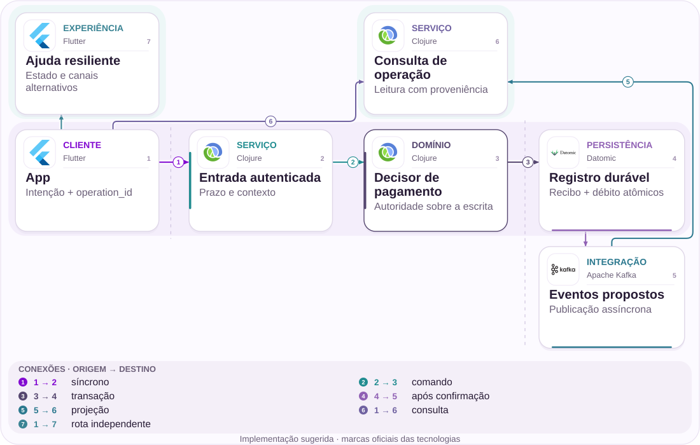
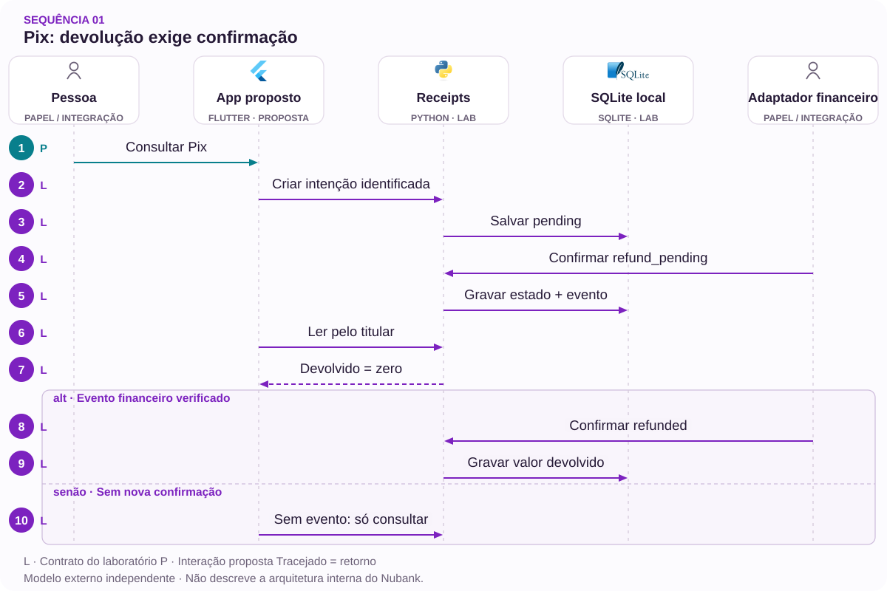

# 01 · Pix de R$ 300,00: esclarecer o estorno

Um recibo confiável para uma tentativa que falhou.

[PT reader](https://wesleyvieira99.github.io/nu/#01-1) · [EN reader](https://wesleyvieira99.github.io/nu/en.html#01-1)

[Executable Python lab](../../labs/case_01.py)

## O registro e seu desfecho


Recorte real da fonte pública, capturado em 23/10/2026. O texto abaixo inclui resposta da empresa e desfecho relatado.

**Histórico resolvido · RA 250462257**

Em 03/06/2026, uma consumidora relatou ter recebido R$ 700,00, transferido R$ 200,00 e tentado outro Pix de R$ 300,00 que falhou. Após mais de 24 horas, dizia não ver o retorno. Em 09/06, o Nubank reconheceu comportamento pontual na comunicação, afirmou estorno automático e envio de extrato privado. Em 10/06, ela marcou resolvido e deu nota 9. O horário exato do estorno não é público.

O caso orienta uma pergunta de produto: quando a transferência não conclui, a pessoa consegue distinguir tentativa, valor temporariamente indisponível e retorno confirmado? O extrato privado não foi inspecionado; portanto, não reconstruo um saldo nem uma cronologia financeira além do relato. A captura mostra uma manifestação pública com solução posterior, não a tela do aplicativo nem evidência de defeito atual. A proposta preserva esse desfecho e investiga uma jornada possível de ambiguidade.

- [Reclame AQUI — relato e resposta pública](https://www.reclameaqui.com.br/nubank/pix-falhou-e-valor-nao-retornou-para-conta-nubank-gerando-atraso-em-contas_M2IN15MxGwipZy9E/)

## Diagnóstico antes da solução

Uma hipótese falsificável é que a informação de retorno chega ao canal de consulta depois da confirmação financeira, prolongando a incerteza sem prolongar necessariamente a retenção. Eu correlacionaria tentativa, confirmação, lançamento e primeira consulta visível, comparando relógios e versões. Se a informação já estava disponível e foi compreendida, a hipótese perde força; a investigação passa ao contexto de apresentação ou atendimento.

O time precisaria distinguir falha de transporte, rejeição antes da liquidação e devolução efetiva. Esses eventos não são sinônimos. A resposta pública não identifica serviço, banco de dados ou fila, então seria incorreto atribuir o episódio a Kafka, cache ou arquitetura distribuída. A primeira entrega é um mapa de estados observados com responsáveis, não a substituição de infraestrutura.

A investigação também precisa separar tempo do cliente de tempo do servidor. Uma tentativa pode ser criada offline, enviada depois e consultada por outro aparelho. Sem essa distinção, o painel atribui à confirmação financeira um atraso de conectividade. Eu usaria timestamps com origem declarada e uma linha temporal por operação, com acesso restrito para investigação. Divergências de relógio devem aparecer como incerteza de medida, não como uma duração negativa silenciosamente descartada.

## Fronteiras da arquitetura



Arquitetura independente proposta; tecnologias sugeridas, não infraestrutura interna do Nubank.

A entrada autenticada consulta e o domínio aplica apenas transições autorizadas. O registro persistente conserva a identidade do evento e o estado confirmado na mesma transação. O caminho de ajuda oferece orientação sem criar outra ordem financeira.

A publicação assíncrona pode atrasar; por isso, a leitura declara sua última confirmação e tem uma rota de conciliação. O desenho não move autoridade sobre dinheiro para a interface. O laboratório verifica uma fronteira local, sem simular liquidação no arranjo Pix.

## Núcleo executável

`Idempotent Consumer [lab]` · `Explicit State Machine [lab]`

```python
    def confirm(self, op, event_id, target, trusted=False):
        if trusted is not True or not event_id:
            raise PermissionError("verified adapter required")
        allowed = {"pending": {"settled", "refund_pending"},
                   "refund_pending": {"refunded"}}
        with self.connect() as db:
            db.execute("BEGIN IMMEDIATE")
            prior = db.execute("SELECT op,target FROM events WHERE id=?",
                               (event_id,)).fetchone()
            if prior:
                if prior != (op, target):
                    raise ValueError("event identity conflict")
                return False
            row = db.execute("SELECT state,amount FROM ops WHERE id=?",
                             (op,)).fetchone()
            if not row:
                raise KeyError(op)
            if target not in allowed.get(row[0], set()):
                raise ValueError("illegal transition")
            returned = row[1] if target == "refunded" else 0
            db.execute("UPDATE ops SET state=?,returned=? WHERE id=?",
                       (target, returned, op))
            db.execute("INSERT INTO events VALUES (?,?,?)",
                       (event_id, op, target))
            return True
```

Trecho literal do laboratório independente executado; demais validações estão no arquivo completo.

A operação começa pendente. Uma confirmação de falha permite aguardar o estorno; somente um evento posterior autorizado marca o retorno. BEGIN IMMEDIATE serializa escritores no arquivo SQLite didático. A identidade do evento é comparada também ao conteúdo, impedindo que uma chave seja reutilizada para outra transição.

O valor devolvido é registrado em centavos e nunca aumenta por replay. Consultar dez vezes não muda o estado. Isso esclarece a garantia: trata-se de um recibo de confirmação, não de um motor que decide devolver dinheiro por timeout. Assinatura, autenticidade do adaptador e conciliação com o ledger ainda seriam integrações obrigatórias.

- [Python — unittest](https://docs.python.org/3/library/unittest.html)
- [Laboratório executável do caso no GitHub](https://github.com/wesleyvieira99/nu/blob/main/labs/case_01.py)

## Implementação na stack

`Idempotent Consumer [proposal]` · `Explicit State Machine [proposal]`

```clojure
(defn receipt-transition [state event]
  ;; Proposed pure rule; persistence must serialize the decision.
  (let [allowed {:pending #{:settled :refund-pending}
                 :refund-pending #{:refunded}}
        target (:target event)]
    (cond
      (not (true? (:verified event)))
      {:error :untrusted-event}
      (not (contains? (get allowed state #{}) target))
      {:error :illegal-transition}
      :else {:next-state target
             :event-id (:event-id event)})))
```

Exemplo de integração proposto, não executado; não é código interno do Nubank.

O exemplo Clojure torna a regra de transição inspecionável e separa rejeição de efeito. Em produção, a função precisaria executar sobre uma versão ainda válida, dentro da transação apropriada ou com comparação de versão. Uma decisão pura correta não elimina corridas entre leitura e gravação.

Eu manteria a stack existente como primeira opção. A seleção de PostgreSQL ou Datomic dependeria do domínio responsável, dos mecanismos de transação já operados e do custo de migração. A UI Flutter consumiria estados explícitos, com linguagem revisada para não transformar “aguardando confirmação” em “dinheiro perdido”. O trecho não foi executado em Clojure.

- [Clojure — Data Structures](https://clojure.org/reference/data_structures)

## Contratos e propriedade

`Idempotent Consumer [proposal]` · `Explicit State Machine [proposal]`

| Campo / regra | Responsável | Invariante |
| --- | --- | --- |
| operation_id | Pix | Intenção estável |
| event_id + payload | Adaptador | Conflito rejeitado |
| owner_scope | Identidade | Consulta autorizada |
| returned_cents | Financeiro | Só confirmado |

```json
{
  "schema_version": 1,
  "operation_id": "synthetic-pix-a",
  "event_id": "synthetic-return-a",
  "state": "refunded",
  "amount_cents": 30000,
  "returned_cents": 30000,
  "owner_scope": "authenticated-subject"
}
```

Contrato ilustrativo proposto; valores sintéticos, não dados de cliente.

O contrato distingue identificador de tentativa, identidade de evento e titular autorizado. operation_id não é uma credencial: conhecer seu valor não autoriza consulta. A versão do schema permite evolução de mensagens sem aceitar silenciosamente estados desconhecidos.

A retenção precisa cobrir investigação e repetição legítima, com política aprovada pelo domínio e privacidade. Logs operacionais registrariam correlação mínima; nomes, chaves Pix e extratos não virariam labels de métricas. O recibo é histórico e não deve ser apresentado como saldo atual. Para registros antigos, a migração preservaria as identidades antes de habilitar consumidores novos.

## Verificação adversarial

`Idempotent Consumer [lab]` · `Explicit State Machine [lab]`

```python
    def test_concurrent_refund_replays_once(self):
        self.apply("failed", "refund_pending")
        barrier = threading.Barrier(4)
        def retry(_):
            barrier.wait(timeout=5)
            return self.apply("refund", "refunded")
        with ThreadPoolExecutor(max_workers=4) as pool:
            results = list(pool.map(retry, range(4)))
        self.assertEqual(results.count(True), 1)
        self.assertEqual(self.bank.read("pix-a", "owner-a")[
            "returned_cents"], 30000)

    def test_timeout_is_not_refund_authority(self):
        for _ in range(10):
            self.bank.read("pix-a", "owner-a")
        receipt = self.bank.read("pix-a", "owner-a")
        self.assertEqual(receipt["state"], "pending")
        self.assertEqual(receipt["returned_cents"], 0)
```

Testes literais do laboratório; contagem e resultado obtidos da execução real.

Os 12 testes executados incluem concorrência de quatro consumidores, repetição, conflito de payload, autorização, dinheiro inválido e reabertura do arquivo. O teste de consulta repetida impede que a aplicação esconda uma decisão financeira dentro de uma leitura. O teste de transição rejeitada confirma que uma identidade de evento não é consumida antes de existir efeito válido.

Esses testes não validam mensagens assinadas, falha de energia, disponibilidade de participantes ou capacidade de produção. Antes do piloto, eu acrescentaria reprodução de mensagens reais anonimizadas e teste de recuperação do publicador. A evidência necessária é conservação de identidade e valor, não apenas resposta HTTP 200.

- [Python — unittest](https://docs.python.org/3/library/unittest.html)

## Medir a jornada certa

| Métrica | Numerador / denominador | Janela e corte |
| --- | --- | --- |
| Estado confiável p 95 | Tempo tentativa→confirmação | 7 dias; tipo de falha |
| Contatos /1 mil | Contatos / tentativas elegíveis | 7 dias; versão app |
| Repetição indevida | Ordens duplicadas / tentativas | Diário; coorte |
| Divergência | Recibos incorretos / auditados | Diário; estado |

O experimento começaria com consultas em sombra comparadas à fonte financeira, sem mostrar o novo recibo. Depois, uma coorte elegível receberia a explicação; o controle manteria a experiência anterior com o mesmo atendimento disponível. A unidade de análise é a tentativa inconclusiva, evitando contar cada retry como cliente adicional.

A coleta combina eventos confirmados e contatos associados por referência restrita, nunca por texto público do cliente. Avaliaria sete dias de acompanhamento por tentativa e cortes por versão do aplicativo e caminho de falha. Qualquer confirmação falsa, acesso cruzado ou Pix duplicado atribuível ao recibo interrompe a expansão. A baseline é desconhecida e precisa ser medida.

## Valor financeiro com premissas

| Cenário assumido | Entrada principal | Líquido/mês | Retorno (meses) |
| --- | --- | --- | --- |
| Conservador | 20 mil × 0,05 × R$ 8,00 | R$ 4.000,00 | 30,00 |
| Base | 50 mil × 0,10 × R$ 8,00 | R$ 32.000,00 | 3,75 |
| Ambicioso | 100 mil × 0,15 × R$ 8,00 | R$ 105.000,00 | 1,14 |

R$ 300,00 é o principal discutido no relato; não é ganho do banco e não entra no cálculo abaixo. Os cenários assumem, por mês, 20 mil / 50 mil / 100 mil tentativas elegíveis, redução incremental de contatos de 0,05 / 0,10 / 0,15 e custo marginal evitável de R$ 8,00 por contato. O custo operacional adicional assumido é R$ 4.000,00 / R$ 8.000,00 / R$ 15.000,00.

A conta é volume × contatos evitados por tentativa × custo marginal menos operação. O investimento assumido de R$ 120.000,00 só tem retorno quando o líquido mensal é positivo. O cenário conservador demonstra que uma ideia útil pode não pagar sua implantação no primeiro ano nessa escala. Capacidade liberada sem redução de despesa deve ser reportada como capacidade, sem substituir o custo marginal por salário médio.

Orçamento de implementação assumido: R$ 120.000,00. Resultados anuais líquidos antes da implementação: R$ 48.000,00 / R$ 384.000,00 / R$ 1.260.000,00. Todos os parâmetros são hipóteses, não baselines do Nubank.

## Roadmap com responsáveis

| Fase proposta | Responsável | Entrega / aceite |
| --- | --- | --- |
| 0–15 dias | Líder Pix | Mapa e amostra conciliada |
| 16–30 dias | Staff + identidade | Contrato; escopo validado |
| 31–60 dias | Engenharia + suporte | Sombra sem divergência |
| 61–90 dias | EM + produto | Piloto; decisão econômica |

O horizonte de 90 dias é uma proposta condicionada à descoberta. O responsável técnico de Pix valida estados e evidências; produto aprova a interpretação; atendimento verifica se consegue explicar o mesmo recibo. O EM coordena dependências e disponibilidade de especialistas, sem assumir autoridade sobre a regra financeira.

Não avançaria diretamente de design para uma coorte ampla. O aceite intermediário exige conciliar uma amostra de tentativas e provar que uma resposta perdida pode ser consultada depois. Se a principal causa observada for atraso real de devolução, o trabalho deve incluir o domínio financeiro correspondente; melhorar apenas o texto seria insuficiente. O orçamento pode ser reestimado depois desse diagnóstico.

## Rollout e operação

O rollout começa pelo observador, depois pela consulta autenticada e finalmente pela apresentação. Uma flag pode retirar a nova tela, mas não apagar recibos ou eventos já reconhecidos. Durante rollback, o serviço anterior precisa continuar consultando o registro compatível; versões incompatíveis devem ser bloqueadas antes do tráfego.

O plantonista de pagamentos recebe alertas de divergência, enquanto suporte recebe a orientação aprovada para estados desconhecidos. Um exercício injeta evento repetido, atraso de publicação e indisponibilidade da leitura. A ação segura é preservar evidência e encaminhar conciliação, nunca disparar uma nova transferência. Alertas sem dono ou sem procedimento de resolução não atendem ao aceite operacional.

## Minha contribuição

Como Staff, eu proporia a fronteira de autoridade, revisaria invariantes e documentaria a decisão entre consultar uma projeção e buscar a fonte financeira. Também facilitaria uma revisão com os times responsáveis para reduzir dependências desnecessárias. A escolha rejeitada é um timer que transforma silêncio em estorno: ele confunde indisponibilidade com decisão financeira e pode contradizer liquidação já ocorrida.

Como EM, eu estruturaria entregas pequenas, capacidade para investigação e uma definição compartilhada de pronto envolvendo suporte e produto. Essas são contribuições propostas, não alegações de que já conduzi essa iniciativa no Nubank. A entrevista pode explorar como eu negociaria uma redução de escopo que preserva correção, mesmo quando um prazo comercial favorece uma solução aparentemente mais rápida.

Para a entrevista, eu pediria um exemplo anonimizado de tentativa inconclusiva e explicaria qual decisão tomaria com cada evidência adicional. Esse exercício demonstra capacidade de reduzir ambiguidade antes de escolher tecnologia. Como líder, eu deixaria explícito quem pode autorizar uma mudança no contrato financeiro e quem responde pela mensagem ao cliente. A colaboração evita uma correção local que apenas transfere a dúvida para outro time.

## Handoff e decisão

**Execução local**

python3 labs/case_01.py -v · 12 testes passaram.

O revisor começa por Receipts.create, confirma a tentativa sintética e acompanha confirm até read. Deve observar que settled é terminal neste fluxo e que uma transferência liquidada exigiria outro processo de devolução. O fixture de 30000 centavos ilustra o valor mencionado, sem reproduzir conta ou extrato real.

O handoff entrega código, testes, contrato e perguntas de integração: quem autentica o evento, qual sistema confirma retorno e como a publicação recupera após falha? O próximo investimento depende dessas respostas e de uma baseline de contatos. Se não houver ambiguidade mensurável ou se o custo de conciliação exceder o benefício, encerro o piloto preservando a instrumentação útil.

- Replay não duplica valor nem muda conteúdo.
- Nenhum titular consulta recibo alheio.
- Rollback conserva identidades e histórico.

- [Laboratório executável do caso no GitHub](https://github.com/wesleyvieira99/nu/blob/main/labs/case_01.py)

## Padrões com prova no código

`Idempotent Consumer [lab]` · `Explicit State Machine [lab]` · `CQRS [proposal]` · `Spring Boot [proposal]`

| Mecanismo | Implementação | Evidência |
| --- | --- | --- |
| Idempotent Consumer | Receipts.confirm | um evento financeiro repetido preserva um único estorno |
| Explicit State Machine | Receipts.confirm | estorno exige transição financeira permitida |
| CQRS / authoritative read model | Proposta para produção | Adaptadores preservam a autoridade fora da interface. |

**Integração Java · proposta**

Spring Boot + transactional repository. Portar invariantes e testes de contrato antes de substituir o modelo Python. Lock de processo não controla concorrência distribuída; persistência, autorização e recuperação exigem testes de integração.

**Avaliação de IA · núcleo determinístico**

Nenhum framework de agentes está implementado neste laboratório. Estado financeiro, autorização e versões permanecem determinísticos. Um assistente só seria avaliado diante de necessidade comprovada de atendimento, sem autoridade sobre saldo ou identidade.

- [P1 · Receipts.confirm](https://github.com/wesleyvieira99/nu/blob/main/labs/case_01.py#L41)
- [P1 · test_concurrent_refund_replays_once](https://github.com/wesleyvieira99/nu/blob/main/labs/case_01.py#L89)
- [P2 · Receipts.confirm](https://github.com/wesleyvieira99/nu/blob/main/labs/case_01.py#L41)
- [P2 · test_refund_without_failure_is_rejected](https://github.com/wesleyvieira99/nu/blob/main/labs/case_01.py#L109)

## Sequência de execução



O sinal trusted é injetado; não há Pix real nem assinatura de eventos.

**Autoridade e fronteira de falha**

um evento financeiro repetido preserva um único estorno. timeout isolado mantém a operação inconclusiva.

A sequência descreve a integração proposta. O laboratório vinculado verifica a invariante do domínio com dados sintéticos; serviços externos, retries de rede e implantação permanecem trabalho de integração.

- [confirm](https://github.com/wesleyvieira99/nu/blob/main/labs/case_01.py#L41)
- [read](https://github.com/wesleyvieira99/nu/blob/main/labs/case_01.py#L68)

## Features, histórias e aceite

**F01.1 · Recibo conciliado · D16–30**

Como cliente, quero consultar uma tentativa inconclusiva sem repetir o Pix. Aceite: um evento financeiro repetido preserva um único estorno.

**F01.2 · Separar timeout de devolução · D31–60**

Como responsável pela conciliação, quero identificar a evidência que autoriza a mudança de estado. Aceite: timeout isolado mantém a operação inconclusiva.

**F01.3 · Expansão medida · D61–90**

Como responsável de produto, quero uma coorte elegível com controle comparável. Aceite: métrica do caso, denominador, custo e barreira de segurança registrados antes da exposição; falhas de conciliação interrompem expansão.

Os testes vinculados exercitam o aceite declarado do domínio, não a interface completa nem a integração de produção. D0–15 é descoberta: confrontar o relato público com amostras internas autorizadas, mapear dependências e aprovar contratos. São janelas incrementais de planejamento, não promessa de prazo. EM coordena dependências; Staff responde pelos contratos; Produto e o domínio aceitam o resultado.

- [Aceite F01.1](https://github.com/wesleyvieira99/nu/blob/main/labs/case_01.py#L89)
- [Aceite F01.2](https://github.com/wesleyvieira99/nu/blob/main/labs/case_01.py#L101)

## Método e sensibilidade

**Sensibilidade do cenário · BRL**

Todos os inputs são hipóteses de cenário, não efeitos medidos no Nubank. Capacidade equivalente não é economia de caixa. A realização reduz apenas o benefício; todos os custos permanecem nos valores do cenário. É análise de sensibilidade, não probabilidade nem estimativa causal.

líquido_período = benefício × realização − custo_variável − operação; primeiro_ano = 12 × líquido_período − implementação

Period / Período: `month`. Values / Valores: BRL.

| Scenario / Cenário | Benefit / Benefício | Variable cost / Variável | Run cost / Operação | Build / Implementação |
| --- | ---: | ---: | ---: | ---: |
| Conservador | 8000.00 | 0.00 | 4000.00 | 120000.00 |
| Base | 40000.00 | 0.00 | 8000.00 | 120000.00 |
| Ambicioso | 120000.00 | 0.00 | 15000.00 | 120000.00 |

| Scenario / Cenário | Period net at 100% / Líquido | Horizon after build / Horizonte | Horizon at 50% / Estresse |
| --- | ---: | ---: | ---: |
| Conservador | 4000.00 | -72000.00 | -120000.00 |
| Base | 32000.00 | 264000.00 | 24000.00 |
| Ambicioso | 105000.00 | 1140000.00 | 420000.00 |

[Reproducible scenario inputs](../../models/normalized-scenarios.json) · [Decimal simulator](../../models/simulate.py)

| Decisão | Método específico do caso |
| --- | --- |
| Baseline / ameaça | Baseline: contatos por tentativa inconclusiva. Ameaça: retries contados como novos clientes. |
| Economia por unidade | Tentativas elegíveis × redução absoluta de contato × custo por contato; principal devolvido não é receita. |
| Experimento proposto | Consulta em sombra antes da coorte com recibo; acompanhar contatos por sete dias e manter ajuda disponível. |
| Critério de parada | Parar por confirmação falsa, acesso cruzado ou Pix duplicado atribuível ao recibo. |

- [Reclame AQUI · ID 250462257](https://www.reclameaqui.com.br/nubank/pix-falhou-e-valor-nao-retornou-para-conta-nubank-gerando-atraso-em-contas_M2IN15MxGwipZy9E/)
- [FinOps Foundation · Unit Economics](https://www.finops.org/framework/capabilities/unit-economics/)
- [Microsoft Research · Pre-experiment design](https://www.microsoft.com/en-us/research/articles/patterns-of-trustworthy-experimentation-pre-experiment-stage/)
