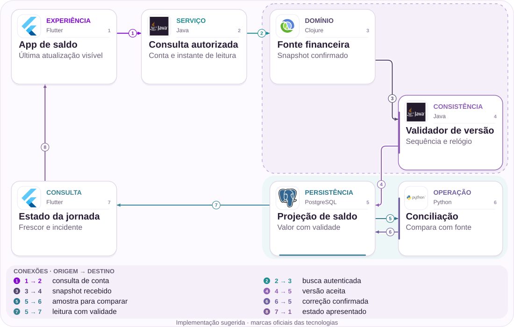
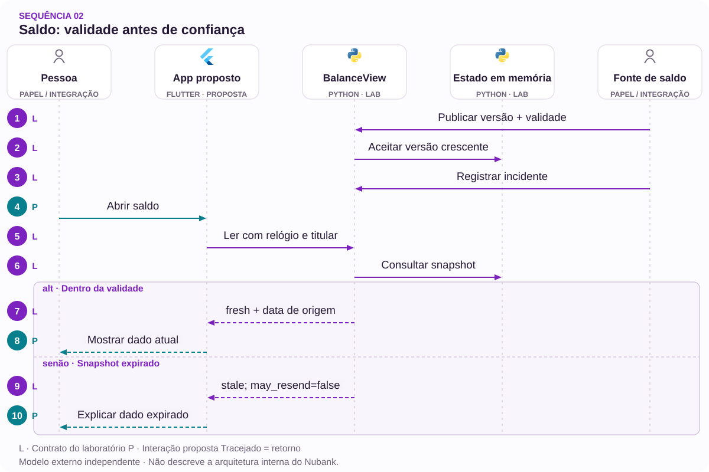

# 02 · Pix recebido, saldo desatualizado

O incidente de 8 de julho como teste de observabilidade.

[PT reader](https://wesleyvieira99.github.io/nu/#02-1) · [EN reader](https://wesleyvieira99.github.io/nu/en.html#02-1)

[Executable Python lab](../../labs/case_02.py)

## O registro e seu desfecho


Recorte real da fonte pública, capturado em 23/10/2026. O texto abaixo inclui resposta da empresa e desfecho relatado.

**Incidente histórico normalizado · 08/07/2026**

O Canaltech reproduziu um Pix enviado ao Nubank cujo valor não aparecia no app em 08/07/2026. O teste entre contas Nubank não reproduziu o problema. A matéria registrou aviso de carregamento da conta. O Nubank informou instabilidade temporária e normalização por volta de 11 h 15. Não foram publicados valor transferido, população afetada ou duração exata.

A evidência inclui observação própria de uma redação e resposta do banco. Isso é mais específico que uma contagem de menções, mas não substitui telemetria financeira. A fotografia da matéria mostra a página do aplicativo na loja, portanto sua legenda é editorial. Não a apresento como captura do erro. A notícia relaciona relatos no X; esses posts não foram verificados individualmente na origem. O capítulo usa a observação e a normalização informadas, sem estimar prejuízo.

- [Canaltech — incidente de 08/07/2026](https://canaltech.com.br/apps/recebeu-pix-no-nubank-e-o-dinheiro-nao-caiu-clientes-relatam-problema-no-app/)

## Diagnóstico antes da solução

Saldo não exibido permite hipóteses diferentes: leitura indisponível, projeção atrasada, integração interrompida ou crédito ainda não confirmado. Eu começaria pela última confirmação conhecida de cada camada, sem assumir que o ledger falhou. Um Pix entre instituições e outro entre contas internas são sondas diferentes; a amostra publicada não prova exclusividade do impacto externo.

A hipótese investigável é que um snapshot antigo permaneceu sem contexto suficiente de validade. O teste exige capturar versão, instante da fonte, instante de consulta e mensagem apresentada. Se a fonte também não confirmou o crédito, o produto deve mostrar desconhecimento, não transformar uma atualização de tela em certeza financeira. O suporte precisa distinguir essas duas situações.

A versão de um snapshot deve ser comparável dentro de uma conta e de uma origem definida. Somar versões de componentes diferentes cria uma ordem artificial. Se o resumo combinar múltiplas fontes, a resposta precisa declarar cobertura e idade de cada componente relevante. Eu começaria pelo menor conjunto capaz de explicar o saldo observado, sem transformar este caso em uma reescrita de toda a home. Esse recorte facilita provar correção antes de ampliar a composição.

## Fronteiras da arquitetura



Arquitetura independente proposta; tecnologias sugeridas, não infraestrutura interna do Nubank.

A fonte financeira permanece autoritativa. O validador aceita versões crescentes e a projeção guarda validade junto ao valor. A conciliação compara uma amostra com a origem e só devolve correções confirmadas.

O estado da jornada combina duas informações independentes: frescor daquele saldo e existência de incidente. Encerrar o banner não renova o snapshot. Essa separação evita uma interface verde que transmite confiança sem nova evidência financeira.

## Núcleo executável

`Monotonic Versioning [lab]` · `Freshness Envelope [lab]`

```python
    def read(self, owner, now):
        if owner != self.owner:
            raise PermissionError("account scope")
        integer(now)
        with self.lock:
            snapshot = self.snapshot
            active_incident = now < self.incident_until
            if snapshot is None:
                return {"state": "unknown", "balance_cents": None,
                        "incident": active_incident, "may_resend": False}
            version, cents, observed, valid_until = snapshot
            if now < observed:
                return {"state": "unknown", "balance_cents": None,
                        "incident": active_incident, "may_resend": False}
            fresh = now < valid_until
            return {"state": "fresh" if fresh else "stale",
                    "balance_cents": cents, "version": version,
                    "as_of": observed, "incident": active_incident,
                    "may_resend": False}
```

Trecho literal do laboratório independente executado; demais validações estão no arquivo completo.

BalanceView.read verifica titular e relógio antes de montar a resposta. Sem snapshot, retorna desconhecido com valor ausente; zero seria uma afirmação financeira falsa. Um instante anterior à observação também produz desconhecido. No limite exato de validade, o estado passa a desatualizado.

O modelo permite exibir o último valor acompanhado de sua data, mas nunca recomenda reenviar Pix. O lock só protege memória de um processo. Persistência, autenticação e sincronização de relógios precisam ser implementadas fora desse núcleo. Um número inteiro de segundos facilita os testes, sem determinar o formato temporal da API real.

- [Python — unittest](https://docs.python.org/3/library/unittest.html)
- [Laboratório executável do caso no GitHub](https://github.com/wesleyvieira99/nu/blob/main/labs/case_02.py)

## Implementação na stack

`Monotonic Versioning [proposal]` · `Freshness Envelope [proposal]`

```dart
String balanceLabel(Map<String, Object?> view) {
  // Proposed presentation only; never authorizes a transfer.
  switch (view['state']) {
    case 'fresh':
      return 'Confirmed balance';
    case 'stale':
      return 'Last known balance — awaiting update';
    default:
      return 'Balance currently unavailable';
  }
}
bool mayResendPix(Map<String, Object?> view) => false;
```

Exemplo de integração proposto, não executado; não é código interno do Nubank.

No Dart proposto, uma função de apresentação trata unknown, stale e fresh como estados explícitos. O status do incidente é recebido separadamente. A camada visual não calcula saldo nem altera validade; limita-se a traduzir contratos em informação compreensível e acessível.

Eu verificaria leitura por tecnologia assistiva, localização do horário e comportamento durante reconexão. Um skeleton infinito pode esconder que existe um saldo anterior; mostrar esse valor sem contexto pode induzir erro. A decisão exige pesquisa de compreensão com tarefas reais. O exemplo não foi compilado, e suas mensagens devem passar pela revisão de produto antes de qualquer uso.

- [Dart — Switch statements](https://dart.dev/language/branches)

## Contratos e propriedade

`Monotonic Versioning [proposal]` · `Freshness Envelope [proposal]`

| Campo / regra | Responsável | Invariante |
| --- | --- | --- |
| source_version | Fonte | Crescente por conta |
| observed_at | Financeiro | Relógio validado |
| valid_until | Contrato | Expira sem renovar |
| incident_until | Plantão | Não altera saldo |

```json
{
  "schema_version": 1,
  "source_version": 8,
  "balance_cents": 12000,
  "observed_at": 100,
  "valid_until": 120,
  "incident_until": 125,
  "state": "stale"
}
```

Contrato ilustrativo proposto; valores sintéticos, não dados de cliente.

A versão pertence à fonte e não ao número de refreshes do cliente. Dois snapshots com a mesma versão e valores diferentes são um conflito que merece investigação. Uma versão mais antiga não substitui a recente; uma versão nova com relógio regressivo também é rejeitada no modelo.

A duração de validade deve refletir o contrato do dado e ser configurada pelo responsável financeiro, não escolhida arbitrariamente pela UI. Telemetria registra idade agregada e estado, evitando conta ou valor como rótulos. A conciliação usa acesso restrito para investigar exemplos. A expiração de um aviso de incidente nunca modifica esses contratos.

## Verificação adversarial

`Monotonic Versioning [lab]` · `Freshness Envelope [lab]`

```python
    def test_incident_expiry_does_not_refresh_balance(self):
        self.view.incident(125, True)
        result = self.view.read("a", 130)
        self.assertFalse(result["incident"])
        self.assertEqual(result["state"], "stale")
        self.assertFalse(result["may_resend"])

    def test_concurrent_versions_keep_newest(self):
        def publish(version):
            return self.view.publish(version, version * 100, 110, 140, True)
        with ThreadPoolExecutor(max_workers=4) as pool:
            list(pool.map(publish, (5, 2, 4, 3)))
        self.assertEqual(self.view.read("a", 115)["version"], 5)
        self.assertEqual(self.view.read("a", 115)["balance_cents"], 500)
```

Testes literais do laboratório; contagem e resultado obtidos da execução real.

Os 14 testes atacam fronteiras de tempo, conflito de versão, origem não autorizada, conta alheia e publicação concorrente. O teste principal deixa o banner expirar enquanto o saldo permanece antigo. Outro publica versões fora de ordem e exige que a maior sobreviva. Não basta testar se aparece uma mensagem: o resultado precisa manter valor, versão e contexto coerentes.

O programa não comprova a qualidade de um relógio distribuído ou a atualização de um sistema externo. Para integração, adicionaria simulação de clock skew, leitura parcial e atraso do canário, além de testes de acessibilidade. Os dados de 12000 centavos são sintéticos e não vêm do relato.

- [Python — unittest](https://docs.python.org/3/library/unittest.html)

## Medir a jornada certa

| Métrica | Numerador / denominador | Janela e corte |
| --- | --- | --- |
| Frescor | Leituras vencidas / leituras | 15 min; origem |
| Detecção | Tempo falha→alerta | Incidente; caminho |
| Compreensão | Tarefas corretas / tarefas | Pesquisa; estado |
| Contatos | Contatos / sessões expostas | 24 h; gravidade |
| Falso atual | Rótulos errados / auditados | Contínuo; versão |

A coleta deve separar disponibilidade, correção e frescor. Um endpoint rápido pode devolver dado velho; um canário saudável não representa todos os bancos de origem. Eu segmentaria por caminho de recebimento e versão do app, usando volumes agregados e uma janela móvel de 15 minutos para operação.

O experimento de comunicação precisa comparar episódios ou coortes equivalentes, pois incidentes diferem em intensidade. A hipótese é reduzir contatos e repetições sem esconder incerteza. A investigação para quando surgir saldo rotulado como atual sem evidência válida, divergência de valor ou orientação de repetição insegura. Não definiria um objetivo de latência antes de medir o caminho existente.

## Valor financeiro com premissas

| Cenário assumido | Entrada principal | Líquido/mês | Retorno (meses) |
| --- | --- | --- | --- |
| Conservador | 2 × 20 mil × 0,01 | R$ -2.200,00 | Não há |
| Base | 3 × 40 mil × 0,02 | R$ 8.800,00 | 17,05 |
| Ambicioso | 4 × 60 mil × 0,03 | R$ 38.400,00 | 3,91 |

O custo modelado é de acompanhamento de incidentes, não de dinheiro supostamente perdido. Assumo por mês 2 / 3 / 4 episódios comparáveis, 20 mil / 40 mil / 60 mil sessões por episódio e queda incremental de contato de 0,01 / 0,02 / 0,03. Cada contato evitável custa hipoteticamente R$ 7,00; canários e operação acrescentam R$ 5.000,00 / R$ 8.000,00 / R$ 12.000,00 por mês.

Multiplico episódios × sessões × diferença de contato × custo e desconto a operação. O investimento hipotético é R$ 150.000,00. Esses volumes não são estimativas da ocorrência de julho: são entradas de sensibilidade. Se o incidente futuro tiver outra gravidade, os resultados não podem ser transportados automaticamente. A mesma sessão não deve entrar simultaneamente neste caso e no caso 01 para somar benefícios.

Orçamento de implementação assumido: R$ 150.000,00. Resultados anuais líquidos antes da implementação: R$ -26.400,00 / R$ 105.600,00 / R$ 460.800,00. Todos os parâmetros são hipóteses, não baselines do Nubank.

## Roadmap com responsáveis

| Fase proposta | Responsável | Entrega / aceite |
| --- | --- | --- |
| 0–15 dias | Financeiro + SRE | Semântica e sondas |
| 16–30 dias | Staff + mobile | Contrato e sombra |
| 31–60 dias | Produto + suporte | Compreensão validada |
| 61–90 dias | EM + plantão | Piloto e exercício |

Nas primeiras semanas, engenharia financeira e confiabilidade definem o que cada fonte confirma. Produto e atendimento acordam mensagens para ausência, atraso e recuperação. O responsável por canários valida que as sondas não criam transações não autorizadas e que um teste não congestiona o caminho real.

O marco seguinte é uma comparação invisível entre rótulos calculados e evidência. Somente depois vem a interface em pequena coorte. O EM coordena revisão e escala de plantão; o Staff resolve contratos entre fonte, projeção e cliente. Se não for possível medir frescor com confiança, o lançamento fica restrito à informação de indisponibilidade, sem simular precisão.

## Rollout e operação

O runbook separa falha de consulta de confirmação financeira ausente. Se o observador perde conexão, não deve publicar que todos os Pix falharam. Um incidente tem dono, escopo, versão e expiração; uma atualização de normalização precisa ser rastreável ao responsável.

No exercício de falha, congelo a projeção, faço o banner expirar e restauro apenas a API. A UI deve continuar reconhecendo o dado antigo. O rollback retira mensagens novas mas preserva snapshots e instrumentação. O suporte recebe uma resposta consistente com a visão técnica e não é orientado a confirmar crédito que o sistema ainda não confirmou.

Limite do laboratório: os avisos de incidente não têm versão; um aviso antigo pode substituir um novo. Isso não renova o saldo. A ordenação dos avisos faz parte da integração proposta, ainda não implementada no exemplo.

## Minha contribuição

Minha contribuição Staff seria tornar explícita a semântica de validade e revisar como o cliente recebe uma resposta composta. Eu rejeitaria um único booleano “sistema normal”: ele mistura saúde global, disponibilidade local e correção de uma conta. Uma representação mais expressiva exige cuidado de produto, mas permite explicar limites sem inventar certeza.

Como EM, conduziria uma entrega que reúne confiabilidade, pagamentos, mobile e atendimento com responsáveis definidos. A decisão de parar pode ser valiosa: um banner que aumenta dúvidas ou gera confirmações falsas não merece expansão mesmo que reduza chamadas. Eu apresentaria evidências e alternativas ao time, respeitando decisões e conhecimento da stack existente.

Uma boa decisão Staff também explicita o que o observador não sabe. Eu discutiria com produto a diferença entre afirmar indisponibilidade e afirmar que uma operação não ocorreu. Como EM, protegeria tempo de análise pós-incidente e revisaria a utilidade dos alertas com quem recebe o plantão. Essa rotina reduz o incentivo de publicar rapidamente um estado verde sem evidência suficiente apenas para encerrar o incidente administrativo.

## Handoff e decisão

**Execução local**

python3 labs/case_02.py -v · 14 testes passaram.

O revisor executa o laboratório, chama publish com versões diferentes e observa read no limite da validade. Depois encerra o incidente sem atualizar o saldo. Esse percurso demonstra a separação central sem depender de uma infraestrutura real.

O pacote de integração deve responder quem emite a versão, como o tempo é obtido, qual é o orçamento de atraso e quem confirma normalização. Antes de expandir, exigir amostra auditada, teste com tecnologia assistiva e capacidade de conciliar snapshots divergentes. Se esses pontos não tiverem proprietário, a decisão é manter a instrumentação em sombra e resolver a responsabilidade antes da exposição ao cliente.

- Banner expirado não renova dados.
- Saldo desconhecido não aparece como zero.
- Versão conflitante gera investigação.

- [Laboratório executável do caso no GitHub](https://github.com/wesleyvieira99/nu/blob/main/labs/case_02.py)

## Padrões com prova no código

`Monotonic Versioning [lab]` · `Freshness Envelope [lab]` · `CQRS [proposal]` · `Spring Boot [proposal]`

| Mecanismo | Implementação | Evidência |
| --- | --- | --- |
| Monotonic Versioning | BalanceView.publish | versão antiga não substitui a mais recente |
| Freshness Envelope | BalanceView.read | no instante de expiração, o snapshot é tratado como desatualizado |
| CQRS / stale-aware projection | Proposta para produção | Adaptadores preservam a autoridade fora da interface. |

**Integração Java · proposta**

Spring Boot + typed response DTO. Portar invariantes e testes de contrato antes de substituir o modelo Python. Lock de processo não controla concorrência distribuída; persistência, autorização e recuperação exigem testes de integração.

**Avaliação de IA · núcleo determinístico**

Nenhum framework de agentes está implementado neste laboratório. Estado financeiro, autorização e versões permanecem determinísticos. Um assistente só seria avaliado diante de necessidade comprovada de atendimento, sem autoridade sobre saldo ou identidade.

- [P1 · BalanceView.publish](https://github.com/wesleyvieira99/nu/blob/main/labs/case_02.py#L27)
- [P1 · test_concurrent_versions_keep_newest](https://github.com/wesleyvieira99/nu/blob/main/labs/case_02.py#L84)
- [P2 · BalanceView.read](https://github.com/wesleyvieira99/nu/blob/main/labs/case_02.py#L49)
- [P2 · test_exact_expiry_is_stale](https://github.com/wesleyvieira99/nu/blob/main/labs/case_02.py#L93)

## Sequência de execução



O relógio e a fonte são confiados; o lock cobre um processo. Incidente não renova saldo.

**Autoridade e fronteira de falha**

versão antiga não substitui a mais recente. sem snapshot, a leitura retorna desconhecido.

A sequência descreve a integração proposta. O laboratório vinculado verifica a invariante do domínio com dados sintéticos; serviços externos, retries de rede e implantação permanecem trabalho de integração.

- [publish](https://github.com/wesleyvieira99/nu/blob/main/labs/case_02.py#L27)
- [read](https://github.com/wesleyvieira99/nu/blob/main/labs/case_02.py#L49)

## Features, histórias e aceite

**F02.1 · Saldo com frescor explícito · D16–30**

Como cliente, quero saber quando o saldo foi confirmado pela fonte. Aceite: versão antiga não substitui a mais recente.

**F02.2 · Ausência não é saldo zero · D31–60**

Como cliente, quero distinguir falha de consulta de ausência de dinheiro. Aceite: sem snapshot, a leitura retorna desconhecido.

**F02.3 · Expansão medida · D61–90**

Como responsável de produto, quero uma coorte elegível com controle comparável. Aceite: métrica do caso, denominador, custo e barreira de segurança registrados antes da exposição; falhas de conciliação interrompem expansão.

Os testes vinculados exercitam o aceite declarado do domínio, não a interface completa nem a integração de produção. D0–15 é descoberta: confrontar o relato público com amostras internas autorizadas, mapear dependências e aprovar contratos. São janelas incrementais de planejamento, não promessa de prazo. EM coordena dependências; Staff responde pelos contratos; Produto e o domínio aceitam o resultado.

- [Aceite F02.1](https://github.com/wesleyvieira99/nu/blob/main/labs/case_02.py#L84)
- [Aceite F02.2](https://github.com/wesleyvieira99/nu/blob/main/labs/case_02.py#L118)

## Método e sensibilidade

**Sensibilidade do cenário · BRL**

Todos os inputs são hipóteses de cenário, não efeitos medidos no Nubank. Capacidade equivalente não é economia de caixa. A realização reduz apenas o benefício; todos os custos permanecem nos valores do cenário. É análise de sensibilidade, não probabilidade nem estimativa causal.

líquido_período = benefício × realização − custo_variável − operação; primeiro_ano = 12 × líquido_período − implementação

Period / Período: `month`. Values / Valores: BRL.

| Scenario / Cenário | Benefit / Benefício | Variable cost / Variável | Run cost / Operação | Build / Implementação |
| --- | ---: | ---: | ---: | ---: |
| Conservador | 2800.00 | 0.00 | 5000.00 | 150000.00 |
| Base | 16800.00 | 0.00 | 8000.00 | 150000.00 |
| Ambicioso | 50400.00 | 0.00 | 12000.00 | 150000.00 |

| Scenario / Cenário | Period net at 100% / Líquido | Horizon after build / Horizonte | Horizon at 50% / Estresse |
| --- | ---: | ---: | ---: |
| Conservador | -2200.00 | -176400.00 | -193200.00 |
| Base | 8800.00 | -44400.00 | -145200.00 |
| Ambicioso | 38400.00 | 310800.00 | 8400.00 |

[Reproducible scenario inputs](../../models/normalized-scenarios.json) · [Decimal simulator](../../models/simulate.py)

| Decisão | Método específico do caso |
| --- | --- |
| Baseline / ameaça | Baseline: contatos por sessão exposta. Ameaça: comparar incidentes de intensidades diferentes. |
| Economia por unidade | Incidentes × sessões afetadas × redução de contato × custo; não atribuir melhoria de saldo à comunicação. |
| Experimento proposto | Comparar episódios ou coortes equivalentes; segmentar origem, versão e frescor, mantendo incerteza visível. |
| Critério de parada | Parar por rótulo de saldo atual sem evidência, divergência de valor ou repetição insegura. |

- [Canaltech](https://canaltech.com.br/apps/recebeu-pix-no-nubank-e-o-dinheiro-nao-caiu-clientes-relatam-problema-no-app/)
- [FinOps Foundation · Unit Economics](https://www.finops.org/framework/capabilities/unit-economics/)
- [Microsoft Research · Pre-experiment design](https://www.microsoft.com/en-us/research/articles/patterns-of-trustworthy-experimentation-pre-experiment-stage/)
