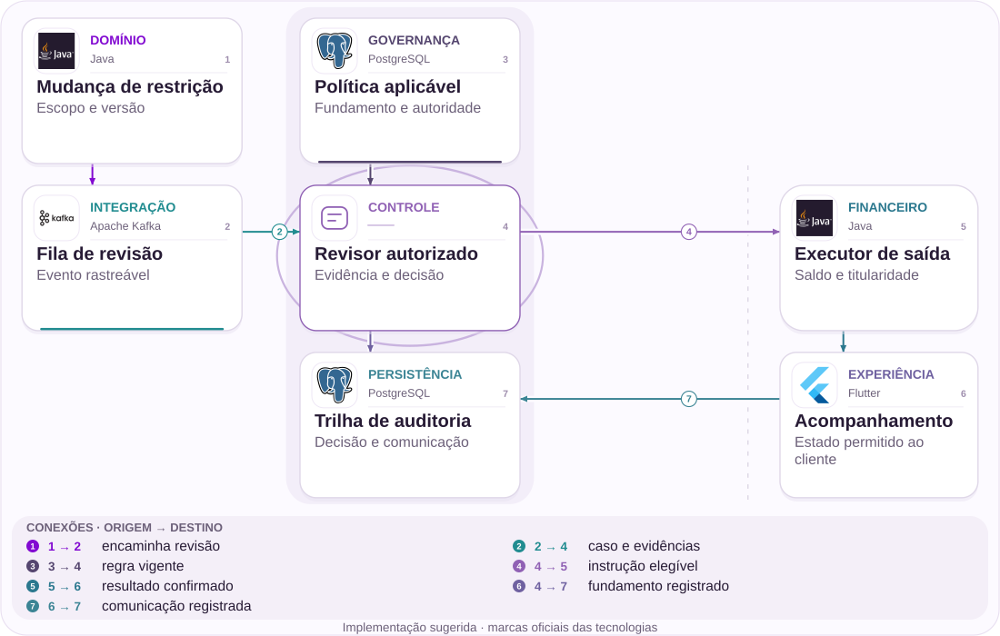

# 03 · Restrição de conta: revisão e saída

Evidência, responsável e reconciliação antes de liberar.

[PT reader](https://wesleyvieira99.github.io/nu/#03-1) · [EN reader](https://wesleyvieira99.github.io/nu/en.html#03-1)

[Executable Python lab](../../labs/case_03.py)

## O registro e seu desfecho


Recorte real da fonte pública, capturado em 23/10/2026. O texto abaixo inclui resposta da empresa e desfecho relatado.

**Desfecho relatado pela imprensa · março de 2026**

O Metrópoles relatou bloqueio superior a R$ 2.000.000,00 de um centro de estética, iniciado em 20/01/2026 e seguido de encerramento da conta. A reportagem atribui à defesa a origem tributária e relata ordem judicial. O Nubank mencionou segurança e compliance e não comentou detalhes por sigilo. No vídeo de 11/03, a repórter disse que o dinheiro foi transferido para outro banco. Autos e cumprimento não foram verificados independentemente.

O artigo e a transcrição têm contribuições diferentes. O primeiro descreve a controvérsia; a transcrição de 06:59–07:23 acrescenta o desfecho segundo a repórter. Não afirmo que assisti integralmente ao vídeo nem que consultei os autos. A proposta não trata a retenção como atual. Também não transporta indenizações de outros clientes citados na matéria para este episódio. O caso orienta desenho de revisão, explicação e saída, com controles proporcionais à autoridade de cada decisão.

- [Metrópoles — bloqueio e desfecho relatado](https://www.metropoles.com/colunas/dinheiro-e-negocios/indicios-de-ilicitos-nubank-bloqueia-contas-e-deixa-clientes-sem-acesso-ao-dinheiro)
- [Metrópoles — desfecho relatado, 06:59–07:23](https://www.youtube.com/watch?v=f6zCNrN1T8Y&t=419s)

## Diagnóstico antes da solução


Quadro real do Metrópoles, 11/03/2026. A transcrição trata da empresa em 02:26 e relata a liberação em 06:59–07:23.

A pergunta técnica é se uma restrição continua ligada a fundamento, evidência, responsável e próxima revisão ao atravessar atendimento, risco e encerramento. Isso não determina se uma suspeita específica era válida. Uma hipótese verificável é a perda de contexto entre o bloqueio inicial e a execução de uma saída autorizada.

Eu amostraria casos por tipo de medida e reconstruiria mudanças de estado com responsáveis. Compararia a data da decisão com a instrução efetiva de transferência, distinguindo espera por documentos, restrição legal ativa e fila operacional. A fonte jornalística não fornece essa decomposição. Não usaria um prazo universal de 72 horas: a regra depende do fundamento aplicável e deve ser validada pelo jurídico.

Um documento enviado pela empresa pode ser relevante sem ser conclusivo. O sistema precisa registrar que foi recebido, quem avaliou e qual decisão autorizada decorreu dele, sem automatizar a conclusão jurídica pela presença de um arquivo. Eu investigaria também handoffs entre áreas: uma tarefa concluída por atendimento não necessariamente encerra revisão de risco. A distinção entre estado de trabalho e estado da restrição evita indicadores de produtividade que escondem casos ainda sem solução operacional.

- [Assistir ao vídeo da fonte](https://www.youtube.com/watch?v=f6zCNrN1T8Y)

## Fronteiras da arquitetura



Arquitetura independente proposta; tecnologias sugeridas, não infraestrutura interna do Nubank.

A revisão recebe eventos e consulta a política vigente. Uma decisão elegível vai para execução financeira; a trilha conserva fundamento e comunicação. O cliente recebe somente o estado cuja exposição foi aprovada, sem limiares antifraude ou dados de terceiros.

O desenho separa revisão de execução. Aprovar uma saída não comprova que o saldo foi transferido. A confirmação depende de conciliação, destino autorizado e ausência de impedimentos ativos, verificados novamente na fronteira de execução.

## Núcleo executável

```python
    def execute_exit(self, expected, role, destination_owner,
                     reconciled_cents, no_active_hold=False):
        with self.lock:
            if role != "executor":
                raise PermissionError("execution scope")
            if type(expected) is not int or expected != self.version:
                raise ValueError("stale execution")
            if self.state != "exit_approved":
                raise ValueError("review required")
            if (not isinstance(destination_owner, str)
                    or not destination_owner.strip()
                    or destination_owner != self.owner):
                raise PermissionError("destination ownership")
            if type(reconciled_cents) is not int:
                raise ValueError("integer cents required")
            if reconciled_cents != self.cents:
                raise ValueError("reconcile before transfer")
            if no_active_hold is not True:
                raise ValueError("legal and risk holds unresolved")
            self.state = "transferred"
            self.released = self.cents
            self.version += 1
            return self.released
```

Trecho literal do laboratório independente executado; demais validações estão no arquivo completo.

Restriction.execute_exit exige papel de executor, versão esperada, titularidade do destino, saldo conciliado e liberação explícita dos impedimentos. Cada rejeição preserva a aprovação anterior sem transferir valor. O relógio de revisão não participa da autorização: vencer a data cria trabalho pendente, não direito técnico de movimentar recursos.

O valor sintético de 200000100 centavos é apenas uma fixture acima de R$ 2.000.000,00, não a quantia exata do caso. O modelo usa lock em memória e não executa pagamentos. Uma integração real precisaria de controle transacional durável, identidade do operador e confirmação da transferência por um domínio financeiro autorizado.

- [Python — unittest](https://docs.python.org/3/library/unittest.html)
- [Laboratório executável do caso no GitHub](https://github.com/wesleyvieira99/nu/blob/main/labs/case_03.py)

## Implementação na stack

```sql
-- Illustrative compare-and-write; not executed.
UPDATE restriction_case
SET state = 'exit_approved', version = version + 1,
    decision_ref = :approved_decision
WHERE case_id = :case_id
  AND version = :expected_version
  AND state = 'restricted'
  AND reconciliation_version = :confirmed_version;
-- Require exactly one row; otherwise reload and review.
-- Transfer execution is a separate authorized transaction.
```

Exemplo de integração proposto, não executado; não é código interno do Nubank.

O SQL ilustrativo condiciona uma atualização à versão, ao estado e à confirmação de conciliação. Ele demonstra a ideia de comparar e gravar, mas não implementa sozinho segregação de funções ou avaliação jurídica. O serviço precisa verificar identidade e política antes da transação e tratar uma atualização de zero linhas como conflito.

Eu favoreceria uma integração com o registro de restrições existente em vez de criar um segundo centro de decisão. Uma fila pode distribuir trabalho; não pode decidir que um caso é elegível porque ficou velho. O esquema de permissões deve separar quem revisa, quem executa e quem audita, com caminhos excepcionais documentados e revisados.

- [PostgreSQL — Transaction Isolation](https://www.postgresql.org/docs/current/transaction-iso.html)

## Contratos e propriedade

| Campo / regra | Responsável | Invariante |
| --- | --- | --- |
| restriction_scope | Risco/jurídico | Fundamento específico |
| decision_version | Revisor | Conflito invalida |
| evidence_ref | Custódia | Acesso restrito |
| exit_instruction | Financeiro | Revalida impedimentos |

```json
{
  "schema_version": 1,
  "case_id": "synthetic-restriction",
  "restriction_scope": "account_exit",
  "decision_version": 2,
  "evidence_ref": "restricted-object-reference",
  "state": "exit_approved",
  "execution_confirmed": false
}
```

Contrato ilustrativo proposto; valores sintéticos, não dados de cliente.

Uma restrição não deve ser um booleano sem contexto. O contrato precisa representar escopo, fundamento, versão e referência de evidência, mantendo documentos sensíveis fora de eventos amplamente distribuídos. A referência pode ser auditável sem expor o conteúdo ao atendimento geral.

A instrução de saída guarda a decisão que a autorizou, mas revalida impedimentos antes de executar. Um novo bloqueio entre revisão e transferência invalida a versão anterior. Para comunicação, a redação aprovada explica a etapa e o canal permitido de contestação sem revelar sinais de detecção. Retenção e acesso aos autos ou documentos seguem políticas específicas, não padrões genéricos de logging.

## Verificação adversarial

```python
    def test_overdue_review_does_not_release_money(self):
        self.assertTrue(self.case.due(999))
        self.assertEqual(self.case.state, "restricted")
        self.assertEqual(self.case.released, 0)

    def test_reconciliation_failure_preserves_approval(self):
        self.approve()
        with self.assertRaises(ValueError):
            self.execute(reconciled_cents=1)
        self.assertEqual(self.case.state, "exit_approved")
        self.assertEqual(self.case.released, 0)
        self.assertEqual(self.execute(), 200000100)
```

Testes literais do laboratório; contagem e resultado obtidos da execução real.

Os 14 testes mostram que revisão vencida não libera dinheiro, que conciliação divergente impede execução e que um revisor não ocupa automaticamente o papel de executor. Também testam destino alheio, evidência ausente, versão antiga, repetição e valores inválidos. Uma segunda execução não pode aumentar o total transferido.

A suíte não valida a correção jurídica de uma política nem a autenticidade de documentos. O próximo nível exigiria testes de integração de papéis e simulação de uma nova restrição chegando entre aprovação e envio. O objetivo é provar que nenhuma simplificação operacional cria liberação indevida, mantendo um caminho auditável para os casos elegíveis.

- [Python — unittest](https://docs.python.org/3/library/unittest.html)

## Medir a jornada certa

| Métrica | Numerador / denominador | Janela e corte |
| --- | --- | --- |
| Idade p 95 | Tempo por caso aberto | Diário; fundamento |
| Sem dono | Casos sem dono / ativos | Diário; categoria |
| Saída confirmada | Tempo aprovação→execução | Semanal; impedimento |
| Falha de controle | Falhas / execuções auditadas | Contínuo; versão |

A idade da fila deve ser segmentada pelo fundamento; misturar uma pendência documental e uma ordem judicial pode ocultar prioridades distintas. O painel mede itens sem proprietário ou revisão definida e acompanha o intervalo de aprovação até execução confirmada. Dados de casos individuais permanecem restritos.

Eu compararia coortes equivalentes por categoria e complexidade, mantendo revisão humana disponível. A redução de contatos só é favorável se não vier de um canal que impede contestação. Liberação indevida, exposição de sinais ou execução sem conciliação interrompem o piloto imediatamente. Baselines e limites operacionais devem ser definidos com risco, jurídico e operação, não inferidos do valor da reportagem.

## Valor financeiro com premissas

| Cenário assumido | Entrada principal | Líquido/mês | Retorno (meses) |
| --- | --- | --- | --- |
| Conservador | 1 mil × 10 min × 25% | R$ -1.250,00 | Não há |
| Base | 2,5 mil × 15 min × 40% | R$ 12.500,00 | 14,40 |
| Ambicioso | 4 mil × 20 min × 50% | R$ 42.000,00 | 4,29 |

O cálculo não usa o saldo retido como benefício. Assumo 1.000 / 2.500 / 4.000 revisões mensais, economia de 10 / 15 / 20 minutos por revisão e custo de R$ 90,00 por hora. Apenas 25% / 40% / 50% da capacidade liberada é assumida como despesa efetivamente evitável. Desconto operação mensal de R$ 5.000,00 / R$ 10.000,00 / R$ 18.000,00 e um investimento hipotético de R$ 180.000,00.

A fórmula é casos × minutos / 60 × custo / hora × fração realizável menos operação. Essa fração deve ser demonstrada por alteração concreta de gasto; se não existir, o benefício financeiro correspondente é zero, mesmo que a fila melhore. Não acrescento indenizações evitadas: não há probabilidade ou custo causal verificáveis para sustentá-las.

Orçamento de implementação assumido: R$ 180.000,00. Resultados anuais líquidos antes da implementação: R$ -15.000,00 / R$ 150.000,00 / R$ 504.000,00. Todos os parâmetros são hipóteses, não baselines do Nubank.

## Roadmap com responsáveis

| Fase proposta | Responsável | Entrega / aceite |
| --- | --- | --- |
| 0–15 dias | Jurídico + risco | Taxonomia aprovada |
| 16–30 dias | Staff + operações | Papéis e evidência |
| 31–60 dias | Engenharia financeira | Sombra conciliada |
| 61–90 dias | EM + governança | Piloto restrito; revisão |

O planejamento começa pela taxonomia de medidas e pela identificação dos responsáveis legais e operacionais. A arquitetura vem depois de entender onde termina a autoridade de cada time. Um caso encerrado precisa de um caminho de saída tão explícito quanto o caminho que criou a restrição.

O Staff coordena contratos e pontos de revalidação; o EM garante capacidade de jurídico, risco e atendimento nos marcos de aceite. A fase em sombra deve reproduzir decisões já tomadas sem executá-las. Se surgirem fundamentos sem regra aprovada ou sem proprietário, esses casos ficam fora do piloto até resolução. O horizonte é proposto, não compromisso assumido pelo Nubank.

## Rollout e operação

O canário inicial acompanha poucos tipos de restrição e não automatiza a decisão substantiva. Alertas de revisão vencida vão ao responsável da categoria; alertas de execução divergente vão ao domínio financeiro. O cliente recebe informação de etapa, não uma promessa de liberação por calendário.

O exercício operacional inclui nova ordem restritiva após aprovação, troca de titularidade do destino e falha depois de enviar a instrução. Neste último caso, consultar e conciliar precedem qualquer reenvio. Rollback congela novas execuções pela versão nova e preserva auditoria. Uma fila mais rápida que perde fundamento, evidência ou possibilidade de recurso é um resultado inaceitável.

## Minha contribuição

Como Staff, eu ajudaria a transformar estados implícitos em um protocolo que permite contestar, revisar e executar com rastreabilidade. A alternativa rejeitada é desbloquear automaticamente ao vencer um timer. Ela parece resolver demora, mas ignora impedimentos e mistura prazo de trabalho com autoridade financeira.

Como EM, eu organizaria a colaboração entre especialistas sem prometer que engenharia pode decidir sozinha uma questão regulatória. Isso inclui capacidade para revisão, treinamento do suporte e critérios de interrupção que tenham respaldo dos responsáveis. Minha proposta de valor é aproximar qualidade técnica e responsabilidade operacional, não apresentar como experiência passada uma iniciativa que estou propondo externamente.

Na avaliação de liderança, eu explicaria como lidar com uma divergência entre urgência do cliente e uma restrição que permanece válida. O caminho não é escolher entre empatia e controle: é oferecer informação permitida, revisão responsável e execução correta quando autorizada. Eu pediria que a equipe discutisse um caso limite e registrasse a decisão, incluindo a razão de não automatizar determinada etapa. Isso torna o projeto revisável por especialistas além da engenharia.

## Handoff e decisão

**Execução local**

python3 labs/case_03.py -v · 14 testes passaram.

O revisor acompanha due, decide e execute_exit nessa ordem, notando que a primeira função não altera dinheiro. Depois injeta saldo divergente e confirma que a aprovação continua disponível para uma execução posterior correta. O laboratório é uma demonstração de controle, não uma recomendação jurídica nem um sistema de encerramento bancário.

Para prosseguir, o domínio precisa fornecer taxonomia válida, identidade dos operadores, confirmação de titularidade e fonte de conciliação. A decisão de investimento depende do volume elegível e de despesa realmente evitável. Se esses contratos não puderem ser estabelecidos, a entrega deve ficar no acompanhamento e na qualidade da fila, preservando execução existente.

- Timer não autoriza transferência.
- Nova restrição invalida aprovação antiga.
- Auditoria conserva decisão e execução distintas.

- [Laboratório executável do caso no GitHub](https://github.com/wesleyvieira99/nu/blob/main/labs/case_03.py)
