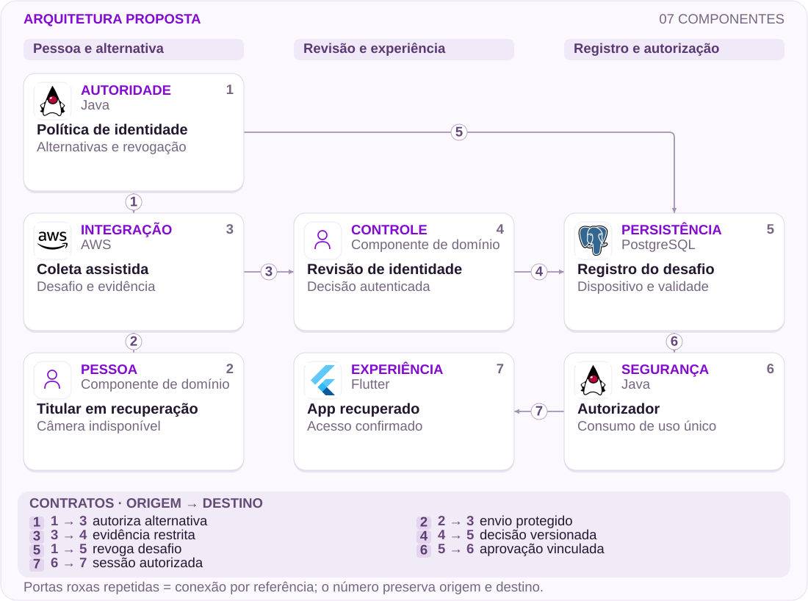

# 04 · Câmera quebrada, recuperação segura

Uma alternativa assistida sem remover controles de identidade.

[PT reader](https://wesleyvieira99.github.io/nu/#04-1) · [EN reader](https://wesleyvieira99.github.io/nu/en.html#04-1)

[Executable Python lab](../../labs/case_04.py)

## O registro e seu desfecho


Recorte real da fonte pública, capturado em 23/10/2026. O texto abaixo inclui resposta da empresa e desfecho relatado.

**Resolvido · RA 230743513**

Em 31/10/2025, um consumidor relatou não conseguir entrar na conta porque a autorização facial dependia de uma câmera quebrada. Em 03/11, o Nubank informou que recebeu uma selfie com código, validou o dispositivo internamente e liberou as funções. O consumidor marcou o problema como resolvido. A fonte não informa duração exata, valor indisponível ou como a foto alternativa foi capturada.

Este caso não prova erro de reconhecimento facial. A barreira descrita é incapacidade física de capturar uma imagem, e a resposta mostra que já existia uma solução assistida. A proposta melhora descoberta, encaminhamento e acompanhamento dessa alternativa, sem alegar que o Nubank a desconhecia. Não há foto biométrica pública a reproduzir; a captura documenta a reclamação e sua resolução. A discussão técnica começa no momento em que repetir a mesma instrução deixa de ser uma ação útil.

- [Reclame AQUI — relato e resposta pública](https://www.reclameaqui.com.br/nubank/dificuldade-de-acesso-a-conta-devido-a-necessidade-de-autorizacao-facial-com-camera-quebrada_lwa1QFYSkYw-6gtU/)

## Diagnóstico antes da solução

Permissão negada, câmera indisponível e identidade não confirmada são motivos distintos. Misturá-los numa mensagem genérica cria tentativas que não alteram a capacidade do dispositivo. A hipótese é que diagnosticar o impedimento antes da captura reduz encaminhamentos repetidos, mantendo a mesma exigência de identidade.

Eu investigaria a sequência de erros locais, tentativas e contatos por jornada, sem registrar imagens em analytics. Uma amostra de recuperação assistida permitiria identificar onde a pessoa abandona ou reinicia o processo. Se o encaminhamento já for claro e a espera estiver na análise especializada, a prioridade muda para capacidade e qualidade da revisão. O relato sozinho não mede essa distribuição.

O diagnóstico local deve ser tratado como sinal não confiável. Um cliente adulterado pode declarar câmera ausente; por isso, esse resultado apenas escolhe uma rota de orientação e nunca reduz a exigência de identidade. Eu verificaria ainda se a alternativa é utilizável por quem não dispõe de outro aparelho, mantendo essa limitação explícita em pesquisa. O caso resolvido não informa qual recurso permitiu a captura alternativa, então não posso supor que todas as pessoas tenham a mesma opção.

## Fronteiras da arquitetura



Arquitetura independente proposta; tecnologias sugeridas, não infraestrutura interna do Nubank.

A pessoa fornece evidência por canal protegido, enquanto a política autoriza quais alternativas são aceitáveis. A revisão gera uma decisão vinculada ao desafio e ao dispositivo pretendido. A política também pode revogar o registro antes do consumo.

O autorizador não interpreta foto nem mensagem de suporte: consome uma aprovação válida uma única vez. A interface só declara recuperação após confirmação do autorizador. Pessoas e revisores são papéis, não componentes de software com logotipo.

## Núcleo executável

```python
    def authorize(self, owner, device, challenge, now):
        with self.lock:
            if owner != self.owner or device != self.device:
                raise PermissionError("recovery binding")
            if type(now) is not int or now < 0:
                raise ValueError("invalid clock")
            if now >= self.expires_at:
                raise ValueError("challenge expired")
            if challenge != self.challenge:
                raise PermissionError("challenge mismatch")
            if self.state != "approved" or not self.evidence:
                raise ValueError("review required or challenge consumed")
            self.state = "authorized"
            self.challenge = None
            return {"device": self.device, "authorized": True}
```

Trecho literal do laboratório independente executado; demais validações estão no arquivo completo.

Recovery.authorize exige vínculo com titular, aparelho e desafio, além de prazo válido e aprovação anterior. Ao concluir, consome o desafio e impede reutilização. A invalidação ocorre sob o mesmo lock que verifica as condições, evitando que duas chamadas concorrentes autorizem pela mesma evidência local.

O código não reconhece rostos nem decide se uma pessoa é legítima. review recebe uma decisão de identidade já validada por um adaptador confiável no modelo. Essa limitação é central: testar uma máquina de estados não equivale a provar segurança biométrica. Em produção, a evidência, o operador e a sessão precisam de autenticação e persistência apropriadas.

- [Python — unittest](https://docs.python.org/3/library/unittest.html)
- [Laboratório executável do caso no GitHub](https://github.com/wesleyvieira99/nu/blob/main/labs/case_04.py)

## Implementação na stack

```dart
String nextStep(String capability, String verification) {
  // Proposed copy routing; never grants account access.
  if (capability == 'camera_unavailable') {
    return 'Open the approved assisted recovery path';
  }
  if (capability == 'permission_denied') {
    return 'Review camera permission instructions';
  }
  if (verification == 'not_confirmed') {
    return 'Follow the identity review instructions';
  }
  return 'Continue the approved capture flow';
}
```

Exemplo de integração proposto, não executado; não é código interno do Nubank.

O Dart ilustrativo separa incapacidade de hardware de falha na verificação. A experiência deve explicar a próxima ação possível sem recomendar atalhos que removem controles. Uma pessoa sem câmera funcional pode precisar de canal assistido ou outro meio aprovado, cuja elegibilidade pertence à política de identidade.

Eu revisaria acessibilidade desde a primeira tela: foco previsível, instruções faladas e preservação do progresso após interrupção. A alternativa não deve obrigar a pessoa a descobrir um contato por tentativa e erro. O trecho não foi compilado e não aciona permissões reais; a integração requer testes em aparelhos representativos e revisão com segurança.

- [Dart — Branches](https://dart.dev/language/branches)

## Contratos e propriedade

| Campo / regra | Responsável | Invariante |
| --- | --- | --- |
| challenge_id | Identidade | Uso único |
| device_binding | Autorizador | Contexto imutável |
| evidence_ref | Revisão | Sem biometria no log |
| expires_at | Política | Limite exclusivo |

```json
{
  "schema_version": 1,
  "challenge_id": "synthetic-one-use",
  "device_binding": "synthetic-device",
  "evidence_ref": "restricted-reference",
  "expires_at": 100,
  "state": "approved",
  "authorized": false
}
```

Contrato ilustrativo proposto; valores sintéticos, não dados de cliente.

O desafio precisa de identificador, validade, dispositivo pretendido e referência à decisão. O contrato não carrega selfie ou documento para a UI geral: transmite o estado mínimo necessário. Uma revogação deve prevalecer sobre uma autorização ainda não consumida, e a consulta deve refletir isso sem reiniciar silenciosamente o caso.

A política de retenção distingue material biométrico, decisão de revisão e logs operacionais. Cada categoria exige acesso e prazo apropriados. Não faria do armazenamento de evidências um arquivo permanente por conveniência técnica. A titularidade vem da sessão verificada; não pode ser escolhida pelo corpo de uma requisição pública, mesmo que o laboratório receba strings diretamente.

## Verificação adversarial

```python
    def test_parallel_authorization_consumes_once(self):
        self.approve()
        def attempt(_):
            try:
                return self.auth()["authorized"]
            except (ValueError, PermissionError):
                return False
        with ThreadPoolExecutor(max_workers=4) as pool:
            result = list(pool.map(attempt, range(4)))
        self.assertEqual(result.count(True), 1)

    def test_camera_problem_is_not_identity_proof(self):
        with self.assertRaises(ValueError):
            self.auth()
        self.assertEqual(self.r.state, "collecting")
```

Testes literais do laboratório; contagem e resultado obtidos da execução real.

Os 14 testes verificam uso único sob concorrência, expiração exata, aparelho diferente, titular incorreto, revogação, decisão sem evidência e valores booleanos enganosos. O teste mais importante confirma que declarar problema na câmera não autoriza nada. Outro mostra que uma tentativa com desafio errado não transforma a seguinte em sucesso sem revisão.

Faltam testes reais de captura, prova de vida, acessibilidade e armazenamento. Eles pertencem a camadas diferentes e exigem critérios próprios. Eu adicionaria exercícios de interrupção de rede e troca de aparelho durante a recuperação, sempre verificando que a decisão aprovada continua vinculada ao contexto correto e não migra para outro dispositivo.

- [Python — unittest](https://docs.python.org/3/library/unittest.html)

## Medir a jornada certa

| Métrica | Numerador / denominador | Janela e corte |
| --- | --- | --- |
| Conclusão legítima | Recuperações válidas / elegíveis | 7 dias; impedimento |
| Repetição inútil | Tentativas sem mudança / jornadas | Sessão; aparelho |
| Fila p 95 | Tempo até revisão | Diário; alternativa |
| Tomada de conta | Casos confirmados / recuperações | Janela de risco; coorte |

Conclusão legítima e apropriação de conta precisam ser lidas juntas. Uma melhoria de conversão que autoriza pessoas indevidas é uma regressão, mesmo que o atendimento diminua. A coleta segmenta impedimento físico, permissão e revisão, evitando usar biometria bruta como dimensão analítica.

O piloto mantém uma coorte comparável de jornadas elegíveis e observa recontatos por sete dias, além de sinais de fraude na janela definida pelo time de identidade. Testes de compreensão incluem pessoas com limitações de captura. Qualquer aumento confirmado de autorização indevida interrompe a expansão; um aumento de tempo de revisão também exige examinar se o fluxo apenas deslocou trabalho para especialistas.

## Valor financeiro com premissas

| Cenário assumido | Entrada principal | Líquido/mês | Retorno (meses) |
| --- | --- | --- | --- |
| Conservador | 3 mil; 0,2 contato; 10% revisão | R$ -3.000,00 | Não há |
| Base | 8 mil; 0,4 contato; 8% revisão | R$ 11.280,00 | 9,75 |
| Ambicioso | 15 mil; 0,6 contato; 5% revisão | R$ 57.500,00 | 1,91 |

Assumo 3.000 / 8.000 / 15.000 recuperações mensais, 0,2 / 0,4 / 0,6 contato evitado por jornada e R$ 9,00 por contato. A alternativa pode aumentar revisão: assumo 0,10 / 0,08 / 0,05 revisão adicional por jornada a R$ 18,00. Operação acrescenta R$ 3.000,00 / R$ 6.000,00 / R$ 10.000,00 mensais, com implantação hipotética de R$ 110.000,00.

A fórmula desconta a revisão adicional antes da operação. Assim, encaminhar melhor não é automaticamente mais barato. A análise não usa saldo do cliente, pois nenhum foi publicado. Fraude residual deve ser medida como guardrail e incluída no orçamento se houver diferença atribuível; não assumi benefício antifraude inexistente. Capacidade de atendimento só vira economia de caixa quando reduz gasto realizável.

Orçamento de implementação assumido: R$ 110.000,00. Resultados anuais líquidos antes da implementação: R$ -36.000,00 / R$ 135.360,00 / R$ 690.000,00. Todos os parâmetros são hipóteses, não baselines do Nubank.

## Roadmap com responsáveis

| Fase proposta | Responsável | Entrega / aceite |
| --- | --- | --- |
| 0–15 dias | Identidade + acessibilidade | Alternativas aprovadas |
| 16–30 dias | Mobile + privacidade | Motivos sem biometria |
| 31–60 dias | Staff + revisão | Vínculo e revogação |
| 61–90 dias | EM + suporte | Piloto com capacidade |

O primeiro marco alinha identidade, mobile e acessibilidade sobre as alternativas já disponíveis. O segundo instrumenta motivos de impedimento sem coletar material sensível. O terceiro constrói retomada e acompanhamento em ambiente controlado. Só depois o piloto mede se a pessoa chega ao canal correto com menos repetição.

O EM precisa reservar capacidade de revisão humana antes de aumentar entrada. O Staff define contratos de vinculação e revogação com os responsáveis pelos dispositivos. Uma taxa de encaminhamento maior sem capacidade de atendimento pode piorar espera; por isso, o aceite envolve fila e qualidade, não apenas telas entregues. O prazo proposto pode mudar após descoberta.

## Rollout e operação

O rollout não começa desabilitando reconhecimento facial. Começa tornando uma alternativa aprovada encontrável e acompanhável. O plantão de identidade recebe alertas de uso repetido, contexto divergente e falhas de consumo; atendimento recebe orientação para não solicitar material por canais improvisados.

Os exercícios incluem desafio expirado durante análise, revogação pelo titular e aprovação seguida de perda de conexão. A retomada consulta o estado existente antes de abrir outro caso. Rollback preserva decisões e permite atendimento assistido pelas rotas anteriores. Se houver dúvida sobre o vínculo da evidência com o dispositivo, a ação é nova revisão autorizada, nunca liberar por conveniência.

## Minha contribuição

Como Staff, eu trabalharia a diferença entre capacidade do aparelho e confiança na identidade, evitando que uma simplificação de UI contamine autorização. Rejeitaria uma regra que aceita qualquer foto enviada após erro de câmera: o problema físico não aumenta a confiabilidade da evidência. A alternativa correta precisa de política, revisão e vínculo de uso único.

Como EM, eu coordenaria mobile, identidade, privacidade e suporte para entregar uma jornada que possa ser operada. Isso inclui capacidade de especialistas e treinamento, além de código. Minha contribuição proposta é tornar segurança e acessibilidade critérios conjuntos de qualidade, com transparência sobre o que o laboratório demonstra e o que depende de validação adicional.

Eu também evitaria um objetivo de conversão que pressione revisores a aprovar casos incertos. O EM deve acompanhar qualidade da decisão, carga e escalonamento, enquanto o Staff mantém o protocolo capaz de representar espera e necessidade de revisão adicional. Uma recuperação pode ser legitimamente mais longa quando faltam evidências. O ganho desejado é remover repetição inútil e melhorar orientação, preservando a decisão de segurança que o caso exige.

## Handoff e decisão

**Execução local**

python3 labs/case_04.py -v · 14 testes passaram.

O revisor primeiro tenta authorize sem review e observa a rejeição. Depois aprova uma referência sintética, altera o dispositivo e verifica nova rejeição; apenas o contexto correto consome o desafio. Esse roteiro demonstra que capacidade de captura e autorização são contratos separados.

O handoff exige política de alternativas aprovada, serviço de sessão, armazenamento restrito e plano de retenção. Também requer teste em hardware real, suporte para interrupções e acompanhamento de fraude. Prosseguir depende de evidência de recuperação legítima melhor sem enfraquecimento de identidade. Se a causa dominante for capacidade de revisão, priorizo a fila antes de acrescentar mais etapas ao aplicativo.

- Câmera indisponível não prova identidade.
- Desafio expirado ou revogado não autoriza.
- Material sensível fica fora de analytics.

- [Laboratório executável do caso no GitHub](https://github.com/wesleyvieira99/nu/blob/main/labs/case_04.py)
