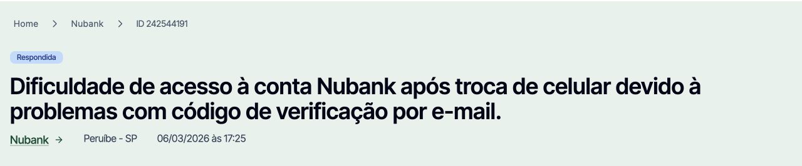
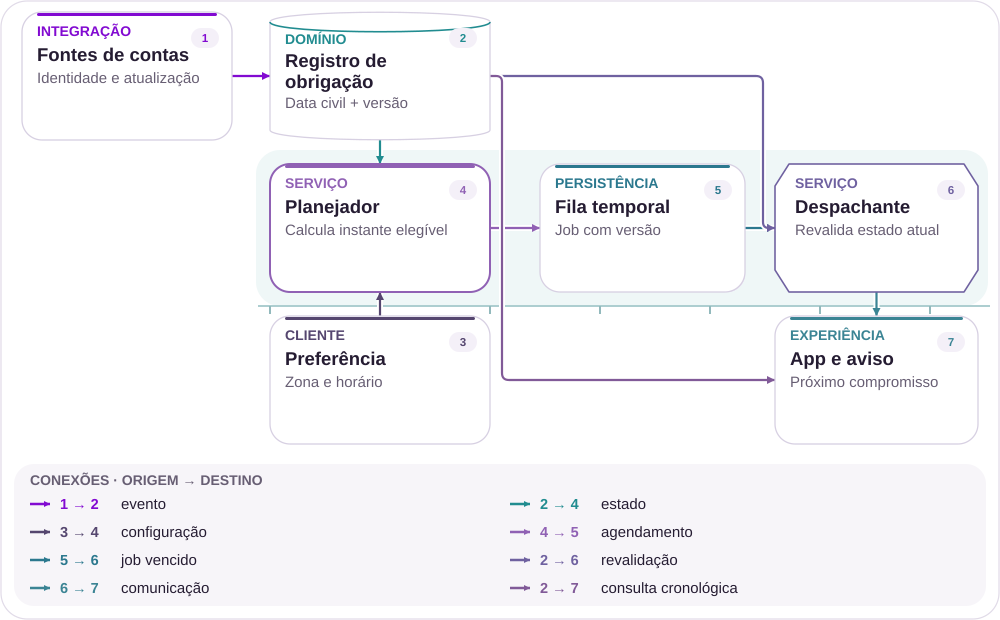
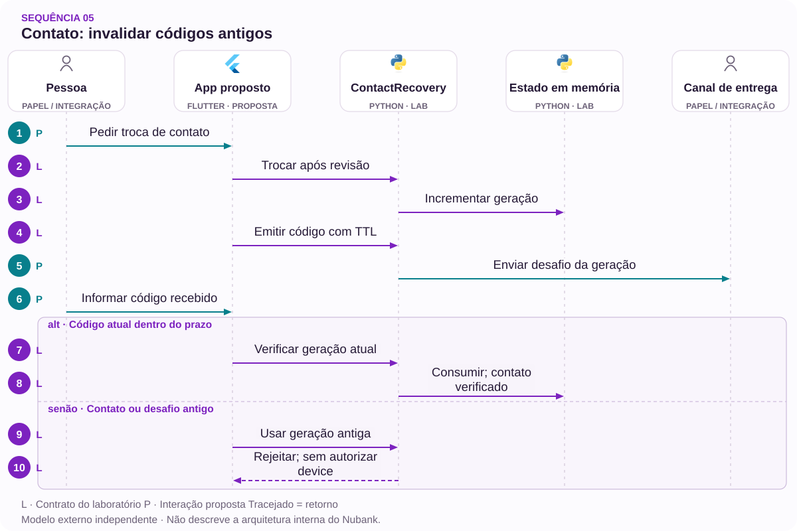

# 05 · Novo telefone, código que não chega

Recuperar o contato sem confundir prova de e-mail e autorização.

[PT reader](https://wesleyvieira99.github.io/nu/#05-1) · [EN reader](https://wesleyvieira99.github.io/nu/en.html#05-1)

[Executable Python lab](../../labs/case_05.py)

## O registro e seu desfecho



Recorte real da fonte pública, capturado em 23/10/2026. O texto abaixo inclui resposta da empresa e desfecho relatado.

**Respondida · RA 242544191**

Em 06/03/2026, um consumidor relatou trocar de celular, não conhecer ou não acessar o e-mail anterior e não receber o código no novo endereço informado. Em 13/03, o Nubank explicou verificações adicionais e informou que um aparelho havia sido autorizado em 09/03. Disse aguardar retorno à orientação privada. O registro está respondido, sem confirmação final pública do consumidor. Não há causa comprovada de falha na entrega.

Um aparelho autorizado não comprova, por si só, que a pessoa concluiu toda a jornada descrita. A resposta pode indicar progresso importante, mas não autoriza converter respondida em resolvida. Este caso trata de e-mail, não de SMS ou câmera quebrada. As mensagens privadas não foram consultadas. A proposta usa o obstáculo relatado para examinar o contrato entre contato atualizado, código entregue, código validado e sessão do novo dispositivo.

- [Reclame AQUI — relato e resposta pública](https://www.reclameaqui.com.br/nubank/dificuldade-de-acesso-a-conta-nubank-apos-troca-de-celular-devido-a-problemas-com-codigo-de-verificacao-por-e-mail_FO6cRDkD3xp9govT/)

## Diagnóstico antes da solução

O relato permite investigar entrega, associação de geração e compreensão da jornada, mas não identifica provedor, bounce ou filtro de spam. Eu rastrearia uma recuperação por recovery_id, comparando solicitação de mudança, emissão, aceitação pelo provedor, retorno de entrega e validação. Aceitação SMTP não significa leitura nem prova de identidade.

Uma hipótese é que o cliente não consiga distinguir qual contato está ativo e qual desafio ainda vale após reenvio. Isso pode ser refutado por logs e pesquisa: se o contato e o desafio estiverem consistentes, o gargalo pode estar fora dessa fronteira. Não afirmaria causa com base apenas em uma mensagem “não chegou”.

A investigação de entrega precisa reconhecer feedback incompleto. Alguns provedores informam aceitação sem confirmação de entrega; outros retornam eventos atrasados ou duplicados. Eu documentaria quais sinais são observações e quais são inferências, mantendo a mensagem ao cliente compatível com essa diferença. Um novo e-mail informado ainda precisa de validação de identidade para mudança de cadastro. A pesquisa deve observar se o usuário entende que confirmar o contato e recuperar acesso podem exigir passos distintos.

## Fronteiras da arquitetura



Arquitetura independente proposta; tecnologias sugeridas, não infraestrutura interna do Nubank.

O contato versionado alimenta emissão e verificação. A política define limites, enquanto o registro conserva o desafio vigente. O verificador consulta novamente a geração antes de consumir o código, evitando que uma mudança concorrente deixe um desafio antigo utilizável.

O app recebe progresso de contato separado de acesso. Confirmar o endereço é apenas uma etapa; a autorização de aparelho continua no domínio de identidade. O diagrama não representa o provedor de entrega como fonte de confiança sobre a titularidade.

## Núcleo executável

`Generation Token [lab]` · `Bounded Retry Budget [lab]`

```python
    def verify(self, owner, generation, code, now):
        if owner != self.owner:
            raise PermissionError("recovery scope")
        if type(now) is not int or now < 0 or not isinstance(code, str):
            raise ValueError("invalid request")
        with self.lock:
            current = self.challenge
            if current is None:
                raise ValueError("challenge unavailable")
            issued_generation, digest, issued_at, expiry, attempts = current
            if type(generation) is not int or generation != self.generation:
                raise ValueError("obsolete contact generation")
            if generation != issued_generation or not issued_at <= now < expiry:
                raise ValueError("challenge expired or not yet valid")
            if attempts >= 3:
                raise ValueError("attempt budget exhausted")
            current[4] += 1
            candidate = hashlib.sha256(code.encode()).digest()
            if not hmac.compare_digest(candidate, digest):
                raise PermissionError("invalid code")
            self.verified, self.challenge = True, None
            return True
```

Trecho literal do laboratório independente executado; demais validações estão no arquivo completo.

ContactRecovery.verify rejeita geração antiga, tempo inválido, desafio ausente e orçamento de tentativas esgotado. O hash compara o código sem persistir seu texto no registro didático. Após sucesso, o desafio é consumido e verified passa a verdadeiro; device_authorized permanece falso.

O laboratório recebe códigos fixos para testes reprodutíveis. Um serviço real deve gerar segredos aleatórios, limitar abuso distribuído e proteger armazenamento. Hash simples de um código curto não é proteção suficiente contra extração do banco; seria necessário um desenho de segredos e chaves adequado. O objetivo aqui é verificar ciclo de vida e vínculo, sem simular um serviço pronto de autenticação.

- [Python — unittest](https://docs.python.org/3/library/unittest.html)
- [Laboratório executável do caso no GitHub](https://github.com/wesleyvieira99/nu/blob/main/labs/case_05.py)

## Implementação na stack

`Generation Token [proposal]` · `Bounded Retry Budget [proposal]`

```typescript
// Proposed presentation contract; validate network input separately.
type RecoveryView =
  | { state: 'contact_pending'; generation: number }
  | { state: 'contact_verified'; generation: number }
  | { state: 'device_authorized'; deviceRef: string };
function accessReady(view: RecoveryView): boolean {
  return view.state === 'device_authorized';
}
function contactReady(view: RecoveryView): boolean {
  return view.state === 'contact_verified'
      || view.state === 'device_authorized';
}
```

Exemplo de integração proposto, não executado; não é código interno do Nubank.

O contrato TypeScript usa uma união explícita para distinguir contato pendente, contato confirmado e aparelho autorizado. Isso facilita revisão da UI, mas tipos estáticos não validam dados recebidos da rede. O adaptador ainda precisa validar schema, origem e escopo antes de construir esse objeto.

A mensagem não expõe o e-mail inteiro nem informa a existência de uma conta para solicitantes não autenticados. O reenvio mostra um prazo coerente com a política e preserva a jornada. Eu reutilizaria o provedor de entrega existente sempre que possível, acrescentando correlação e tratamento de eventos em vez de presumir que trocar fornecedor resolve a causa desconhecida.

- [TypeScript — Narrowing](https://www.typescriptlang.org/docs/handbook/2/narrowing.html)

## Contratos e propriedade

`Generation Token [proposal]` · `Bounded Retry Budget [proposal]`

| Campo / regra | Responsável | Invariante |
| --- | --- | --- |
| recovery_id | Identidade | Escopo por titular |
| contact_generation | Contato | Muda com autorização |
| challenge_hash | Segurança | Nunca logar código |
| delivery_state | Adaptador | Aceito ≠ lido |

```json
{
  "schema_version": 1,
  "recovery_id": "synthetic-recovery",
  "contact_generation": 2,
  "delivery_state": "accepted",
  "contact_verified": false,
  "device_authorized": false,
  "expires_at": 160
}
```

Contrato ilustrativo proposto; valores sintéticos, não dados de cliente.

A geração muda apenas após atualização de contato autorizada. Cada emissão substitui o desafio anterior dentro dessa geração e aplica cooldown. O TTL pertence ao desafio, enquanto o limite de tentativas pertence à política de abuso. Na produção, limites adicionais por conta, aparelho e origem precisam sobreviver a reinício e múltiplas instâncias.

Eventos de entrega devem distinguir aceito, devolvido e expirado sem concluir que a mensagem foi lida. O registro público não fornece tais eventos. Logs evitam códigos e endereços completos; a investigação usa referências protegidas. Alteração de contato não pode permitir que um invasor escolha livremente o destino e se torne titular por receber o próprio código.

## Verificação adversarial

`Generation Token [lab]` · `Bounded Retry Budget [lab]`

```python
    def test_contact_change_invalidates_old_code(self):
        self.r.change_contact("a", "other@example.test", True)
        self.r.issue("a", "654321", 110, 60)
        with self.assertRaises(ValueError):
            self.r.verify("a", 1, "123456", 120)
        self.assertTrue(self.r.verify("a", 2, "654321", 120))

    def test_contact_proof_does_not_authorize_device(self):
        self.assertTrue(self.r.verify("a", 1, "123456", 120))
        self.assertTrue(self.r.verified)
        self.assertFalse(self.r.device_authorized)
```

Testes literais do laboratório; contagem e resultado obtidos da execução real.

Os 14 testes incluem troca de contato com código antigo, reenvio, limite de tentativas, expiração, relógio futuro, replay e titular incorreto. O teste de separação de estado confirma que validar e-mail não autoriza um dispositivo. Essa invariante evita transformar um mecanismo de entrega em prova completa de identidade.

A suíte não envia e-mail nem mede entregabilidade. Faltam eventos do provedor, limites entre processos e testes de enumeração por tempo de resposta. Antes de produção, eu acrescentaria ataques de reenvio coordenado e duas sessões mudando o contato simultaneamente, além de integração com a política real de recuperação de identidade.

- [Python — unittest](https://docs.python.org/3/library/unittest.html)

## Medir a jornada certa

| Métrica | Numerador / denominador | Janela e corte |
| --- | --- | --- |
| Contato confirmado | Confirmações / jornadas | 7 dias; provedor |
| Retomada | Retomadas concluídas / iniciadas | Sessão; versão |
| Recontato | Contatos repetidos / recovery_id | 7 dias; motivo |
| Código obsoleto | Aceites indevidos / verificações | Contínuo; geração |
| Abuso | Casos confirmados / jornadas | Janela de risco |

O funil precisa mostrar emissão, entrega observável, validação de contato e autorização, sem tratar essas etapas como equivalentes. Eu mediria recontato por recuperação e tempo por etapa, com cortes por provedor e versão de app quando houver volume suficiente para preservar privacidade.

O experimento compara jornadas elegíveis de complexidade semelhante e observa recuperação legítima, mensagens enviadas e carga de revisão. Uma melhora de entrega que aumenta abuso não passa no aceite. A expansão para se houver código obsoleto aceito, vazamento de cadastro ou tomada de conta atribuível ao fluxo. A baseline permanece desconhecida até instrumentação e validação com o time de identidade.

## Valor financeiro com premissas

| Cenário assumido | Entrada principal | Líquido/mês | Retorno (meses) |
| --- | --- | --- | --- |
| Conservador | 10 mil; Δ 0,05; 15 mil envios | R$ -450,00 | Não há |
| Base | 30 mil; Δ 0,12; 45 mil envios | R$ 20.450,00 | 4,89 |
| Ambicioso | 60 mil; Δ 0,18; 90 mil envios | R$ 71.700,00 | 1,39 |

Assumo 10.000 / 30.000 / 60.000 jornadas mensais, redução de recontato de 0,05 / 0,12 / 0,18 e custo marginal de R$ 8,00 por contato. Assumo 15.000 / 45.000 / 90.000 mensagens adicionais a R$ 0,03 cada, mais R$ 4.000,00 / R$ 7.000,00 / R$ 12.000,00 de operação mensal. A implementação hipotética custa R$ 100.000,00.

O benefício líquido é jornadas × recontatos evitados × custo, menos mensagens e operação. Não uso receita média global por cliente para valorar acesso recuperado; seria necessário demonstrar incremento causal de receita e margem, o que o relato não permite. O cenário conservador pode ser negativo, evidenciando que enviar mais mensagens sem reduzir dúvida suficientemente não justifica o investimento por custo evitado.

Orçamento de implementação assumido: R$ 100.000,00. Resultados anuais líquidos antes da implementação: R$ -5.400,00 / R$ 245.400,00 / R$ 860.400,00. Todos os parâmetros são hipóteses, não baselines do Nubank.

## Roadmap com responsáveis

| Fase proposta | Responsável | Entrega / aceite |
| --- | --- | --- |
| 0–15 dias | Identidade + entrega | Mapa de eventos |
| 16–30 dias | Staff + segurança | Geração e limites |
| 31–60 dias | Mobile + produto | Retomada em sombra |
| 61–90 dias | EM + suporte | Piloto sem abuso novo |

O roadmap começa com um inventário de eventos já disponíveis e das formas de recuperar contato. A equipe de identidade valida quais mudanças exigem revisão; o responsável pela entrega descreve o que seus callbacks realmente significam. Produto define mensagens que expliquem andamento sem revelar cadastro.

A etapa em sombra compara geração emitida e consumida, antes de alterar reenvio ou experiência. O EM coordena dependências com o provedor e capacidade de revisão; o Staff resolve concorrência e persistência da política. Se a observabilidade revelar problema predominantemente externo, o plano deve priorizar o adaptador e comunicação, sem refazer desnecessariamente toda a autenticação.

## Rollout e operação

No canário, a emissão antiga e a nova precisam compartilhar o mesmo controle de geração. Uma flag de UI não impede que um código antigo seja aceito por um backend incompatível. A migração exige compatibilidade ou bloqueio explícito de versões que não entendem a nova identidade.

O exercício inclui retorno de entrega atrasado, reenvio concorrente e troca de contato enquanto o código está em trânsito. A operação deve conseguir distinguir atraso do provedor de desafio já revogado. Rollback preserva gerações e limites; não reativa segredos antigos. Alertas de abuso vão ao time de identidade, enquanto falhas de entrega agregadas acionam o responsável pelo canal.

## Minha contribuição

Como Staff, eu proporia o contrato de geração e a separação entre posse do contato e autorização do dispositivo. Rejeitaria a alternativa de aceitar qualquer código ainda não expirado: dois contatos e dois reenvios podem deixar várias provas contraditórias aparentemente válidas. O desafio precisa ser o vigente no contexto correto.

Como EM, eu construiria uma entrega com segurança, entrega de mensagens e mobile, incluindo testes de abuso no critério de pronto. Também garantiria que o suporte veja o mesmo progresso sem acessar segredos. Essas ações são uma proposta de trabalho e de coordenação, não uma declaração de autoridade ou resultados anteriores dentro do Nubank.

A decisão técnica precisa resistir à pressão por remover etapas sem entender sua finalidade. Eu explicaria quais controles são obrigatórios para o risco e quais repetições são apenas consequência de estado mal preservado. Como EM, organizaria uma revisão com atendimento usando jornadas anonimizadas, permitindo que as pessoas que recebem a dúvida participem do design. Isso produz uma solução mais operável e evita adicionar mais um botão de reenvio sem resolver o contexto.

## Handoff e decisão

**Execução local**

python3 labs/case_05.py -v · 14 testes passaram.

O revisor começa por change_contact, emite um código, altera novamente o contato e tenta consumir a geração anterior. Depois verifica que o contato novo pode ser confirmado sem autorizar o aparelho. Os testes usam endereços example.test e códigos sintéticos; não fazem envio nem acesso real.

O handoff pede serviço de identidade, geração de segredos, armazenamento protegido, callbacks de entrega e rate limiting durável. A decisão de prosseguir exige recuperação legítima mensurável e guardrails de abuso. Se só melhorar aceitação do provedor, sem conclusão ou redução de recontato, o piloto não demonstra o valor pretendido e precisa de novo diagnóstico.

- Contato verificado não autoriza aparelho.
- Reenvio invalida o desafio anterior.
- Nenhum código aparece em logs.

- [Laboratório executável do caso no GitHub](https://github.com/wesleyvieira99/nu/blob/main/labs/case_05.py)

## Padrões com prova no código

`Generation Token [lab]` · `Bounded Retry Budget [lab]` · `Hexagonal Architecture [proposal]` · `Spring Security [proposal]`

| Mecanismo | Implementação | Evidência |
| --- | --- | --- |
| Generation Token | ContactRecovery.change_contact | trocar contato invalida o código anterior |
| Bounded Retry Budget | ContactRecovery.verify | o orçamento de tentativas bloqueia a próxima verificação |
| Hexagonal Architecture / delivery adapter | Proposta para produção | Adaptadores preservam a autoridade fora da interface. |

**Integração Java · proposta**

Spring Security + distributed rate limiter. Portar invariantes e testes de contrato antes de substituir o modelo Python. Lock de processo não controla concorrência distribuída; persistência, autorização e recuperação exigem testes de integração.

**Avaliação de IA · núcleo determinístico**

Nenhum framework de agentes está implementado neste laboratório. Estado financeiro, autorização e versões permanecem determinísticos. Um assistente só seria avaliado diante de necessidade comprovada de atendimento, sem autoridade sobre saldo ou identidade.

- [P1 · ContactRecovery.change_contact](https://github.com/wesleyvieira99/nu/blob/main/labs/case_05.py#L21)
- [P1 · test_contact_change_invalidates_old_code](https://github.com/wesleyvieira99/nu/blob/main/labs/case_05.py#L78)
- [P2 · ContactRecovery.verify](https://github.com/wesleyvieira99/nu/blob/main/labs/case_05.py#L46)
- [P2 · test_budget_exhaustion](https://github.com/wesleyvieira99/nu/blob/main/labs/case_05.py#L95)

## Sequência de execução



Código de teste é fornecido; canal, segredo aleatório e limites distribuídos são integrações futuras.

**Autoridade e fronteira de falha**

trocar contato invalida o código anterior. o orçamento de tentativas bloqueia a próxima verificação.

A sequência descreve a integração proposta. O laboratório vinculado verifica a invariante do domínio com dados sintéticos; serviços externos, retries de rede e implantação permanecem trabalho de integração.

- [change_contact](https://github.com/wesleyvieira99/nu/blob/main/labs/case_05.py#L21)
- [verify](https://github.com/wesleyvieira99/nu/blob/main/labs/case_05.py#L46)

## Features, histórias e aceite

**F05.1 · Contato versionado · D16–30**

Como cliente, quero usar apenas o código do contato atual. Aceite: trocar contato invalida o código anterior.

**F05.2 · Tentativas limitadas e retomada · D31–60**

Como cliente, quero retomar a verificação sem permitir tentativas ilimitadas. Aceite: o orçamento de tentativas bloqueia a próxima verificação.

**F05.3 · Expansão medida · D61–90**

Como responsável de produto, quero uma coorte elegível com controle comparável. Aceite: métrica do caso, denominador, custo e barreira de segurança registrados antes da exposição; falhas de conciliação interrompem expansão.

Os testes vinculados exercitam o aceite declarado do domínio, não a interface completa nem a integração de produção. D0–15 é descoberta: confrontar o relato público com amostras internas autorizadas, mapear dependências e aprovar contratos. São janelas incrementais de planejamento, não promessa de prazo. EM coordena dependências; Staff responde pelos contratos; Produto e o domínio aceitam o resultado.

- [Aceite F05.1](https://github.com/wesleyvieira99/nu/blob/main/labs/case_05.py#L78)
- [Aceite F05.2](https://github.com/wesleyvieira99/nu/blob/main/labs/case_05.py#L95)

## Método e sensibilidade

**Sensibilidade do cenário · BRL**

Todos os inputs são hipóteses de cenário, não efeitos medidos no Nubank. Capacidade equivalente não é economia de caixa. A realização reduz apenas o benefício; todos os custos permanecem nos valores do cenário. É análise de sensibilidade, não probabilidade nem estimativa causal.

líquido_período = benefício × realização − custo_variável − operação; primeiro_ano = 12 × líquido_período − implementação

Period / Período: `month`. Values / Valores: BRL.

| Scenario / Cenário | Benefit / Benefício | Variable cost / Variável | Run cost / Operação | Build / Implementação |
| --- | ---: | ---: | ---: | ---: |
| Conservador | 4000.00 | 450.00 | 4000.00 | 100000.00 |
| Base | 28800.00 | 1350.00 | 7000.00 | 100000.00 |
| Ambicioso | 86400.00 | 2700.00 | 12000.00 | 100000.00 |

| Scenario / Cenário | Period net at 100% / Líquido | Horizon after build / Horizonte | Horizon at 50% / Estresse |
| --- | ---: | ---: | ---: |
| Conservador | -450.00 | -105400.00 | -129400.00 |
| Base | 20450.00 | 145400.00 | -27400.00 |
| Ambicioso | 71700.00 | 760400.00 | 242000.00 |

[Reproducible scenario inputs](../../models/normalized-scenarios.json) · [Decimal simulator](../../models/simulate.py)

| Decisão | Método específico do caso |
| --- | --- |
| Baseline / ameaça | Baseline: contatos por recovery_id. Ameaça: confundir emissão, entrega e autorização. |
| Economia por unidade | Contato evitado menos mensagens enviadas e operação; custo de envio segue no cenário mesmo sob estresse. |
| Experimento proposto | Comparar jornadas de complexidade semelhante por provedor; medir retomada legítima e carga de revisão. |
| Critério de parada | Parar por código obsoleto aceito, vazamento de cadastro ou tomada de conta. |

- [Reclame AQUI · ID 242544191](https://www.reclameaqui.com.br/nubank/dificuldade-de-acesso-a-conta-nubank-apos-troca-de-celular-devido-a-problemas-com-codigo-de-verificacao-por-e-mail_FO6cRDkD3xp9govT/)
- [FinOps Foundation · Unit Economics](https://www.finops.org/framework/capabilities/unit-economics/)
- [Microsoft Research · Pre-experiment design](https://www.microsoft.com/en-us/research/articles/patterns-of-trustworthy-experimentation-pre-experiment-stage/)
