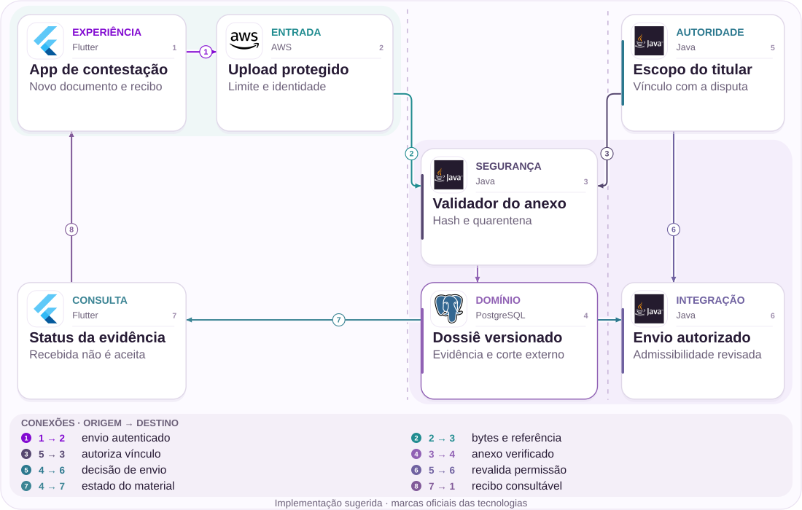

# 06 · Nova evidência durante a contestação

Receber, verificar e decidir admissibilidade são etapas diferentes.

[PT reader](https://wesleyvieira99.github.io/nu/#06-1) · [EN reader](https://wesleyvieira99.github.io/nu/en.html#06-1)

[Executable Python lab](../../labs/case_06.py)

## O registro e seu desfecho


Recorte real da fonte pública, capturado em 23/10/2026. O texto abaixo inclui resposta da empresa e desfecho relatado.

**Respondida · RA 240394695**

Em 10/02/2026, uma consumidora relatou contestar compra Airbnb não reconhecida e não conseguir acrescentar comprovantes enquanto o caso estava em análise. Em 18/02, o Nubank informou crédito de confiança, disputa aberta em 11/02, cancelamento do cartão virtual e desativação do atualizador automático. Os valores aparecem mascarados. Não há resultado final público nem confirmação de que o canal de anexos foi reaberto.

O obstáculo concreto é acrescentar material depois da abertura, não demonstrar aqui se a compra era fraudulenta. A confirmação atribuída ao Airbnb está em mensagem privada não examinada. O crédito de confiança é provisório e deve aparecer separado do resultado da disputa. A proposta não promete que todo documento tardio será aceito pela bandeira: busca preservar material, explicar a etapa e oferecer decisão de admissibilidade rastreável.

- [Reclame AQUI — relato e resposta pública](https://www.reclameaqui.com.br/nubank/compra-nao-reconhecida-contestacao-em-analise-e-impossibilidade-de-enviar-novos-comprovantes_Rud6eWI8D-puvZac/)

## Diagnóstico antes da solução

Um estado “em análise” pode estar sendo usado para bloquear toda edição, embora acrescentar uma evidência e alterar a reclamação original tenham riscos diferentes. Essa é uma hipótese, não a causa comprovada do app. Eu mapearia as etapas internas e os prazos externos, identificando onde anexos adicionais ainda podem ser considerados.

A investigação compara tentativas de upload, contatos para envio e decisões do analista. É necessário separar impedimento de interface, limite de formato, quarentena e corte da bandeira. Se o material já estava fora do prazo aplicável, a melhoria pode ser uma explicação e um encaminhamento permitido, sem sugerir que engenharia consegue reabrir unilateralmente a disputa.

Também distinguiria evidência complementar de correção de dados da transação contestada. A primeira pode ser acrescentada sem alterar a identidade do caso; a segunda pode exigir revisão do próprio objeto da disputa. Se ambos usarem o mesmo botão genérico de editar, fica difícil explicar o que foi efetivamente recebido. O desenho proposto registra intenção do envio e mantém rastreabilidade, permitindo ao analista decidir como o material se relaciona ao conjunto anterior.

## Fronteiras da arquitetura



Arquitetura independente proposta; tecnologias sugeridas, não infraestrutura interna do Nubank.

O upload entra em quarentena e conserva identidade antes de chegar ao dossiê. O escopo do titular protege tanto a entrada quanto a submissão. A política do dossiê determina o que pode seguir após revisão, sem apagar evidências anteriores.

O retorno ao aplicativo distingue recebido, em verificação, disponível para análise e enviado. Receber bytes não confirma mérito ou aceitação externa. O desenho também não mistura esse estado com crédito provisório ou decisão financeira definitiva.

## Núcleo executável

```python
    def append(self, owner, upload_id, content, now):
        if owner != self.owner:
            raise PermissionError("dispute scope")
        if not upload_id or type(content) is not bytes:
            raise ValueError("upload identity and bytes required")
        if not 0 < len(content) <= 1024 * 1024:
            raise ValueError("attachment size")
        if type(now) is not int or now < 0:
            raise ValueError("clock")
        digest = hashlib.sha256(content).hexdigest()
        with self.lock:
            if upload_id in self.seen:
                previous = self.items[self.seen[upload_id]]
                if previous["digest"] != digest:
                    raise ValueError("upload identity conflict")
                return dict(previous)
            item = dict(version=len(self.items) + 1, digest=digest,
                        received_at=now, state="quarantined",
                        late=now >= self.cutoff)
            self.seen[upload_id] = len(self.items)
            self.items.append(item)
            return dict(item)
```

Trecho literal do laboratório independente executado; demais validações estão no arquivo completo.

Dossier.append aplica escopo, tamanho e identidade do upload antes de criar uma versão. Repetir a mesma chave e conteúdo retorna o registro anterior; reutilizar a chave com bytes diferentes gera conflito. O retorno é uma cópia, para que o chamador não altere o estado interno por acidente.

Material recebido após o corte é preservado como tardio, mas submit não promete enviá-lo nessa janela. O scanner é uma fronteira simulada: um booleano confiável representa resultado externo já verificado. O laboratório não inspeciona malware nem armazena arquivos em nuvem. Seu contrato é conservar versão e separar recebimento de elegibilidade.

- [Python — unittest](https://docs.python.org/3/library/unittest.html)
- [Laboratório executável do caso no GitHub](https://github.com/wesleyvieira99/nu/blob/main/labs/case_06.py)

## Implementação na stack

```typescript
// Proposed metadata only; no storage permissions implemented here.
type EvidenceRecord = {
  dossierId: string;
  uploadId: string;
  version: number;
  originalObjectRef: string;
  digest: string;
  state: 'quarantined' | 'reviewable' | 'rejected' | 'submitted';
  late: boolean;
};
function readyForReview(item: EvidenceRecord): boolean {
  return item.state === 'reviewable';
}
```

Exemplo de integração proposto, não executado; não é código interno do Nubank.

O exemplo de armazenamento define referências e estados, não permissões completas. Em uma integração com S 3, eu projetaria upload restrito, quarentena, avaliação de conteúdo e liberação para analistas autorizados. O objeto original e eventuais derivados precisam de identidades distintas, para que remoção de metadados não destrua a referência probatória original.

O serviço de disputa decide admissibilidade e prazo; o armazenamento não assume essa autoridade. URLs temporárias não devem virar links públicos no histórico. A UI pode mostrar nome seguro, tamanho e recibo sem renderizar conteúdo ativo. O exemplo TypeScript é ilustrativo e não foi executado ou conectado a serviços AWS.

- [Amazon S3 — User Guide](https://docs.aws.amazon.com/AmazonS3/latest/userguide/Welcome.html)

## Contratos e propriedade

| Campo / regra | Responsável | Invariante |
| --- | --- | --- |
| upload_id + digest | Ingestão | Sem substituição |
| dossier_version | Disputa | Histórico preservado |
| scan_state | Segurança | Quarentena primeiro |
| cutoff + rule | Operação | Receber ≠ submeter |

```json
{
  "schema_version": 1,
  "dossier_id": "synthetic-dispute",
  "upload_id": "synthetic-upload",
  "dossier_version": 2,
  "digest": "sha256-reference",
  "state": "quarantined",
  "late": false,
  "provisional_credit_is_final": false
}
```

Contrato ilustrativo proposto; valores sintéticos, não dados de cliente.

O contrato associa upload_id, versão do dossiê, digest e momento de recebimento. O digest detecta alteração de bytes, mas não prova que o conteúdo é verdadeiro. A revisão substantiva continua necessária e pode rejeitar material tecnicamente íntegro.

O modelo não aceita substituir silenciosamente um anexo. Correções são novas versões com relação explícita à anterior. Prazos precisam de origem, fuso e regra aplicável, revisados com operação da bandeira. Privacidade exige separar quem vê o recibo de quem pode abrir documentos. Retenção deve considerar disputa, contestação e obrigações pertinentes, sem adotar armazenamento ilimitado como padrão.

## Verificação adversarial

```python
    def test_late_evidence_is_retained_without_submission_promise(self):
        item = self.upload(now=101)
        self.d.scan(item["version"], True, True)
        with self.assertRaises(ValueError):
            self.d.submit(item["version"], "dispute-analyst", True)
        self.assertEqual(len(self.d.items), 1)
        self.assertEqual(self.d.items[0]["state"], "reviewable")

    def test_reused_upload_id_cannot_replace_evidence(self):
        original = self.upload()
        with self.assertRaises(ValueError):
            self.upload(data=b"replacement")
        self.assertEqual(self.d.items[0]["digest"], original["digest"])
```

Testes literais do laboratório; contagem e resultado obtidos da execução real.

Os 14 testes verificam material tardio preservado sem promessa de submissão, conflito de identidade, quarentena, conteúdo rejeitado, escopo, replay e mutação do retorno. A fronteira exata do corte conta como tardia no modelo e precisa ser validada contra a regra real antes da integração.

O teste de substituição protege evidência anterior, enquanto o de quarentena impede que upload concluído pareça prova já utilizável. A suíte não valida tipos de arquivo reais, antivírus, acessibilidade ou regras de bandeira. Eu acrescentaria testes com arquivos malformados e interrupção durante envio, além de restauração do vínculo após expiração de uma URL temporária.

- [Python — unittest](https://docs.python.org/3/library/unittest.html)

## Medir a jornada certa

| Métrica | Numerador / denominador | Janela e corte |
| --- | --- | --- |
| Recibo válido | Uploads vinculados / elegíveis | Diário; etapa |
| Análise p 95 | Tempo recepção→admissibilidade | Semanal; corte |
| Recontato | Contatos para anexar / dossiês | 7 dias; motivo |
| Integridade | Falhas / anexos auditados | Contínuo; versão |
| Custo de triagem | Minutos / dossiê elegível | Semanal; material |

O sucesso não é simplesmente aumentar anexos. A métrica principal observa material elegível recebido com recibo e analisado dentro da janela útil. Mais documentos irrelevantes podem aumentar custo e atrasar decisões; por isso, acompanhar tempo do analista e admissibilidade é necessário.

O piloto compara disputas de estágio e motivo semelhantes, com avaliação por analistas que conhecem os prazos. Recontatos são medidos por dossiê em sete dias. Nenhum resultado de chargeback é atribuído à melhoria sem comparação adequada, porque mérito e estabelecimento influenciam o desfecho. Exposição de documento, troca de prova ou prazo perdido interrompem imediatamente a expansão.

## Valor financeiro com premissas

| Cenário assumido | Entrada principal | Líquido/mês | Retorno (meses) |
| --- | --- | --- | --- |
| Conservador | 2 mil × 4 min × 25% | R$ -1.100,00 | Não há |
| Base | 6 mil × 6 min × 40% | R$ 10.200,00 | 13,73 |
| Ambicioso | 12 mil × 8 min × 50% | R$ 46.400,00 | 3,02 |

O modelo financeiro usa retrabalho do analista, sem inventar o valor mascarado da compra. Assumo 2.000 / 6.000 / 12.000 dossiês mensais, 4 / 6 / 8 minutos poupados por dossiê, R$ 75,00 por hora e fração realizável de 25% / 40% / 50%. Assumo 3.000 / 9.000 / 18.000 uploads adicionais a R$ 0,20, mais R$ 3.000,00 / R$ 6.000,00 / R$ 10.000,00 mensais de operação. A implantação hipotética custa R$ 140.000,00.

A conta desconta verificação de arquivos e operação da capacidade monetizável. Se a capacidade não reduzir despesa, reporto horas, não caixa. Principal eventualmente recuperado ao cliente fica fora dessa fórmula. Um aumento de vitória em disputa só entraria em análise separada depois de demonstrar causalidade e quem efetivamente recebe o benefício.

Orçamento de implementação assumido: R$ 140.000,00. Resultados anuais líquidos antes da implementação: R$ -13.200,00 / R$ 122.400,00 / R$ 556.800,00. Todos os parâmetros são hipóteses, não baselines do Nubank.

## Roadmap com responsáveis

| Fase proposta | Responsável | Entrega / aceite |
| --- | --- | --- |
| 0–15 dias | Operação de disputas | Etapas e cortes |
| 16–30 dias | Segurança + privacidade | Custódia e acesso |
| 31–60 dias | Staff + mobile | Recibo e quarentena |
| 61–90 dias | EM + analistas | Piloto; custo de triagem |

A operação de disputas lidera o mapa de etapas e cortes; segurança define a fronteira de upload; privacidade revisa custódia e retenção. O Staff articula esses contratos para que uma alteração aparentemente pequena no app não crie um canal de documentos sem governança.

O primeiro protótipo deve receber anexos sintéticos, gerar recibo e mostrar ao analista somente material liberado. Depois, uma coorte restrita valida utilidade e custo. O EM garante treinamento e capacidade para o aumento de entrada. Se o corte externo impedir consideração, a entrega se limita a encaminhamento permitido e explicação, sem prometer que toda evidência muda o resultado.

## Rollout e operação

O rollout habilita recebimento antes de qualquer automação de envio externo. O analista continua responsável por admissibilidade; uma flag não pode transformar todos os anexos em prova aceita. O plantão de segurança observa falhas de quarentena, e operação de disputas acompanha material próximo do corte.

O exercício injeta upload duplicado, scanner indisponível e callback atrasado. O estado seguro conserva o arquivo restrito e explica pendência. Rollback fecha novas admissões pelo fluxo novo, mas preserva recibos e acesso autorizado ao material já recebido. Não apagar a evidência é tão importante quanto não submetê-la indevidamente.

## Minha contribuição

Como Staff, eu proporia evidência adicional imutável em vez de reabrir livremente todo o formulário. Essa decisão preserva o relato original e torna alterações auditáveis. A alternativa rejeitada é sobrescrever o anexo anterior: ela simplifica a tela, mas perde contexto e pode confundir a análise.

Como EM, eu coordenaria uma entrega com operação de disputa, mobile, segurança e privacidade, colocando capacidade de análise e treinamento no mesmo plano do desenvolvimento. A contribuição proposta é transformar uma barreira concreta em um fluxo operável, sem prometer vitória em chargeback ou atribuir resultado financeiro a um exemplo de código.

Uma discussão de contratação pode explorar como eu negociaria o escopo mínimo com operação: talvez o primeiro ganho venha de recibo e encaminhamento, antes de automatizar submissão. Como Staff, documentaria essa fronteira para reduzir risco; como EM, asseguraria que o time não seja cobrado por resultado de bandeira que não controla. O compromisso seria com recebimento íntegro, análise no prazo aplicável e informação correta, medidos separadamente de vitória financeira.

## Handoff e decisão

**Execução local**

python3 labs/case_06.py -v · 14 testes passaram.

O revisor envia bytes sintéticos, repete o upload e tenta reutilizar a identidade com outro conteúdo. Depois observa a diferença entre quarentena, revisão e submissão. Um documento tardio permanece registrado, mas não atravessa o corte automaticamente.

Para produção, o handoff requer armazenamento protegido, scanner real, validação de formato, política de retenção e adaptador da bandeira. O aceite inclui acesso por titular, integridade do histórico e mensagens que não confundam crédito provisório com decisão final. Se o custo de triagem adicional superar o retrabalho evitado, a próxima etapa é melhorar orientação de evidência antes de expandir o canal.

- Recibo de upload não promete aceitação externa.
- Novo anexo nunca apaga o anterior.
- Documento em quarentena não é submetido.

- [Laboratório executável do caso no GitHub](https://github.com/wesleyvieira99/nu/blob/main/labs/case_06.py)
