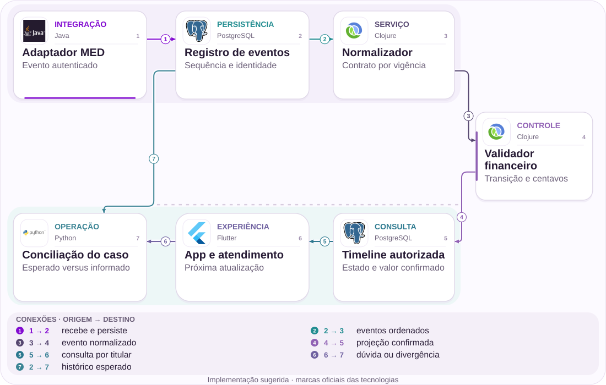

# 07 · MED: acompanhar sem prometer devolução

Três Pix somam R$ 478,55; a informação também precisa de estado.

[PT reader](https://wesleyvieira99.github.io/nu/#07-1) · [EN reader](https://wesleyvieira99.github.io/nu/en.html#07-1)

[Executable Python lab](../../labs/case_07.py)

## O registro e seu desfecho


Recorte real da fonte pública, capturado em 23/10/2026. O texto abaixo inclui resposta da empresa e desfecho relatado.

**Respondida · RA 228360515**

Em 02/10/2025, uma consumidora relatou três Pix que somavam R$ 478,55 por ingressos CCXP 25 e disse ter avisado o Nubank em menos de duas horas após perceber um golpe. Pediu atualização do MED. O Nubank informou abertura do procedimento, prazo de sete dias corridos mais quatro para reembolso condicionado. Não publicou resultado individual ou valor recuperado. Trata-se de resposta histórica de 2025, não descrição integral das regras atuais.

A resposta pública relaciona falta de e-mail a contestação não acolhida ou ausência de saldo, mas não informa qual desfecho ocorreu nesse caso. O cliente precisa de uma conclusão explícita quando houver evidência, e de acompanhamento quando ainda não houver. Não foram examinados boletim de ocorrência, comprovantes ou chat privado. O valor citado é exposição alegada do cliente; não é perda definitiva verificada nem receita potencial do banco.

- [Reclame AQUI — relato e resposta pública](https://www.reclameaqui.com.br/nubank/solicitacao-de-informacoes-sobre-med-mecanismo-especial-de-devolucao-para-via-pix_8_pzeovlbbFJyohm/)

## Diagnóstico antes da solução

O diagnóstico separa andamento interbancário de entrega de uma mensagem ao cliente. Ausência de e-mail não revela se o processo está em análise, se houve resposta negativa, se faltou saldo ou se a comunicação falhou. A hipótese de engenharia é que estados explícitos e uma próxima atualização reduzem contatos por incerteza.

Eu reconstruiria eventos recebidos, projeção disponível e notificações emitidas por caso, sem inferir que atraso causou esvaziamento da conta recebedora. A fonte não demonstra essa causalidade. O episódio é de 2025; uma implementação atual precisa mapear contratos e regras vigentes em 2026 com Pix, risco e jurídico, sem julgar retroativamente a conduta com requisitos posteriores.

A timeline deve explicar devolução parcial sem transformar o restante em dívida do banco. Também precisa distinguir encerramento operacional de impossibilidade definitiva de qualquer recuperação futura, conforme o contrato aplicável. Eu não preencheria lacunas de eventos com uma conclusão provável para tornar a tela mais simples. Se a informação não estiver confirmada, a próxima ação é investigar e comunicar o limite, preservando a possibilidade de atualizar o estado quando surgir evidência autorizada.

## Fronteiras da arquitetura



Arquitetura independente proposta; tecnologias sugeridas, não infraestrutura interna do Nubank.

O adaptador verifica origem antes de persistir. O normalizador traduz a versão vigente para um contrato interno; o validador protege transições e valores antes de publicar a timeline. App e atendimento compartilham essa visão autorizada.

A conciliação compara o histórico esperado com o estado explicado ao cliente. A sequência do laboratório é interna ao adaptador e não pretende reproduzir campos oficiais do DICT. Uma lacuna bloqueia avanço e exige recuperação, em vez de fabricar um desfecho.

## Núcleo executável

```python
    def apply(self, event_id, sequence, state, cents=0, trusted=False):
        if trusted is not True:
            raise PermissionError("verified MED adapter required")
        if type(sequence) is not int or sequence <= 0 or not event_id:
            raise ValueError("event identity")
        if type(cents) is not int or cents < 0:
            raise ValueError("integer cents required")
        payload = (sequence, state, cents)
        with self.lock:
            if event_id in self.events:
                if self.events[event_id] != payload:
                    raise ValueError("event conflict")
                return False
            if sequence != self.sequence + 1:
                raise ValueError("sequence gap or obsolete event")
            allowed = {"reported": {"analyzing"},
                       "analyzing": {"partial", "closed"},
                       "partial": {"partial", "closed"}}
            if state not in allowed.get(self.state, set()):
                raise ValueError("state transition")
            if state != "partial" and cents != 0:
                raise ValueError("refund must be explicit")
            if state == "partial" and not 0 < cents <= self.claimed - self.recovered:
                raise ValueError("invalid recovery amount")
            self.recovered += cents
            self.sequence, self.state = sequence, state
            self.events[event_id] = payload
            return True
```

Trecho literal do laboratório independente executado; demais validações estão no arquivo completo.

RecoveryTimeline.apply conserva identidade e payload de cada evento. Só aceita a próxima sequência; eventos atrasados ou lacunas exigem conciliação e reenvio controlado. Devolução parcial precisa ser positiva e não pode ultrapassar o valor contestado ainda pendente. Encerrar um caso não acrescenta dinheiro.

A função valida autoridade antes de reconhecer replay e rejeita booleanos como valores monetários. O modelo não bloqueia contas, não chama participantes e não implementa todos os estados regulamentares. Ele demonstra uma projeção de comunicação com conservação de centavos. Reabertura ou novas regras exigiriam contrato explícito adicional, não uma transição improvisada.

- [Python — unittest](https://docs.python.org/3/library/unittest.html)
- [Laboratório executável do caso no GitHub](https://github.com/wesleyvieira99/nu/blob/main/labs/case_07.py)

## Implementação na stack

```clojure
(defn recovery-event [current event]
  ;; Proposed local rule, not a DICT payload specification.
  (let [amount (:cents event)
        remaining (- (:claimed current) (:recovered current))]
    (cond
      (not (true? (:verified event))) {:error :untrusted}
      (not (integer? amount)) {:error :invalid-money}
      (not (<= 1 amount remaining)) {:error :amount-out-of-range}
      (not= (:sequence event) (inc (:sequence current)))
      {:error :sequence-gap}
      :else {:next-recovered (+ (:recovered current) amount)
             :next-sequence (:sequence event)})))
```

Exemplo de integração proposto, não executado; não é código interno do Nubank.

O Clojure proposto valida um evento financeiro sem realizar efeito externo. O retorno descreve uma atualização possível; persistência precisa comparar versão e gravar evento e projeção atomicamente. Um consumidor Kafka, se escolhido, deve reconhecer repetições e manter uma estratégia de recuperação de lacunas.

O adaptador real exige autenticação e mapeamento do contrato oficial vigente, revisados com o domínio Pix. Não apresento nomes sintéticos como campos de produção. Para Flutter, a timeline separaria valor confirmado, estado de análise e próxima atualização. Não usaria uma barra percentual que sugere probabilidade de recuperação sem um modelo validado e explicável.

- [Banco Central — API do DICT, referência de integração](https://aprendervalor.bcb.gov.br/content/estabilidadefinanceira/pix/API-DICT.html)

## Contratos e propriedade

| Campo / regra | Responsável | Invariante |
| --- | --- | --- |
| contract_version | Pix + jurídico | Vigência explícita |
| event_id + sequence | Adaptador | Lacuna não avança |
| recovered_cents | Financeiro | Nunca supera total |
| next_update | Operação | Não promete devolução |

```json
{
  "schema_version": 1,
  "contract_version": "synthetic-adapter-v1",
  "case_id": "synthetic-med",
  "event_id": "synthetic-partial-return",
  "sequence": 2,
  "state": "partial",
  "confirmed_cents": 20000,
  "claimed_cents": 47855
}
```

Contrato ilustrativo proposto; valores sintéticos, não dados de cliente.

O contrato declara versão de schema e vigência da regra, além de identidade, sequência e valor confirmado. O identificador do processo não concede acesso: consultas são vinculadas ao titular e ao escopo operacional do atendimento. Eventos carregam referências mínimas, sem dados completos da conta recebedora.

Para devoluções parciais, o total precisa ser reconciliado com a fonte financeira e com eventos anteriores. Uma mensagem duplicada não aumenta o recuperado; uma correção de valor deve ter semântica própria e aprovação, em vez de simplesmente enviar um número negativo. Prazos e estados oficiais seriam validados antes de qualquer integração; o laboratório é independente dessa homologação.

## Verificação adversarial

```python
    def test_partial_refund_replay_never_doubles_money(self):
        self.event("analysis", 1, "analyzing")
        self.event("refund-a", 2, "partial", 20000)
        self.assertFalse(self.event("refund-a", 2, "partial", 20000))
        self.event("refund-b", 3, "partial", 27855)
        self.assertEqual(self.t.read("a")["recovered_cents"], 47855)

    def test_gap_retries_after_missing_event(self):
        with self.assertRaises(ValueError):
            self.event("refund", 2, "partial", 100)
        self.event("analysis", 1, "analyzing")
        self.assertTrue(self.event("refund", 2, "partial", 100))
```

Testes literais do laboratório; contagem e resultado obtidos da execução real.

Os 14 testes cobrem devolução parcial repetida, soma acima do total, lacuna de sequência, encerramento sem recuperação, tentativa de reabertura, conflito de evento e escopo incorreto. O teste de lacuna mostra que rejeitar um evento não o consome: depois de receber o anterior, o mesmo evento pode ser aceito.

O laboratório também impede que silêncio encerre o processo. Não testa saldo real no recebedor, comunicação do arranjo ou prazo regulamentar. Para integração, eu acrescentaria replay de mensagens anonimizadas, comparação com a fonte financeira e exercícios de indisponibilidade do adaptador. A garantia relevante é não comunicar dinheiro recuperado que não foi confirmado.

- [Python — unittest](https://docs.python.org/3/library/unittest.html)

## Medir a jornada certa

| Métrica | Numerador / denominador | Janela e corte |
| --- | --- | --- |
| Atualização p 95 | Tempo evento→consulta | Diário; etapa |
| Sem próxima data | Casos sem data / elegíveis | Diário; responsável |
| Dúvida de andamento | Contatos / processos ativos | 7 dias; coorte |
| Valor divergente | Diferenças / casos auditados | Contínuo; versão |
| Recuperação observada | Valor devolvido / elegível | Fechamento; perfil |

O indicador principal mede latência entre evento confirmado e estado consultável, segmentado por etapa e versão do contrato. Também acompanho casos sem próxima atualização, contatos por dúvida e divergência entre valor exibido e confirmado. Esses sinais são diferentes da taxa de recuperação financeira.

A avaliação usa coortes de processos comparáveis, considerando tempo de comunicação, perfil e recuperabilidade. Uma timeline mais clara pode reduzir contato sem recuperar um centavo adicional; isso ainda pode ser útil, mas precisa ser descrito corretamente. A expansão para diante de promessa falsa, exposição de dados ou total divergente. A baseline não é pública e deve ser coletada antes de definir metas.

## Valor financeiro com premissas

| Cenário assumido | Entrada principal | Líquido/mês | Retorno (meses) |
| --- | --- | --- | --- |
| Conservador | 3 mil × 0,3 × R$ 9,00 | R$ 3.100,00 | 51,61 |
| Base | 8 mil × 0,6 × R$ 9,00 | R$ 33.200,00 | 4,82 |
| Ambicioso | 15 mil × 0,8 × R$ 9,00 | R$ 90.000,00 | 1,78 |

O cenário financeiro mede acompanhamento, sem somar R$ 478,55 como benefício. Assumo 3.000 / 8.000 / 15.000 processos ativos mensais, 0,3 / 0,6 / 0,8 contato evitado por processo e custo marginal de R$ 9,00. A operação adicional assumida custa R$ 5.000,00 / R$ 10.000,00 / R$ 18.000,00 mensais; implantação hipotética de R$ 160.000,00.

O cálculo é processos × contatos evitados × custo menos operação. Recuperação adicional ao cliente é uma medida separada, sem valor assumido nesta conta. Se a comunicação não alterar o mecanismo de recuperação, não atribuo causalmente aumento de devolução. Também não somo este cenário ao de suporte geral ou Pix, pois os contatos podem pertencer às mesmas jornadas.

Orçamento de implementação assumido: R$ 160.000,00. Resultados anuais líquidos antes da implementação: R$ 37.200,00 / R$ 398.400,00 / R$ 1.080.000,00. Todos os parâmetros são hipóteses, não baselines do Nubank.

## Roadmap com responsáveis

| Fase proposta | Responsável | Entrega / aceite |
| --- | --- | --- |
| 0–15 dias | Pix + risco + jurídico | Contrato vigente |
| 16–30 dias | Staff + operação | Semântica e conciliação |
| 31–60 dias | Mobile + suporte | Timeline em sombra |
| 61–90 dias | EM + produto | Piloto; clareza medida |

A descoberta reúne domínio Pix, risco e jurídico para mapear contrato vigente e política de comunicação. O marco inicial é uma tabela de eventos com autoridade, interpretação e informação permitida ao titular. O Staff resolve semântica e reconciliação; produto define como explicar estados incompletos sem prometer resultado.

A projeção roda em sombra antes de receber tráfego de consulta. Operação compara amostras de devoluções parciais e casos encerrados; atendimento valida sua utilidade. O EM coordena capacidade e dependências regulatórias. Se o adaptador não puder garantir origem ou completude, o piloto se limita a mensagens gerais aprovadas e a melhoria da observabilidade, sem timeline individual especulativa.

## Rollout e operação

O canário começa por leitura e comunicação, sem alterar ações interbancárias. Um dono operacional trata lacunas; outro confirma divergências financeiras. A próxima atualização é um compromisso de informação planejado, não garantia de devolução. Se ela não puder ser cumprida, o caso precisa de novo prazo e escalonamento, não silêncio.

O exercício injeta devolução parcial duplicada, evento fora de ordem, adaptador indisponível e encerramento com saldo recuperado zero. Rollback preserva histórico e deixa a consulta anterior explicar os estados conhecidos. Versões de contrato coexistentes devem ser identificáveis; misturar regras históricas e atuais numa mesma máquina sem vigência é risco de interpretação e operação.

## Minha contribuição

Como Staff, eu proporia um protocolo em que estado e valor têm evidência associada, com evolução por vigência. Rejeitaria inferir negativa pelo silêncio de e-mail: entrega de mensagem e decisão do processo são domínios diferentes. Também evitaria um indicador de recuperação percentual sem fundamento, que pode parecer promessa financeira.

Como EM, eu alinharia Pix, risco, jurídico, suporte e mobile em torno de um objetivo mensurável de clareza e menor retrabalho. A prioridade não seria demonstrar uma arquitetura sofisticada, mas fazer cada etapa ser explicável e operável. Essas contribuições são propostas para a função, sem afirmar experiência interna ou ganhos já obtidos no Nubank.

Na colaboração com o time, eu separaria metas de comunicação de metas de recuperação para evitar uma atribuição enganosa de mérito. O EM pode incentivar rapidez de atualização sem cobrar devolução que depende de saldo e de outros participantes. O Staff pode ajudar a construir evidência de completude e consistência. Esse alinhamento permite mostrar valor real de engenharia mesmo quando o desfecho financeiro de um caso individual permanece limitado por fatores externos.

## Handoff e decisão

**Execução local**

python3 labs/case_07.py -v · 14 testes passaram.

O revisor executa a análise, aplica duas devoluções parciais sintéticas e repete uma delas. O total deve permanecer 47855 centavos. Em seguida, tenta ultrapassar o valor e fechar um caso sem devolução; o modelo distingue claramente conclusão e dinheiro recuperado.

O handoff depende de contrato oficial validado, autenticação de eventos, persistência, conciliação e política de comunicação. Nenhum teste local substitui homologação do arranjo. Prosseguir exige coerência financeira e redução mensurável de incerteza. Se o projeto apenas produz mais notificações sem compreensão ou menor recontato, a decisão é revisar a experiência antes de ampliar o volume.

- Devolução duplicada não soma duas vezes.
- Silêncio de e-mail não fecha o processo.
- Contrato histórico e atual ficam separados.

- [Laboratório executável do caso no GitHub](https://github.com/wesleyvieira99/nu/blob/main/labs/case_07.py)
