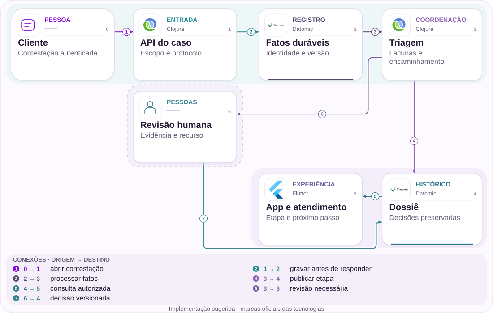

# 08 · Empréstimo contestado: uma decisão precisa poder ser revisada

Da evidência de acesso ao dossiê, ao recurso e à responsabilidade

[PT reader](https://wesleyvieira99.github.io/nu/#08-1) · [EN reader](https://wesleyvieira99.github.io/nu/en.html#08-1)

[Executable Python lab](../../labs/case_08.py)

## 08 · A contestação e o contraponto


Recorte real da fonte pública, capturado em 23/10/2026. O texto abaixo inclui resposta da empresa e desfecho relatado.

Em 14/01/2026, a reclamação 237674561 relata empréstimo não reconhecido, descoberto após três parcelas vencidas. O Nubank responde que a contratação ocorreu em março de 2024 em aparelho autorizado, mediante senha, e que não encontrou irregularidade. Mantém a negativa. O cliente encerra o caso em 31/01 como Não resolvido. Esses são relatos públicos de partes em desacordo; não permitem concluir fraude ou consentimento.

**O que esta evidência sustenta**

Uma oportunidade de tornar a investigação compreensível e revisável. O valor contratado, o contrato individual e os sinais completos não estão públicos. A captura documenta a reclamação e a resposta; não substitui uma perícia.

- [Reclame AQUI — caso 08 · 2026-01-14](https://www.reclameaqui.com.br/nubank/emprestimo-nao-reconhecido-e-falta-de-suporte-do-nubank-apos-3-meses_gejzPKG3_RfQy5qv/)

## Acesso observado não resolve consentimento

A pergunta de engenharia começa na fronteira entre evidência e conclusão. Um registro de dispositivo autorizado pode ser relevante para a investigação, mas não deve ser armazenado como sinônimo de vontade do titular. A proposta separa fatos de acesso, versão da política aplicada, interpretação do revisor e decisão comunicada. Isso permite contestar uma premissa específica sem reabrir toda a conversa do zero.

A hipótese falsificável é que parte do retrabalho decorre de dossiês incompletos ou de decisões que não deixam explícita sua fundamentação revisável. Eu confrontaria uma amostra autorizada de casos com recontato com o que o agente conseguia consultar naquele momento. Se o dossiê já era completo e compreensível, a hipótese perde força; a intervenção pode estar na política, na comunicação ou em outra etapa.

O estudo não propõe revelar segredos antifraude ao público nem converter toda contestação em reembolso. A decisão financeira continua sujeita à autoridade e à política aprovadas. O ganho procurado é uma análise consistente, com responsável, evidências minimizadas e recurso definido. A complexidade jurídica e operacional precisa ser validada com especialistas antes de definir prazos ou medidas provisórias.

## Dossiê com revisão independente



Arquitetura externa proposta; não representa a implementação interna do Nubank.

A API autentica o titular e restringe o caso ao seu escopo. O registro durável conserva ações antes da confirmação; a triagem organiza lacunas, sem decidir fraude. O dossiê fornece projeções diferentes para cliente e atendimento, mantendo referência comum de versão.

A revisão humana grava decisão e política no histórico. Um recurso acrescenta uma etapa; não apaga a primeira decisão. O caminho de exceção exige revisor independente no modelo. Identidade, autorização real e retenção de provas são integrações necessárias, fora do laboratório.

## Núcleo: revisão e identidade da ação

```python
    def append(self, action_id, expected, actor, role, kind, evidence):
        if not isinstance(action_id, str) or not action_id.strip():
            raise ValueError('nonempty action identity required')
        event = dict(actor=actor, role=role, kind=kind, evidence=evidence)
        payload = json.dumps(event, sort_keys=True)
        with self.db:
            self.db.execute('BEGIN IMMEDIATE')
            old = self.db.execute('SELECT payload FROM events WHERE action_id=?',
                                  (action_id,)).fetchone()
            if old:
                if old[0] != payload:
                    raise ValueError('idempotency conflict')
                return self.history()
            history = self.history()
            if expected != len(history):
                raise ValueError('stale revision')
            allowed = {'evidence': 'analyst', 'decision': 'reviewer',
                       'appeal': 'customer', 'review': 'reviewer'}
            if kind not in allowed or allowed[kind] != role:
                raise PermissionError('role not authorized')
            if kind == 'decision' and not any(
                    e['kind'] == 'evidence' for e in history):
                raise ValueError('no evidence dossier')
            validate_transition(history, event)
            self.db.execute('INSERT INTO events VALUES(?,?,?)',
                            (expected + 1, action_id, payload))
        return self.history()
```

Trecho literal de labs/case_08.py; executado nos testes locais.

A transação compara revisão esperada, identidade da ação e papel autorizado. Uma retentativa idêntica retorna o histórico sem duplicar o evento; reutilizar a chave com outro conteúdo é conflito. Esse contrato impede duas decisões concorrentes de avançarem a mesma revisão.

O laboratório representa um único caso e recebe papéis de um contexto confiável. Não autentica pessoas nem determina a legitimidade do empréstimo. O método validate_transition exige evidência antes da decisão e protege a independência do recurso. O banco local demonstra persistência; não representa o armazenamento real da instituição.

- [Laboratório executável do caso no GitHub](https://github.com/wesleyvieira99/nu/blob/main/labs/case_08.py)

## A política deve ser explícita

```clojure
(defn reviewable? [{:keys [evidence decision policy]}]
  (and (seq evidence)
       (string? policy)
       (every? #(contains? % :source-ref) evidence)
       (not= :device-access-only decision)))

(defn appeal-command [case-id revision reviewer]
  {:case-id case-id
   :expected-revision revision
   :action :independent-review
   :reviewer reviewer})
```

Exemplo ilustrativo em Clojure, não executado; integração e política ainda exigem validação.

Uma função pura pode verificar completude estrutural antes de encaminhar o dossiê. Ela não transforma presença de dados em veredicto correto. O exemplo rejeita uma categoria simplificada de decisão baseada somente em acesso ao dispositivo; essa regra é uma proposta do estudo, não uma regra conhecida do Nubank.

No serviço, o identificador do revisor deve vir da identidade autenticada, e não do corpo enviado pelo cliente. A política possui versão imutável, vigência e responsável. Mudanças de política precisam de exemplos aprovados e revisão operacional, porque um deploy tecnicamente correto ainda pode produzir decisões inadequadas. Kafka transportaria referências minimizadas; anexos sensíveis permaneceriam em armazenamento restrito.

## Contrato de evidência e de acesso

| Objeto | Responsável | Regra |
| --- | --- | --- |
| Referência de evidência | Segurança | Hash e origem; sem senha |
| Decisão | Revisor autorizado | Política e revisão obrigatórias |
| Recurso | Operações | Preserva decisão anterior |
| Projeção do cliente | Produto | Motivo suficiente, sem segredo |

```json
{
  "case_id": "synthetic-08",
  "revision": 3,
  "evidence": [{"category": "device_access", "digest": "sha256:..."}],
  "decision": {"policy": "v1", "reviewer_ref": "reviewer-1"},
  "appeal": {"status": "pending", "independent_reviewer": true},
  "customer_projection": {"stage": "under_review"}
}
```

Contrato sintético e ilustrativo; não é payload capturado do aplicativo.

O hash ajuda a identificar a evidência, mas não prova que ela é verdadeira nem substitui cadeia de custódia. A política de retenção define por quanto tempo o objeto pode ser consultado; a projeção não deve manter cópia desnecessária. Acesso administrativo exige finalidade registrada e deve ser auditável por uma equipe independente.

## Testar o recurso e a retomada

```python
    def test_appeal_requires_independent_reviewer(self):
        self.seed()
        self.d.append('a', 2, 'owner', 'customer', 'appeal', {})
        with self.assertRaises(PermissionError):
            self.d.append('r', 3, 'r1', 'reviewer', 'review', {'policy': 'v2'})
        self.assertEqual(len(self.d.history()), 3)
        self.d.append('r', 3, 'r2', 'reviewer', 'review', {'policy': 'v2'})
        self.assertEqual(self.d.history()[1]['evidence']['policy'], 'v1')

    def test_restart_and_retry_preserve_one_evidence(self):
        self.d.append('e', 0, 'a', 'analyst', 'evidence', self.ev)
        self.d.close()
        self.d = Dispute(self.path)
        result = self.d.append('e', 0, 'a', 'analyst', 'evidence', self.ev)
        self.assertEqual(len(result), 1)
        self.assertNotIn('consent', result[0]['evidence'])
```

Trechos literais; 9 testes locais passaram no conjunto completo.

A primeira asserção protege a independência do recurso e verifica que uma rejeição não muda o histórico. A segunda fecha e reabre o banco, repete a ação e confirma um único registro. Outros testes atacam revisão velha, papel errado, ausência de evidência e payload sensível.

Os testes não avaliam qualidade humana, autenticidade da evidência ou justiça da política. Para produção, acrescentaria revisão de amostras cegas, testes de acesso entre contas, expiração de permissões, auditoria de exportação e exercícios de indisponibilidade da ferramenta. Um sistema que preserva perfeitamente uma decisão ruim ainda precisa de correção de processo.

## Medir revisão útil e custo humano

| Métrica | Definição | Janela / corte |
| --- | --- | --- |
| Revisão útil | Casos com ação fundamentada / abertos | Semanal; tipo de disputa |
| Retrabalho | Minutos repetidos / dossiê elegível | Amostra mensal; equipe |
| Recontato | Contatos repetitivos / casos | 30 dias; etapa |
| Divergência | Decisões alteradas por falha material / auditadas | Mensal; política |

A linha de base é desconhecida. Instrumentaria transições com case_id pseudonimizado, versão e instante; o tempo de trabalho exige amostragem operacional, não apenas duração da fila. Idade de caso e tempo efetivamente trabalhado são medidas diferentes. Também acompanharia acesso indevido e falhas de auditoria como guardrails.

O piloto compararia equipes ou períodos equivalentes com critérios de elegibilidade pré-definidos, evitando selecionar apenas casos simples. Uma revisão independente avaliaria amostras de ambos os grupos. Interromperia a expansão se surgissem exposição de dados, perda de evidência ou piora material da consistência das decisões, mesmo que o tempo médio caísse.

## Valor: capacidade recuperada, não lucro

| Cenário assumido | Potencial/ano | Operação/ano | Ano 1 após custo |
| --- | --- | --- | --- |
| Conservador | R$ 144.000 | R$ 60.000 | R$ -156.000 |
| Base | R$ 504.000 | R$ 90.000 | R$ 174.000 |
| Ambicioso | R$ 1.080.000 | R$ 120.000 | R$ 720.000 |

Todos os insumos são assumidos: 12 mil, 24 mil ou 40 mil dossiês anuais; 8, 14 ou 18 minutos de retrabalho evitados; R$ 90 por hora total. A capacidade valorizada é N × minutos ÷ 60 × 90. Assumo implementação de R$ 240 mil e operação anual de R$ 60 mil, 90 mil ou 120 mil. A última coluna desconta ambos no primeiro ano e não representa caixa realizado.

No cenário base, 24.000 × 14 ÷ 60 × 90 = R$ 504.000; menos R$ 90.000 e R$ 240.000 resulta em R$ 174.000 de capacidade líquida modelada. O equilíbrio do primeiro ano exige aproximadamente 15.715 dossiês equivalentes. Se as horas apenas forem redistribuídas, não há economia de caixa automática. O investimento depende de confirmar retrabalho evitável e de haver uso concreto para a capacidade liberada.

**Separação financeira**

Principal contestado e possível fraude não entram nesta conta. Uma perda só pode ser estimada com confirmação, exposição e recuperação verificáveis. Não agregar benefícios com outros capítulos que tratem os mesmos contatos.

## Plano de 90 dias com responsáveis

| Fase proposta | Entrega e responsável | Porta de saída |
| --- | --- | --- |
| 0–15 dias | Risco + operações: taxonomia e amostra | Fatos e inferências separados |
| 16–30 dias | Staff + privacidade: contrato e acesso | Revisão de acesso aprovada |
| 31–60 dias | EM + operações: sombra e treinamento | Amostra independente consistente |
| 61–90 dias | Produto + risco: piloto limitado | Guardrails e capacidade validados |

O calendário é hipótese de planejamento. A dependência crítica é obter acesso autorizado a uma amostra suficiente, não construir a tela. Se fontes de evidência forem incompatíveis, o primeiro entregável passa a ser a identificação dessas lacunas e a atribuição de responsáveis por corrigi-las.

O Engineering Manager organiza capacidade entre crédito, fraude, atendimento e privacidade; o Staff define contratos e critérios técnicos. A revisão de política permanece com seus responsáveis. Cada fase termina com evidência observável e decisão registrada de continuar, restringir ou parar. Não uso o prazo para prometer uma alteração que dependa de validação externa.

## Operar sem transformar fila em abandono

A implantação começa em sombra: a nova ferramenta prepara o dossiê, mas a operação existente continua decidindo. Compara-se completude, tempo de preparo e divergências, sem mudar automaticamente cobrança ou crédito. O canário seguinte expõe acompanhamento e revisão para uma coorte limitada, com capacidade humana reservada para os recursos.

Alertas devem distinguir fila envelhecida, evidência indisponível e falha de autorização. Operações responde pela fila; segurança responde por exposição; a equipe do serviço responde por perda ou duplicação de eventos. Uma indisponibilidade da projeção não encerra o protocolo nem apaga sua trilha. O cliente recebe indicação honesta de etapa e próximo passo.

Rollback desliga a nova projeção e o roteamento automático, preservando o histórico e os casos em curso. Um exercício deve simular banco indisponível após decisão, permissão revogada durante consulta e retorno de uma versão antiga. O runbook precisa explicar como reconciliar pendências e como comunicar continuidade, sem exportar dossiês para planilhas desprotegidas.

## Minha contribuição para a decisão

Como Staff, eu definiria o modelo de evidência, os limites de autorização e os invariantes de revisão. Conduziria a discussão sobre consistência, retenção e exposição de sinais, usando exemplos concretos de divergência. A decisão mais importante seria manter separado o registro de acesso da interpretação sobre consentimento, evitando que um campo técnico carregue uma conclusão que não lhe pertence.

Como Engineering Manager, eu criaria uma entrega conjunta com operação e risco, estabelecendo dono da jornada e tempo reservado para revisão. Priorizaria primeiro o retrabalho mais frequente demonstrado pela amostra, com critérios explícitos para decidir se o próximo investimento é produto, integração ou treinamento. Essas são ações que proponho executar; não alego ter dirigido equipes ou políticas do Nubank.

Eu rejeitaria a alternativa de automatizar a negativa apenas porque o dossiê contém um dispositivo conhecido. Também evitaria abrir todos os sinais ao atendimento. A proposta equilibra revisão útil e minimização de acesso, e aceita um custo operacional maior quando necessário para preservar a qualidade de uma decisão sensível.

## Entrega para revisão técnica e operacional

- Executar: python3 labs/case_08.py. A suíte completa possui 9 testes; nenhum serviço externo é acessado.
- Revisar Dispute.append e validate_transition; depois inspecionar o histórico antes e depois de um recurso.
- Confirmar que retry, conflito de chave, revisão antiga e papel incorreto não criam nova decisão.
- Antes de produção: identidade, escopo por conta, retenção, política, auditoria e revisão humana independente.

O laboratório cabe em uma revisão conjunta: engenharia explica o contrato; operações verifica se o histórico permite reconstruir o trabalho; risco avalia quais decisões exigem supervisão; privacidade avalia exposição. A execução local valida apenas os invariantes modelados, não o mérito de uma contestação.

A porta final é simples: prosseguir apenas se a amostra demonstrar lacuna corrigível, a revisão independente mantiver qualidade e a capacidade liberada tiver destino. Caso contrário, preservar o aprendizado e escolher outra intervenção. O resultado esperado desta proposta é uma decisão melhor fundamentada e mais fácil de revisar, sem promessa de resolver automaticamente disputas financeiras.

- [Laboratório executável do caso no GitHub](https://github.com/wesleyvieira99/nu/blob/main/labs/case_08.py)
