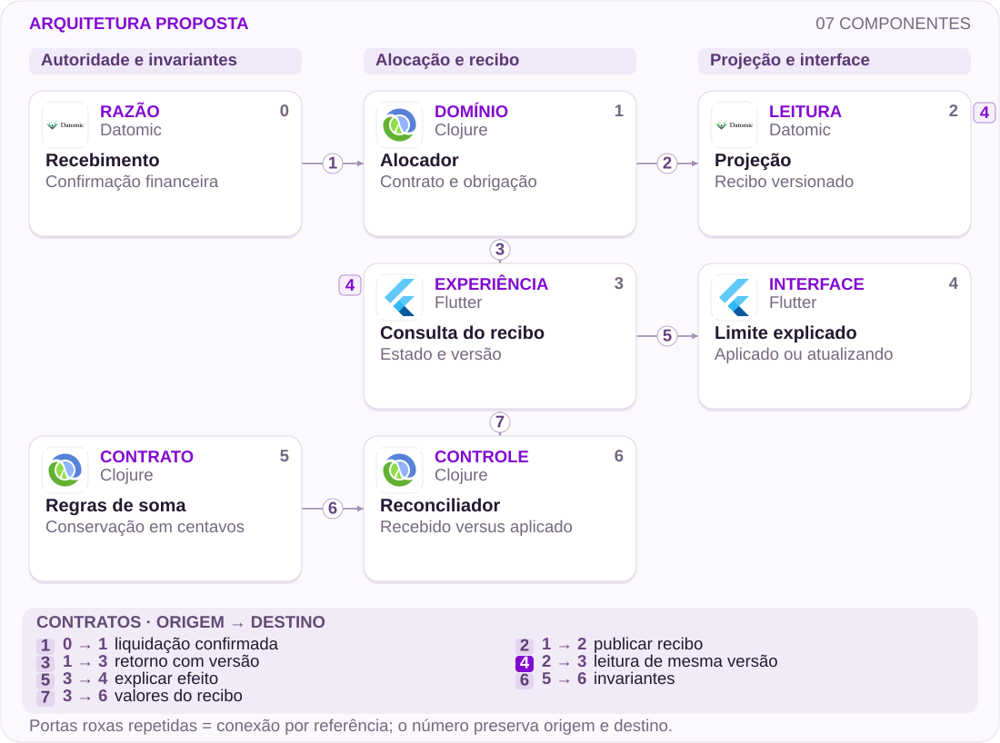
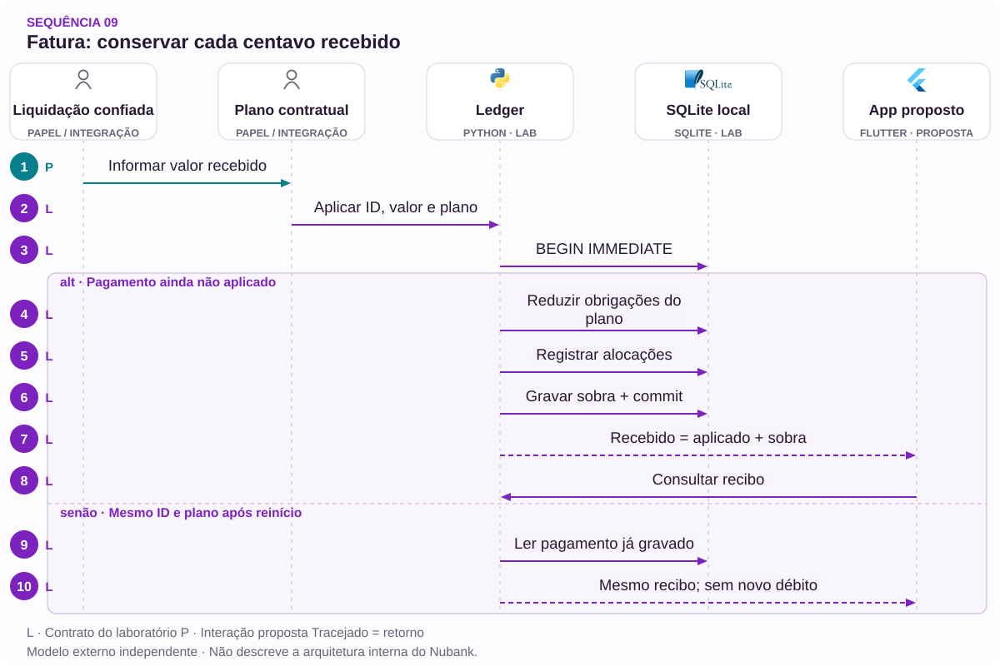

# 09 · Fatura paga, limite incerto: seguir cada centavo

Recebimento, alocação e projeção precisam compartilhar um contrato

[PT reader](https://wesleyvieira99.github.io/nu/#09-1) · [EN reader](https://wesleyvieira99.github.io/nu/en.html#09-1)

[Executable Python lab](../../labs/case_09.py)

## 09 · Pago não explica a alocação


Recorte real da fonte pública, capturado em 23/10/2026. O texto abaixo inclui resposta da empresa e desfecho relatado.

A reclamação 242838873, de 10/03/2026, relata fatura indicada como paga e limite não totalmente recomposto, após três chamados. Em 17/03, o Nubank informa correção da fatura, consideração do pagamento e quitação das parcelas antecipadas. Explica a recomposição do limite conforme processamento e saldo financiado. O estado público é Respondida; não há confirmação final do cliente. Valores individuais estão ocultos.

**Limite da evidência**

A resposta sustenta correção realizada, mas não revela o razão, a ordem dos eventos ou a causa técnica. Este estudo propõe rastreabilidade de alocação; não diagnostica o sistema responsável.

- [Reclame AQUI — caso 09 · 2026-03-10](https://www.reclameaqui.com.br/nubank/pagamento-de-fatura-nao-processado-e-limite-nao-liberado_DSi3KqzKEFj9hHIa/)

## Três estados com consequências diferentes

Receber dinheiro, aplicar dinheiro e atualizar uma leitura de limite são etapas distintas. A interface pode informar corretamente que houve pagamento e ainda deixar sem resposta quais obrigações foram liquidadas. Quando existe financiamento, o efeito sobre crédito disponível depende de regras que um único rótulo não consegue explicar. O recibo precisa ligar recebimento, destino e consequência, em vez de apenas substituir uma palavra na tela.

Minha hipótese é que parte do recontato nasce da ausência dessa ligação verificável entre canais. A investigação usaria o identificador de pagamento para reconstruir confirmação, alocações, compensações e atualização de projeção. Compararia o que o cliente viu com o que suporte e razão registravam na mesma versão. Se o problema estiver no cálculo da obrigação, melhorar a apresentação será insuficiente e deve ceder prioridade à correção financeira.

A fronteira de responsabilidade inclui regras contratuais de financiamento e reconhecimento da liquidação. O aplicativo não pode decidir sozinho para qual dívida mover o valor. Também não deve convidar a um segundo pagamento enquanto a primeira alocação estiver incerta. A proposta torna explícita a pendência e oferece acompanhamento pelo mesmo identificador.

## Um recibo ligado ao razão



Arquitetura externa proposta; não representa a implementação interna do Nubank.

O alocador recebe confirmação financeira e aplica um plano validado. O recibo canônico e sua projeção carregam a mesma revisão. O reconciliador compara valores do recibo com invariantes independentes; uma divergência não é resolvida escondendo centavos na apresentação.

A atualização do limite pode seguir outro ritmo, mas precisa indicar sua versão e estado. O diagrama resume responsabilidades, não todas as integrações. Correção financeira exige compensações autorizadas no razão; o reconciliador detecta e encaminha, sem editar saldos por conta própria.

## Núcleo: alocar ou não alterar nada

`Unit of Work [lab]` · `Conservation Invariant [lab]`

```python
    def apply(self, ident, amount, plan, crash=False):
        if not isinstance(ident, str) or not ident.strip():
            raise ValueError('nonempty payment identity required')
        if type(amount) is not int or amount <= 0:
            raise ValueError('positive integer cents required')
        if any(type(v) is not int or v <= 0 for v in plan.values()):
            raise ValueError('invalid allocation')
        encoded = json.dumps(plan, sort_keys=True)
        with self.db:
            self.db.execute('BEGIN IMMEDIATE')
            old = self.db.execute('SELECT amount,plan FROM payments WHERE id=?',
                                  (ident,)).fetchone()
            if old:
                if old != (amount, encoded):
                    raise ValueError('payment conflict')
                return self.receipt(ident)
            if sum(plan.values()) > amount:
                raise ValueError('allocation exceeds received amount')
            for target, value in plan.items():
                changed = self.db.execute('UPDATE obligations SET due=due-? '
                    'WHERE id=? AND due>=?', (value, target, value)).rowcount
                if changed != 1:
                    raise ValueError('unknown or overpaid obligation')
                self.db.execute('INSERT INTO allocations VALUES(?,?,?)',
                                (ident, target, value))
            if crash:
                raise RuntimeError('crash before commit')
            self.db.execute('INSERT INTO payments VALUES(?,?,?,?)',
                            (ident, amount, encoded, amount - sum(plan.values())))
        return self.receipt(ident)
```

Trecho literal de labs/case_09.py; SQLite representa uma autoridade local.

A escrita condicional impede aplicar mais que a obrigação deve. Todas as alocações e o recibo pertencem à mesma transação: se o segundo destino for inválido, o primeiro também volta ao estado anterior. O saldo não aplicado permanece explícito.

O exemplo recebe um plano já escolhido; não implementa a prioridade contratual do Nubank. Em produção, essa escolha precisa de política versionada, autorização por conta e prova de liquidação. A retentativa só é aceita quando valor e plano são idênticos. Reutilizar a chave para mudar o destino exige outra ação autorizada, nunca uma atualização silenciosa.

- [Laboratório executável do caso no GitHub](https://github.com/wesleyvieira99/nu/blob/main/labs/case_09.py)

## Função pura, escrita transacional

`Unit of Work [proposal]` · `Conservation Invariant [proposal]`

```clojure
(defn allocation-valid? [{:keys [received allocations unapplied]}]
  (and (pos-int? received)
       (every? pos-int? (vals allocations))
       (<= 0 unapplied)
       (= received (+ unapplied (reduce + (vals allocations))))))

(defn allocation-event [payment-id revision plan]
  {:event-type :payment-applied
   :payment-id payment-id
   :revision revision
   :allocations plan})
```

Exemplo ilustrativo em Clojure, não executado; o laboratório Python é o artefato testado.

A função verifica conservação, mas não prova que cada obrigação é elegível. Essa segunda validação precisa ocorrer dentro da fronteira transacional que conhece saldo, titular e contrato. Separar cálculo puro de persistência facilita testar regras e revisar mudanças, sem atribuir à função garantias que dependem do banco.

Uma integração com eventos deve gravar alocação e intenção de publicação atomicamente. O consumidor da projeção deduplica pelo identificador e pela revisão financeira. Não basta confiar na ordem do transporte: replay, reprocessamento e mudanças de consumidor podem entregar novamente o mesmo fato. Falhas de publicação deixam trabalho pendente identificável, não autorização para reaplicar o pagamento.

## Conservar dinheiro e identidade

`Unit of Work [proposal]` · `Conservation Invariant [proposal]`

| Campo | Semântica | Responsável |
| --- | --- | --- |
| payment_id | Recebimento estável | Liquidação |
| allocations | Destino em centavos | Crédito/fatura |
| unapplied | Saldo ainda sem destino | Operações |
| revision | Fato financeiro de origem | Razão |

```json
{
  "payment_id": "synthetic-payment-09",
  "currency": "BRL",
  "received_cents": 15001,
  "allocations": {"bill": 10000, "installment": 5000},
  "unapplied_cents": 1,
  "ledger_revision": 42,
  "limit_projection_revision": 41,
  "limit_state": "updating"
}
```

Exemplo sintético: 15.001 recebidos, 15.000 aplicados, 1 não aplicado.

A revisão de limite inferior à revisão financeira explica que a leitura ainda está atualizando, sem afirmar crédito já disponível. Identificadores não devem expor conta ou contrato em URLs públicas. O suporte recebe o necessário para explicar a alocação; detalhes de terceiros e outras obrigações permanecem protegidos. Retificação deve referenciar o fato anterior e conservar a trilha.

## Falha parcial não pode virar meia baixa

`Unit of Work [lab]` · `Conservation Invariant [lab]`

```python
    def test_failure_after_first_write_rolls_everything_back(self):
        with self.assertRaises(ValueError):
            self.l.apply('p', 20000, {'bill': 10000, 'installment': 6000})
        self.assertEqual(self.l.due('bill'), 10000)
        self.assertEqual(self.l.due('installment'), 5000)
        self.assertEqual(self.l.db.execute(
            'SELECT COUNT(*) FROM allocations').fetchone()[0], 0)

    def test_restart_retry_does_not_apply_twice(self):
        first = self.l.apply('p', 12000, {'bill': 10000})
        self.l.close()
        self.l = Ledger(self.path)
        self.assertEqual(self.l.apply('p', 12000, {'bill': 10000}), first)
        self.assertEqual(first['unapplied'], 2000)
        self.assertEqual(self.l.due('bill'), 0)
```

Trechos literais da suíte; 9 testes passaram.

O teste de falha parcial tenta quitar uma obrigação e exceder outra, verificando rollback integral. O teste de retomada reabre o banco e confirma que o mesmo recebimento não reaplica o dinheiro. A suíte também verifica centavo residual, plano conflitante, valor fracionário e tentativa de pagar obrigação já quitada.

Ainda faltam regras de juros, taxas, moeda, estorno e autorização entre contas. Um teste de integração deve observar outbox e projeção após falha entre commit e publicação, validando o recibo contra uma fonte independente. A conservação local é necessária, mas não substitui reconciliação com o sistema de liquidação.

## Métricas que seguem o pagamento

| Métrica | Numerador / denominador | Janela e corte |
| --- | --- | --- |
| Aplicação atrasada | Pagamentos além do prazo / elegíveis | Diária; tipo de dívida |
| Saldo sem destino | Centavos não aplicados / recebidos | Diária; idade |
| Recontato | Contatos de alocação / pagamentos | 30 dias; contrato |
| Divergência | Recibos que não conciliam / verificados | Contínua; revisão |

As linhas de base e prazos internos são desconhecidos. Definiria primeiro a origem de cada timestamp: confirmação externa, commit de aplicação e publicação da projeção. Um atraso de rede não deve ser confundido com atraso de liquidação. Contatos exigem taxonomia revisada em amostra para separar dúvida de apresentação de erro financeiro real.

O experimento libera o recibo explicável sem mudar regras de alocação. Compara coortes equivalentes por produto, financiamento e valor. Pararia a expansão diante de qualquer quebra de conservação, aumento de pagamentos repetidos ou vazamento de contexto entre contas. O objetivo de reduzir contato não pode incentivar ocultação da opção de ajuda.

## Conta financeira com duas parcelas de custo

| Cenário assumido | Potencial/ano | Operação/ano | Ano 1 após custo |
| --- | --- | --- | --- |
| Conservador | R$ 70.800 | R$ 60.000 | R$ -249.200 |
| Base | R$ 240.000 | R$ 60.000 | R$ -80.000 |
| Ambicioso | R$ 676.800 | R$ 60.000 | R$ 356.800 |

Todos os valores abaixo são hipóteses: 60 mil, 120 mil ou 240 mil pagamentos elegíveis/ano; redução de 0,06, 0,10 ou 0,14 contato por pagamento; R$ 18 por contato. Além disso, assumo 1, 2 ou 3 horas de conciliação evitadas a cada mil pagamentos, a R$ 100/h. Implementação: R$ 260 mil; operação anual: R$ 60 mil. Contatos e horas de conciliação devem ser conjuntos de trabalho diferentes.

No cenário base, 120.000 × 0,10 × 18 + 120 × 2 × 100 = R$ 240.000 de capacidade anual. O primeiro ano resulta em R$ 240.000 − 60.000 − 260.000 = −R$ 80.000. O equilíbrio exigiria 160 mil pagamentos equivalentes à hipótese base. Essa conta favorece um piloto ou reaproveitamento de componentes, não aprovação automática do projeto completo.

**Sem converter saldo em receita**

Limite recomposto e principal recebido não são lucro. A capacidade só vira caixa se houver redução concreta de gasto. Excluir desta conta o retrabalho de antecipação já medido no caso 14.

## Roadmap orientado à reconciliação

| Fase proposta | Dono e entrega | Gate |
| --- | --- | --- |
| 0–15 dias | Fatura + crédito: mapa de alocação | Casos sintéticos conciliados |
| 16–30 dias | Staff: recibo e outbox | Falhas não duplicam aplicação |
| 31–60 dias | Operações: sombra de reconciliação | Diferenças classificadas |
| 61–90 dias | EM + produto: canário do recibo | Contatos caem; integridade mantida |

A principal dependência é uma referência financeira confiável para comparar a nova leitura. Sem isso, um painel pode apenas tornar um erro mais convincente. Na primeira fase, contabilidade e crédito aprovam os exemplos de pagamento parcial, financiamento, antecipação e compensação, com valores em centavos e versões explícitas.

O calendário de 90 dias é cenário de planejamento. O EM reserva capacidade de suporte e operações durante o canário; o Staff define testes de falha e contrato de correção. Se a qualidade das referências não atingir o gate, a entrega seguinte é reconciliação e saneamento, não expansão visual. Cada exceção precisa de responsável e destino para o valor não aplicado.

## Rollback preserva a escrita financeira

O lançamento começa por leitura em sombra. A projeção calcula o recibo e é comparada com o razão, sem orientar o cliente nem alterar alocações. Depois, um canário expõe a memória de aplicação para contas elegíveis. A leitura antiga permanece disponível como fallback identificado, sem misturar versões de total e detalhe.

Alertas combinam idade do saldo não aplicado, atraso de projeção e violações de soma. Plataforma responde por publicação; crédito e fatura respondem pela interpretação financeira; operações coordena resolução do cliente. Uma fila de erro deve carregar IDs e motivos, nunca dados financeiros completos desnecessários em logs abertos.

Desligar o novo recibo não desfaz pagamentos confirmados. Rollback é de apresentação e roteamento, seguido de reconciliação das pendências. Exercícios incluem crash antes e depois do commit, consumidor atrasado e correção concorrente. A ferramenta precisa distinguir o que foi recebido do que foi aplicado durante toda a recuperação, inclusive para o atendimento.

## Minha contribuição em duas frentes

Como Staff, eu colocaria conservação e identidade no centro do desenho. Escolheria a fronteira da transação, definiria a compensação e documentaria quais leituras podem ser eventualmente consistentes. Eu rejeitaria a solução de inferir limite disponível apenas de um rótulo de fatura paga, porque ela troca um contrato financeiro por uma aproximação visual.

Como Engineering Manager, eu uniria as equipes que hoje podem enxergar partes diferentes do mesmo pagamento. Definiria um responsável pela resolução ponta a ponta e um acordo de investigação com IDs compartilhados. O plano deve incluir treinamento do suporte e capacidade para tratar exceções, não somente a entrega do componente móvel.

Eu também defenderia uma decisão econômica proporcional à evidência. O cenário base não paga a implantação no primeiro ano assumido. Se uma API de recibo existente puder ser ampliada, o custo muda e deve ser recalculado. Meu papel é explicitar esse tradeoff e proteger a integridade da jornada, sem apresentar capacidade potencial como economia já realizada.

## Roteiro de revisão do recibo

- Executar python3 labs/case_09.py; 9 testes locais, sem integração bancária.
- Ler Ledger.apply e receipt; reproduzir alocação em dois destinos com um centavo residual.
- Provocar falha no segundo destino e confirmar que o primeiro não permanece baixado.
- Antes de produção: liquidação real, escopo por conta, regras contratuais, outbox e compensações.

O revisor deve conseguir responder de onde veio cada centavo e para onde ele foi. Um recibo que apenas mostra um total não satisfaz o contrato. A demonstração local permite inspecionar pagamentos, obrigações e alocações diretamente, mas não cobre todas as regras de um cartão ou financiamento real.

A decisão de avançar exige uma amostra conciliada, compreensão demonstrada pelo cliente e operação capaz de resolver diferenças. Se houver quebra de conservação, o gate é parar e corrigir a autoridade financeira. Se a escrita estiver correta e apenas a leitura for confusa, o piloto de explicação pode seguir com risco e custo menores.

- [Laboratório executável do caso no GitHub](https://github.com/wesleyvieira99/nu/blob/main/labs/case_09.py)

## Padrões com prova no código

`Unit of Work [lab]` · `Conservation Invariant [lab]` · `Transactional boundary [proposal]` · `Spring Transactions [proposal]`

| Mecanismo | Implementação | Evidência |
| --- | --- | --- |
| Unit of Work | Ledger.apply | falha parcial desfaz todas as alterações |
| Conservation Invariant | Ledger.receipt | a soma do valor alocado e do restante conserva o valor recebido |
| Transactional boundary / ledger adapter | Proposta para produção | Adaptadores preservam a autoridade fora da interface. |

**Integração Java · proposta**

Spring Transactions + integer minor units. Portar invariantes e testes de contrato antes de substituir o modelo Python. Lock de processo não controla concorrência distribuída; persistência, autorização e recuperação exigem testes de integração.

**Avaliação de IA · núcleo determinístico**

Nenhum framework de agentes está implementado neste laboratório. Estado financeiro, autorização e versões permanecem determinísticos. Um assistente só seria avaliado diante de necessidade comprovada de atendimento, sem autoridade sobre saldo ou identidade.

- [P1 · Ledger.apply](https://github.com/wesleyvieira99/nu/blob/main/labs/case_09.py#L34)
- [P1 · test_failure_after_first_write_rolls_everything_back](https://github.com/wesleyvieira99/nu/blob/main/labs/case_09.py#L95)
- [P2 · Ledger.receipt](https://github.com/wesleyvieira99/nu/blob/main/labs/case_09.py#L66)
- [P2 · test_exact_conservation_across_two_targets](https://github.com/wesleyvieira99/nu/blob/main/labs/case_09.py#L130)

## Sequência de execução



Liquidação e ordem contratual vêm de adaptadores; o modelo não demonstra recomposição real de limite.

**Autoridade e fronteira de falha**

falha parcial desfaz todas as alterações. a soma do valor alocado e do restante conserva o valor recebido.

A sequência descreve a integração proposta. O laboratório vinculado verifica a invariante do domínio com dados sintéticos; serviços externos, retries de rede e implantação permanecem trabalho de integração.

- [apply](https://github.com/wesleyvieira99/nu/blob/main/labs/case_09.py#L34)
- [receipt](https://github.com/wesleyvieira99/nu/blob/main/labs/case_09.py#L66)

## Features, histórias e aceite

**F09.1 · Alocação atômica · D16–30**

Como cliente, quero entender onde meu pagamento foi aplicado. Aceite: falha parcial desfaz todas as alterações.

**F09.2 · Recibo por destino · D31–60**

Como responsável pela conciliação, quero conciliar o total pago com cada obrigação. Aceite: a soma do valor alocado e do restante conserva o valor recebido.

**F09.3 · Expansão medida · D61–90**

Como responsável de produto, quero uma coorte elegível com controle comparável. Aceite: métrica do caso, denominador, custo e barreira de segurança registrados antes da exposição; falhas de conciliação interrompem expansão.

Os testes vinculados exercitam o aceite declarado do domínio, não a interface completa nem a integração de produção. D0–15 é descoberta: confrontar o relato público com amostras internas autorizadas, mapear dependências e aprovar contratos. São janelas incrementais de planejamento, não promessa de prazo. EM coordena dependências; Staff responde pelos contratos; Produto e o domínio aceitam o resultado.

- [Aceite F09.1](https://github.com/wesleyvieira99/nu/blob/main/labs/case_09.py#L95)
- [Aceite F09.2](https://github.com/wesleyvieira99/nu/blob/main/labs/case_09.py#L130)

## Método e sensibilidade

**Sensibilidade do cenário · BRL**

Todos os inputs são hipóteses de cenário, não efeitos medidos no Nubank. Capacidade equivalente não é economia de caixa. A realização reduz apenas o benefício; todos os custos permanecem nos valores do cenário. É análise de sensibilidade, não probabilidade nem estimativa causal.

líquido_período = benefício × realização − custo_variável − operação; primeiro_ano = líquido_período − implementação

Period / Período: `year`. Values / Valores: BRL.

| Scenario / Cenário | Benefit / Benefício | Variable cost / Variável | Run cost / Operação | Build / Implementação |
| --- | ---: | ---: | ---: | ---: |
| Conservador | 70800.00 | 0.00 | 60000.00 | 260000.00 |
| Base | 240000.00 | 0.00 | 60000.00 | 260000.00 |
| Ambicioso | 676800.00 | 0.00 | 60000.00 | 260000.00 |

| Scenario / Cenário | Period net at 100% / Líquido | Horizon after build / Horizonte | Horizon at 50% / Estresse |
| --- | ---: | ---: | ---: |
| Conservador | 10800.00 | -249200.00 | -284600.00 |
| Base | 180000.00 | -80000.00 | -200000.00 |
| Ambicioso | 616800.00 | 356800.00 | 18400.00 |

[Reproducible scenario inputs](../../models/normalized-scenarios.json) · [Decimal simulator](../../models/simulate.py)

| Decisão | Método específico do caso |
| --- | --- |
| Baseline / ameaça | Baseline: contatos e horas de conciliação por pagamento. Ameaça: confundir rede e liquidação. |
| Economia por unidade | Contato evitado + horas liberadas por mil pagamentos; o valor recebido não integra o benefício. |
| Experimento proposto | Liberar o recibo sem mudar alocação; comparar produto, financiamento e valor em coortes equivalentes. |
| Critério de parada | Parar por quebra de conservação, pagamentos repetidos ou contexto entre contas. |

- [Reclame AQUI · ID 242838873](https://www.reclameaqui.com.br/nubank/pagamento-de-fatura-nao-processado-e-limite-nao-liberado_DSi3KqzKEFj9hHIa/)
- [FinOps Foundation · Unit Economics](https://www.finops.org/framework/capabilities/unit-economics/)
- [Microsoft Research · Pre-experiment design](https://www.microsoft.com/en-us/research/articles/patterns-of-trustworthy-experimentation-pre-experiment-stage/)
