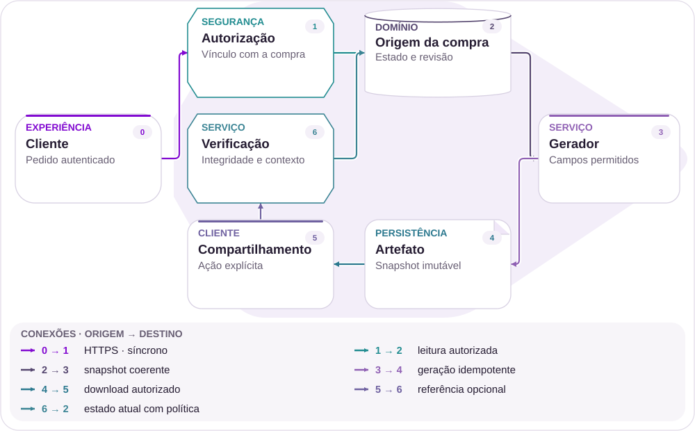
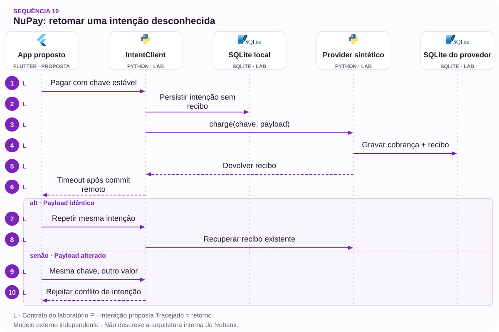

# 10 · NuPay após erro exibido: recuperar a intenção antes de repetir

Resultado desconhecido é um estado financeiro, não um convite a cobrar de novo

[PT reader](https://wesleyvieira99.github.io/nu/#10-1) · [EN reader](https://wesleyvieira99.github.io/nu/en.html#10-1)

[Executable Python lab](../../labs/case_10.py)

## 10 · Duplicidade com desfecho confirmado


Recorte real da fonte pública, capturado em 23/10/2026. O texto abaixo inclui resposta da empresa e desfecho relatado.

No caso 241843991, de 27/02/2026, o cliente relata erro exibido e repetição de pagamento NuPay, resultando em duas operações de R$ 900 e juros de R$ 81,17. O Nubank informa crédito da duplicidade e dos juros em 04/03; o cliente confirma resolução. A causa técnica não está demonstrada.

| Dado público | Cuidado de interpretação |
| --- | --- |
| 4 parcelas de R$ 245,29 | Soma declarada: R$ 981,16 |
| R$ 900 + R$ 81,17 | Soma analítica: R$ 981,17 |
| Diferença: R$ 0,01 | Não inventar ajuste de arredondamento |

**Caso histórico resolvido**

A divergência de um centavo pertence ao relato. O lançamento exato do ajuste não foi publicado; a resposta confirma categorias, não um total numérico.

- [Reclame AQUI — caso 10 · 2026-02-27](https://www.reclameaqui.com.br/nubank/cobranca-duplicada-e-juros-indevidos-por-falha-no-nupay_YLMPdqVkdlSKVq-X/)

## Timeout não equivale a falha definitiva

Uma interrupção pode ocorrer depois que o parceiro aceitou o pagamento e antes que o aplicativo receba a confirmação. Nesse intervalo, dizer que nada aconteceu pode induzir uma nova intenção financeira. A hipótese deste capítulo é que um estado explícito de resultado desconhecido, acompanhado de consulta à tentativa original, reduz repetição involuntária sem impedir novas compras legítimas.

A investigação deve reconstruir IDs, instantes e contratos entre cliente, serviço e provedor. É necessário distinguir retry da mesma intenção de uma segunda compra deliberada. Valor, comerciante e proximidade temporal ajudam na análise, mas não são identidade suficiente: duas compras iguais podem ser legítimas. A fonte pública não permite concluir qual mecanismo estava presente ou ausente no incidente.

O controle deve começar antes do envio: gerar e persistir a intenção, vincular conteúdo e chave, recuperar o estado após reinício do aplicativo. Se o provedor não oferecer idempotência ou consulta confiável, a garantia diminui. Nesse caso, a experiência precisa reconhecer a incerteza e acionar reconciliação, em vez de prometer exatamente uma execução distribuída.

## Uma intenção atravessa a incerteza



Arquitetura externa proposta; não representa a implementação interna do Nubank.

O registro vincula chave, valor, moeda e recebedor antes do despacho. O provedor conserva a mesma chave entre tentativas. Confirmação e reconciliação atualizam a intenção original, permitindo que o aplicativo retome o recibo após perder a resposta.

O modelo usa dois bancos para representar a fronteira entre serviço e provedor. Não existe transação distribuída entre eles. A propriedade depende explicitamente de deduplicação no provedor; sem essa capacidade, o desenho exige outra estratégia operacional e não pode manter a mesma promessa.

## Núcleo: persistir antes de despachar

`Idempotency Key [lab]` · `Intent / Effect Separation [lab]`

```python
    def pay(self, key, amount, merchant, timeout_after_provider=False):
        if not isinstance(key, str) or not key.strip():
            raise ValueError('nonempty intent identity required')
        if type(amount) is not int or amount <= 0 or not merchant:
            raise ValueError('invalid intent')
        payload = json.dumps([amount, merchant])
        with self.db:
            self.db.execute('BEGIN IMMEDIATE')
            old = self.db.execute('SELECT payload,receipt FROM intents WHERE key=?',
                                  (key,)).fetchone()
            if old and old[0] != payload:
                raise ValueError('intent conflict')
            if old and old[1]:
                return old[1]
            self.db.execute('INSERT OR IGNORE INTO intents VALUES(?,?,NULL)',
                            (key, payload))
        receipt = self.provider.charge(key, payload)
        if timeout_after_provider:
            raise TimeoutError('provider committed; local outcome unknown')
        with self.db:
            self.db.execute('UPDATE intents SET receipt=? WHERE key=?',
                            (receipt, key))
        return receipt

    def state(self, key):
        row = self.db.execute('SELECT receipt FROM intents WHERE key=?',
                              (key,)).fetchone()
        return 'absent' if row is None else ('confirmed' if row[0] else 'unknown')
```

Trecho literal de labs/case_10.py; dois bancos locais e um provedor sintético.

A intenção é gravada antes da chamada externa. O timeout injetado acontece depois do commit do provedor e antes de salvar o recibo local. A retomada usa a mesma chave e recebe o recibo já existente, demonstrando que ausência de resposta não autoriza outro efeito.

Não se deve manter uma transação local aberta enquanto espera a rede: isso cria bloqueios sem tornar o parceiro atomicamente participante. O laboratório torna essa separação visível. Em produção, o payload inclui escopo de conta e contrato; a integração precisa tratar retenção de chave, expiração e compatibilidade do provedor.

- [Laboratório executável do caso no GitHub](https://github.com/wesleyvieira99/nu/blob/main/labs/case_10.py)

## O estado deve orientar a próxima ação

`Idempotency Key [proposal]` · `Intent / Effect Separation [proposal]`

```dart
sealed class PaymentState {}
class Unknown extends PaymentState {
  final String intentId;
  Unknown(this.intentId);
}
class Confirmed extends PaymentState {
  final String receiptId;
  Confirmed(this.receiptId);
}

String nextAction(PaymentState state) => switch (state) {
  Unknown() => 'Check the existing payment',
  Confirmed() => 'Open receipt',
  _ => 'Continue',
};
```

Dart ilustrativo, não executado; estados e textos exigem revisão de produto e acessibilidade.

A interface oferece consulta da tentativa existente quando o resultado é desconhecido. O texto é apenas um exemplo: precisa informar o que está sendo verificado, sem afirmar débito ou falha antes da confirmação. O botão de nova compra deve representar nova intenção explícita, não um retry disfarçado.

Persistência local ajuda o aplicativo a retomar, mas o servidor continua sendo a referência. Reinstalação, troca de aparelho ou limpeza de armazenamento não podem criar automaticamente outra cobrança. Ao recuperar a sessão, o cliente consulta intenções autorizadas e recentes. Dados do recebedor devem ser suficientes para reconhecimento, com minimização de informação sensível e sem expor credenciais de integração.

## Identidade antes de heurística

`Idempotency Key [proposal]` · `Intent / Effect Separation [proposal]`

| Contrato | Invariante | Limite |
| --- | --- | --- |
| Mesma chave | Mesmo conteúdo e recibo | Escopo e retenção definidos |
| Conteúdo diferente | Conflito explícito | Não atualizar em silêncio |
| Nova intenção | Pode repetir valor | Consentimento próprio |
| Correção | Vínculo com principal/encargos | Política e reconciliação |

```json
{
  "intent_id": "synthetic-intent-10",
  "currency": "BRL",
  "amount_cents": 90000,
  "merchant_ref": "synthetic-merchant",
  "payload_digest": "sha256:...",
  "provider_key": "synthetic-intent-10",
  "state": "unknown",
  "next_action": "query_existing_intent"
}
```

Contrato sintético em centavos; não é uma captura do NuPay.

O digest não substitui validação dos campos e não deve ser usado como única autorização. Uma correção financeira é outra operação, vinculada ao efeito original; ela não apaga a intenção nem transforma uma tentativa confirmada em nunca ocorrida. Juros e principal exigem trilhas separadas para que a resolução seja completa e auditável.

## Falhar depois do efeito externo

`Idempotency Key [lab]` · `Intent / Effect Separation [lab]`

```python
    def test_timeout_restart_and_retry_produce_one_charge(self):
        with self.assertRaises(TimeoutError):
            self.c.pay('intent1', 90000, 'merchant', True)
        self.assertEqual(self.c.state('intent1'), 'unknown')
        self.assertEqual(self.charges(), 1)
        self.c.db.close()
        self.c = IntentClient(self.path / 'client.db', self.p)
        self.assertEqual(self.c.pay('intent1', 90000, 'merchant'),
                         'provider:intent1')
        self.assertEqual(self.charges(), 1)
        self.assertEqual(self.c.state('intent1'), 'confirmed')

    def test_same_amount_can_be_two_explicit_purchases(self):
        self.c.pay('intent1', 90000, 'merchant')
        self.c.pay('intent2', 90000, 'merchant')
        self.assertEqual(self.charges(), 2)
```

Trechos literais; 9 testes passaram, incluindo retomada após timeout.

O cenário adverso mais importante já produziu efeito no provedor. A asserção verifica uma cobrança após reabrir o cliente e repetir a chamada. Outro teste permite duas compras iguais com intenções diferentes, evitando uma proteção que bloqueie indiscriminadamente pagamentos legítimos.

A suíte também verifica conflito de valor, recebedor diferente, múltiplos timeouts e centavos inválidos. Não cobre rede real, retenção de chaves do parceiro, juros ou cancelamento comercial. O contrato de integração precisa testar esses comportamentos com o provedor, especialmente uma resposta tardia depois que a jornada foi encaminhada para atendimento.

## Medir ambiguidade e efeito confirmado

| Métrica | Definição | Coleta / corte |
| --- | --- | --- |
| Resultado desconhecido | Intenções sem desfecho / elegíveis | Eventos; provedor e versão |
| Duplicidade confirmada | Repetições involuntárias / intenções | Revisão; motivo |
| Tempo de reconciliação | p95 até resultado definitivo | Por idade e parceiro |
| Falso bloqueio | Compras legítimas impedidas / revisadas | Amostra independente |

As taxas atuais são desconhecidas. Uma exceção de rede não pode entrar automaticamente no numerador de duplicidade. A confirmação exige vínculo entre intenções e análise do efeito, preservando compras legítimas iguais. O indicador de correção completa verifica principal e encargos associados, sem inferir que todo ajuste é perda do banco.

O experimento começa com recuperação de intenção em sombra e testes de falha. O canário compara versões móveis e parceiros compatíveis, mantendo política de autorização constante. Qualquer nova duplicidade causada pelo controle, impedimento de pagamento legítimo ou perda de rastreabilidade interrompe a expansão. Conversão isolada não é critério suficiente de sucesso.

## Um caso forte não prova ROI elevado

| Cenário assumido | Potencial/ano | Operação/ano | Ano 1 após custo |
| --- | --- | --- | --- |
| Conservador | R$ 4.050 | R$ 36.000 | R$ -211.950 |
| Base | R$ 27.000 | R$ 36.000 | R$ -189.000 |
| Ambicioso | R$ 108.000 | R$ 36.000 | R$ -108.000 |

Hipóteses anuais: 30 mil, 60 mil ou 100 mil intenções ambíguas; duplicidade confirmada em 0,5%, 1% ou 2%; prevenção incremental de 30%, 50% ou 60%. Isso produz 45, 300 ou 1.200 incidentes evitados. Assumo R$ 50 de atendimento/conciliação e R$ 40 de encargos irrecuperáveis por incidente, total R$ 90. Não uso os valores do relato como custo médio do banco.

Implementação assumida: R$ 180 mil; operação anual: R$ 36 mil. No cenário base, 300 × 90 = R$ 27.000; primeiro ano: R$ 27.000 − 36.000 − 180.000 = −R$ 189.000. O equilíbrio exige 2.400 incidentes efetivamente evitados no primeiro ano. Nenhum cenário apresentado justifica sozinho o investimento completo. Uma correção menor, reaproveitada em plataforma, pode ter outra conta e deve ser estimada separadamente.

**Não confundir fluxo e perda**

Principal devolvido não é automaticamente despesa do banco. Capacidade operacional, encargos suportados e dinheiro do cliente são categorias distintas. O incidente real não fornece frequência populacional nem ganho realizado.

## Roadmap condicionado ao parceiro

| Fase proposta | Responsável e entrega | Gate |
| --- | --- | --- |
| 0–15 dias | Pagamentos: contrato do provedor | Idempotência/consulta verificadas |
| 16–30 dias | Staff + mobile: intenção persistente | Reinício recupera mesma operação |
| 31–60 dias | Operações: falhas e sombra | Efeito externo reconciliado |
| 61–90 dias | EM + produto: canário por parceiro | Sem duplicidade nem falso bloqueio |

A dependência mais importante é saber o que o parceiro realmente garante e por quanto tempo guarda a chave. Se a consulta não distingue pendente de inexistente, o desenho precisa preservar essa ambiguidade. O cronograma de 90 dias é planejamento proposto, não promessa de mudança pelo Nubank ou pelo provedor.

O EM negocia capacidade de integração, teste e suporte; o Staff documenta as garantias por cenário de falha. A entrega móvel deve esperar o contrato do servidor. Um texto melhor, sem recuperação de estado, pode apenas esconder o problema. A porta econômica também é explícita: começar por mudança limitada quando os cenários não sustentam plataforma nova.

## Operar o desconhecido sem repetir

O canário deve ter uma fila de intenções desconhecidas com idade, parceiro e próximo passo. Alertas não transportam dados completos do pagamento; usam referências autorizadas para investigação. A equipe de pagamentos responde pelo efeito, integração pelo contrato externo e atendimento pela continuidade da comunicação ao cliente.

O runbook começa consultando a intenção existente e a evidência do provedor. Não orienta o operador a criar outra cobrança para testar se funciona. Quando a confirmação chega tarde, ela deve atualizar o mesmo caso e impedir correções duplicadas. Um pedido de reembolso exige fluxo próprio e autorização adequada; não é consequência automática de timeout.

Rollback desativa a nova experiência, mas conserva intenções e confirmações já gravadas. Simularia perda de resposta, retorno duplicado, resposta fora de ordem e indisponibilidade da consulta. Também testaria recuperação após reinstalação do app. A condição de parada é qualquer cenário em que o estado mostrado induza ação financeira incompatível com o que se sabe.

## Minha contribuição para o contrato

Como Staff, eu tornaria explícitas as garantias locais e as dependências externas. Recusaria o uso de exatamente uma vez como slogan para toda a jornada. O desenho deve dizer onde há transação, onde há deduplicação e onde existe incerteza. Eu também definiria a diferença entre retry e nova intenção para que prevenção de duplicidade não impeça compras legítimas.

Como Engineering Manager, eu coordenaria mobile, pagamentos, parceiro e suporte em torno de cenários reproduzíveis de falha. A equipe precisa de tempo para exercícios e reconciliação, não apenas de uma meta de entrega visual. Eu colocaria o custo do projeto e a evidência de incidência na mesma decisão de prioridade.

A alternativa rejeitada é bloquear automaticamente qualquer pagamento de mesmo valor ao mesmo recebedor em uma janela curta. Essa regra pode gerar falsos positivos e não resolve perda de resposta. Uma intenção identificada oferece contrato mais preciso, desde que o parceiro coopere. Quando ele não coopera, a limitação precisa aparecer no desenho e no plano operacional.

## Revisão do efeito único sob uma hipótese

- Executar python3 labs/case_10.py; 9 testes locais sem chamadas financeiras.
- Inspecionar Provider.charge e IntentClient.pay; localizar os dois commits separados.
- Injetar timeout_after_provider = True e observar estado unknown com uma cobrança existente.
- Retomar com a mesma chave; depois criar outra intenção explícita e verificar duas compras legítimas.

A garantia demonstrada depende de o provedor sintético deduplicar corretamente. O laboratório não prova que um parceiro real oferece a mesma retenção, escopo ou consulta. Antes de produção, são necessários testes contratuais, autenticação, moeda, regras de expiração e reconciliação independente do efeito.

Avançar somente quando o contrato externo estiver confirmado, a mensagem orientar a ação correta e o piloto demonstrar redução de repetição sem bloquear compras válidas. Caso contrário, limitar a mudança à recuperação de informações e à operação assistida. O valor desta contribuição está em tornar a incerteza administrável e impedir que uma resposta perdida vire uma nova obrigação financeira.

- [Laboratório executável do caso no GitHub](https://github.com/wesleyvieira99/nu/blob/main/labs/case_10.py)

## Padrões com prova no código

`Idempotency Key [lab]` · `Intent / Effect Separation [lab]` · `Ports & Adapters [proposal]` · `Spring Boot [proposal]`

| Mecanismo | Implementação | Evidência |
| --- | --- | --- |
| Idempotency Key | IntentClient.pay | reinício e retry preservam um efeito no provedor |
| Intent / Effect Separation | IntentClient.pay | chaves distintas representam intenções distintas |
| Ports & Adapters / payment provider | Proposta para produção | Adaptadores preservam a autoridade fora da interface. |

**Integração Java · proposta**

Spring Boot + resilient HTTP adapter. Portar invariantes e testes de contrato antes de substituir o modelo Python. Lock de processo não controla concorrência distribuída; persistência, autorização e recuperação exigem testes de integração.

**Avaliação de IA · núcleo determinístico**

Nenhum framework de agentes está implementado neste laboratório. Estado financeiro, autorização e versões permanecem determinísticos. Um assistente só seria avaliado diante de necessidade comprovada de atendimento, sem autoridade sobre saldo ou identidade.

- [P1 · IntentClient.pay](https://github.com/wesleyvieira99/nu/blob/main/labs/case_10.py#L45)
- [P1 · test_timeout_restart_and_retry_produce_one_charge](https://github.com/wesleyvieira99/nu/blob/main/labs/case_10.py#L92)
- [P2 · IntentClient.pay](https://github.com/wesleyvieira99/nu/blob/main/labs/case_10.py#L45)
- [P2 · test_same_amount_can_be_two_explicit_purchases](https://github.com/wesleyvieira99/nu/blob/main/labs/case_10.py#L104)

## Sequência de execução



Dois bancos locais. Idempotência do provedor é premissa explícita; não existe exactly-once de rede.

**Autoridade e fronteira de falha**

reinício e retry preservam um efeito no provedor. chaves distintas representam intenções distintas.

A sequência descreve a integração proposta. O laboratório vinculado verifica a invariante do domínio com dados sintéticos; serviços externos, retries de rede e implantação permanecem trabalho de integração.

- [pay](https://github.com/wesleyvieira99/nu/blob/main/labs/case_10.py#L45)
- [state](https://github.com/wesleyvieira99/nu/blob/main/labs/case_10.py#L69)

## Features, histórias e aceite

**F10.1 · Intenção persistida · D16–30**

Como cliente, quero repetir uma consulta após timeout sem cobrar novamente. Aceite: reinício e retry preservam um efeito no provedor.

**F10.2 · Compras distintas explícitas · D31–60**

Como cliente, quero realizar duas compras legítimas de mesmo valor. Aceite: chaves distintas representam intenções distintas.

**F10.3 · Expansão medida · D61–90**

Como responsável de produto, quero uma coorte elegível com controle comparável. Aceite: métrica do caso, denominador, custo e barreira de segurança registrados antes da exposição; falhas de conciliação interrompem expansão.

Os testes vinculados exercitam o aceite declarado do domínio, não a interface completa nem a integração de produção. D0–15 é descoberta: confrontar o relato público com amostras internas autorizadas, mapear dependências e aprovar contratos. São janelas incrementais de planejamento, não promessa de prazo. EM coordena dependências; Staff responde pelos contratos; Produto e o domínio aceitam o resultado.

- [Aceite F10.1](https://github.com/wesleyvieira99/nu/blob/main/labs/case_10.py#L92)
- [Aceite F10.2](https://github.com/wesleyvieira99/nu/blob/main/labs/case_10.py#L104)

## Método e sensibilidade

**Sensibilidade do cenário · BRL**

Todos os inputs são hipóteses de cenário, não efeitos medidos no Nubank. Capacidade equivalente não é economia de caixa. A realização reduz apenas o benefício; todos os custos permanecem nos valores do cenário. É análise de sensibilidade, não probabilidade nem estimativa causal.

líquido_período = benefício × realização − custo_variável − operação; primeiro_ano = líquido_período − implementação

Period / Período: `year`. Values / Valores: BRL.

| Scenario / Cenário | Benefit / Benefício | Variable cost / Variável | Run cost / Operação | Build / Implementação |
| --- | ---: | ---: | ---: | ---: |
| Conservador | 4050.00 | 0.00 | 36000.00 | 180000.00 |
| Base | 27000.00 | 0.00 | 36000.00 | 180000.00 |
| Ambicioso | 108000.00 | 0.00 | 36000.00 | 180000.00 |

| Scenario / Cenário | Period net at 100% / Líquido | Horizon after build / Horizonte | Horizon at 50% / Estresse |
| --- | ---: | ---: | ---: |
| Conservador | -31950.00 | -211950.00 | -213975.00 |
| Base | -9000.00 | -189000.00 | -202500.00 |
| Ambicioso | 72000.00 | -108000.00 | -162000.00 |

[Reproducible scenario inputs](../../models/normalized-scenarios.json) · [Decimal simulator](../../models/simulate.py)

| Decisão | Método específico do caso |
| --- | --- |
| Baseline / ameaça | Baseline: duplicidades confirmadas por intenção. Ameaça: classificar toda exceção de rede como duplicação. |
| Economia por unidade | Intenções ambíguas × taxa confirmada × prevenção × custo de incidente; não conta principal como ganho. |
| Experimento proposto | Recuperação em sombra e testes de falha antes do canário por app/parceiro, mantendo autorização. |
| Critério de parada | Parar por nova duplicidade, bloqueio de compra legítima ou perda de rastreabilidade. |

- [Reclame AQUI · ID 241843991](https://www.reclameaqui.com.br/nubank/cobranca-duplicada-e-juros-indevidos-por-falha-no-nupay_YLMPdqVkdlSKVq-X/)
- [FinOps Foundation · Unit Economics](https://www.finops.org/framework/capabilities/unit-economics/)
- [Microsoft Research · Pre-experiment design](https://www.microsoft.com/en-us/research/articles/patterns-of-trustworthy-experimentation-pre-experiment-stage/)
