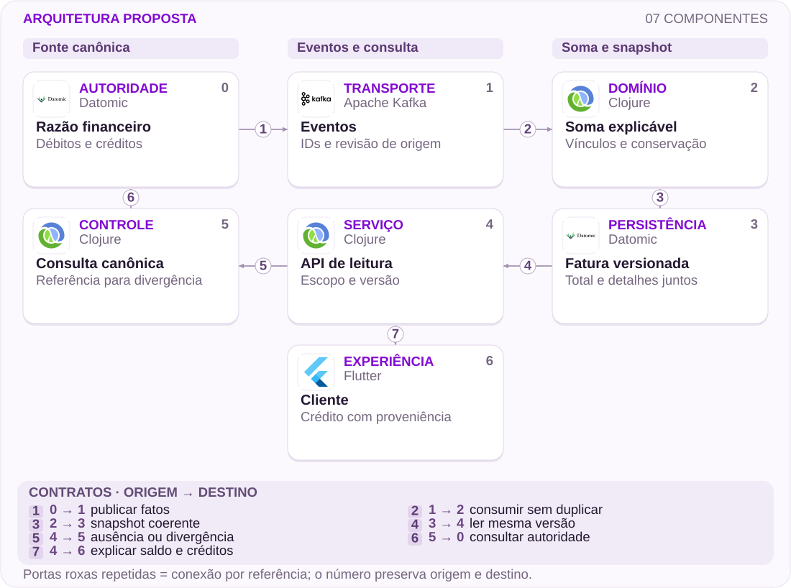
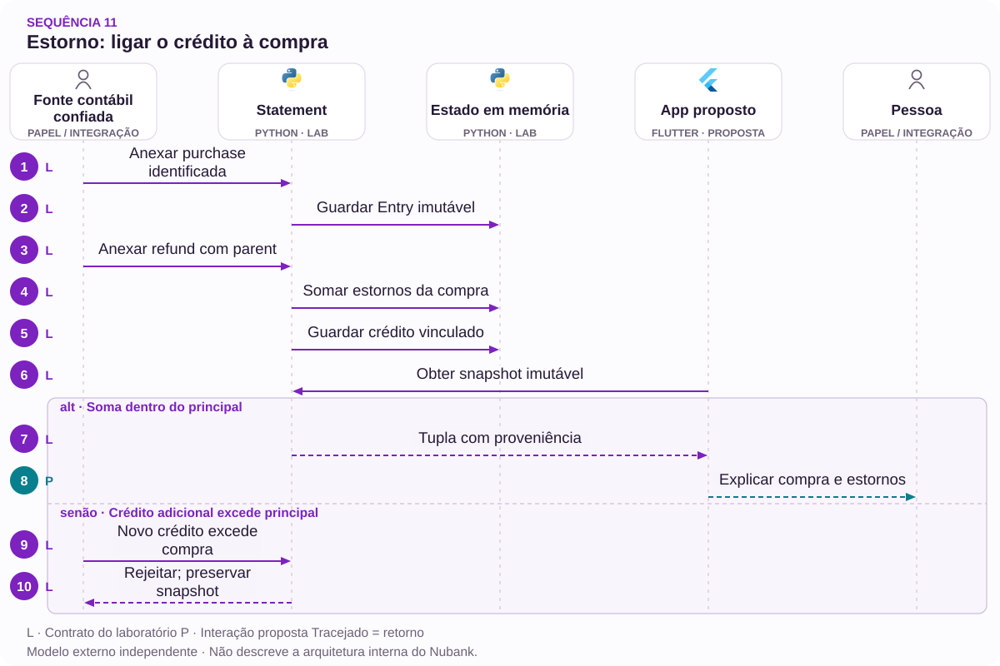

# 11 · Estorno em três lançamentos: a fatura precisa explicar a própria soma

Proveniência, versão e acessibilidade antes de presumir erro contábil

[PT reader](https://wesleyvieira99.github.io/nu/#11-1) · [EN reader](https://wesleyvieira99.github.io/nu/en.html#11-1)

[Executable Python lab](../../labs/case_11.py)

## 11 · Crédito visível, saldo questionado


Recorte real da fonte pública, capturado em 23/10/2026. O texto abaixo inclui resposta da empresa e desfecho relatado.

No caso 213597411, de 31/03/2025, o cliente relata três estornos cuja soma considera correta, mas não percebe o abatimento da fatura. O Nubank afirma aplicação correta e explica compras menos pagamento antecipado menos estornos. O cliente confirma resolução em 08/04. A fonte não demonstra defeito contábil nem esclarece qual ação produziu o desfecho.

**Escopo do capítulo**

Investigar compreensão e consistência da leitura. Valores individuais não estão públicos. A solução proposta não parte da premissa de dinheiro retido; começa pela capacidade de explicar cada crédito e o saldo correspondente.

- [Reclame AQUI — caso 11 · 2025-03-31](https://www.reclameaqui.com.br/nubank/estorno-nao-abatido-da-fatura_yqEaE2DaZR8JYUSd/)

## Um total correto pode continuar opaco

O cliente precisa reconhecer a compra de origem, identificar todos os créditos associados e entender a diferença entre saldo aberto e documento fechado. Três linhas verdes não respondem necessariamente quanto mudou no valor a pagar. A proposta é uma memória de cálculo navegável, com relação explícita entre estorno, compra e versão da fatura.

A hipótese falsificável é que a decomposição reduz erros de interpretação quando o crédito já foi contabilizado corretamente. Testaria tarefas concretas: encontrar a compra cancelada, somar estornos parciais e explicar o saldo após um pagamento antecipado. Se participantes continuam errando, investigaria linguagem, agrupamento ou discrepância entre versões; não atribuiria automaticamente o problema à falta de atenção do cliente.

Também existe uma fronteira contábil: um modelo de apresentação não pode corrigir o razão para fazer sua soma parecer consistente. A fonte financeira mantém autoridade. O aplicativo deve demonstrar a conta da versão consultada e oferecer investigação quando não conseguir conciliá-la. Documentos de fechamento e leituras abertas precisam informar sua data de referência, sem prometer identidade entre períodos diferentes.

## Total e detalhe viajam na mesma versão



Arquitetura externa proposta; não representa a implementação interna do Nubank.

Eventos preservam identidade e versão do razão. O agregador liga estornos à compra e constrói um snapshot cujo total e detalhes pertencem à mesma revisão. O cliente pode expandir a explicação sem receber uma segunda soma calculada por regras independentes.

A consulta canônica é o caminho para dados ausentes ou divergentes, não licença para misturar valores de versões diferentes. A interface informa quando a referência mudou. O desenho não pretende cobrir juros, câmbio ou todos os lançamentos de um produto real; essas regras exigem integração com a autoridade financeira.

## Núcleo: identidade e limite do estorno

`Immutable Snapshot [lab]` · `Referenced Credit [lab]`

```python
    def append(self, entry):
        if not isinstance(entry.id, str) or not entry.id.strip():
            raise ValueError('nonempty entry identity required')
        if type(entry.cents) is not int or entry.cents <= 0:
            raise ValueError('positive integer cents required')
        if entry.kind not in {'purchase', 'refund', 'payment'}:
            raise ValueError('unknown entry type')
        with self.lock:
            old = self.entries.get(entry.id)
            if old:
                if old != entry:
                    raise ValueError('entry identity conflict')
                return
            if entry.kind == 'refund':
                purchase = self.entries.get(entry.parent)
                if not purchase or purchase.kind != 'purchase':
                    raise ValueError('missing purchase provenance')
                used = sum(e.cents for e in self.entries.values()
                           if e.kind == 'refund' and e.parent == entry.parent)
                if used + entry.cents > purchase.cents:
                    raise ValueError('refund exceeds purchase')
            elif entry.parent:
                raise ValueError('unexpected parent')
            self.entries[entry.id] = entry

    def snapshot(self):
        with self.lock:
            return tuple(self.entries.values())
```

Trecho literal de labs/case_11.py; modelo em memória, protegido por lock local.

Cada lançamento tem identidade imutável. Um estorno precisa referenciar uma compra existente e a soma de estornos de principal não pode exceder essa compra no modelo. Retentativas idênticas não criam uma segunda redução. O snapshot retorna uma tupla de objetos imutáveis.

Essa limitação é deliberada: compensação adicional, juros e outras categorias exigiriam tipos próprios, não um estorno maior disfarçado. O laboratório não persiste em disco nem implementa consumo distribuído. O lock demonstra a exclusão necessária em uma autoridade local; um serviço real precisa de transação ou escrita condicional correspondente.

- [Laboratório executável do caso no GitHub](https://github.com/wesleyvieira99/nu/blob/main/labs/case_11.py)

## Uma função de soma compartilhada

`Immutable Snapshot [proposal]` · `Referenced Credit [proposal]`

```clojure
(defn explain-statement [entries]
  (let [sum-kind (fn [kind]
                   (reduce + (map :cents
                     (filter #(= kind (:kind %)) entries))))
        purchases (sum-kind :purchase)
        refunds (sum-kind :refund)
        payments (sum-kind :payment)
        signed (- purchases refunds payments)]
    {:purchases purchases
     :refunds refunds
     :payments payments
     :amount-due (max 0 signed)
     :credit-balance (max 0 (- signed))}))
```

Clojure ilustrativo e não executado; regras simplificadas equivalentes ao laboratório.

O redutor separa compras, estornos e pagamentos. Quando o saldo assinado fica negativo, apresenta crédito disponível na fatura, não valor a pagar negativo. Isso evita perder significado financeiro ao limitar o total visual a zero. As duas quantidades continuam reconciliáveis.

App, PDF e atendimento deveriam consumir a mesma projeção ou um contrato comum de cálculo, com versão declarada. Copiar a fórmula em três clientes aumenta o risco de divergência. A implementação real deve acrescentar categorias aprovadas por contabilidade e manter testes de paridade entre canais. A função não decide data de lançamento nem se o estabelecimento efetivamente devolveu dinheiro.

## Proveniência é parte do contrato

`Immutable Snapshot [proposal]` · `Referenced Credit [proposal]`

| Elemento | Regra | Privacidade |
| --- | --- | --- |
| entry_id | Identidade estável | Sem conta no identificador público |
| parent | Compra de origem do estorno | Somente dono autorizado |
| revision | Total e detalhes coerentes | Não expor histórico desnecessário |
| credit_balance | Crédito distinto do valor devido | Texto acessível |

```json
{
  "statement_id": "synthetic-statement-11",
  "revision": 4,
  "currency": "BRL",
  "purchases_cents": 10000,
  "refunds_cents": 10000,
  "payments_cents": 0,
  "amount_due_cents": 0,
  "refund_entries": ["r0", "r1", "r2"],
  "source_purchase": "p"
}
```

Exemplo sintético de três estornos; nenhum valor foi extraído da conta do reclamante.

Uma relação muitos-para-um é necessária quando a devolução chega em partes. O total da compra e seus créditos não devem ser duplicados apenas porque aparecem no resumo e no detalhamento. No atendimento, uma referência curta permite localizar a mesma versão sem pedir ao cliente que envie novamente todos os documentos ou exponha informações de outras compras.

## Testar soma, versão e concorrência

`Immutable Snapshot [lab]` · `Referenced Credit [lab]`

```python
    def test_three_refunds_reduce_exactly_once(self):
        for i, cents in enumerate((3333, 3333, 3334)):
            refund = Entry('r' + str(i), 'refund', cents, 'p')
            self.s.append(refund)
            self.s.append(refund)
        result = explain(self.s.snapshot())
        self.assertEqual(result['refunds'], 10000)
        self.assertEqual(result['amount_due'], 0)
        self.assertEqual(result['revision'], 4)

    def test_old_snapshot_does_not_change_after_new_credit(self):
        old = self.s.snapshot()
        self.s.append(Entry('r', 'refund', 5000, 'p'))
        self.assertEqual(explain(old)['amount_due'], 10000)
        self.assertEqual(explain(self.s.snapshot())['amount_due'], 5000)
```

Trechos literais; 9 testes locais passaram.

A divisão sintética 3.333 + 3.333 + 3.334 demonstra conservação exata de 10.000 centavos. O replay de cada crédito não altera o resultado. O snapshot antigo permanece estável após um novo estorno, permitindo explicar por que duas versões legítimas podem mostrar saldos diferentes.

Outros testes rejeitam estorno sem origem, excesso de devolução, conflito de identidade e centavos inválidos. A concorrência tenta devolver 6.000 duas vezes contra 10.000 e aceita apenas uma operação. Não há testes de regra contratual real, fechamento, tributos ou juros. Esses limites devem aparecer antes que o exemplo seja usado como referência de implementação.

## O sucesso é compreensão demonstrada

| Métrica | Numerador / denominador | Janela e corte |
| --- | --- | --- |
| Compreensão | Tarefas respondidas corretamente / tarefas | Sessões; acessibilidade |
| Contato interpretativo | Dúvidas sobre crédito aplicado / estornos | 30 dias; tipo de estorno |
| Paridade | Snapshots conciliados / comparados | Diária; canal e revisão |
| Proveniência | Créditos com origem válida / créditos | Contínua; integração |

As linhas de base são desconhecidas. O experimento usa tarefas equivalentes e grupos comparáveis, com o mesmo cálculo financeiro. Mede acerto e tempo, sem confundir uma tela mais rápida com entendimento melhor. Leitores de tela precisam anunciar sinal, valor e vínculo; cor não pode ser a única informação sobre crédito.

A classificação de contato é auditada para não chamar erro financeiro de dúvida do cliente. Interromperia o canário diante de divergência de soma, mistura de versões ou piora de compreensão em grupos assistivos. A quantidade de cliques em detalhes é sinal de uso, não prova de sucesso. A validação final pede ao participante explicar o saldo com suas próprias palavras.

## Economia depende de dúvidas evitadas

| Cenário assumido | Potencial/ano | Operação/ano | Ano 1 após custo |
| --- | --- | --- | --- |
| Conservador | R$ 16.000 | R$ 24.000 | R$ -128.000 |
| Base | R$ 120.000 | R$ 24.000 | R$ -24.000 |
| Ambicioso | R$ 400.000 | R$ 24.000 | R$ 256.000 |

Hipóteses anuais: 200 mil, 500 mil ou 1 milhão de estornos elegíveis; redução de 0,005, 0,015 ou 0,025 contato interpretativo por estorno; R$ 16 por contato. Implementação assumida: R$ 120 mil; operação: R$ 24 mil/ano. O cálculo monetiza capacidade de atendimento, não o valor do crédito devolvido ao cliente.

No cenário base, 500.000 × 0,015 × 16 = R$ 120.000. Após operação e implantação, o primeiro ano fica em −R$ 24.000. O equilíbrio exige 600 mil estornos equivalentes à hipótese base. Se o produto já tiver uma projeção comum, o investimento incremental pode ser menor; a estimativa deve então ser refeita, sem transportar automaticamente o benefício assumido.

**Não somar as mesmas jornadas**

Excluir contatos de duplicidade tratados no caso 10 e de alocação tratados no 09. Horas liberadas só viram caixa com mudança concreta de gasto. Nenhuma taxa ou economia foi observada no Nubank por este estudo.

## Roadmap de cálculo e linguagem

| Fase proposta | Dono e entrega | Gate |
| --- | --- | --- |
| 0–15 dias | Contabilidade + design: cenários | Somas e perguntas aprovadas |
| 16–30 dias | Staff: projeção e vínculos | Total/detalhe na mesma revisão |
| 31–60 dias | Mobile + acessibilidade: protótipo | Compreensão assistiva validada |
| 61–90 dias | EM + produto: experimento | Acerto melhora sem divergência |

O prazo de 90 dias é uma hipótese de planejamento. Primeiro é necessário obter exemplos representativos de estornos parciais, pagamentos e fechamento, sempre com acesso autorizado ou dados sintéticos. Sem essa cobertura, uma tela bonita pode funcionar apenas no caso simples e falhar justamente na jornada que gera contato.

O Staff define versão e invariantes; contabilidade aprova semântica; design valida linguagem; o EM protege capacidade para pesquisa e ajustes. A aceitação não é uma lista de componentes renderizados. Ela exige que o cliente reconheça a origem do crédito e compreenda o saldo, e que suporte consiga reproduzir a explicação usando a mesma referência.

## Operação com fallback identificável

A projeção roda primeiro em sombra e compara somas com a referência financeira. No canário, a memória de cálculo aparece sob demanda para uma coorte limitada. Se a versão mudar durante a consulta, a interface informa atualização e recalcula o conjunto completo; não troca apenas o total deixando detalhes antigos.

Alertas cobrem créditos órfãos, excesso de estorno de principal e divergência de versão entre canais. A equipe da projeção investiga processamento; contabilidade resolve semântica; atendimento recebe instrução para distinguir dúvida de erro. Logs usam referências, não descrições completas de compras ou documentos pessoais.

Rollback esconde o detalhamento novo e mantém o saldo canônico, preservando IDs para investigação. Um exercício deve simular evento repetido, estorno antes da compra e PDF de versão anterior. A reconciliação precisa explicar por que o evento foi rejeitado ou aguardou dependência. Não se deve descartar silenciosamente um crédito porque chegou fora de ordem.

## Minha contribuição para confiança na soma

Como Staff, eu definiria uma representação financeira que preserve sinal, origem e revisão. Evitaria três cálculos independentes para app, PDF e suporte. A escolha técnica seria uma projeção explicável com fonte canônica e política clara para eventos fora de ordem, sem transformar a interface em autoridade financeira.

Como Engineering Manager, eu organizaria a entrega com contabilidade, experiência, acessibilidade e operação. Reservaria tempo para observar usuários interpretando cenários difíceis, porque compreensão não emerge automaticamente de uma tabela correta. O backlog incluiria linguagem e suporte, além de processamento e telemetria.

Eu rejeitaria resolver o problema apenas mudando a cor do estorno ou adicionando um selo de aplicado. Isso reforça uma afirmação sem permitir verificá-la. O tradeoff é oferecer detalhes suficientes sem sobrecarregar a tela inicial: resumo simples, explicação progressiva e total rigorosamente ligado à versão. Essas são contribuições propostas, sem alegação de atuação passada no banco.

## Handoff: reproduzir a explicação

- Executar python3 labs/case_11.py; 9 testes, dados sintéticos em memória.
- Ler Entry, Statement.append, snapshot e explain; observar débito, crédito e saldo a pagar.
- Repetir três estornos, guardar uma versão antiga e comparar com a nova.
- Antes de produção: persistência, ordem de eventos, categorias contábeis, autorização e paridade entre canais.

O revisor deve conseguir explicar por que um crédito reduz o saldo e por que uma versão antiga permanece diferente. A solução não depende de esconder o histórico nem de ensinar o cliente a refazer manualmente toda a contabilidade. O laboratório demonstra um contrato pequeno que pode ser discutido com produto e contabilidade.

Avançar apenas se a projeção conciliar, a linguagem melhorar compreensão e os guardrails assistivos forem preservados. Se houver erro financeiro, a correção do razão tem prioridade. Se houver apenas dúvida interpretativa, o experimento pode validar uma melhoria menor. A força do caso está em respeitar essa distinção, inclusive quando a reclamação histórica já foi resolvida.

- [Laboratório executável do caso no GitHub](https://github.com/wesleyvieira99/nu/blob/main/labs/case_11.py)

## Padrões com prova no código

`Immutable Snapshot [lab]` · `Referenced Credit [lab]` · `CQRS [proposal]` · `Spring Boot [proposal]` · `Spring AI [proposal]`

| Mecanismo | Implementação | Evidência |
| --- | --- | --- |
| Immutable Snapshot | Statement.snapshot | crédito novo não altera snapshot antigo |
| Referenced Credit | Statement.append | um estorno sem compra de origem é rejeitado |
| CQRS / explainable statement read model | Proposta para produção | Adaptadores preservam a autoridade fora da interface. |

**Integração Java · proposta**

Spring Boot + immutable records. Portar invariantes e testes de contrato antes de substituir o modelo Python. Lock de processo não controla concorrência distribuída; persistência, autorização e recuperação exigem testes de integração.

**Avaliação de IA · Spring AI**

Experimento proposto: Spring AI para explicar lançamentos já reconciliados, citando suas referências. Ferramentas de leitura, citações, orçamento de tokens e aprovação humana são requisitos. Não autoriza dinheiro, elegibilidade ou identidade. Os testes Python não comprovam integração com LLM.

- [P1 · Statement.snapshot](https://github.com/wesleyvieira99/nu/blob/main/labs/case_11.py#L51)
- [P1 · test_old_snapshot_does_not_change_after_new_credit](https://github.com/wesleyvieira99/nu/blob/main/labs/case_11.py#L83)
- [P2 · Statement.append](https://github.com/wesleyvieira99/nu/blob/main/labs/case_11.py#L26)
- [P2 · test_orphan_refund_rejected_without_mutation](https://github.com/wesleyvieira99/nu/blob/main/labs/case_11.py#L95)
- [Spring AI · MCP integration](https://docs.spring.io/spring-ai/reference/api/mcp/mcp-overview.html)

## Sequência de execução



Não calcula juros, impostos, câmbio ou parcelas. Imutabilidade e lock são locais ao processo.

**Autoridade e fronteira de falha**

crédito novo não altera snapshot antigo. os três estornos reduzem o total uma única vez.

A sequência descreve a integração proposta. O laboratório vinculado verifica a invariante do domínio com dados sintéticos; serviços externos, retries de rede e implantação permanecem trabalho de integração.

- [append](https://github.com/wesleyvieira99/nu/blob/main/labs/case_11.py#L26)
- [snapshot](https://github.com/wesleyvieira99/nu/blob/main/labs/case_11.py#L51)

## Features, histórias e aceite

**F11.1 · Fatura reproduzível · D16–30**

Como cliente, quero reabrir uma composição de fatura e encontrar o mesmo total. Aceite: crédito novo não altera snapshot antigo.

**F11.2 · Estorno com origem · D31–60**

Como cliente, quero rastrear cada crédito até sua compra. Aceite: os três estornos reduzem o total uma única vez.

**F11.3 · Expansão medida · D61–90**

Como responsável de produto, quero uma coorte elegível com controle comparável. Aceite: métrica do caso, denominador, custo e barreira de segurança registrados antes da exposição; falhas de conciliação interrompem expansão.

Os testes vinculados exercitam o aceite declarado do domínio, não a interface completa nem a integração de produção. D0–15 é descoberta: confrontar o relato público com amostras internas autorizadas, mapear dependências e aprovar contratos. São janelas incrementais de planejamento, não promessa de prazo. EM coordena dependências; Staff responde pelos contratos; Produto e o domínio aceitam o resultado.

- [Aceite F11.1](https://github.com/wesleyvieira99/nu/blob/main/labs/case_11.py#L83)
- [Aceite F11.2](https://github.com/wesleyvieira99/nu/blob/main/labs/case_11.py#L73)

## Método e sensibilidade

**Sensibilidade do cenário · BRL**

Todos os inputs são hipóteses de cenário, não efeitos medidos no Nubank. Capacidade equivalente não é economia de caixa. A realização reduz apenas o benefício; todos os custos permanecem nos valores do cenário. É análise de sensibilidade, não probabilidade nem estimativa causal.

líquido_período = benefício × realização − custo_variável − operação; primeiro_ano = líquido_período − implementação

Period / Período: `year`. Values / Valores: BRL.

| Scenario / Cenário | Benefit / Benefício | Variable cost / Variável | Run cost / Operação | Build / Implementação |
| --- | ---: | ---: | ---: | ---: |
| Conservador | 16000.00 | 0.00 | 24000.00 | 120000.00 |
| Base | 120000.00 | 0.00 | 24000.00 | 120000.00 |
| Ambicioso | 400000.00 | 0.00 | 24000.00 | 120000.00 |

| Scenario / Cenário | Period net at 100% / Líquido | Horizon after build / Horizonte | Horizon at 50% / Estresse |
| --- | ---: | ---: | ---: |
| Conservador | -8000.00 | -128000.00 | -136000.00 |
| Base | 96000.00 | -24000.00 | -84000.00 |
| Ambicioso | 376000.00 | 256000.00 | 56000.00 |

[Reproducible scenario inputs](../../models/normalized-scenarios.json) · [Decimal simulator](../../models/simulate.py)

| Decisão | Método específico do caso |
| --- | --- |
| Baseline / ameaça | Baseline: contato interpretativo por estorno. Ameaça: chamar erro financeiro de dúvida do cliente. |
| Economia por unidade | Estornos elegíveis × contatos evitados × custo; não monetiza o crédito que já é devido. |
| Experimento proposto | Tarefas equivalentes com o mesmo cálculo; verificar compreensão, paridade e grupos assistivos. |
| Critério de parada | Parar por soma divergente, mistura de versões ou piora de compreensão. |

- [Reclame AQUI · ID 213597411](https://www.reclameaqui.com.br/nubank/estorno-nao-abatido-da-fatura_yqEaE2DaZR8JYUSd/)
- [FinOps Foundation · Unit Economics](https://www.finops.org/framework/capabilities/unit-economics/)
- [Microsoft Research · Pre-experiment design](https://www.microsoft.com/en-us/research/articles/patterns-of-trustworthy-experimentation-pre-experiment-stage/)
