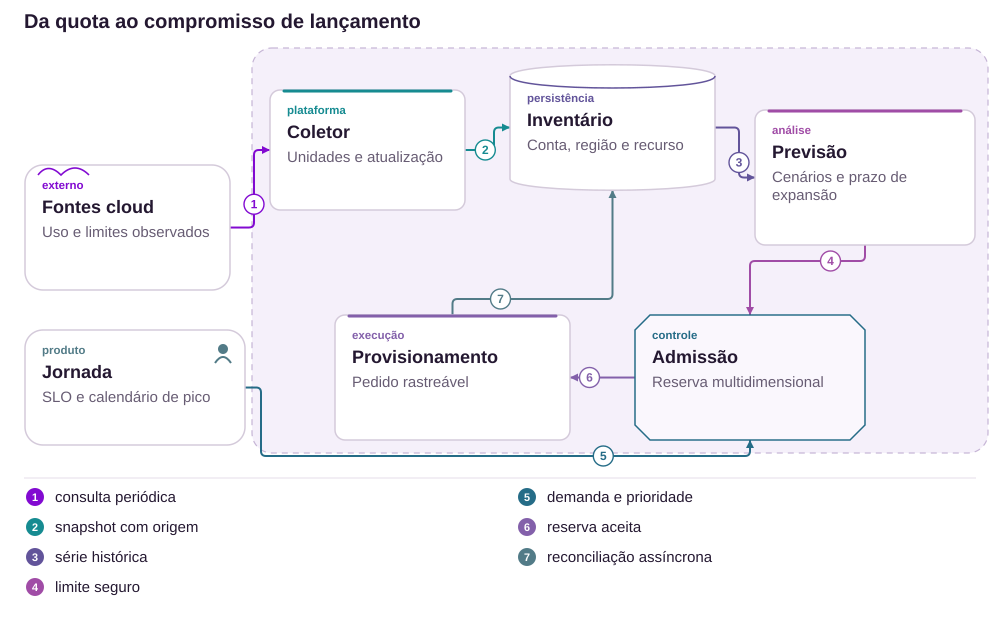

# 12 · Entregue no rastreio, ausente na mão: separar entrega e posse

Gerações de cartão, prova de origem e uma exceção com responsável

[PT reader](https://wesleyvieira99.github.io/nu/#12-1) · [EN reader](https://wesleyvieira99.github.io/nu/en.html#12-1)

[Executable Python lab](../../labs/case_12.py)

## 12 · A resposta posterior muda o contexto


Recorte real da fonte pública, capturado em 23/10/2026. O texto abaixo inclui resposta da empresa e desfecho relatado.

A reclamação 230126691, de 23/10/2025, relata mensagens de entrega sem recebimento e, depois, uma quarta tentativa frustrada. O Nubank informa cancelamento das vias não recebidas e, em 10/11, nova entrega, desbloqueio e uso. A página continua Em réplica, sem confirmação final da cliente. Não se deve apresentar o cartão como ainda desaparecido.

**Mídia e evidência**

A cliente menciona vídeo doméstico, mas não há URL pública verificada nas capturas. O livro usa a página real como prova documental; não inventa gravação, assinatura ou foto de entrega.

- [Reclame AQUI — caso 12 · 2025-10-23](https://www.reclameaqui.com.br/nubank/nao-recebimento-de-cartao-nubank-solicitado-apos-cancelamento-por-perda-e-falhas-sucessivas-na-entrega_CERudU76NRiJiJM_/)

## O fornecedor afirma um fato; o produto decide um estado

Um evento de transportadora pode ser confiável como registro do que ela declarou e ainda ser insuficiente para concluir posse pelo destinatário. A jornada deve preservar essa distinção. Entrega declarada, entrega contestada e ativação segura são estados com autoridades diferentes; reduzi-los a um único status impede tratar divergências sem sobrescrever informação.

A hipótese é que parte das reemissões repetidas pode ser evitada quando evento, via e remessa possuem identidade própria e a exceção tem um responsável ponta a ponta. Eu reconstruiria jornadas autorizadas por geração de cartão, distinguindo perda original, pedido substituto, reenvio e retorno tardio. Se a recorrência tiver outra origem, como endereço ou desempenho de rota, o plano precisa atacar essa causa operacional demonstrada.

O estudo não conclui que o fornecedor falsificou entrega nem que o banco tinha determinada integração. A investigação deve buscar comprovante, procedência, horário e política de apuração, com acesso mínimo. Não é aceitável exigir exposição pública de endereço, assinatura ou vídeo da residência para que o cliente consiga acompanhamento.

## A via antiga não manda na nova



Arquitetura externa proposta; não representa a implementação interna do Nubank.

O gateway preserva a identidade do evento e a referência da remessa. O registro liga cada remessa a uma geração do cartão. A verificação de consistência encaminha eventos antigos e disputas para uma decisão controlada, sem alterar silenciosamente a via atual.

O cliente inicia contestação por canal autenticado. Reemissão cria nova geração e cancela a anterior conforme política; não é consequência automática de qualquer atraso. Ativação segura permanece um contrato separado. O provedor externo não recebe marca de tecnologia interna nem autoridade para ativar o cartão.

## Núcleo: geração e disputa persistente

```python
    def event(self, ident, generation, kind, scope):
        if not isinstance(ident, str) or not ident.strip():
            raise ValueError('nonempty event identity required')
        if type(generation) is not int or generation < 1:
            raise ValueError('positive integer generation required')
        required = {'delivered': 'carrier', 'dispute': 'customer',
                    'activate': 'customer_verified'}
        if kind not in required or required[kind] != scope:
            raise PermissionError('scope mismatch')
        payload = json.dumps([generation, kind, scope])
        with self.db:
            self.db.execute('BEGIN IMMEDIATE')
            old = self.db.execute('SELECT payload FROM events WHERE id=?',
                                  (ident,)).fetchone()
            if old:
                if old[0] != payload:
                    raise ValueError('event conflict')
                return self.state()
            current, carrier, disputed, active = self.state()
            if generation > current:
                raise ValueError('future generation; event not consumed')
            if generation == current:
                if kind == 'delivered':
                    carrier = 'delivered'
                elif kind == 'dispute':
                    disputed, active = 1, 0
                elif kind == 'activate':
                    if disputed:
                        raise ValueError('dispute requires separate resolution')
                    active = 1
                self.db.execute('UPDATE card SET carrier=?,disputed=?,active=? '
                                'WHERE id=1', (carrier, disputed, active))
            self.db.execute('INSERT INTO events VALUES(?,?)', (ident, payload))
        return self.state()
```

Trecho literal de labs/case_12.py; estado local sintético de uma conta.

Um evento de geração antiga é registrado, mas não altera o cartão atual. Uma entrega repetida também não limpa a contestação. O modelo diferencia declaração do transportador, disputa e ativação, impedindo que um webhook transforme automaticamente entrega em uso autorizado.

O escopo recebido é contexto confiável injetado pelo servidor, não uma credencial enviada livremente pelo usuário. Assinatura do parceiro e fatores reais de ativação não estão implementados. Uma disputa bloqueia ativação nesse modelo; sua resolução operacional exige um fluxo separado, enquanto a reemissão cria outra geração controlada.

- [Laboratório executável do caso no GitHub](https://github.com/wesleyvieira99/nu/blob/main/labs/case_12.py)

## Normalizar sem apagar procedência

```clojure
(defn accept-delivery [state event]
  (cond
    (not= (:generation state) (:generation event))
    (assoc state :last-event-result :old-generation)

    (= :delivered (:type event))
    (assoc state :carrier-state :delivered)

    (= :customer-dispute (:type event))
    (assoc state :disputed? true :active? false)

    :else state))
;; Carrier delivery does not clear :disputed? or set :active?.
```

Clojure ilustrativo, não executado; não representa código de transportadora ou do Nubank.

O redutor não tenta descobrir a verdade física a partir de um status. Ele aplica regras de precedência e conserva a disputa. A normalização deve guardar o evento original com acesso restrito, além do estado comum usado pelo produto. Caso contrário, detalhes necessários à apuração desaparecem na tradução entre fornecedores.

A camada de integração autentica origem, limita replay e valida vínculo entre remessa e conta. Um timestamp recebido não é suficiente para ordenar toda a vida do cartão: relógios divergem e fornecedores podem reenviar informações antigas. Geração e identidade são controles mais fortes para impedir que uma atualização de uma via cancelada pareça confirmar a nova.

## Contrato entre físico e digital

| Campo | Autoridade | Regra |
| --- | --- | --- |
| carrier_state | Transportadora | Declaração com origem |
| customer_disputed | Cliente autenticado | Não apagado por replay |
| card_generation | Gestão de cartões | Via anterior não sobrescreve |
| card_active | Ativação segura | Independente da entrega |

```json
{
  "card_generation": 2,
  "shipment_ref": "synthetic-shipment-12",
  "carrier_state": "delivered",
  "customer_disputed": true,
  "card_active": false,
  "event_id": "carrier-event-17",
  "evidence_ref": null,
  "next_action": "investigate_delivery"
}
```

Estado sintético: entrega declarada, contestação aberta e cartão inativo.

Comprovantes podem conter endereço, assinatura ou imagem de terceiro. A referência de evidência deve permitir acesso por finalidade, expiração e auditoria. O aplicativo apresenta informação suficiente para o cliente agir, sem publicar dados do recebedor. A equipe de logística mantém responsabilidade por obter a evidência do parceiro; não transfere essa integração ao cliente.

## Replays não encerram a exceção

```python
    def test_old_delivery_does_not_replace_new_generation(self):
        self.d.event('d1', 1, 'delivered', 'carrier')
        self.d.reissue(1, 'operator')
        self.d.event('late', 1, 'delivered', 'carrier')
        self.assertEqual(self.d.state(), (2, 'pending', 0, 0))

    def test_replayed_delivery_cannot_clear_dispute(self):
        self.d.event('d1', 1, 'delivered', 'carrier')
        self.d.event('c1', 1, 'dispute', 'customer')
        self.d.event('d1', 1, 'delivered', 'carrier')
        self.d.event('d2', 1, 'delivered', 'carrier')
        self.assertEqual(self.d.state(), (1, 'delivered', 1, 0))
        with self.assertRaises(ValueError):
            self.d.event('a1', 1, 'activate', 'customer_verified')
```

Trechos literais; 10 testes passaram no laboratório.

O primeiro teste demonstra que uma confirmação antiga não transforma a segunda geração em entregue. O segundo repete o webhook original e envia outro evento de entrega: a disputa permanece aberta e a ativação segue bloqueada. A propriedade é mais importante que a ordem feliz de mensagens.

A suíte também verifica reinício, conflito de evento, papel incorreto, reemissão com geração antiga e cancelamento da ativação anterior. Não testa entrega física, assinatura criptográfica ou prova de posse. Exercícios de integração devem validar fornecedores reais, políticas de expiração e falhas entre cancelamento da via antiga e emissão da nova.

## Medir posse e exceção, não só expedição

| Métrica | Numerador / denominador | Janela e corte |
| --- | --- | --- |
| Entrega contestada | Contestações / entregas declaradas | Semanal; rota e parceiro |
| Reemissão repetida | Novas vias / jornada de reposição | 30 dias; geração |
| Tempo de exceção | p95 até decisão com responsável | Diária; motivo |
| Via inválida ativa | Ativações de via cancelada / tentativas | Contínua; integração |

A linha de base é desconhecida. Dados operacionais devem ligar jornada, remessa e geração sem exportar endereços para telemetria geral. Tempo até posse confirmada pode depender de ativação ou outro sinal seguro aprovado; não deve ser inferido apenas do evento da transportadora.

O piloto compara rotas e fornecedores equivalentes, controlando mudanças de sazonalidade e modalidade de envio. A redução de reemissão só conta como melhoria se a posse ou resolução for confirmada. Pararia a expansão diante de ativação indevida, fechamento automático de disputa ou coleta excessiva de dados pessoais. Reduzir custo negando reenvio necessário é um resultado adverso, não sucesso.

## Frete evitado tem um limite econômico

| Cenário assumido | Potencial/ano | Operação/ano | Ano 1 após custo |
| --- | --- | --- | --- |
| Conservador | R$ 3.900 | R$ 24.000 | R$ -110.100 |
| Base | R$ 15.600 | R$ 24.000 | R$ -98.400 |
| Ambicioso | R$ 46.800 | R$ 24.000 | R$ -67.200 |

Hipóteses anuais: 50 mil, 100 mil ou 150 mil remessas elegíveis; reemissões evitadas em 0,2%, 0,4% ou 0,8% dessas jornadas. Isso corresponde a 100, 400 ou 1.200 reemissões. Assumo R$ 9 por cartão, R$ 18 por envio e R$ 12 de suporte incremental, total R$ 39. Nenhum custo unitário vem da reclamação.

Implementação assumida: R$ 90 mil; operação: R$ 24 mil/ano. No cenário base, 400 × 39 = R$ 15.600; primeiro ano: R$ 15.600 − 24.000 − 90.000 = −R$ 98.400. O equilíbrio exige aproximadamente 2.924 reemissões evitadas no primeiro ano. Esses cenários não sustentam sozinhos um investimento amplo; favorecem piloto focalizado ou extensão de fluxo existente.

**Benefício não demonstrado**

A quantidade narrada por uma cliente não é taxa populacional. Não contar toda contestação como fraude nem toda reemissão como evitável. Suporte já incluído no custo logístico não pode ser somado outra vez.

## Roadmap com fornecedor e operação

| Fase proposta | Dono e entrega | Gate |
| --- | --- | --- |
| 0–15 dias | Logística: mapa de eventos e rotas | Identidades e fontes conferidas |
| 16–30 dias | Staff + cartões: geração e contrato | Via antiga não altera atual |
| 31–60 dias | Operações + parceiro: apuração | Exceção tem dono e evidência |
| 61–90 dias | EM: piloto em rota limitada | Posse melhora; segurança mantida |

O calendário é uma hipótese de 90 dias. A dependência crítica é a cooperação operacional do fornecedor, incluindo qualidade de eventos e acesso a comprovantes. Se essa fonte não existir, a primeira entrega deve tornar a lacuna visível e definir alternativa, não criar uma falsa certeza no aplicativo.

O EM coordena capacidade de logística, cartão, suporte e parceiro. O Staff define geração, identidade e transições. A política de reenvio precisa de aprovação operacional; não pode surgir como efeito colateral de um retry técnico. Cada gate inclui uma jornada contestada, uma entrega legítima e um evento tardio de via cancelada.

## Runbook para uma entrega contestada

O atendimento abre um caso vinculado à remessa e à geração, preservando a declaração do cliente. O operador consulta procedência e próxima ação autorizada. Reemitir sem diagnóstico não é o único botão: apuração, canal alternativo e cancelamento de via exposta precisam de política e responsabilidade claras.

Alertas separam ausência de atualização, disputa envelhecida e evento incompatível com a geração. Logística responde pelo parceiro; cartões responde por cancelamento e ativação; a equipe do serviço responde por perda de eventos. Informações sensíveis permanecem em ferramentas com acesso restrito, não em tickets amplamente visíveis.

Rollback desativa interpretação nova e conserva histórico de geração e disputa. Nunca reativa vias canceladas. O exercício operacional inclui webhook repetido após reemissão, entrega informada para a via errada e indisponibilidade do comprovante. A reconciliação precisa manter o cliente informado sem usar um status de rastreio como prova conclusiva de posse.

## Minha contribuição atravessa a fronteira física

Como Staff, eu definiria uma identidade que sobreviva a reemissão, troca de transportadora e eventos tardios. A decisão central seria separar declaração de entrega de ativação segura e manter a contestação como fato próprio. A arquitetura deve tolerar a imperfeição do mundo físico sem fingir que uma ordem de mensagens resolve a verdade da entrega.

Como Engineering Manager, eu criaria um dono para a exceção completa e um fórum operacional com o fornecedor. A equipe precisa acompanhar resolução e custo por jornada, não apenas número de cartões expedidos. Eu reservaria capacidade para casos fora do fluxo comum e alinharia quais evidências são necessárias para mudar de etapa.

Eu rejeitaria a alternativa de encerrar automaticamente o caso quando a transportadora reenviar entregue. Também evitaria coletar vídeos residenciais como requisito padrão. O tradeoff é ter apuração suficiente com dados mínimos e custo proporcional. O investimento deve ser guiado por rotas e causas verificadas, sem extrapolar uma reclamação para toda a operação.

## Handoff: revisar a geração atual

- Executar python3 labs/case_12.py; 10 testes com banco local e eventos sintéticos.
- Ler Delivery.event e reissue; identificar quem pode declarar entrega, contestar e ativar.
- Criar segunda geração e reenviar um evento da primeira; a via atual deve permanecer inalterada.
- Antes de produção: assinatura do parceiro, identidade, prova de posse, retenção e resolução de disputa.

A demonstração local verifica precedência e persistência, não se uma encomenda chegou. O revisor deve reconhecer essa fronteira e pedir testes contratuais do fornecedor antes de aprovar a integração. Também deve verificar que o atendimento consegue reconstruir todas as vias sem confundir um cartão cancelado com o atual.

Prosseguir apenas quando a apuração tiver responsável, os eventos estiverem vinculados corretamente e a segurança de ativação permanecer intacta. Se a evidência operacional mostrar problema de rota, a intervenção pode ser logística. A contribuição de engenharia é garantir que o produto represente essa realidade com clareza e não a esconda atrás de um estado único.

- [Laboratório executável do caso no GitHub](https://github.com/wesleyvieira99/nu/blob/main/labs/case_12.py)
