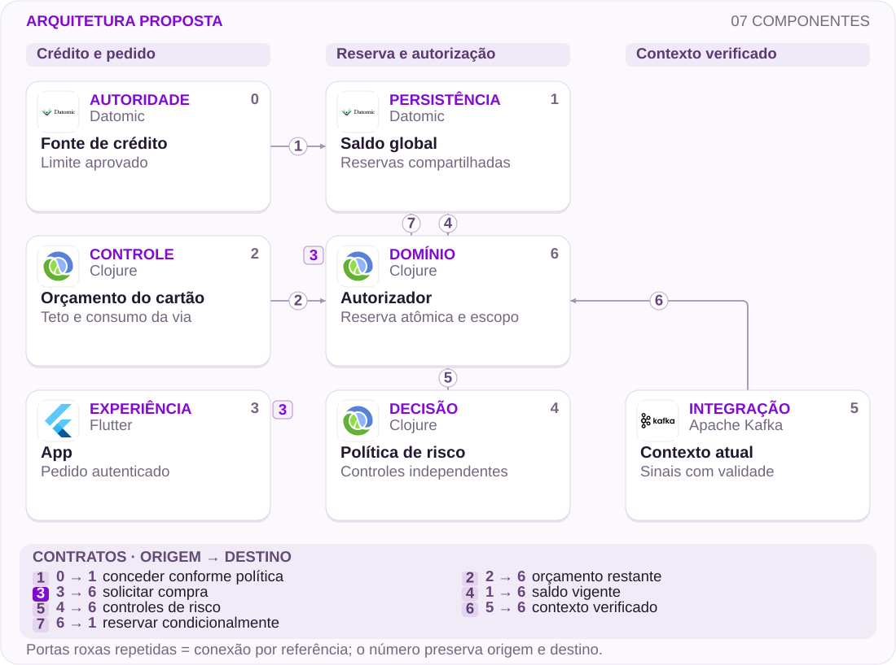

# 13 · Teto do cartão virtual não é crédito disponível

Explicar a restrição sem enfraquecer a autorização financeira

[PT reader](https://wesleyvieira99.github.io/nu/#13-1) · [EN reader](https://wesleyvieira99.github.io/nu/en.html#13-1)

[Executable Python lab](../../labs/case_13.py)

## 13 · Dois valores, interpretações diferentes


Recorte real da fonte pública, capturado em 23/10/2026. O texto abaixo inclui resposta da empresa e desfecho relatado.

A reclamação 244706833, de 30/03/2026, relata compra de R$ 300 recusada apesar de um valor visualizado de R$ 800. O Nubank responde que a imagem correspondia ao teto configurado do cartão virtual, não ao crédito aprovado, e que compras comprometiam o limite global. O estado é Respondida. A fonte não comprova falha de 3DS ou autorização indevida.

**Imagem citada, não disponível**

A resposta menciona screenshot enviado pela cliente, mas o AX público não expõe seu endereço. A evidência publicada é a página real. O exemplo de R$ 400/R$ 100 na resposta é hipotético, não saldo da conta.

- [Reclame AQUI — caso 13 · 2026-03-30](https://www.reclameaqui.com.br/nubank/recusa-de-transacao-com-limite-disponivel-e-fatura-em-dia_ef3HnxyEcUpqSZLk/)

## Configurar um teto não concede crédito

O produto reúne pelo menos três conceitos: limite aprovado, saldo global ainda disponível e restrição escolhida para um cartão virtual. Um número configurável pode parecer uma promessa de compra se o rótulo e a hierarquia não deixarem claro o que ele controla. A proposta separa essas informações e explica a restrição mais forte, sem sugerir que o cliente ganhou crédito ao mover um controle.

A hipótese falsificável é que parte das tentativas e contatos resulta dessa confusão, não de um defeito de autorização. Eu observaria usuários explicando o efeito de aumentar o teto virtual e compararia a resposta com sua ação posterior. Também investigaria desatualização: uma leitura correta pode ficar velha quando outro cartão consome crédito compartilhado.

A autorização continua independente. Mesmo com crédito disponível, outros controles podem recusar a compra. A interface deve oferecer informação atual e suficiente, não garantia absoluta de aprovação. O estudo não recomenda retirar controles de risco, aumentar limite ou mudar política para produzir uma taxa de conversão aparentemente melhor.

## O crédito é compartilhado; a reserva é atômica



Arquitetura externa proposta; não representa a implementação interna do Nubank.

A fonte de crédito define a concessão; o saldo global registra reservas compartilhadas. O orçamento do cartão acrescenta uma restrição, enquanto política e contexto mantêm controles próprios. O autorizador valida escopo e reserva contra a autoridade vigente.

A tela não é participante dessa transação: sua prévia pode envelhecer. O diagrama enfatiza autorização, enquanto a leitura explicável consome projeções versionadas. Nenhuma edição do teto virtual altera o crédito global. A validação de risco real está fora do laboratório e permanece necessária para produção.

## Núcleo: duas vias, um saldo

```python
    def reserve(self, owner, ident, card, cents):
        if not isinstance(ident, str) or not ident.strip():
            raise ValueError('nonempty reservation identity required')
        if type(cents) is not int or cents <= 0:
            raise ValueError('integer cents required')
        with self.db:
            self.db.execute('BEGIN IMMEDIATE')
            available = self.preview(owner, card)
            old = self.db.execute('SELECT card,cents FROM holds WHERE id=?',
                                  (ident,)).fetchone()
            if old:
                if old != (card, cents):
                    raise ValueError('reservation conflict')
                return ident
            if cents > available:
                raise ValueError('insufficient global credit or card budget')
            self.db.execute('UPDATE account SET free=free-? WHERE owner=?',
                            (cents, owner))
            self.db.execute('UPDATE cards SET spent=spent+? WHERE id=?',
                            (cents, card))
            self.db.execute('INSERT INTO holds VALUES(?,?,?)', (ident, card, cents))
        return ident

    def set_cap(self, owner, card, cap):
        if type(cap) is not int or cap < 0:
            raise ValueError('integer cap required')
        with self.db:
            if self.db.execute('UPDATE cards SET cap=? WHERE id=? AND owner=?',
                               (cap, card, owner)).rowcount != 1:
                raise PermissionError('not owned')
```

Trecho literal de labs/case_13.py; reserva local em SQLite com centavos inteiros.

A transação consulta crédito global e orçamento do cartão, verifica identidade da reserva e só então reduz ambos. Duas compras concorrentes em cartões diferentes não podem usar o mesmo saldo. A autorização de titular ocorre antes de devolver um recibo idempotente, impedindo que a chave sirva para consultar operação de outra pessoa.

O teto é uma configuração separada. O laboratório modela orçamento acumulado sintético, não um período real do produto. Expiração de reservas, liquidação, reversão e análise de risco não estão implementadas. A prévia é útil para explicar, mas a decisão financeira revalida tudo dentro da transação.

- [Laboratório executável do caso no GitHub](https://github.com/wesleyvieira99/nu/blob/main/labs/case_13.py)

## Uma prévia honesta no aplicativo

```dart
class CreditView {
  final int globalAvailableCents;
  final int virtualCapCents;
  final int virtualSpentCents;
  final DateTime asOf;
  CreditView(this.globalAvailableCents, this.virtualCapCents,
      this.virtualSpentCents, this.asOf);

  int get previewCents {
    final remaining = virtualCapCents - virtualSpentCents;
    final bounded = remaining < globalAvailableCents
        ? remaining : globalAvailableCents;
    return bounded < 0 ? 0 : bounded;
  }
  // A display estimate never replaces server authorization.
}
```

Dart ilustrativo e não executado; o laboratório Python valida a autoridade, não este componente.

A prévia usa o menor valor entre crédito global e orçamento restante, limitado a zero. Essa fórmula só faz sentido quando unidades, moeda e períodos são compatíveis. Uma implementação real deve declarar tais condições e mostrar a data de referência, evitando combinar um orçamento mensal com consumo de outra janela.

O componente precisa distinguir teto escolhido de crédito disponível em texto e sem depender de cor. Mensagens sobre recusa usam motivos seguros e acionáveis, sem expor mecanismos antifraude. Um valor estimado não deve virar frase de aprovação garantida. Revalidar no servidor protege contra concorrência; explicar o estado evita que essa proteção pareça comportamento arbitrário.

## Contrato de limite e de orçamento

| Campo | O que representa | O que não representa |
| --- | --- | --- |
| global_available | Crédito após reservas | Promessa de aprovação |
| virtual_cap | Restrição configurada | Nova concessão |
| virtual_spent | Consumo na janela definida | Todo saldo financiado |
| as_of | Referência da leitura | Estado eterno |

```json
{
  "account_ref": "synthetic-account-13",
  "card_ref": "virtual-a",
  "currency": "BRL",
  "global_available_cents": 20000,
  "virtual_cap_cents": 80000,
  "virtual_spent_cents": 30000,
  "preview_cents": 20000,
  "as_of": "synthetic-revision-2",
  "authorization_guaranteed": false
}
```

Valores sintéticos; não reproduzem o saldo privado da reclamação.

A interface não deve apresentar dados de uma conta sob contexto de outra sessão. Cache precisa de escopo por titular, cartão e versão. O motivo seguro de recusa é um contrato entre risco e produto; logs detalhados ficam restritos. A exposição pública de sinais de fraude não é necessária para explicar que teto virtual e limite aprovado são conceitos diferentes.

## Concorrência ataca a autoridade

```python
    def test_two_cards_cannot_overspend_shared_credit(self):
        barrier = threading.Barrier(2)
        results = []
        def attempt(card):
            client = Credit(self.path)
            barrier.wait()
            try:
                client.reserve('owner', 'hold-' + card, card, 30000)
                results.append('ok')
            except ValueError:
                results.append('declined')
            finally:
                client.db.close()
        threads = [threading.Thread(target=attempt, args=(c,)) for c in ('a', 'b')]
        for thread in threads:
            thread.start()
        for thread in threads:
            thread.join()
        self.assertCountEqual(results, ['ok', 'declined'])
        self.assertEqual(self.c.preview('owner', 'a'), 20000)
```

Teste literal; a suíte completa passou 10 testes.

As duas threads abrem conexões distintas e competem por R$ 500 sintéticos, tentando reservar R$ 300 cada. Apenas uma pode concluir. O resultado não depende de a tela ter mostrado saldo suficiente antes das tentativas. Isso demonstra por que cálculo móvel não substitui a autoridade financeira.

Outros testes cobrem aumento de teto sem criação de crédito, redução de orçamento, retry, usuário errado, prévia antiga, conflito de chave e retomada após reinício. A suíte não testa risco, rede de cartões ou expiração de reserva. Esses controles precisam de testes próprios e não podem ser removidos para reproduzir o exemplo simplificado.

## Compreensão sem afrouxar controles

| Métrica | Definição | Janela e corte |
| --- | --- | --- |
| Entendimento | Usuários que explicam o teto / testados | Sessões; acessibilidade |
| Contato por confusão | Contatos desse motivo / elegíveis | 30 dias; versão móvel |
| Recusa após consulta | Recusas por crédito / tentativas após leitura | Diária; idade da leitura |
| Fora da política | Aprovações incompatíveis / auditadas | Contínua; controle de risco |

As linhas de base são desconhecidas. A primeira métrica exige tarefa de compreensão, não pergunta de satisfação. A terceira precisa distinguir saldo que mudou legitimamente de leitura atrasada. Recolheria apenas eventos e categorias necessárias, sem registrar detalhes sensíveis de compras em telemetria de experiência.

O experimento mantém a política de autorização constante e altera somente a explicação. Coortes são segmentadas por uso de cartão virtual e versão. Interromperia expansão por vazamento entre contas, promessa enganosa de aprovação ou aumento de aprovações fora da política. Uma redução de tentativas pode ser positiva quando evita ações que o cliente agora entende que não cabem no crédito disponível.

## Valor calculado sem contar compras negadas como receita

| Cenário assumido | Potencial/ano | Operação/ano | Ano 1 após custo |
| --- | --- | --- | --- |
| Conservador | R$ 6.400 | R$ 12.000 | R$ -65.600 |
| Base | R$ 32.000 | R$ 12.000 | R$ -40.000 |
| Ambicioso | R$ 96.000 | R$ 12.000 | R$ 24.000 |

Hipóteses anuais: 100 mil, 250 mil ou 500 mil usuários elegíveis; redução de 0,004, 0,008 ou 0,012 contato por usuário; R$ 16 por contato. Implementação assumida: R$ 60 mil; operação: R$ 12 mil/ano. A conta considera somente capacidade de atendimento, sem converter volume de compra em margem.

No cenário base, 250.000 × 0,008 × 16 = R$ 32.000. O primeiro ano resulta em R$ 32.000 − 12.000 − 60.000 = −R$ 40.000. O equilíbrio exige 562.500 usuários equivalentes à hipótese base. O cenário ambicioso produz R$ 24.000 líquidos modelados no primeiro ano, mas depende de efeito e coorte ainda não medidos.

**A conta que não faço**

Não trato R$ 300 tentados como receita perdida nem R$ 800 como crédito aprovado. Uma análise de contribuição de compras exigiria elegibilidade e margem verificadas, além de experimento causal separado. ARPAC do grupo não substitui esses dados.

## Roadmap de terminologia e consistência

| Fase proposta | Dono e entrega | Gate |
| --- | --- | --- |
| 0–15 dias | Design + crédito: termos e tarefas | Usuário distingue teto de crédito |
| 16–30 dias | Staff + mobile: projeção e versão | Cache respeita conta e período |
| 31–60 dias | Risco + engenharia: testes de reserva | Concorrência preserva saldo |
| 61–90 dias | EM + produto: experimento limitado | Compreensão cresce; política igual |

O horizonte de 90 dias é proposto. Uma mudança pequena de linguagem pode ser validada antes da integração mais ampla, desde que não esconda desatualização. A dependência financeira é conhecer a semântica de consumo do cartão e a autoridade responsável por reservas; o produto não deve inventar uma conta simplificada sem esse alinhamento.

O EM coordena design, mobile, cartões, crédito e risco. O Staff define quais dados podem ser eventualmente consistentes e qual decisão precisa ser atômica. O gate de cada fase inclui acessibilidade e comportamento em sessão trocada. A definição de sucesso combina interpretação correta e segurança, em vez de perseguir aprovação a qualquer custo.

## Leitura atrasada não deve virar crédito fictício

A implantação começa com comparação em sombra entre prévia e autoridade, registrando idade e motivo da diferença. O canário altera a apresentação para uma coorte limitada. Quando a consulta falhar, a interface mantém uma referência identificada ou informa indisponibilidade; não substitui o valor por teto configurado como se fossem equivalentes.

Alertas separam atraso de projeção, erro de escopo e inconsistência de reserva. A equipe financeira responde pelo saldo; mobile pela associação correta da resposta à sessão; risco pelos motivos permitidos de comunicação. O suporte recebe explicação consistente com a mesma versão, sem acesso indiscriminado a sinais internos.

Rollback reverte a experiência visual e preserva reservas confirmadas. Exercícios incluem dois cartões concorrentes, redução de teto abaixo do consumo, troca de conta durante consulta e resposta antiga chegando depois de uma nova. A autorização nunca pode depender da ordem em que esses componentes renderizam. Qualquer saldo comprometido exige reconciliação, não limpeza de cache como correção financeira.

## Minha contribuição: clareza com autoridade

Como Staff, eu separaria configuração, projeção e autorização. Definiria identidade das reservas, consistência global e escopo das leituras. A decisão técnica mais importante é manter o crédito compartilhado em uma autoridade capaz de arbitrar concorrência, enquanto a experiência apresenta uma estimativa honesta e compreensível.

Como Engineering Manager, eu faria produto, crédito e risco concordarem sobre os termos e o experimento antes da entrega. A equipe precisaria observar usuários, não apenas validar screenshots. Eu protegeria tempo para acessibilidade, suporte e análise dos motivos de recusa, porque a melhoria depende tanto da linguagem quanto da integração.

Eu rejeitaria aumentar a taxa de aprovação relaxando controles para compensar uma explicação ruim. Também evitaria mostrar apenas o menor número sem explicar sua origem: isso pode resolver a tentativa atual e manter a confusão. O tradeoff é exposição suficiente para compreensão, preservando limites de risco e complexidade visual. Nenhuma contribuição proposta presume autoridade minha sobre políticas do banco.

## Handoff: provar que o teto não cria saldo

- Executar python3 labs/case_13.py; 10 testes locais, incluindo duas conexões concorrentes.
- Inspecionar Credit.preview, reserve e set_cap; aumentar teto e observar crédito global inalterado.
- Repetir a mesma reserva e consultar com outro titular; não pode haver débito duplo nem vazamento de recibo.
- Antes de produção: risco, rede de cartões, expiração, liquidação, reversões e autorização real.

Os valores do laboratório são exemplos sintéticos. A conta real do relato permanece privada e não deve ser reconstruída por inferência a partir de um teto configurado. O revisor deve verificar a propriedade financeira e, separadamente, se a interface explica a restrição sem prometer sucesso.

A decisão final exige compreensão melhor, projeções com semântica correta e ausência de regressão na política. Se a evidência mostrar apenas terminologia ruim, priorizar uma melhoria pequena. Se houver disputa de saldo concorrente, tratar a autoridade antes da apresentação. O projeto é forte quando a intervenção acompanha o problema demonstrado, não quando maximiza a quantidade de serviços novos.

- [Laboratório executável do caso no GitHub](https://github.com/wesleyvieira99/nu/blob/main/labs/case_13.py)
