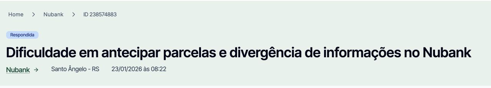
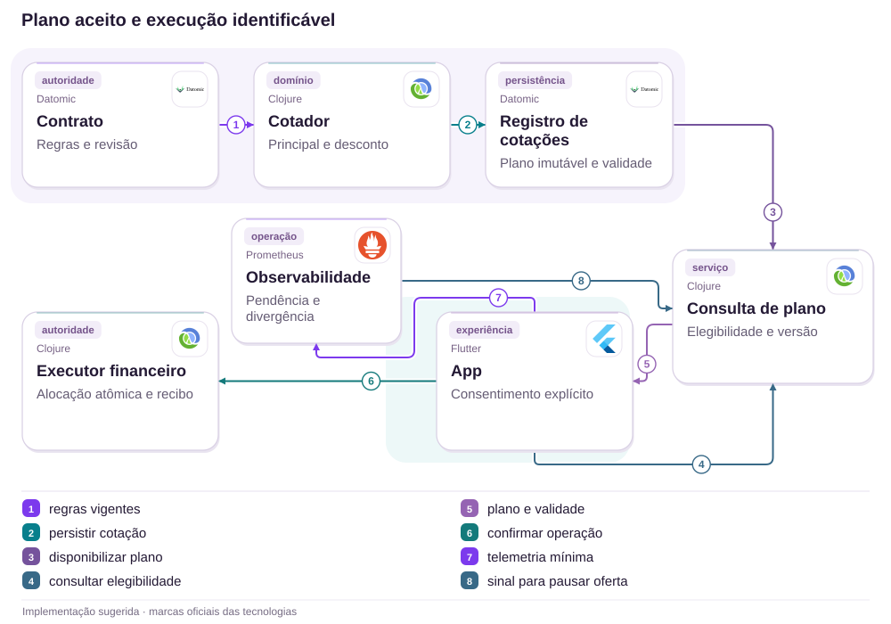

# 14 · Antecipação recebida, execução atrasada: tornar o plano verificável

Cotação, validade, alocação e desconto com um recibo único

[PT reader](https://wesleyvieira99.github.io/nu/#14-1) · [EN reader](https://wesleyvieira99.github.io/nu/en.html#14-1)

[Executable Python lab](../../labs/case_14.py)

## 14 · A empresa reconhece a execução tardia



Recorte real da fonte pública, capturado em 23/10/2026. O texto abaixo inclui resposta da empresa e desfecho relatado.

Na reclamação 238574883, de 23/01/2026, a cliente relata dificuldade para antecipar parcelas e orientações divergentes. O Nubank reconhece pagamento recebido e execução fora da data prevista; informa efetivação da parcela 23 em 02/02, com 13 restantes. Explica condições de pagamento e sustenta que o atendimento cumpriu seu prazo. O estado é Respondida, sem confirmação final da cliente.

**O que permanece desconhecido**

Não há valor, taxa, memória de cálculo ou causa técnica pública. A admissão é sobre execução fora da data; não autoriza concluir que todas as tentativas ou regras de insuficiência estavam erradas.

- [Reclame AQUI — caso 14 · 2026-01-23](https://www.reclameaqui.com.br/nubank/dificuldade-em-antecipar-parcelas-e-divergencia-de-informacoes-no-nubank_tFpS34o-ncejc1a3/)

## Receber não é efetivar a antecipação

Uma jornada de antecipação envolve oferta de desconto, escolha de parcelas, pagamento e aplicação financeira. Esses eventos podem ocorrer em momentos diferentes e responder a regras diferentes. O produto precisa tornar visível se existe apenas uma solicitação, uma cotação válida, dinheiro recebido ou uma obrigação realmente quitada. Sem essa distinção, um débito pode parecer conclusão de uma operação que ainda depende de alocação.

A hipótese é que uma cotação versionada, ligada ao recibo final e à fila de exceções, reduz operações recebidas sem efetivação compreensível. Eu reconstruiria uma amostra por quote_id e payment_id, comparando regra, validade, recebimento e aplicação. Não presumiria que o problema é somente de interface: divergência de cálculo ou execução deve ser tratada na autoridade financeira.

O laboratório propõe um pacote sintético atômico de fatura e antecipação. Isso não descreve a prioridade contratual atual do Nubank. A regra real de aplicação parcial, cancelamento e reversão de desconto precisa ser validada antes da implementação. O modelo serve para discutir a fronteira entre dinheiro recebido, consentimento sobre um plano e obrigação efetivamente liquidada.

## A cotação é um contrato com validade



Arquitetura externa proposta; não representa a implementação interna do Nubank.

O cotador utiliza regras e revisão do contrato para publicar um plano imutável. O aplicativo consulta validade e confirma uma operação identificada. O executor financeiro revalida e aplica dentro de sua autoridade, produzindo recibo próprio; a consulta não substitui essa decisão.

Observabilidade sinaliza pendências e divergências para a operação responsável, que pode pausar novas ofertas. O diagrama não concede ao monitor autoridade para editar saldo. Recebimento real, cálculo contratual e razão são integrações necessárias; o laboratório reduz esse conjunto a uma conta e valores sintéticos.

## Núcleo: revalidar antes de aplicar

```python
    def execute(self, ident, now, crash=False):
        with self.db:
            self.db.execute('BEGIN IMMEDIATE')
            row = self.db.execute('SELECT revision,bill,principal,discount,'
                'expires,received,executed FROM quotes WHERE id=?',
                (ident,)).fetchone()
            if not row:
                raise ValueError('unknown quote')
            revision, bill, principal, discount, expires, received, done = row
            needed = bill + principal - discount
            if done:
                return dict(applied=needed, unapplied=received - needed)
            current = self.db.execute('SELECT revision FROM contract').fetchone()[0]
            if now >= expires or revision != current:
                raise ValueError('expired or stale quote; funds remain unapplied')
            if received < needed:
                raise ValueError('full quoted amount not received')
            self.db.execute('UPDATE contract SET revision=revision+1,'
                            'settled=settled+?', (principal,))
            self.db.execute('UPDATE quotes SET executed=1 WHERE id=?', (ident,))
            if crash:
                raise RuntimeError('crash before commit')
        return dict(applied=needed, unapplied=received - needed)
```

Trecho literal de labs/case_14.py; execução transacional em centavos.

A cotação só é aplicada se revisão, validade e valor recebido forem compatíveis. Uma falha antes do commit reverte toda a execução. Depois de concluída, uma retentativa retorna o recibo original mesmo que o relógio já tenha ultrapassado a validade; ela não tenta executar uma nova antecipação.

Dinheiro recebido em cotação expirada ou insuficiente permanece registrado para resolução, sem sumir nem ser aplicado sob outro preço silenciosamente. O laboratório não implementa devolução automática. O relógio e os fatos de liquidação devem vir de fontes confiáveis do servidor, e o desconto fornecido precisa de cálculo contratual aprovado.

- [Laboratório executável do caso no GitHub](https://github.com/wesleyvieira99/nu/blob/main/labs/case_14.py)

## Cálculo puro não dispensa a transação

```clojure
(defn executable? [quote contract now received]
  (let [required (+ (:bill-cents quote)
                    (- (:principal-cents quote)
                       (:discount-cents quote)))]
    (and (= (:revision quote) (:revision contract))
         (< now (:expires-at quote))
         (>= received required))))

;; Run this check inside the same authority as financial application.
;; The clock, contract and settlement evidence are server-owned.
;; A completed operation returns its original receipt on retry.
```

Clojure ilustrativo, não executado; regras sintéticas para revisão do contrato.

A função expressa as condições de execução, mas avaliá-la fora da transação deixa uma janela para alteração do contrato. O serviço precisa comparar a revisão e aplicar a mudança na mesma autoridade. O valor necessário deve incluir todos os componentes aprovados, sem omitir a fatura corrente para tornar a oferta aparentemente mais barata.

Mudança material de preço ou plano exige nova confirmação. Revalidar não significa recalcular e debitar silenciosamente. O histórico conserva cotação aceita, motivo de cancelamento e recibo de aplicação. Uma implementação em Clojure pode manter o cálculo determinístico; integração financeira e publicação de eventos continuam responsáveis por atomicidade, durabilidade e reconciliação.

## Plano, recebimento e recibo separados

| Objeto | Identidade | Invariante |
| --- | --- | --- |
| Cotação | quote_id + revisão | Plano imutável e expiração |
| Recebimento | payment_id | Mesmo pagamento não soma duas vezes |
| Execução | quote_id | Aplicação única após validação |
| Exceção | Caso vinculado | Destino do valor sempre explícito |

```json
{
  "quote_id": "synthetic-quote-14",
  "contract_revision": 1,
  "currency": "BRL",
  "current_bill_cents": 5000,
  "principal_cents": 10000,
  "discount_cents": 1000,
  "required_cents": 14000,
  "received_cents": 14000,
  "execution_state": "pending",
  "expires_at": 100
}
```

Exemplo sintético: R$ 50 de fatura + R$ 100 de principal −R$ 10 de desconto = R$ 140.

O desconto não é uma economia do banco a ser maximizada: é parte da obrigação contratual com o cliente. A apresentação deve separar principal, encargos, desconto e total requerido. Identificadores permitem investigação sem expor contrato completo em logs. O responsável financeiro define retenção e compensações; atendimento recebe uma memória de cálculo acessível e uma próxima ação.

## Crash e validade atacam o plano

```python
    def test_received_is_not_executed_and_crash_rolls_back(self):
        self.r.receive('p', 'q', 14000)
        with self.assertRaises(RuntimeError):
            self.r.execute('q', 90, crash=True)
        self.assertEqual(self.r.db.execute('SELECT settled FROM contract')
                         .fetchone()[0], 0)
        self.r.db.close()
        self.r = Repayment(self.path)
        self.assertEqual(self.r.execute('q', 90)['applied'], 14000)
        self.assertEqual(self.r.execute('q', 200)['applied'], 14000)
        self.assertEqual(self.r.db.execute('SELECT settled FROM contract')
                         .fetchone()[0], 10000)
```

Teste literal; 9 testes passaram na suíte completa.

O teste recebe o valor e falha depois das escritas, antes do commit. A obrigação permanece não liquidada; após reinício, a execução conclui uma vez. A repetição posterior à validade retorna o mesmo resultado, demonstrando a diferença entre recuperar um recibo e aceitar uma cotação expirada.

Outros testes cobrem pagamento parcial, expiração, duplicação de recebimento, conflito, cotação tornada antiga por outra execução, excesso de um centavo e desconto inválido. Não há juros reais, débito automático externo ou devolução implementada. Uma suíte de integração deve validar os lançamentos contra contabilidade e exercitar compensação de operações que não puderem ser efetivadas.

## Medir o intervalo que o cliente não vê

| Métrica | Definição | Janela e corte |
| --- | --- | --- |
| Tempo de execução | p95 de recebido elegível até aplicado | Diária; modalidade |
| Pendente financiado | Operações com valor recebido sem execução / elegíveis | Diária; idade e motivo |
| Desconto divergente | Centavos diferentes do plano aprovado | Contínua; versão contratual |
| Cancelamento explicado | Casos com motivo e destino comunicados / cancelados | Semanal; canal |

As linhas de base são desconhecidas. Recebimento precisa de timestamp financeiro, não do toque no botão. Também é necessário distinguir cotação expirada antes do pagamento de execução atrasada depois de elegibilidade confirmada. Essa segmentação evita atribuir ao mesmo indicador comportamentos com causas e responsabilidades diferentes.

O piloto mantém cálculo contratual aprovado e compara acompanhamento antigo com plano/recibo explícitos. A expansão para execução nova exige validação financeira independente. Interromperia por dupla aplicação, desconto incorreto, dinheiro sem destino rastreável ou cancelamento comunicado de forma enganosa. Tempo menor não compensa um centavo aplicado ao contrato errado.

## Valor do retrabalho, não do desconto retirado

| Cenário assumido | Potencial/ano | Operação/ano | Ano 1 após custo |
| --- | --- | --- | --- |
| Conservador | R$ 14.400 | R$ 30.000 | R$ -165.600 |
| Base | R$ 67.200 | R$ 30.000 | R$ -112.800 |
| Ambicioso | R$ 192.000 | R$ 30.000 | R$ 12.000 |

Hipóteses anuais: 30 mil, 70 mil ou 120 mil antecipações elegíveis; redução absoluta de incidentes em 0,3%, 0,6% ou 1%. Assumo R$ 140 de retrabalho e R$ 20 de suporte incremental por incidente, total R$ 160. Isso corresponde a 90, 420 ou 1.200 ocorrências evitadas. Implementação: R$ 150 mil; operação: R$ 30 mil/ano, ambas assumidas.

No cenário base, 420 × 160 = R$ 67.200. O primeiro ano resulta em R$ 67.200 − 30.000 − 150.000 = −R$ 112.800. O equilíbrio exige 187.500 antecipações equivalentes à hipótese base. O cenário ambicioso resulta em R$ 12.000 líquidos modelados, mas sua incidência e seu efeito precisam ser medidos. O plano deve começar pequeno se não houver evidência de escala suficiente.

**Fronteiras da conta**

Não calcular perda a partir das quantidades de parcelas do relato. Desconto contratual correto não é custo evitável. Excluir ocorrências e contatos já contabilizados no caso 09; não somar capacidade liberada como se fosse caixa garantido.

## Roadmap com contabilidade no início

| Fase proposta | Dono e entrega | Gate |
| --- | --- | --- |
| 0–15 dias | Crédito + contabilidade: regras | Exemplos de cálculo aprovados |
| 16–30 dias | Staff: cotação e execução | Validade e revisão atômicas |
| 31–60 dias | Operações: sombra e reconciliação | Recebido tem destino verificável |
| 61–90 dias | EM + produto: piloto limitado | Desconto correto e recontato menor |

O horizonte de 90 dias é uma proposta. A dependência crítica é concordância sobre regra contratual, arredondamento e prioridade de aplicação. Não cabe à equipe móvel inferir essas condições de textos de atendimento. Exemplos aprovados precisam incluir insuficiência, vencimento, pagamento excedente e mudança de contrato entre oferta e execução.

O EM reúne financiamento, fatura, débito automático, suporte e contabilidade em uma entrega única. O Staff define as fronteiras técnicas e a estratégia de compensação. Cada fase termina com evidência de que o estado comunicado corresponde ao financeiro. Se o cálculo não estiver validado, a próxima etapa é resolver essa lacuna, não acelerar o rollout.

## Operação de uma cotação que não concluiu

O canário começa com cotação e recibo em sombra, comparados com a fonte financeira. A equipe acompanha uma fila de operações recebidas sem execução, segmentada por validade, insuficiência e revisão antiga. Cada categoria tem responsável e próxima ação; o status genérico de processamento não substitui um plano de resolução.

Alertas cobrem idade, valor e divergência de desconto. Crédito responde pela regra; plataforma financeira pela aplicação; operações pela resolução; produto pela comunicação. O runbook não permite reaplicar um pagamento sob outro plano sem autorização. Caso seja necessária devolução ou compensação, ela mantém vínculo com recebimento e cotação originais.

Rollback pausa novas ofertas ou a nova experiência, preservando recibos e valores já recebidos. Exercícios incluem crash após commit, cotação vencida durante pagamento, débito automático concorrente e resposta antiga. A recuperação começa pela autoridade financeira, não pela tela. Toda pendência deve terminar em aplicação válida ou destino aprovado e rastreável para o dinheiro.

## Minha contribuição: tornar a promessa executável

Como Staff, eu definiria o que significa aceitar uma cotação e qual autoridade garante sua execução. Separaria cálculo puro, consentimento, recebimento e aplicação, com identidade e revisão em cada fronteira. Eu rejeitaria uma correção que apenas altere o status visual quando a operação financeira ainda não foi efetivada.

Como Engineering Manager, eu coordenaria os times que compartilham essa jornada e tornaria as dependências visíveis no plano. Atendimento precisa de acesso ao plano aceito e ao motivo da exceção; contabilidade precisa de lançamentos reconciliáveis; mobile precisa de uma semântica estável para explicar. A entrega só termina quando esses três lados funcionam juntos.

O tradeoff central é validade da oferta versus fricção. Manter uma cotação indefinidamente pode comprometer a regra financeira; expirar sem explicar pode frustrar o cliente. Eu escolheria revalidação transparente, com novo consentimento quando houver mudança material. O custo e a oportunidade seriam reavaliados no piloto, sem alegar ganhos ou autoridade que não possuo.

## Handoff: dinheiro recebido tem um destino

- Executar python3 labs/case_14.py; 9 testes locais e valores sintéticos.
- Revisar quote, receive e execute; observar recebimento separado da efetivação.
- Injetar crash antes do commit, reabrir banco e repetir; principal só pode ser liquidado uma vez.
- Antes de produção: preço contratual, relógio confiável, autorização, liquidação, razão e devolução controlada.

O revisor deve verificar tanto o caminho feliz quanto a operação que não pode concluir. O laboratório conserva dinheiro recebido em uma pendência explícita; não promete que isso seja suficiente para uma experiência real. A resolução exige política, prazo validado e comunicação, além da transação.

Avançar somente quando plano, execução e recibo conciliam, o cliente entende o total necessário e a operação sabe tratar expiração e insuficiência. Se não houver base para automatizar, manter assistência humana com rastreabilidade. O resultado desejado é uma promessa financeira que pode ser explicada e cumprida, e uma exceção que não desaparece entre equipes.

- [Laboratório executável do caso no GitHub](https://github.com/wesleyvieira99/nu/blob/main/labs/case_14.py)
