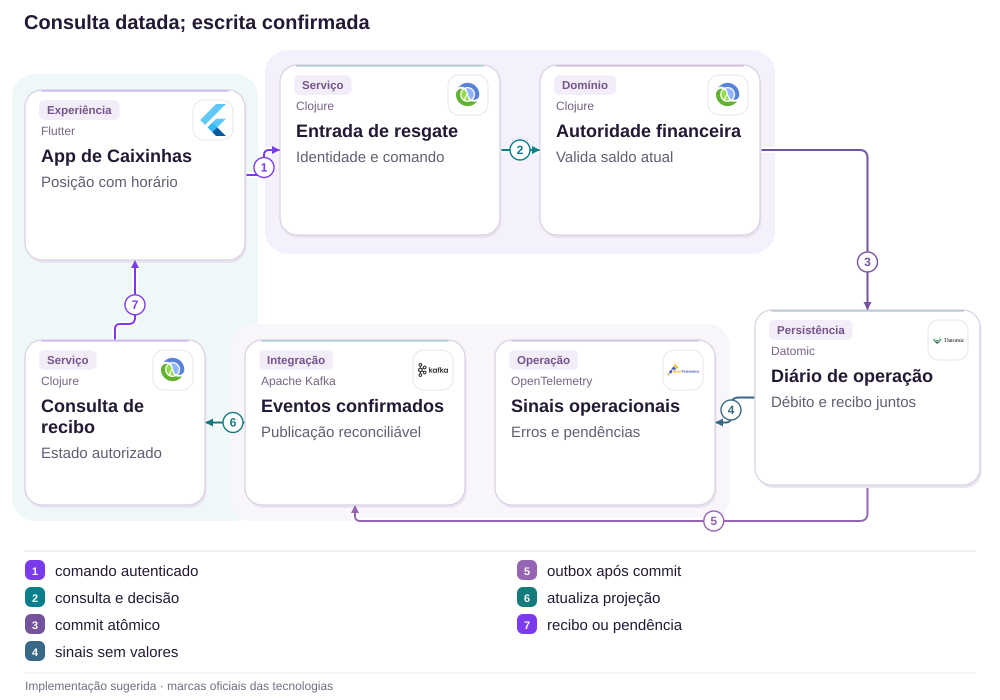

# 15 · Caixinhas: dinheiro visível, resgate confiável

Resiliência · Autoridade financeira

[PT reader](https://wesleyvieira99.github.io/nu/#15-1) · [EN reader](https://wesleyvieira99.github.io/nu/en.html#15-1)

[Executable Python lab](../../labs/case_15.py)

## O incidente e o desfecho


Recorte real da fonte pública, capturado em 23/10/2026. O texto abaixo inclui resposta da empresa e desfecho relatado.

Em 28/04/2026, o relato 247218209 descreveu Caixinhas ausentes e resgate indisponível, sem previsão útil no atendimento. Na resposta de 30/04, o Nubank reconheceu oscilação temporária para alguns clientes, declarou os ativos protegidos e informou resgate concluído na conta em 28/04 às 20:46:01. O status público é Respondida, sem avaliação final do consumidor. Não há valor divulgado, duração individual comprovada ou evidência de perda patrimonial.

A pergunta de engenharia é como preservar orientação confiável durante uma dependência degradada. A reportagem do Olhar Digital reproduziu uma tela incompleta nesse episódio e informou recuperação; isso não identifica a causa interna nem quantifica clientes afetados. A solução abaixo é minha proposta de projeto, não uma reconstrução do incidente.

- [Reclame AQUI · 247218209](https://www.reclameaqui.com.br/nubank/indisponibilidade-de-resgate-de-dinheiro-em-caixinhas-e-falta-de-comunicacao-do-banco_Nc3yoYhKbC1BpbqL/)
- [Olhar Digital · 28/04/2026](https://olhardigital.com.br/2026/04/28/internet-e-redes-sociais/nubank-app-enfrenta-instabilidades-nesta-terca-feira-28/)

## Ler saldo não é autorizar resgate

Eu separaria três perguntas que a tela costuma condensar: o investimento existe, qual posição foi verificada por último e é possível executar um resgate agora? A falha de uma consulta não responde negativamente às outras duas. Mostrar zero porque a posição não carregou confunde indisponibilidade com patrimônio; permitir saque sobre informação antiga cria outro risco. O estado degradado precisa explicar a diferença sem expor detalhes internos.

Minha hipótese falsificável é que uma leitura auxiliar poderia continuar oferecendo posição datada quando a autoridade de resgate está indisponível. Eu procuraria contratos existentes, dependências comuns, orçamento de latência e histórico de falhas correlacionadas. Se leitura e escrita compartilham a mesma indisponibilidade inevitável, cache isolado pode ajudar orientação, mas não restaura liquidez. Essa diferença determina o investimento e precisa aparecer na revisão de produto.

A investigação começaria com tentativas sintéticas e rastros autorizados: consulta iniciada, resposta desconhecida, comando aceito e recibo confirmado. Não pediria extratos de clientes para reproduzir o problema. A jornada termina quando a pessoa recebe confirmação financeira ou uma explicação honesta de indisponibilidade, com caminho de acompanhamento e próxima atualização.

## O recibo fecha o ciclo



Arquitetura externa proposta; tecnologias ilustram escolhas, não sistemas internos confirmados.

Somente a autoridade financeira pode comprometer o débito. O diário precisa persistir resultado e identidade do comando na mesma transação. A outbox proposta divulga fatos já confirmados; se o transporte parar, o cliente consulta o recibo por caminho autorizado. Observabilidade recebe sinais reduzidos, sem valores ou identificadores de conta nas etiquetas.

A posição datada da interface permanece consultiva e não atravessa essa fronteira como autorização. O laboratório representa apenas o compromisso local e a repetição do recibo. Custódia, liquidação, indisponibilidade parcial e autorização entre serviços ainda exigem contratos próprios e testes distribuídos.

## Uma tentativa, um compromisso

```python
    def withdraw(self, actor, key, cents, snapshot, now, ledger_online=True):
        with self.lock:
            for value in (actor, key, snapshot.owner):
                identifier(value)
            if type(now) is not int or now < 0:
                raise ValueError('invalid clock')
            if actor != self.owner or snapshot.owner != actor:
                raise PermissionError('account scope')
            if not key or type(cents) is not int or cents <= 0:
                raise ValueError('invalid command')
            command = (actor, cents)
            if key in self.receipts:
                prior_command, receipt = self.receipts[key]
                if prior_command != command:
                    raise ValueError('idempotency conflict')
                return receipt
            if not ledger_online:
                raise RuntimeError('authority unavailable')
            if not 0 <= now - snapshot.observed_at <= 30:
                raise ValueError('snapshot expired')
            if snapshot.version != self.version:
                raise ValueError('refresh required')
            if cents > self.balance:
                raise ValueError('insufficient funds')
            self.balance -= cents
            self.version += 1
            receipt = (key, cents, self.version)
            self.receipts[key] = (command, receipt)
            return receipt
```

Trecho literal do laboratório executado; imports e inicialização no arquivo completo.

A operação exige titular compatível, valor inteiro positivo e snapshot recente da mesma versão. O relógio de 30 segundos é uma hipótese didática, não um prazo do Nubank. O saldo consultivo não substitui a autoridade: com ledger indisponível, nenhum débito acontece. Depois de um sucesso, repetir a mesma chave recupera o recibo mesmo se o snapshot expirou; isso evita transformar uma resposta perdida em segundo saque.

A trava cobre um processo. Em produção, eu substituiria esse trecho por transação condicional na autoridade durável, preservando a mesma semântica observável. O aplicativo não cria snapshots confiáveis; o objeto do teste representa uma leitura emitida pelo serviço. Um recibo também exige controle de acesso antes da deduplicação.

- [Laboratório executável do caso no GitHub](https://github.com/wesleyvieira99/nu/blob/main/labs/case_15.py)

## Dart para um estado compreensível

```dart
enum WithdrawalState { loading, datedPosition, unavailable, confirmed }

String guidance(WithdrawalState state, String observedAt) {
  return switch (state) {
    WithdrawalState.loading => 'Loading current position',
    WithdrawalState.datedPosition => 'Last verified: $observedAt',
    WithdrawalState.unavailable => 'Withdrawal unavailable; track status',
    WithdrawalState.confirmed => 'Withdrawal confirmed; view receipt',
  };
}

bool mayRequestFreshAuthorization(WithdrawalState state) =>
    state == WithdrawalState.datedPosition;
```

Exemplo Dart ilustrativo, não executado; texto de demonstração requer localização.

A interface pode oferecer nova tentativa de autorização sem afirmar que o resgate está disponível. Eu apresentaria valor verificado, horário e indisponibilidade como informações separadas; leitores de tela receberiam a mesma distinção. O estado confirmado nasce do recibo, não de uma animação concluída. Texto e cor devem reforçar o significado, nunca carregar sozinhos a explicação.

O serviço Clojure proposto mantém a decisão, enquanto Flutter apresenta o contrato. Eu avaliaria os componentes já disponíveis antes de introduzir qualquer tecnologia. A implantação começa pelo estado desconhecido e pelo recibo consultável, porque uma nova tela sem contrato financeiro consistente apenas desloca a confusão para outro ponto da jornada.

## Identidades que sobrevivem ao retry

| Campo | Regra | Dono |
| --- | --- | --- |
| operation_id | Único por intenção | Serviço financeiro |
| position_version | Monótono por posição | Custódia |
| observed_at | Instante verificável | Fonte da leitura |
| receipt_id | Somente após commit | Ledger |

```json
{
  "schema": "withdrawal-status.v1",
  "operation_id": "synthetic-operation",
  "state": "UNKNOWN",
  "position_version": 42,
  "observed_at": "2026-01-01T12:00:00Z",
  "receipt_id": null,
  "next_action": "QUERY_RECEIPT"
}
```

Contrato proposto, dados sintéticos; schema não executado.

UNKNOWN não é recusa nem confirmação. O consumidor pode consultar o mesmo identificador sem criar intenção financeira nova. Uma mudança de quantia exige outra chave; reutilizar a anterior deve falhar de maneira explícita. Eu definiria retenção do recibo de acordo com as obrigações existentes, e prazo de cache muito menor, evitando apagar evidência durável quando uma projeção expira.

O titular é resolvido pela identidade autenticada, não enviado como autoridade no JSON. Logs guardam referência opaca, classe do erro e versão. A conciliação compara comandos comprometidos e eventos publicados, com permissão restrita para investigar divergências e sem copiar saldos para painéis de operação.

## Falhas que não podem virar débito

```python
    def test_cache_does_not_authorize(self):
        with self.assertRaises(RuntimeError):
            self.w.withdraw(self.s.owner, 'a', 1000, self.s, 101, False)
        self.assertEqual(self.w.balance, 10_000)
        self.assertEqual(self.w.receipts, {})

    def test_retry_after_commit_returns_receipt(self):
        first = self.w.withdraw(self.s.owner, 'a', 1000, self.s, 101)
        retry = self.w.withdraw(self.s.owner, 'a', 1000, self.s, 900, False)
        self.assertEqual(first, retry)
        self.assertEqual(self.w.balance, 9000)

    def test_parallel_commands_cannot_spend_same_version(self):
        def attempt(key):
            try:
                return self.w.withdraw(self.s.owner, key, 7000, self.s, 101)
            except ValueError:
                return None
        with ThreadPoolExecutor(max_workers=2) as pool:
            results = list(pool.map(attempt, ['a', 'b']))
        self.assertEqual(sum(x is not None for x in results), 1)
        self.assertEqual(self.w.balance, 3000)
```

Trecho literal dos testes; 13 testes do laboratório passaram localmente.

Os treze testes passaram localmente. Além dos trechos, a suíte cobre titular errado, chave conflitante, tempo futuro, limite exato de validade, insuficiência e tipos monetários inválidos. A corrida usa duas intenções contra a mesma versão; somente uma pode comprometer fundos. O teste de repetição distingue operação já concluída de nova solicitação durante indisponibilidade.

Eu acrescentaria no ambiente integrado uma queda após o commit e antes da resposta, atraso na outbox e recuperação de réplica. O critério seria uma única movimentação e um recibo recuperável. Esta suíte não mede disponibilidade, latência de rede ou capacidade de custódia, e uma execução verde não autoriza dinheiro real.

## Métricas com estado desconhecido

O baseline de negócio é desconhecido. Eu mediria conclusão confirmada: recibos em até 60 segundos divididos por intenções válidas, diariamente, segmentados por versão do app e produto. A janela de 60 segundos é proposta para discussão, não SLA publicado. Uma intenção sem recibo permanece desconhecida até conciliação e aparece separadamente, impedindo que desapareça do denominador.

A segunda métrica é orientação útil: tentativas degradadas com posição datada e próximo passo sobre tentativas degradadas, por hora. A terceira é contato repetido em 24 horas por intenção afetada, com vínculo pseudonimizado e retenção limitada. A quarta é conflito de recibos por comando comprometido; qualquer divergência financeira confirmada interrompe o piloto. Traces amostrados explicam falhas, sem etiquetas de alta cardinalidade.

O experimento compara jornadas equivalentes durante falhas simuladas e depois uma coorte pequena, sem fabricar indisponibilidade financeira. A meta inicial proposta é reduzir contato sem aumentar desconhecidos ou atrasar confirmação. Se a mensagem diminuir contatos por desistência ou impedir acesso assistido, o resultado não conta como sucesso.

## Valor sem transformar saldo em receita

O caso público não informa montante. A avaliação financeira proposta considera capacidade de atendimento, não o patrimônio em Caixinhas. Assumo, exclusivamente para planejamento, 20.000 intenções afetadas por mês, oito minutos por contato evitado, R$ 60 por hora carregada, R$ 5.000 mensais de operação e R$ 120.000 de implementação. Nenhum desses insumos é dado do Nubank.

| Cenário assumido | Queda absoluta | Horas/mês | Valor líquido/mês |
| --- | --- | --- | --- |
| Conservador | 2 p.p. | 53,33 | −R$ 1.800 |
| Base | 5 p.p. | 133,33 | R$ 3.000 |
| Ambicioso | 10 p.p. | 266,67 | R$ 11.000 |

Fórmula mensal: intenções × redução absoluta de contato × minutos ÷ 60 × custo horário, menos operação. O equilíbrio operacional exige 3,125 pontos percentuais de redução, equivalentes a 625 contatos evitados. Recuperar a implementação exigiria 40 meses no cenário base e 10,91 no ambicioso, somente se a capacidade liberada se converter integralmente em caixa; no conservador não há retorno com essas premissas.

Finanças precisaria validar custo marginal, sazonalidade e destino das horas. Capacidade reaproveitada pode melhorar atendimento sem reduzir despesa. Eu não somaria esse benefício ao de outros casos de suporte sem eliminar contatos sobrepostos, e não estimaria perda patrimonial ou receita recuperada a partir da reclamação.

## Plano de 90 dias com saídas verificáveis

Dias 0–15: o Staff responsável por Investimentos mapeia a autoridade de resgate com Custódia e SRE; Produto define as mensagens para posição antiga e resultado desconhecido. A entrega é um contrato com exemplos de falha e classificação de dados. A saída exige consenso sobre quem pode declarar conclusão, incluindo dependências externas e estados sem previsão confiável.

Dias 16–30: backend implementa consulta idempotente e diário em ambiente de teste, enquanto Mobile valida leitura assistida e repetição segura. QA injeta perda de resposta após compromisso. Dias 31–60: SRE executa sombra de estados e reconciliação; a expansão exige ausência de divergência no conjunto conhecido, telemetria completa e documentação de atendimento revisada.

Dias 61–90: o Engineering Manager coordena piloto por jornada, revisão de custos e treinamento. Investimentos aceita integridade; Produto aceita compreensão; SRE aceita recuperação. Os 90 dias são horizonte proposto, condicionado aos contratos existentes. Ausência de autoridade transacional confiável bloqueia a escrita do piloto, mesmo que a experiência visual esteja pronta.

## Operar quando a dependência cai

Eu começaria em sombra, calculando o estado que seria mostrado sem modificar a autorização financeira. A primeira coorte recebe apenas consulta e explicação; a escrita avança quando a recuperação do recibo foi exercitada. A chave de desligamento pode retirar a nova apresentação, mas nunca apagar operações comprometidas nem transformar recibos em erro genérico.

O plantão de Investimentos responde a diferença entre diário e posição; SRE responde a indisponibilidade e atraso de publicação; Atendimento recebe um estado legível e a próxima atualização acordada. Um exercício derruba a projeção mantendo a autoridade, outro derruba a autoridade mantendo a leitura. Ambos precisam preservar a distinção entre posição conhecida e capacidade atual de resgatar.

Eu interromperia expansão se surgisse recibo incompatível, posição de outro titular ou aumento de tentativas desconhecidas além do limite acordado após baseline. A reconciliação trata cada operação pendente com dono e prazo. Não usaria anúncio de serviço normalizado como substituto da confirmação individual de que um comando foi concluído.

## Minha contribuição: confiança sob falha

Como Staff, eu escreveria a decisão sobre autoridade, freshness e idempotência antes de escolher mecanismos. Reuniria a equipe para comparar três alternativas: somente mensagem global de incidente, cache consultivo com recibo e fila de resgates para execução posterior. Minha preferência inicial seria a segunda, porque melhora orientação mantendo a autorização próxima do estado atual. Uma fila muda a expectativa temporal e exige consentimento específico; não entraria silenciosamente no escopo.

Como Engineering Manager, eu negociaria capacidade entre Mobile, Investimentos, SRE e Atendimento, evitando que cada time entregue um estado diferente. A revisão semanal examinaria operações desconhecidas, dependências bloqueadas e aprendizado de testes, com decisões registradas e responsáveis explícitos. O trabalho que proponho é reduzir ambiguidade entre equipes, não prometer disponibilidade perfeita.

Eu apresentaria ao comitê um teste reproduzível, uma limitação conhecida e uma hipótese econômica por vez. Esta proposta demonstra meu método de decisão e coordenação; não atribui a mim participação no incidente nem conhecimento privilegiado da arquitetura do Nubank.

## Handoff: do laboratório à decisão

Execute python3 labs/case_15.py -v. Comece em Withdrawals.withdraw e siga snapshot, receipts e a verificação de titular. Troque o serviço disponível por indisponível e observe que o saldo não muda; depois repita uma operação concluída com o relógio avançado e verifique que o recibo continua idêntico. Esses passos tornam a principal fronteira auditável em poucos minutos.

O checklist de aceite inclui: nenhum débito sem autoridade atual; nenhuma dupla execução por retry; nenhuma leitura de recibo entre titulares; posição antiga identificada; resultado desconhecido acompanhável; e conciliação de publicação atrasada. A integração ainda precisa autenticação real, persistência transacional, políticas de custódia e liquidação, relógios confiáveis, migração e testes de desastre.

Eu recomendaria avançar apenas para protótipo integrado se o dono da autoridade aceitar esse contrato e os testes de falha forem reproduzíveis. Se a consulta datada induzir pessoas a acreditar que o saque está garantido, o desenho de comunicação volta à pesquisa. A qualidade da entrega inclui saber interromper uma melhoria aparente que cria interpretação financeira incorreta.

- [Laboratório executável do caso no GitHub](https://github.com/wesleyvieira99/nu/blob/main/labs/case_15.py)
