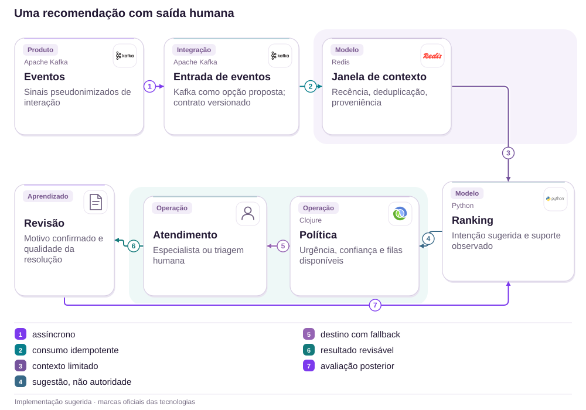

# 16 · Portabilidade: elegível não significa vencido

Campanhas · Explicabilidade · Custódia

[PT reader](https://wesleyvieira99.github.io/nu/#16-1) · [EN reader](https://wesleyvieira99.github.io/nu/en.html#16-1)

[Executable Python lab](../../labs/case_16.py)

## Uma resposta contraditória, um calendário


Recorte real da fonte pública, capturado em 23/10/2026. O texto abaixo inclui resposta da empresa e desfecho relatado.

Relato 250210183, de 01/06/2026: uma cliente Nu+ afirmou ter portado investimentos e recebido no chat a informação de inelegibilidade, sem justificativa. Em 09/06, o Nubank confirmou a portabilidade de Tesouro Direto e a elegibilidade, explicando dez parcelas a partir de junho. Status: Respondida, sem confirmação pública do primeiro crédito. A reclamação antecede o primeiro vencimento previsto, 10/06; portanto, não comprova cashback atrasado.

O regulamento consultado define janela, valor líquido e condições de manutenção. A oportunidade é dar a cliente e atendimento a mesma explicação temporal e versionada. Não conhecemos o valor individual transferido nem o registro original consultado pelo agente; a proposta não atribui o desacordo a um motor específico.

- [Reclame AQUI · 250210183](https://www.reclameaqui.com.br/nubank/campanha-de-portabilidade-enganosa-ou-cometeram-um-erro-na-minha-conta_2DQdhvJ76VJIOMDb/)
- [Regulamento oficial da campanha](https://cdn.nubank.com.br/investments/portability/regulamento-campanha-cvm210.pdf)

## Três perguntas antes de declarar erro

Eu distinguiria elegibilidade, vencimento e pagamento realizado. Uma pessoa pode estar elegível em junho, ter uma parcela ainda não vencida e não possuir crédito lançado. Se esses estados viram uma única flag, atendimento tende a interpretar ausência de crédito como exclusão da campanha. A hipótese a testar é inconsistência de significado entre canais, sem presumir que o cálculo financeiro estava errado.

A investigação seguiria um exemplo sintético desde a conclusão da custódia até o benefício. Precisaria saber qual data conta para a campanha, como saídas reduzem entradas e qual revisão do regulamento foi aceita. Uma transferência solicitada no prazo e concluída depois pode exigir resposta diferente; o sistema deve mostrar o evento considerado e uma rota de revisão, sem expor posições de terceiros.

Eu entrevistaria Operações de Investimentos e Atendimento sobre exceções antes de modelar automação. O objetivo não é transformar toda reclamação em crédito, mas oferecer uma decisão contestável com fatos reproduzíveis. Divergência entre canais deve abrir análise da mesma evidência, em vez de começar uma nova conversa sem contexto.

## Uma projeção explicável de benefício



Arquitetura externa proposta; tecnologias ilustram escolhas, não sistemas internos confirmados.

A origem informa fatos de custódia; o decisor aplica uma revisão da campanha; a agenda separa vencimento de pagamento. O executor só produz crédito com autorização e condições atuais. A conciliação retorna divergências para revisão do plano, sem alterar retroativamente um recibo já emitido. App e atendimento consultariam a mesma projeção, omitidos do desenho para manter visível o fluxo principal.

Kafka e Datomic são escolhas ilustrativas. Uma implementação existente pode resolver essas responsabilidades com outros componentes. O laboratório representa apenas regras Nu+ simplificadas, e não cobre todos os ativos, exceções ou critérios reais de manutenção.

## Calendário antes da cobrança

```python
    def schedule(self, actor, active_subscription):
        with self.lock:
            identifier(actor)
            if actor != self.owner:
                raise PermissionError('account scope')
            if active_subscription is not True:
                return {'state': 'INELIGIBLE', 'total_cents': 0, 'dues': ()}
            net = sum(e.signed_cents for e in self.events.values()
                      if date(2026, 3, 1) <= e.settled <= date(2026, 5, 29))
            total = min(max(net, 0) // 3_000_000 * 18_000, 180_000)
            dues = tuple(date(2026 + (5 + i) // 12, (5 + i) % 12 + 1, 10)
                         for i in range(10)) if total else ()
            return {'state': 'ELIGIBLE' if total else 'BELOW_THRESHOLD',
                    'total_cents': total, 'dues': dues}
    def pay(self, actor, installment, today, balance_maintained=True,
            active_subscription=True):
        with self.lock:
            plan = self.schedule(actor, active_subscription)
            if type(installment) is not int or not 0 <= installment < 10:
                raise ValueError('installment range')
            if installment in self.paid:
                return self.paid[installment]
            if type(today) is not date or not plan['dues']:
                raise ValueError('date or eligibility invalid')
            if today < plan['dues'][installment]:
                raise ValueError('not due')
            if balance_maintained is not True:
                raise ValueError('maintenance review required')
            if self.frozen_total not in (None, plan['total_cents']):
                raise ValueError('plan changed; reconcile')
            self.frozen_total = plan['total_cents']
            self.paid[installment] = self.frozen_total // 10
            return self.paid[installment]
```

Trecho literal do laboratório executado; imports e inicialização no arquivo completo.

O cálculo usa centavos inteiros, entradas líquidas concluídas dentro da janela e dez datas de vencimento. O exemplo Nu+ aplica R$ 180 por bloco de R$ 30.000, limitado a R$ 1.800, conforme o regulamento consultado. O valor individual do relato permanece desconhecido. Nenhum pagamento é permitido antes do vencimento ou sem as verificações explícitas de assinatura e manutenção.

Após o primeiro crédito, mudança no total calculado bloqueia parcela nova e exige conciliação. Repetir a mesma parcela retorna o recibo anterior, sem criar efeito adicional. O modelo não implementa correções retroativas nem suspensão proporcional de benefício: essas políticas precisam ser acordadas antes de substituir o bloqueio conservador.

- [Regulamento oficial](https://cdn.nubank.com.br/investments/portability/regulamento-campanha-cvm210.pdf)
- [Laboratório executável do caso no GitHub](https://github.com/wesleyvieira99/nu/blob/main/labs/case_16.py)

## Uma explicação comum aos canais

```clojure
(defn explain-installment [{:keys [eligible due paid today]}]
  (cond
    paid {:state :paid :next-action :view-receipt}
    (not eligible) {:state :review :next-action :view-reasons}
    (.isBefore today due)
    {:state :scheduled :next-action :view-calendar :due due}
    :else {:state :due :next-action :track-payment}))

;; Inputs come from authorized, versioned domain services.
;; This function explains; it never posts a financial credit.
```

Clojure ilustrativo não executado; não é o motor de regras do Nubank.

A explicação precisa mostrar o motivo e a próxima ação, não apenas uma cor verde ou vermelha. Antes do vencimento, o calendário responde à ausência de crédito. Após o vencimento, a falta de recibo passa para acompanhamento. Quando a elegibilidade é contestada, a revisão deve receber os eventos e a regra usados, sem pedir que a pessoa reconte a história.

Eu implantaria essa função na camada de apresentação de domínio, consumida por app e console autorizado de atendimento. A autoridade financeira continuaria separada. Textos seriam localizados e testados com cenários de ainda não vencido, abaixo do mínimo e em revisão. A interface não deve inferir fraude, descumprimento ou erro do cliente a partir de dado incompleto.

## Regra, evento e parcela identificáveis

| Registro | Identidade | Proteção |
| --- | --- | --- |
| Custódia | event_id + titular | Origem autenticada |
| Decisão | rule_version + cutoff | Reprodução histórica |
| Parcela | campanha + conta + índice | Crédito único |
| Revisão | decision_id + motivo | Acesso restrito |

```json
{
  "schema": "campaign-decision.v1",
  "rule_version": "nuplus-demo-v1",
  "eligibility": "ELIGIBLE",
  "installment": 0,
  "due_date": "2026-06-10",
  "payment_state": "NOT_YET_DUE",
  "receipt_id": null
}
```

Contrato proposto; fixture sintética, não resposta de API real.

Cada decisão registra a data de corte dos fatos. Eventos atrasados não são silenciosamente retrodatados sobre parcelas pagas; geram uma revisão identificada, com análise do impacto. A manutenção do investimento é uma condição separada da assinatura. O responsável pela campanha define a regra e Operações valida a evidência de custódia; engenharia assegura execução reprodutível.

O regulamento disponível hoje pode diferir de uma comunicação histórica. Eu arquivaria a revisão efetivamente aplicável e seu hash, com acesso jurídico apropriado. Este capítulo restringe o exemplo ao Nu+, evitando misturar os números Ultravioleta divergentes entre a resposta e versões públicas do material.

## Testar a data, não só a soma

```python
    def test_complaint_date_is_before_first_due_date(self):
        plan = self.c.schedule('owner', True)
        self.assertEqual(plan['state'], 'ELIGIBLE')
        self.assertEqual(plan['dues'][0], date(2026, 6, 10))
        with self.assertRaises(ValueError):
            self.c.pay('owner', 0, date(2026, 6, 1))
        self.assertEqual(self.c.paid, {})

    def test_outflow_changes_net_eligibility(self):
        out = Transfer('out', 'owner', date(2026, 5, 29), -1)
        self.c.record(out, 'custody')
        self.assertEqual(self.c.schedule('owner', True)['total_cents'], 0)

    def test_concurrent_payment_is_once_per_installment(self):
        def pay(_):
            return self.c.pay('owner', 0, date(2026, 6, 10))
        with ThreadPoolExecutor(max_workers=4) as pool:
            results = list(pool.map(pay, range(20)))
        self.assertEqual(set(results), {1800})
        self.assertEqual(sum(self.c.paid.values()), 1800)
```

Trecho literal dos testes; 15 testes do laboratório passaram localmente.

A suíte executada também testa origem de custódia, identidade conflitante, janela, teto, saldo líquido negativo, assinatura inativa e manutenção. O primeiro dia da reclamação não autoriza a primeira parcela. A leitura e a inclusão de eventos compartilham a trava; um teste concorrente exercita o contrato. Uma alteração tardia após o primeiro crédito exige revisão do plano, em vez de recalcular pagamentos silenciosamente.

O laboratório não demonstra aderência integral ao regulamento nem verifica elegibilidade real de qualquer pessoa. No ambiente integrado, eu testaria replay de custódia, alterações de assinatura próximas ao vencimento e perda de resposta do executor. Finanças e Investimentos precisam aprovar fixtures de exceção antes de a suíte funcionar como gate de entrega.

## Concordância e pontualidade observáveis

Todos os baselines são desconhecidos. A métrica principal seria concordância entre canais: consultas simultâneas com a mesma decisão e versão divididas por pares comparáveis, diariamente e por campanha. Outra seria explicação completa: decisões com motivo, regra e próxima ação sobre decisões servidas. A coleta ocorre no domínio, sem registrar posições financeiras no analytics do app.

Pontualidade exige parcelas elegíveis vencidas como denominador: créditos conciliados até a janela operacional acordada divididos por essas parcelas, por vencimento. Recontato em sete dias por decisão contestada mede esforço, segmentado por motivo. Pagamento duplicado por parcela é a barreira financeira: qualquer ocorrência comprovada pausa expansão e abre reconciliação, mesmo que a concordância de telas esteja excelente.

Eu proporia primeiro um teste de compreensão com datas sintéticas e uma sombra entre canais. O objetivo inicial seria eliminar contradições explicáveis por calendário, não aumentar elegibilidade. A decisão de expandir depende de conciliação financeira e de uma amostra suficiente de casos contestados; ausência de reclamação não prova entendimento.

## Benefício prometido é obrigação, não ganho

Os R$ 180 por R$ 30.000 descrevem uma regra pública Nu+, não o benefício individual deste relato nem receita bancária. Para avaliar a proposta, assumo 12.000 participantes por mês, 1,5 contatos repetidos evitados por contestação removida, custo carregado de R$ 18 por contato, operação de R$ 4.000 mensais e implementação de R$ 90.000. Todos são insumos hipotéticos.

| Cenário | Queda absoluta | Contatos evitados | Valor líquido/mês |
| --- | --- | --- | --- |
| Conservador | 1 p.p. | 180 | −R$ 760 |
| Base | 3 p.p. | 540 | R$ 5.720 |
| Ambicioso | 6 p.p. | 1.080 | R$ 15.440 |

A fórmula é participantes × queda absoluta de contestação × contatos por caso × custo por contato, menos operação. O equilíbrio mensal exige reduzir 1,235 ponto percentual de contestação. Se todo o valor de capacidade virasse caixa, a implementação retornaria em 15,73 meses no cenário base e 5,83 no ambicioso; não há retorno no conservador. Uma campanha finita pode encerrar antes disso, o que exige avaliar reutilização sem contabilizá-la antecipadamente.

Eu não trataria bônus negado como economia nem volume portado como lucro. A decisão depende de custo marginal real, duração restante da campanha e possibilidade comprovada de reaproveitar o serviço em outras ofertas.

## Entregar uma decisão que possa ser revisada

Dias 0–15: Produto de Investimentos e o dono da campanha reúnem regulamento aplicável, exemplos limítrofes e calendário de pagamentos. Operações confirma a semântica da conclusão de custódia; Jurídico valida comunicação, sem delegar interpretação contratual ao código. A saída é uma matriz de cenários aprovada, incluindo pedido antes do vencimento e transferência concluída fora da janela.

Dias 16–30: backend publica decisão versionada em sandbox; Atendimento testa o mesmo resultado em seu console. Dias 31–60: o Staff acompanha sombra contra decisões existentes, classifica divergências e exige resolução antes de tocar pagamentos. O time de dados valida denominadores; Segurança revisa acesso a posições e documentos.

Dias 61–90: o EM coordena uma oferta limitada, primeiro na explicação e depois no executor, com aceite de Finanças por parcela conciliada. O horizonte é proposto, não compromisso do Nubank. Sem versão confiável do regulamento ou prova de custódia, a decisão segue em revisão humana; o prazo de projeto não justifica inferir elegibilidade.

## Mudança de regra sem reescrever o passado

A publicação de uma nova versão começa em sombra sobre fixtures e fatos autorizados. Diferenças são classificadas como correção, mudança de política ou dado tardio. O responsável pela campanha aprova a categoria; engenharia não reaplica uma regra nova a créditos anteriores por conveniência técnica. Um rollback retira o novo decisor, mas preserva decisões, recibos e casos abertos.

O plantão de Investimentos recebe discrepância de custódia, Finanças recebe parcela duplicada ou valor incompatível, e Atendimento recebe explicação incompleta. Eu exercitaria evento fora de ordem, dois executores no vencimento e assinatura alterada entre consulta e pagamento. A revisão precisa registrar qual condição estava válida no instante da decisão financeira.

A operação também precisa de um calendário humano: feriados, fechamento e responsáveis por exceção. O laboratório usa datas civis e não pretende resolver essa política. Se o contrato operacional ainda não existe, mostrar uma previsão precisa cria promessa falsa; a interface deve apresentar o prazo aprovado e seu escopo.

## Minha contribuição: reduzir interpretações

Como Staff, eu conduziria o desenho de um registro de decisão reproduzível, com regra, corte de fatos e explicação compartilhada. Rejeitaria uma solução baseada apenas em copiar o texto do regulamento para o chat: isso ajuda referência, mas não explica quais fatos daquele participante foram considerados. Também rejeitaria liberar bônus automaticamente quando os canais discordam; contradição exige revisão, não autorização financeira improvisada.

Como Engineering Manager, eu organizaria um único backlog com Produto, Custódia, Finanças e Atendimento, mantendo responsáveis por regra e por execução distintos. Mediria tempo bloqueado em decisões de política e removeria dependências antes de pressionar velocidade de implementação. O artefato central seria uma coleção pequena de cenários aceitos por todos, com rastreabilidade até o contrato.

Essa é uma contribuição que proponho levar à função: transformar ambiguidade comercial em contratos testáveis sem fingir que engenharia decide sozinha sobre direitos do cliente. Não afirmo que implementei campanhas no Nubank nem que conheço sua operação interna.

## Revisão guiada do benefício

Execute python3 labs/case_16.py -v. Comece por Campaign.record, avance para schedule e compare 01/06 com 10/06 em pay. Insira uma saída de um centavo no exemplo de limiar e observe a decisão; depois tente processar a mesma parcela em paralelo. Por fim, altere a posição após o primeiro pagamento e confirme que a parcela seguinte exige revisão.

O aceite inclui origem autenticada, deduplicação de evento, janela inclusiva definida, ausência de crédito antes do vencimento, assinatura e manutenção verificadas, identidade única de parcela e revisão de plano alterado. Ainda faltam persistência, regras completas por ativo, assinatura real dos eventos, pagamentos bancários, calendário operacional e políticas de correção. Os trechos Clojure e JSON são propostas não executadas.

Eu avançaria se os donos de campanha e Finanças aceitarem a matriz e conseguirem reproduzir uma decisão contestada. Pararia se a equipe só puder explicar o saldo atual, sem reconstruir a regra aplicada. A capacidade de responder por que uma decisão ocorreu é parte do produto, especialmente quando uma oferta tem prazo e pagamento parcelado.

- [Laboratório executável do caso no GitHub](https://github.com/wesleyvieira99/nu/blob/main/labs/case_16.py)
