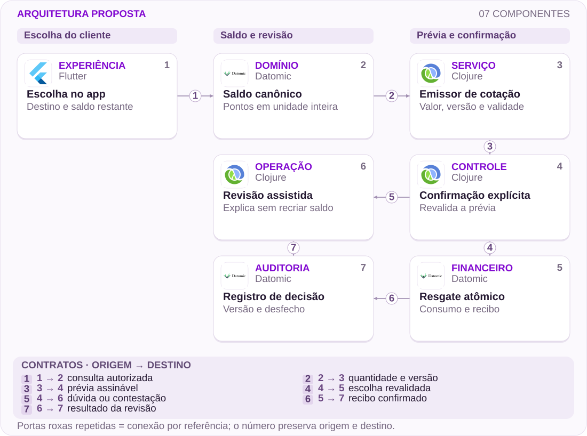

# 17 · Ultravioleta: uma escolha, um saldo

Benefícios · Consentimento · Unidades

[PT reader](https://wesleyvieira99.github.io/nu/#17-1) · [EN reader](https://wesleyvieira99.github.io/nu/en.html#17-1)

[Executable Python lab](../../labs/case_17.py)

## Conversão confirmada, compreensão contestada


Recorte real da fonte pública, capturado em 23/10/2026. O texto abaixo inclui resposta da empresa e desfecho relatado.

No relato 245086475, de 03/04/2026, a cliente disse entender pontos e cashback como benefícios separados e pediu reversão após resgatar dinheiro. Em 06/04, o Nubank afirmou saldo unificado, escolha confirmada e irreversível, com resgate de 19.071,36 pontos por R$ 577,91 em 01/04/2026. Negou falha operacional. Status: Respondida, sem avaliação final. A página não comprova operação não autorizada nem mostra a interface utilizada.

Minha proposta ataca o risco de interpretação antes da confirmação, respeitando o limite público de irreversibilidade. Não promete desfazer a transação nem trata o valor recebido como prejuízo comprovado. O desafio técnico é vincular uma explicação compreensível ao saldo e à cotação que serão consumidos.

- [Reclame AQUI · 245086475](https://www.reclameaqui.com.br/nubank/cliente-ultravioleta-se-sente-prejudicado-por-confusao-entre-cashback-e-pontos-no-app-nubank_L00uI85JWvpRpJLL/)
- [Termos Ultravioleta](https://nubank.com.br/contratos/termos-e-condicoes-nubank-ultravioleta)

## Duas unidades não criam dois ativos

O fato público é uma divergência entre expectativa e regra declarada pela empresa. A causa de interface é desconhecida: sem a tela histórica, não podemos afirmar rótulo, hierarquia ou confirmação ausente. Minha hipótese é que apresentar alternativas como duas quantidades independentes pode produzir um modelo mental de soma. Ela é testável com protótipos e tarefas, sem atribuir esse desenho à versão real do aplicativo.

Eu começaria pedindo que participantes expliquem o que permanecerá após cada escolha, antes de permitir um resgate simulado. O resultado correto é compreender exclusividade, destino, quantidade consumida e saldo restante, não apenas localizar um botão. A pesquisa incluiria leitores de tela e diferentes familiaridades com pontos, evitando selecionar somente pessoas experientes com programas de fidelidade.

No domínio, eu procuraria uma unidade canônica e uma cotação identificada. Alternar a apresentação entre dinheiro e pontos não deveria duplicar saldo, e mudar a cotação durante confirmação não pode alterar silenciosamente o compromisso. A evidência de entendimento orienta a experiência; somente autorização financeira atual permite consumir o benefício.

## A prévia é parte do compromisso



Arquitetura externa proposta; tecnologias ilustram escolhas, não sistemas internos confirmados.

A confirmação recebe uma cotação emitida por serviço autorizado, incluindo versão do saldo e validade. O resgate consome a unidade canônica e persiste recibo atomicamente. A revisão assistida pode explicar ou encaminhar exceção conforme política; não recebe uma conexão que recrie pontos automaticamente. O registro reúne decisão e desfecho com acesso restrito.

O laboratório só executa a alternativa dinheiro, deliberadamente. Milhas exigiriam outro contrato e confirmação do parceiro, não uma multiplicação improvisada. Os logos representam escolhas propostas para responsabilidades, sem alegar onde o Nubank mantém seu saldo de benefícios.

## Consumir exatamente a prévia aceita

```python
    def redeem(self, actor, quote_id, choice, key, now):
        with self.lock:
            for value in (actor, quote_id, key):
                identifier(value)
            if type(now) is not int or now < 0:
                raise ValueError('invalid clock')
            if actor != self.owner:
                raise PermissionError('account scope')
            if choice != 'cash' or not key:
                raise ValueError('explicit supported choice required')
            command = (quote_id, choice)
            if key in self.receipts:
                old, receipt = self.receipts[key]
                if old != command:
                    raise ValueError('idempotency conflict')
                return receipt
            quote = self.quotes[quote_id]
            if now >= quote.expires_at:
                raise ValueError('quote expired')
            if quote.balance_version != self.version:
                raise ValueError('balance changed; preview again')
            if quote.points_minor > self.points:
                raise ValueError('insufficient points')
            self.points -= quote.points_minor
            self.cash += quote.cash_cents
            self.version += 1
            receipt = (quote_id, quote.points_minor, quote.cash_cents)
            self.receipts[key] = (command, receipt)
            return receipt
```

Trecho literal do laboratório executado; imports e inicialização no arquivo completo.

Pontos usam centésimos de ponto e reais usam centavos, ambos inteiros. O fixture reproduz apenas as quantidades publicadas pela empresa, sem deduzir uma taxa comercial universal. O serviço de cotação é uma dependência confiável simulada; o cliente não fornece um valor de conversão arbitrário. Cotação expirada, versão alterada ou escolha não suportada não gera efeito financeiro.

A mesma chave devolve o mesmo recibo após o compromisso. Outra chave para a mesma cotação encontra saldo versionado incompatível e falha. Isso é uma propriedade de execução, não prova de consentimento informado: entender a escolha exige avaliação de produto e acessibilidade, além da atomicidade do backend.

- [Laboratório executável do caso no GitHub](https://github.com/wesleyvieira99/nu/blob/main/labs/case_17.py)

## Dart: consequência antes do botão

```dart
class RedemptionPreview {
  final int pointsConsumedMinor;
  final int cashReceivedCents;
  final int pointsRemainingMinor;
  final String quoteId;
  final DateTime expiresAt;
  const RedemptionPreview(this.pointsConsumedMinor,
      this.cashReceivedCents, this.pointsRemainingMinor,
      this.quoteId, this.expiresAt);
}

String consequenceLabel(RedemptionPreview preview) =>
    "This choice consumes the same benefit balance. "
    "Review the amount and remaining points before confirming.";
```

Dart ilustrativo não executado; formatação monetária e localização omitidas.

Eu organizaria a prévia em uma frase principal e três quantidades: o que sai, o que entra e o que permanece. A alternativa não escolhida aparece como uso do mesmo saldo, sem se apresentar como um segundo patrimônio. A confirmação precisa manter a informação visível quando o teclado, fonte ampliada ou leitor de tela muda a navegação.

Um aviso genérico repetido pode virar ruído. Eu compararia uma consequência concreta com uma caixa de confirmação adicional, medindo entendimento e erros, não cliques. Ao expirar a cotação, a interface volta à prévia e exige nova confirmação; não atualiza números atrás do botão já aceito. A regra de irreversibilidade precisa ser comunicada sem prometer exceção operacional.

## Unidades que o contrato não confunde

| Campo | Unidade | Invariante |
| --- | --- | --- |
| points_minor | 1/100 ponto | Inteiro não negativo |
| cash_cents | 1/100 BRL | Cotação autorizada |
| balance_version | Revisão | Revalidada no commit |
| quote_id | Referência opaca | Uso financeiro único |

```json
{
  "schema": "redemption-preview.v1",
  "quote_id": "synthetic-quote",
  "choice": "cash",
  "points_consumed_minor": 1907136,
  "cash_received_cents": 57791,
  "points_remaining_minor": 0,
  "balance_version": 1,
  "irreversible_after_confirmation": true
}
```

Fixture explicativa das quantidades relatadas; contrato proposto não executado.

A representação de pontos precisa dizer unidade e precisão em todo limite. Um número decimal sem unidade pode ser interpretado como reais por um consumidor genérico. Eu versionaria o contrato e bloquearia campos desconhecidos na escrita, preservando compatibilidade planejada nas leituras. A cotação inclui destino autorizado e titular na camada protegida, não em analytics.

O registro de confirmação deve ser suficiente para revisar qual prévia foi apresentada, sem capturar a tela inteira ou dados de viagem. Retenção e acesso seguem política definida com Privacidade. Reconstruir uma decisão não exige armazenar todos os gestos da pessoa; exige identidade da cotação, revisão do texto e resultado financeiro.

## O teste não confunde UX com atomicidade

```python
    def test_same_balance_cannot_be_spent_twice(self):
        self.b.redeem('owner', 'q1', 'cash', 'a', 100)
        with self.assertRaises(ValueError):
            self.b.redeem('owner', 'q1', 'cash', 'b', 101)
        self.assertEqual(self.b.points, 0)
        self.assertEqual(self.b.cash, 57_791)

    def test_retry_preserves_original_receipt(self):
        first = self.b.redeem('owner', 'q1', 'cash', 'a', 100)
        retry = self.b.redeem('owner', 'q1', 'cash', 'a', 900)
        self.assertEqual(first, retry)
        self.assertEqual(self.b.cash, 57_791)

    def test_expired_preview_has_no_financial_effect(self):
        with self.assertRaises(ValueError):
            self.b.redeem('owner', 'q1', 'cash', 'a', 200)
        self.assertEqual(self.b.points, 1_907_136)
        self.assertEqual(self.b.cash, 0)
        self.assertEqual(self.b.receipts, {})
```

Trecho literal dos testes; 13 testes do laboratório passaram localmente.

Os treze testes passaram. A suíte inclui disputa concorrente, tentativa de cotação não autorizada, titular errado, chave conflitante e relógio inválido, inclusive NaN. Esses testes demonstram ausência de efeito para entradas rejeitadas e consumo único no modelo. Eles não demonstram que uma pessoa compreendeu o texto nem que a cotação reproduz regras reais de fidelidade.

Eu combinaria a suíte com tarefas assistidas: escolher dinheiro, explicar o saldo restante e reconhecer que milhas deixam de estar disponíveis para a mesma quantidade. Testes de integração cobririam confirmação após mudança de saldo e resposta perdida depois do commit. A revisão deve aceitar evidência técnica e compreensão separadamente; uma não substitui a outra.

## Medir entendimento, preservar escolha

Baseline desconhecido. A métrica principal proposta é compreensão correta: participantes que explicam saldo restante e exclusividade sem ajuda sobre participantes que chegam à prévia, por rodada de pesquisa e modo de acesso. Uma segunda mede tentativa de uso da alternativa já consumida por resgate concluído, em sete dias, com coleta mínima e sem inferir arrependimento automaticamente.

Contato sobre reversão por mil resgates, dividido por versão da prévia e modalidade, mede esforço observado. Expiração com abandono por prévias expiradas mede custo de fricção. Consumo duplicado por cotação é a barreira financeira: qualquer ocorrência confirmada suspende o piloto. Todas as janelas e segmentações seriam fixadas antes da comparação, com amostra suficiente por acessibilidade.

Eu proporia meta inicial de aumentar compreensão sem reduzir conclusão legítima por barreira desnecessária. Primeiro pesquisa, depois experimento controlado apenas sobre apresentação. Não se randomiza taxa, direito ou reversibilidade. Uma queda de contato sem melhora de compreensão pode significar desistência de pedir ajuda e não justifica expansão.

## Custo de compreensão, não valor dos pontos

R$ 577,91 é o crédito informado na resposta individual; não é perda comprovada nem ganho da proposta. Assumo 40.000 resgates mensais, 1% com dúvida relevante, R$ 45 de tratamento por caso e, em 15% deles, R$ 100 de remediação discricionária aprovada. Isso resulta em R$ 60 por caso potencialmente evitável. Assumo ainda operação de R$ 4.500 por mês e implementação de R$ 150.000; nenhum parâmetro é observado no Nubank.

| Cenário | Prevenção assumida | Casos/mês | Potencial líquido |
| --- | --- | --- | --- |
| Conservador | 25% | 100 | R$ 1.500 |
| Base | 50% | 200 | R$ 7.500 |
| Ambicioso | 75% | 300 | R$ 13.500 |

Equilíbrio mensal: 75 casos evitados, ou 18,75% dos 400 assumidos. Recuperação hipotética do investimento: 100, 20 e 11,11 meses, respectivamente, se os custos forem realmente evitáveis. A parcela de remediação não presume obrigação nem prática existente. Finanças deve separar custo variável de capacidade reaproveitada; o último não vira caixa automaticamente.

O modelo deve cair se a pesquisa mostrar que o problema é raro ou que o novo fluxo não muda compreensão. Não monetizo pontos remanescentes nem extrapolo o relato para a base Ultravioleta.

## Da hipótese de linguagem à integração

Dias 0–15: Design Research conduz tarefas com alternativas de apresentação; Produto de Benefícios valida a regra e os destinos. O Staff registra unidades, cotação, versão e estados terminais. A saída exige que o problema de compreensão seja reproduzido em pesquisa, sem assumir que a reclamação prova uma causa geral.

Dias 16–30: Mobile prototipa consequência e acessibilidade, backend cria cotação vinculada em sandbox e Segurança revisa escopo. Dias 31–60: QA exercita expiração, concorrência e resposta perdida; Privacidade aprova o registro mínimo. A saída técnica é consumo único com recibo recuperável; a saída de produto é entendimento demonstrado na tarefa.

Dias 61–90: o EM coordena uma coorte de apresentação com monitoramento de suporte e revisão de Finanças. Qualquer mudança em contrato de benefício exige a governança própria antes do rollout. Esse horizonte proposto não promete alterar o produto em 90 dias; explicita dependências que poderiam impedir a decisão.

## Falhar antes do consumo, explicar depois

O rollout começa pela prévia em ambiente controlado e pela cotação em sombra. O caminho financeiro só muda depois que o serviço prova revalidação atômica. Eu simularia expiração enquanto a pessoa lê, mudança de saldo em outra sessão e queda de resposta após crédito. Em todos os casos, o aplicativo precisa apresentar estado honesto e impedir uma confirmação em termos diferentes.

Benefícios é dono da conciliação de unidades; SRE acompanha taxa de cotação expirada e falhas; Atendimento recebe o registro autorizado da prévia. O rollback pode restaurar a apresentação anterior, mas precisa manter consulta de recibos emitidos na nova versão. Nenhuma bandeira deve fazer uma transação confirmada parecer cancelável.

A expansão para milhas seria outro projeto de integração, com semântica de confirmação do parceiro e tratamento de pendência. Eu manteria essa fronteira explícita para evitar que uma melhoria de copy carregue uma nova promessa de reversão ou uma alteração econômica não aprovada.

## Minha contribuição: precisão e empatia

Como Staff, eu tornaria unidade, cotação e versão conceitos explícitos do domínio. Uma decisão importante seria manter o saldo canônico independente das formas de exibição. Rejeitaria armazenar dois saldos ajustados por eventos separados para representar um único benefício, porque isso amplia reconciliação e permite interpretações divergentes. A escolha concreta de armazenamento dependeria do sistema existente e do custo de migração.

Como Engineering Manager, eu aproximaria pesquisa, Mobile, Benefícios e Atendimento para revisar a mesma tarefa, em vez de distribuir somente requisitos de telas. Protegeria espaço para participantes com acessibilidade e para exercícios de falha, que costumam desaparecer quando a data fica apertada. A revisão de entrega exigiria uma demonstração de entendimento e outra de integridade.

A proposta combina respeito à regra publicada com atenção à experiência contestada. Não preciso assumir defeito sistêmico para propor uma melhoria verificável. Esse é o julgamento que eu levaria à posição: separar o que a evidência sustenta, o que o código garante e o que ainda exige validação com pessoas.

## Handoff: revisar a consequência completa

Execute python3 labs/case_17.py -v. Inspecione Quote e Benefits.issue antes de redeem: a autoridade de cotação faz parte da garantia. Reproduza o fixture e confirme redução dos pontos e crédito uma única vez. Avance o relógio até a expiração, mude a chave de repetição e tente outro titular; cada caminho deve preservar a fronteira descrita.

O aceite requer unidade explícita, cotação emitida por autoridade, saldo revalidado, exclusividade entendida, efeito único e recibo acessível após perda de resposta. Faltam integração financeira, política de expiração real, assinatura ou canal autenticado de cotação, persistência e revisão de textos. O teste local não certifica conformidade jurídica nem cobre resgate em parceiros de milhas.

Eu avançaria se a prévia melhora compreensão sem inventar flexibilidade contratual. Pararia se a solução depende de prometer reversão que o domínio não oferece. A demonstração final para o revisor deve permitir explicar, em voz alta e sem jargão, o saldo antes, a escolha e o saldo depois.

- [Laboratório executável do caso no GitHub](https://github.com/wesleyvieira99/nu/blob/main/labs/case_17.py)
