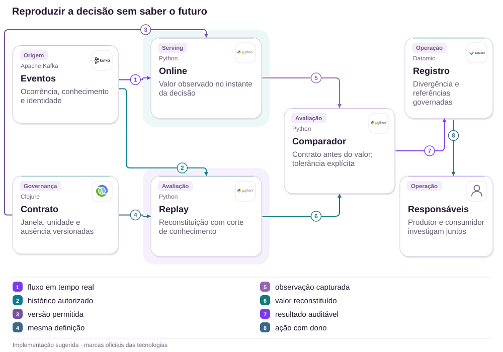
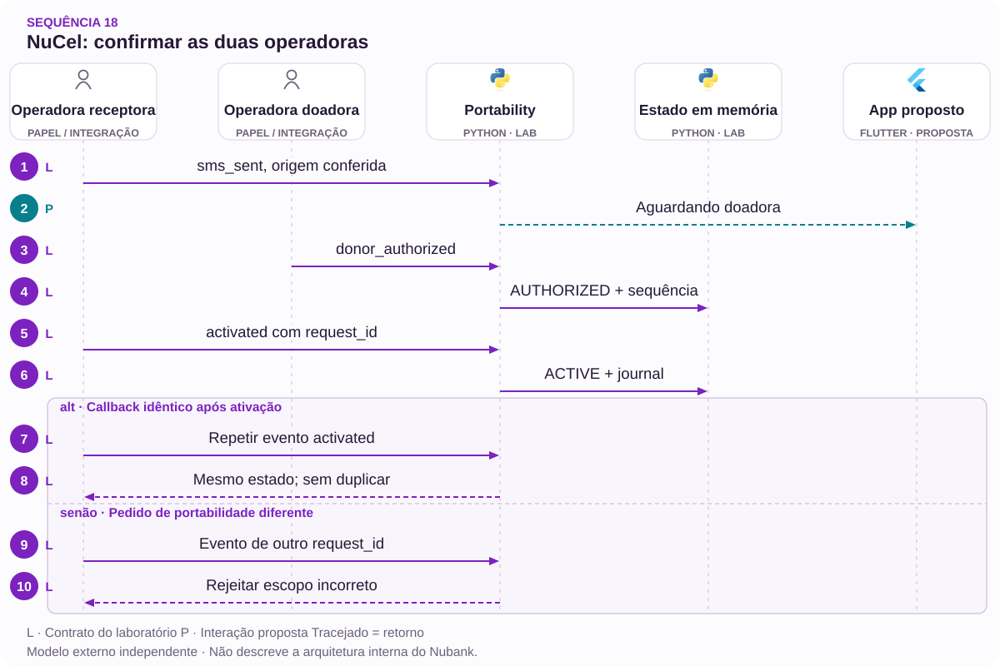

# 18 · NuCel: confirmação entre duas operadoras

Portabilidade · Eventos · Responsabilidade

[PT reader](https://wesleyvieira99.github.io/nu/#18-1) · [EN reader](https://wesleyvieira99.github.io/nu/en.html#18-1)

[Executable Python lab](../../labs/case_18.py)

## Cancelamento não resolveu a portabilidade


Recorte real da fonte pública, capturado em 23/10/2026. O texto abaixo inclui resposta da empresa e desfecho relatado.

Relato 254143071, de 17/07/2026: a consumidora afirmou responder ao SMS da Vivo, não concluir a portabilidade para NuCel e receber cobrança. Em 24/07, o Nubank declarou ausência de confirmação registrada pela doadora, cancelamento da linha provisória e ajuste de eventuais cobranças. A consumidora contestou a explicação, marcou Não resolvido e nota 0. Não há valor divulgado nem evidência independente que atribua a falha a uma operadora.

A proposta foca rastreabilidade da confirmação e responsabilidade pelo próximo passo. Não confunde encerramento administrativo com conclusão da intenção original. Cancelar pode ser uma escolha válida da pessoa; não equivale a portar o número, e o estado apresentado deve preservar essa diferença.

- [Reclame AQUI · 254143071](https://www.reclameaqui.com.br/nubank/falha-na-portabilidade-da-linha-vivo-pre-pago-para-nubanknucel-com-cobranca-indevida_6p5gIX1MMyDPSDus/)

## O que cada confirmação realmente comprova


Tutorial oficial do Nubank, 10/10/2025. Contexto do produto; não é filmagem da reclamação.

[Source video / Vídeo da fonte](https://www.youtube.com/watch?v=0-Sftqs-plI)

Responder a uma mensagem, a operadora registrar a resposta e o número tornar-se ativo são eventos distintos. Minha hipótese falsificável é que um diário correlacionado permitiria localizar a fronteira sem comprovação, reduzindo encaminhamentos circulares. Eu verificaria identificadores compartilhados, contratos de retorno, relógios e política de retentativa com o parceiro, sem supor que um webhook específico causou o episódio.

O vídeo oficial do Nubank sobre portabilidade com chip físico e virtual, publicado em 10/10/2025, oferece contexto de produto. Não é registro deste incidente nem comprova que a confirmação chegou à doadora. Eu usaria o material para alinhar instruções de autoatendimento com os estados observáveis e validar se uma pessoa consegue identificar quem deve agir em seguida.

- [Nubank · Portabilidade NuCel · vídeo oficial](https://www.youtube.com/watch?v=0-Sftqs-plI)
- [Guia oficial de portabilidade](https://blog.nubank.com.br/portabilidade-celular-como-funciona/)

## Comparar o ocorrido e o confirmado



Arquitetura externa proposta; tecnologias ilustram escolhas, não sistemas internos confirmados.

O contrato define quem pode declarar cada etapa. Estado operacional e diário recebem o mesmo evento, mas a conciliação compara o que foi aplicado com o que foi observado. Uma lacuna cria investigação com dono, referência e próximo prazo; não inventa confirmação. A caixa de pessoas não recebe logo de tecnologia, porque representa coordenação e não um componente de software.

O diário proposto não inclui conteúdo de SMS. Autorização da doadora e ativação da receptora permanecem distintas. Cobrança provisória exige integração e política próprias; este desenho não presume direito de estorno nem altera contratos de telecomunicações.

## A origem faz parte do evento

`Explicit State Machine [lab]` · `Issuer-bound Events [lab]`

```python
    def apply(self, event, authenticated_source):
        with self.lock:
            for value in (event.event_id, event.request_id, event.kind, event.source):
                identifier(value)
            if event.request_id != self.request_id:
                raise ValueError('request scope')
            if event.source != authenticated_source:
                raise PermissionError('untrusted source')
            if self.SOURCES.get(event.kind) != event.source:
                raise PermissionError('event authority')
            if type(event.sequence) is not int or event.sequence < 1:
                raise ValueError('invalid sequence')
            if event.event_id in self.seen:
                if self.seen[event.event_id] != event:
                    raise ValueError('event identity conflict')
                return self.state
            if event.sequence <= self.sequences.get(event.source, 0):
                raise ValueError('out-of-order; reconcile')
            allowed = {'sms_sent': ('REQUESTED',),
                       'donor_authorized': ('WAIT_DONOR',),
                       'activated': ('AUTHORIZED',),
                       'cancelled': ('REQUESTED', 'WAIT_DONOR', 'AUTHORIZED')}
            if self.state not in allowed[event.kind]:
                raise ValueError('invalid transition; reconcile')
            self.state = {'sms_sent': 'WAIT_DONOR', 'donor_authorized':
                          'AUTHORIZED', 'activated': 'ACTIVE',
                          'cancelled': 'CANCELLED'}[event.kind]
            self.seen[event.event_id] = event
            self.sequences[event.source] = event.sequence
            self.journal.append(event)
            return self.state
```

Trecho literal do laboratório executado; imports e inicialização no arquivo completo.

O modelo aceita autorização da doadora apenas pelo emissor correspondente, e ativação apenas depois dessa autorização. Um relato de SMS respondido pode abrir investigação, mas não simular a confirmação entre empresas. Eventos repetidos são deduplicados; identidade reaproveitada com outro conteúdo falha. A sequência é por emissor, evitando comparar números de sistemas diferentes como se fossem um relógio global.

Cancelamento é terminal para aquela tentativa. Uma ativação atrasada não ressuscita o pedido: exige conciliação. O parâmetro de origem representa um adaptador já autenticado; uma string enviada pelo aplicativo não seria autenticação em produção. A validação criptográfica, o vínculo do titular e o armazenamento durável ainda precisam existir fora deste laboratório.

- [Laboratório executável do caso no GitHub](https://github.com/wesleyvieira99/nu/blob/main/labs/case_18.py)

## Dart: mostrar dependência sem culpar

`Explicit State Machine [proposal]` · `Issuer-bound Events [proposal]`

```dart
enum PortState { requested, waitingDonor, authorized, active, cancelled }

String nextStep(PortState state) => switch (state) {
  PortState.requested => "Follow the verified confirmation instructions",
  PortState.waitingDonor => "Confirmation pending; track investigation",
  PortState.authorized => "Authorization received; activation pending",
  PortState.active => "Portability completed",
  PortState.cancelled => "This attempt was cancelled; review billing status",
};

// Billing status is a separate authorized projection.
// A customer tap does not produce donor authorization.
```

Dart ilustrativo, não executado; mensagens finais exigem pesquisa e localização.

Eu evitaria mostrar apenas pendente. A pessoa precisa distinguir instrução que pode executar, confirmação que depende de outra organização e investigação em andamento. A interface oferece atualização e canal de ajuda com o mesmo identificador, sem mandar repetir um processo já cancelado ou trocar de operadora às cegas. O texto explica o estado conhecido, sem atribuir culpa não demonstrada.

Cobrança e portabilidade aparecem como dimensões separadas. Um ajuste financeiro em análise não pode virar linha ativa, nem uma linha cancelada comprova crédito concluído. Mobile consome projeções autorizadas e acessíveis; o domínio decide transições. Eu exigiria revisão conjunta de Operações NuCel e Atendimento antes de publicar os rótulos.

## Tentativas não compartilham confirmação

`Explicit State Machine [proposal]` · `Issuer-bound Events [proposal]`

| Campo | Significado | Responsável |
| --- | --- | --- |
| request_id | Uma tentativa | Receptora |
| issuer | Quem afirma o fato | Adaptador autenticado |
| sequence | Ordem por emissor | Parceiro emissor |
| billing_case_id | Análise separada | Operação financeira |

```json
{
  "schema": "portability-event.v1",
  "event_id": "synthetic-donor-confirmation",
  "request_id": "synthetic-attempt-2",
  "issuer": "donor",
  "kind": "donor_authorized",
  "sequence": 7,
  "billing_effect": "NONE"
}
```

Contrato ilustrativo não executado; sem número de telefone ou conteúdo do SMS.

Uma segunda tentativa recebe identidade nova. Evidência da primeira pode ajudar suporte, mas não satisfaz automaticamente a autorização da segunda. Eu guardaria instante de ocorrência e recebimento para investigar atraso, sem ordenar todos os parceiros pelo relógio de um só. O laboratório rejeita evento adiantado para revisão; um sistema real pode estacioná-lo em fila durável e reaplicar depois de preencher a lacuna.

O registro público de acompanhamento usa referência opaca e etapa, sem telefone completo. A tabela de resolução de identidade tem acesso mais restrito e retenção definida. O dono da integração revisa quebra de schema com o parceiro; Atendimento não deve interpretar payload bruto nem transformar ausência de evento em acusação contra o cliente.

## Reproduzir a lacuna entre empresas

`Explicit State Machine [lab]` · `Issuer-bound Events [lab]`

```python
    def test_user_sms_claim_cannot_authorize_donor(self):
        event = Event('d', 'request-a', 'donor_authorized', 'owner', 1)
        with self.assertRaises(PermissionError):
            self.p.apply(event, 'owner')
        self.assertEqual(self.p.state, 'WAIT_DONOR')

    def test_late_activation_cannot_revive_cancelled_request(self):
        cancel = Event('c', 'request-a', 'cancelled', 'owner', 1)
        self.p.apply(cancel, 'owner')
        late = Event('a', 'request-a', 'activated', 'recipient', 2)
        with self.assertRaises(ValueError):
            self.p.apply(late, 'recipient')
        self.assertEqual(self.p.state, 'CANCELLED')

    def test_early_activation_requires_reconciliation(self):
        event = Event('a', 'request-a', 'activated', 'recipient', 2)
        with self.assertRaises(ValueError):
            self.p.apply(event, 'recipient')
        self.assertNotIn('a', self.p.seen)
        self.assertEqual(self.p.state, 'WAIT_DONOR')
```

Trecho literal dos testes; 12 testes do laboratório passaram localmente.

Os doze testes passaram. A suíte cobre fluxo completo, duplicata, pedido diferente, emissor falsificado, sequência antiga e reprocessamento após chegada da autorização faltante. O cenário central é adverso: ativação recebida antes da prova necessária não se torna sucesso. Cancelamento mantém seu significado mesmo quando chegam eventos atrasados.

No ambiente integrado, eu testaria callbacks assinados, indisponibilidade do parceiro e relógios divergentes. Também simularia atendimento consultando duas tentativas semelhantes para verificar isolamento. Esses testes não comprovam SMS entregue, qualidade de rede ou conformidade regulatória. Para isso são necessários parceiros, dispositivos e especialistas de telecomunicações, com plano de ensaio e evidência próprios.

## Medir conclusão e limbo separadamente

Baseline desconhecido. Conclusão deve contar números efetivamente ativos sobre tentativas elegíveis iniciadas, em coortes semanais, separadas por doadora e tipo de chip. Cancelamentos aparecem como resultado separado. A segunda métrica é tempo em espera de confirmação: distribuição entre solicitação e evento autorizado, incluindo pendências abertas como censuradas, sem tratá-las como instantâneas ou excluí-las.

A terceira mede investigação com próximo passo e dono sobre divergências abertas, diariamente. A quarta mede cobrança contestada ainda sem decisão por tentativa cancelada, em sete dias; ela não presume cobrança indevida. A quinta é transição sem evidência autorizada por transição aplicada, com tolerância proposta de zero para expansão. Dados sensíveis ficam fora de etiquetas e painéis agregados.

Eu compararia coortes equivalentes após observar sazonalidade e mistura de operadoras. A melhoria precisa aumentar conclusão real ou reduzir limbo, sem empurrar cancelamento. Se a média melhora porque os casos difíceis são encerrados mais cedo, o piloto falhou na intenção original e requer revisão.

## Valor de uma linha realmente ativada

O relato não publica cobrança nem estorno. O cenário proposto usa uma coorte hipotética de 5.000 pedidos elegíveis, seis meses ativos por linha incremental e contribuição de R$ 12 por mês ativo, após custos variáveis assumidos. Considero R$ 5.000 de operação do piloto e R$ 20.000 de implementação incremental reaproveitando infraestrutura existente. Essa verba não estima uma reconstrução completa de telecom; todos os insumos são assumidos.

| Cenário | Ganho absoluto | Linhas extras | Líquido em 6 meses |
| --- | --- | --- | --- |
| Conservador | 2 p.p. | 100 | −R$ 17.800 |
| Base | 5 p.p. | 250 | −R$ 7.000 |
| Ambicioso | 8 p.p. | 400 | R$ 3.800 |

A fórmula é pedidos × ganho absoluto de ativação × meses ativos × contribuição mensal, menos R$ 25.000 de custos. O equilíbrio exige aproximadamente 347,22 linhas equivalentes, ou pelo menos 348 linhas inteiras, correspondentes a 6,96 pontos percentuais para 348 linhas. Os cenários conservador e base não pagam o piloto; isso é informação para decisão, não um defeito a esconder.

Receita não é margem, e ativação sem permanência não realiza seis meses de contribuição. Finanças precisaria validar churn, subsídio, suporte e custo do parceiro. Não uso ARPAC bancário como margem de telefonia nem monetizo cobrança contestada como ganho.

## Dependências que definem o prazo

Dias 0–15: Operações NuCel e o responsável pela integração com a doadora catalogam eventos, autorizações e estados terminais. O Staff identifica lacunas de correlação; Produto define conclusão sob a perspectiva do cliente. A saída exige um contrato de responsabilidade por etapa e um caminho de investigação que ambas as organizações consigam executar.

Dias 16–30: backend constrói diário e conciliador em sandbox, Mobile testa mensagens e Financeiro separa acompanhamento de cobrança. Dias 31–60: QA injeta eventos faltantes, duplicados e atrasados com o parceiro; Atendimento ensaia uma segunda tentativa sem perder contexto. A saída é localizar a fronteira pendente sem expor número completo ou conteúdo do SMS.

Dias 61–90: o EM coordena piloto limitado por capacidade operacional e revisa custo por investigação. A expansão depende do aceite do parceiro, de conciliação e de conclusão real, não de tickets fechados. O cronograma é proposta condicionada; se não há retorno verificável da doadora, nenhuma equipe deve fingir que o problema foi resolvido apenas com uma tela.

## Operar a divergência sem perder o cliente

Eu iniciaria o diário em sombra, sem mudar transições ou cobrança. A conciliação levantaria casos para uma equipe pequena, com limite de fila e prazo de próxima atualização. Só depois da validação passaria a apresentar o estado novo ao cliente. Um aumento abrupto de divergências pode indicar quebra de contrato, e não crescimento real de falhas de portabilidade.

O dono da integração recebe alertas por ausência de confirmação e sequência inesperada; Operações decide o encaminhamento com a doadora; Financeiro acompanha ajustes autorizados separadamente. O exercício principal é receber ativação depois de cancelamento: a linha não pode ser considerada desejada apenas porque chegou um callback. A resolução precisa verificar estado real nas duas partes.

O rollback desliga decisões automáticas novas e mantém o diário para investigação. Não apaga evidência nem reabre pedidos cancelados. A pessoa recebe uma explicação do que se sabe, do que falta e da próxima atualização, sem receber uma promessa de prazo que o parceiro não aceitou.

## Minha contribuição: coordenar fronteiras

Como Staff, eu defenderia separar prova de autorização, estado operacional e interpretação de atendimento. Rejeitaria avançar a portabilidade apenas com a declaração de SMS respondido, porque isso atravessa a autoridade da doadora. Também rejeitaria encerrar todo timeout como falha definitiva: atraso requer investigação e pode ser reconciliado. A escolha de estados explícitos evita que conveniência de implementação vire regra de produto.

Como Engineering Manager, eu organizaria o trabalho com dono por contrato e por próxima ação, incluindo o parceiro no plano de dependências. A revisão não serviria para atribuir culpa, mas para tornar visível qual evidência falta e quem consegue obtê-la. Protegendo essa disciplina, o time pode responder ao cliente sem criar pressão para fabricar uma confirmação.

Eu traria uma definição de pronto que inclui continuidade de atendimento e reconciliação de cobrança. Não alego experiência interna no NuCel; demonstro como investigaria uma jornada distribuída em que o sucesso técnico de uma parte ainda pode deixar a pessoa sem a intenção concluída.

## Handoff: mostrar quem pode afirmar o quê

Execute python3 labs/case_18.py -v. Siga Portability.apply e a tabela SOURCES. Envie ativação antes de autorização, confirme que nada avança, acrescente a prova faltante e repita o evento. Depois cancele outra tentativa e envie ativação tardia. O contraste demonstra por que ordem de chegada, autoridade e intenção atual precisam ser avaliadas separadamente.

O checklist exige isolamento entre tentativas, emissor autenticado, deduplicação, reconciliação de ordem inesperada, cancelamento respeitado e estado financeiro independente. Ainda faltam callbacks reais, assinatura, persistência, investigação com parceiros, consentimentos e teste em dispositivos. O laboratório não inclui tarifação nem estorno e não pode certificar uma portabilidade real.

Eu recomendaria avançar quando as organizações conseguem resolver uma divergência sintética com referência compartilhada e prazo de retorno. Pararia se a solução depende de ocultar ausência de confirmação ou redefinir cancelamento como sucesso. O revisor deve conseguir apontar em cada seta do desenho qual contrato autoriza o próximo estado.

- [Laboratório executável do caso no GitHub](https://github.com/wesleyvieira99/nu/blob/main/labs/case_18.py)

## Padrões com prova no código

`Explicit State Machine [lab]` · `Issuer-bound Events [lab]` · `Saga-style coordination [proposal]` · `Spring Kafka [proposal]` · `LangGraph [proposal]`

| Mecanismo | Implementação | Evidência |
| --- | --- | --- |
| Explicit State Machine | Portability.apply | ativação tardia não reabre pedido cancelado |
| Issuer-bound Events | Portability.apply | relato do SMS não substitui evento da doadora |
| Saga-style coordination / partner boundary | Proposta para produção | Adaptadores preservam a autoridade fora da interface. |

**Integração Java · proposta**

Spring Kafka + bounded reconciliation worker. Portar invariantes e testes de contrato antes de substituir o modelo Python. Lock de processo não controla concorrência distribuída; persistência, autorização e recuperação exigem testes de integração.

**Avaliação de IA · LangGraph**

Experimento proposto: LangGraph para preparar uma investigação de divergência para a equipe responsável. Ferramentas de leitura, citações, orçamento de tokens e aprovação humana são requisitos. Não autoriza dinheiro, elegibilidade ou identidade. Os testes Python não comprovam integração com LLM.

- [P1 · Portability.apply](https://github.com/wesleyvieira99/nu/blob/main/labs/case_18.py#L37)
- [P1 · test_late_activation_cannot_revive_cancelled_request](https://github.com/wesleyvieira99/nu/blob/main/labs/case_18.py#L84)
- [P2 · Portability.apply](https://github.com/wesleyvieira99/nu/blob/main/labs/case_18.py#L37)
- [P2 · test_user_sms_claim_cannot_authorize_donor](https://github.com/wesleyvieira99/nu/blob/main/labs/case_18.py#L78)
- [LangGraph · persistence](https://docs.langchain.com/oss/python/langgraph/persistence)

## Sequência de execução



Origens são atores sintéticos autenticados. SMS não equivale à autorização da doadora nem à ativação.

**Autoridade e fronteira de falha**

relato do SMS não substitui evento da doadora. ativação tardia não reabre pedido cancelado.

A sequência descreve a integração proposta. O laboratório vinculado verifica a invariante do domínio com dados sintéticos; serviços externos, retries de rede e implantação permanecem trabalho de integração.

- [apply](https://github.com/wesleyvieira99/nu/blob/main/labs/case_18.py#L37)
- [apply](https://github.com/wesleyvieira99/nu/blob/main/labs/case_18.py#L37)

## Features, histórias e aceite

**F18.1 · Confirmação por origem · D16–30**

Como cliente, quero identificar qual operadora ainda precisa confirmar. Aceite: relato do SMS não substitui evento da doadora.

**F18.2 · Reconciliação de eventos tardios · D31–60**

Como cliente, quero cancelar sem reativação inesperada. Aceite: ativação tardia não reabre pedido cancelado.

**F18.3 · Expansão medida · D61–90**

Como responsável de produto, quero uma coorte elegível com controle comparável. Aceite: métrica do caso, denominador, custo e barreira de segurança registrados antes da exposição; falhas de conciliação interrompem expansão.

Os testes vinculados exercitam o aceite declarado do domínio, não a interface completa nem a integração de produção. D0–15 é descoberta: confrontar o relato público com amostras internas autorizadas, mapear dependências e aprovar contratos. São janelas incrementais de planejamento, não promessa de prazo. EM coordena dependências; Staff responde pelos contratos; Produto e o domínio aceitam o resultado.

- [Aceite F18.1](https://github.com/wesleyvieira99/nu/blob/main/labs/case_18.py#L78)
- [Aceite F18.2](https://github.com/wesleyvieira99/nu/blob/main/labs/case_18.py#L84)

## Método e sensibilidade

**Sensibilidade do cenário · BRL**

Todos os inputs são hipóteses de cenário, não efeitos medidos no Nubank. Capacidade equivalente não é economia de caixa. A realização reduz apenas o benefício; todos os custos permanecem nos valores do cenário. É análise de sensibilidade, não probabilidade nem estimativa causal. O benefício já cobre uma coorte com seis meses ativos por linha extra; não multiplicar por seis novamente.

líquido_período = benefício × realização − custo_variável − operação; coorte_seis_meses = líquido_período − implementação

Period / Período: `cohort`. Values / Valores: BRL.

| Scenario / Cenário | Benefit / Benefício | Variable cost / Variável | Run cost / Operação | Build / Implementação |
| --- | ---: | ---: | ---: | ---: |
| Conservador | 7200.00 | 0.00 | 5000.00 | 20000.00 |
| Base | 18000.00 | 0.00 | 5000.00 | 20000.00 |
| Ambicioso | 28800.00 | 0.00 | 5000.00 | 20000.00 |

| Scenario / Cenário | Period net at 100% / Líquido | Horizon after build / Horizonte | Horizon at 50% / Estresse |
| --- | ---: | ---: | ---: |
| Conservador | 2200.00 | -17800.00 | -21400.00 |
| Base | 13000.00 | -7000.00 | -16000.00 |
| Ambicioso | 23800.00 | 3800.00 | -10600.00 |

[Reproducible scenario inputs](../../models/normalized-scenarios.json) · [Decimal simulator](../../models/simulate.py)

| Decisão | Método específico do caso |
| --- | --- |
| Baseline / ameaça | Baseline: linhas efetivamente ativas por tentativa elegível. Ameaça: encerrar casos difíceis para melhorar média. |
| Economia por unidade | Ativações extras × seis meses ativos × contribuição mensal; contribuição marginal é hipótese, não ARPAC global. |
| Experimento proposto | Comparar coortes por doadora e chip, sazonalidade e pendências; medir conclusão real sem empurrar cancelamento. |
| Critério de parada | Parar por transição sem evidência; manter cancelamentos e pendências no resultado da coorte. |

- [Reclame AQUI · ID 254143071](https://www.reclameaqui.com.br/nubank/falha-na-portabilidade-da-linha-vivo-pre-pago-para-nubanknucel-com-cobranca-indevida_6p5gIX1MMyDPSDus/)
- [FinOps Foundation · Unit Economics](https://www.finops.org/framework/capabilities/unit-economics/)
- [Microsoft Research · Pre-experiment design](https://www.microsoft.com/en-us/research/articles/patterns-of-trustworthy-experimentation-pre-experiment-stage/)
