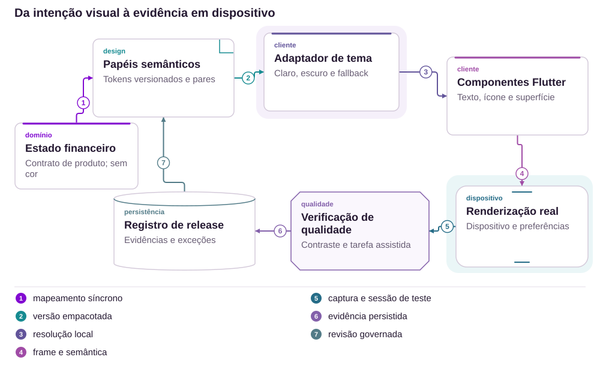
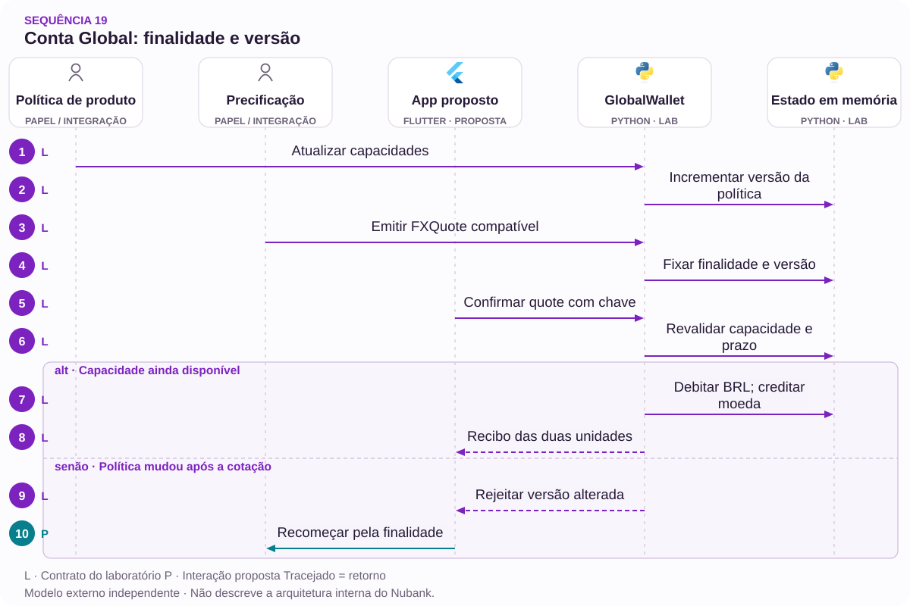

# 19 · Conta Global: finalidade antes do câmbio

Capacidades · Cotação · Expectativa

[PT reader](https://wesleyvieira99.github.io/nu/#19-1) · [EN reader](https://wesleyvieira99.github.io/nu/en.html#19-1)

[Executable Python lab](../../labs/case_19.py)

## Uma limitação, uma solução reconhecida


Recorte real da fonte pública, capturado em 23/10/2026. O texto abaixo inclui resposta da empresa e desfecho relatado.

Relato 243002037, de 11/03/2026: o consumidor disse converter aproximadamente R$ 50.000 em euros para transferência externa e alegou R$ 1.600 de IOF e taxas ao descobrir a limitação. Em 18/03, o Nubank explicou o uso para compras e saques, sem transferências externas naquela modalidade, e informou solução privada. Em 21/03, o consumidor marcou Resolvido, nota 10 e continuidade do relacionamento. Não foram publicados os termos ou valores finais da solução.

A proposta identifica a finalidade antes de gerar uma conversão custosa. Ela não sugere que o problema permanece aberto nem transforma uma expectativa em prova de funcionalidade prometida. A integração tecnológica citada no relato não significa que todas as capacidades de outro produto estejam presentes.

- [Reclame AQUI · 243002037](https://www.reclameaqui.com.br/nubank/conversao-para-euro-na-conta-global-nubank-gerou-prejuizo-de-r1600-por-limitacao-nao-clara-do-servico_hPjBF5ut2RIkdhxz/)

## Capacidade é específica do produto

Um saldo em euros responde em qual moeda a pessoa possui recursos, não quais ações pode executar. A hipótese de projeto é que perguntar finalidade antes da cotação revela incompatibilidades cedo: gastar com cartão, sacar ou enviar a terceiros são tarefas diferentes. Eu testaria se essa pergunta é compreendida sem exigir que a pessoa conheça a infraestrutura ou o parceiro utilizado.

A investigação mapearia capacidades por produto, moeda, destino e versão aplicável. O fato do relato é a expectativa frustrada e a solução reconhecida; não sabemos a tela histórica nem a sequência exata da contratação. Portanto, eu não atribuiria a causa a copy ausente. Um protótipo precisa demonstrar que a nova sequência evita conversão incompatível sem bloquear usos legítimos.

A publicação oficial sobre transferências internacionais oferece contexto de escopo, mas não substitui uma revisão histórica do contrato individual. Eu manteria o catálogo versionado e a origem da decisão, evitando apresentar a capacidade atual como prova do que estava disponível em outra data.

- [Nubank · Transferência internacional](https://blog.nubank.com.br/transferencia-internacional-o-que-e-e-como-fazer/)

## A capacidade acompanha a cotação



Arquitetura externa proposta; tecnologias ilustram escolhas, não sistemas internos confirmados.

O catálogo permite ou recusa a finalidade antes de emitir a cotação. A prévia carrega a revisão considerada, mas o commit consulta a política atual novamente: uma capacidade removida durante a leitura invalida a execução. A conciliação valida o efeito financeiro; o registro pode fundamentar revisão aprovada do catálogo, sem que uma reclamação altere capacidades automaticamente.

O desenho não cria remessas internacionais. Ele impede que a intenção de remessa avance como conversão de outro produto. O laboratório modela apenas uma combinação sintética de gasto em cartão, moeda e país; suportar novas combinações exige decisões e integrações próprias.

## Uma cotação não sobrevive à política

`Capability Preflight [lab]` · `Version-bound Quote [lab]`

```python
    def commit(self, actor, quote_id, key, now):
        with self.lock:
            for value in (actor, quote_id, key):
                identifier(value)
            if type(now) is not int or now < 0:
                raise ValueError('invalid clock')
            if actor != self.owner:
                raise PermissionError('account scope')
            if not key:
                raise ValueError('idempotency key required')
            if key in self.receipts:
                if self.receipts[key][0] != quote_id:
                    raise ValueError('idempotency conflict')
                return self.receipts[key]
            quote = self.quotes[quote_id]
            capability = (quote.purpose, quote.currency, quote.country)
            if quote.capability_version != self.version:
                raise ValueError('capability changed; start again')
            if capability not in self.allowed or now >= quote.expires_at:
                raise ValueError('not executable')
            if quote.debit_cents > self.balance:
                raise ValueError('insufficient funds')
            if any(r[0] == quote_id for r in self.receipts.values()):
                raise ValueError('quote already consumed')
            self.balance -= quote.debit_cents
            self.foreign[quote.currency] = self.foreign.get(quote.currency, 0) + \
                quote.foreign_minor
            receipt = (quote_id, quote.debit_cents, quote.foreign_minor)
            self.receipts[key] = receipt
            return receipt
```

Trecho literal do laboratório executado; imports e inicialização no arquivo completo.

A cotação liga finalidade, moeda, país, valor e versão de capacidade. A escrita verifica titular, validade e saldo, e consome a cotação uma única vez. A repetição da mesma chave consulta o recibo já comprometido mesmo após mudança de política; uma execução nova encontra a revisão incompatível e para. Não há conversão reversa automática ao expirar: nada foi debitado antes do commit.

Os valores de teste são sintéticos e não representam taxa cambial ou tributação histórica. O catálogo é local e a autorização do emissor é simulada. Em produção, uma autoridade financeira durável precisa preservar atomicidade entre débito, saldo estrangeiro e recibo, além das regras de preço e produto aprovadas.

- [Laboratório executável do caso no GitHub](https://github.com/wesleyvieira99/nu/blob/main/labs/case_19.py)

## Um contrato de capacidade explícito

`Capability Preflight [proposal]` · `Version-bound Quote [proposal]`

```typescript
type Purpose = "card_spend" | "cash_withdrawal" | "external_transfer";

type Capability = {
  product: "global-demo";
  purpose: Purpose;
  currency: "EUR" | "USD";
  country: string;
  revision: number;
  allowed: boolean;
  explanationCode: string;
};

function canRequestQuote(c: Capability): boolean {
  return c.allowed && c.revision > 0;
}
// The backend revalidates capability at financial commit.
```

TypeScript ilustrativo não executado; tipos não substituem validação de runtime.

O contrato torna a negativa específica: este produto não atende a esta finalidade nas condições consultadas. A interface pode explicar a limitação antes de apresentar preço, sem sugerir que basta converter primeiro e descobrir depois. Eu evitaria um catálogo gigante no aparelho; o serviço responde apenas à intenção atual, com revisão e motivo publicável.

Produto é dono da capacidade; Pricing é dono da cotação; a autoridade financeira é dona do efeito. Essas fronteiras permitem revisar uma funcionalidade sem reescrever o cálculo cambial. O serviço precisa tratar respostas ausentes como desconhecidas, não como permissão. Tipagem de compilação ajuda desenvolvimento, mas dados externos precisam validação e autenticação próprias.

## Guardar a intenção, minimizar exposição

`Capability Preflight [proposal]` · `Version-bound Quote [proposal]`

| Registro | Campos mínimos | Uso |
| --- | --- | --- |
| Capacidade | finalidade + revisão | Explicar decisão |
| Cotação | quantias + validade | Revalidar prévia |
| Compromisso | quote_id + recibo | Evitar duplicidade |
| Revisão | motivo + referência | Investigar exceção |

```json
{
  "schema": "capability-check.v1",
  "product": "global-demo",
  "purpose": "external_transfer",
  "currency": "EUR",
  "country": "IE",
  "revision": 1,
  "allowed": false,
  "quote_id": null
}
```

Contrato proposto e sintético; nenhuma conversão deve nascer desta negativa.

A finalidade precisa ser útil para decisão sem coletar história familiar, viagem ou comprovantes desnecessários. O país no modelo é uma dimensão técnica de capacidade, não uma inferência de nacionalidade. A revisão de privacidade define retenção e uso permitido. Uma referência de suporte permite investigar a negativa sem reproduzir dados financeiros no ticket.

O contrato evolui com revisão explícita. Uma mudança incompatível pode invalidar uma prévia ainda aberta e exigir nova confirmação; não muda um recibo já emitido. Eu manteria um registro da versão utilizada para explicar decisões históricas, sem congelar indefinidamente uma permissão que o produto deixou de oferecer.

## Rejeitar antes de cobrar

`Capability Preflight [lab]` · `Version-bound Quote [lab]`

```python
    def test_unsupported_transfer_never_debits(self):
        q = FXQuote('no', 'owner', 'external_transfer', 'EUR', 'IE',
                    10_000, 1500, 1, 200)
        with self.assertRaises(ValueError):
            self.w.issue(q, 'pricing')
        self.assertEqual(self.w.balance, 100_000)
        self.assertNotIn('no', self.w.quotes)

    def test_capability_change_invalidates_old_preview(self):
        self.w.update_capabilities(set(), 'product-policy')
        with self.assertRaises(ValueError):
            self.w.commit('owner', 'q', 'a', 100)
        self.assertEqual(self.w.foreign, {})

    def test_expiry_does_not_trigger_reverse_conversion(self):
        with self.assertRaises(ValueError):
            self.w.commit('owner', 'q', 'a', 200)
        self.assertEqual(self.w.balance, 100_000)
        self.assertEqual(self.w.receipts, {})
```

Trecho literal dos testes; 14 testes do laboratório passaram localmente.

Os quatorze testes passaram, incluindo relógio inválido, repetição concorrente, segunda chave para a mesma cotação, titular errado e alteração não autorizada de capacidade. O primeiro teste é deliberadamente sobre intenção incompatível: a negativa acontece antes de emitir cotação e não modifica saldo. O teste de expiração comprova ausência de débito, não um estorno posterior.

A integração precisaria testar alteração de política entre cotação e commit em processos distintos, falha parcial do ledger e consulta de recibo após timeout. Também avaliaria se leitores de tela identificam a limitação antes do preço. Nenhum teste local calcula IOF, valida taxa ou afirma que o produto histórico deveria oferecer transferência externa.

## Sucesso é a finalidade compatível

Baseline desconhecido. Eu mediria incompatibilidade descoberta antes do câmbio: intenções não suportadas identificadas antes de cotação sobre intenções não suportadas confirmadas em pesquisa ou revisão, por semana. Esse denominador exige amostra revisada; não pode ser inferido apenas de quem clicou em ajuda. Outra métrica é compreensão da limitação sobre participantes expostos, por modo de acesso.

Conversão seguida de contato sobre capacidade em sete dias por conversões concluídas mede sinal de fricção, sem provar causalidade. Bloqueio incorreto de finalidade suportada por intenções revisadas mede dano do catálogo. Compromisso com versão de capacidade inválida por commits é a barreira técnica. A coleta usa códigos de motivo, versão e contagens agregadas, sem dados de destinatário.

O experimento proposto altera a ordem da informação, não preços ou direitos. A decisão de expansão considera compreensão e falsa negativa junto à conversão, para não premiar um fluxo que reduz problemas simplesmente impedindo toda operação. Qualquer débito após negativa de capacidade ou vazamento de dados interrompe o piloto.

## A conversão evitada também tem custo

Os aproximadamente R$ 50.000 convertidos e R$ 1.600 de custos são alegações individuais; o caso foi resolvido sem detalhar a compensação. Não são receita recuperada. Para planejamento, assumo 10.000 intenções mensais, 2% incompatíveis, R$ 30 de tratamento e R$ 100 de remediação em 20% dos casos. Subtraio R$ 3 de contribuição perdida por conversão evitada, operação mensal de R$ 3.000 e implementação de R$ 80.000.

| Cenário | Prevenção assumida | Casos evitados | Potencial líquido/mês |
| --- | --- | --- | --- |
| Conservador | 25% | 50 | −R$ 650 |
| Base | 50% | 100 | R$ 1.700 |
| Ambicioso | 75% | 150 | R$ 4.050 |

Cada caso evitado vale hipoteticamente R$ 30 + 20% × R$ 100 − R$ 3 = R$ 47 antes da operação. Equilíbrio: 63,83 casos por mês, ou 31,915% dos 200 assumidos. Recuperação da implementação seria 47,06 meses no cenário base e 19,75 no ambicioso, se os custos se materializarem como economia; no conservador, não ocorre.

Todos os insumos de negócio são assumidos. IOF não é margem bancária; custos poupados ao cliente são outra dimensão, não somada ao resultado da empresa. Eu revisaria o projeto se a prevenção necessária exceder o que a pesquisa demonstra ou se a integração exigir investimento substancialmente maior.

## Responsáveis por capacidade e preço

Dias 0–15: Produto Global identifica capacidades e revisões com o parceiro; Pesquisa valida a pergunta de finalidade. O Staff documenta a fronteira entre capacidade e preço. A saída exige um catálogo pequeno, autorizado e com exemplos negativos, não uma lista inferida a partir de marketing ou funcionalidades de outra empresa.

Dias 16–30: backend implementa consulta e prévia em sandbox; Mobile avalia acessibilidade e localização. Dias 31–60: QA executa corrida de mudança de política, expiração e recibo após timeout; Pricing e Financeiro aceitam a revalidação. O gate exige que a negativa não gere débito e que usos suportados continuem possíveis.

Dias 61–90: o EM coordena piloto de apresentação e revisão de custo de falso bloqueio. Atendimento recebe motivos consistentes, e Produto aceita métricas de compreensão. O cronograma é proposto e condicionado à integração; adicionar transferência internacional de fato é uma iniciativa diferente, com riscos e contratos próprios, não um atalho deste plano.

## Mudar o catálogo com segurança

A primeira etapa roda o catálogo em sombra e compara decisões com a política vigente. Divergências precisam de revisão de Produto, não ajuste automático para aumentar conversão. Uma revisão nova é publicada com identidade, exemplos de regressão e responsável. Se faltar resposta do catálogo, o sistema informa indisponibilidade da consulta e não emite cotação autorizada por suposição.

SRE monitora disponibilidade e idade da revisão; Produto responde por falsa negativa e capacidade incorreta; Financeiro concilia efeitos. Eu exercitaria remoção de capacidade durante confirmação e restauração da versão anterior. Um rollback deve considerar cotações abertas: a política de compatibilidade decide quais continuam válidas, sem reinterpretar recibos já comprometidos.

A comunicação de incidente distingue falha de consulta de indisponibilidade do produto. A pessoa não deve receber como alternativa automática uma reconversão potencialmente custosa. Um caso assistido consulta o histórico autorizado e aplica a política aprovada, mantendo a solução individual separada de uma promessa geral de reembolso.

## Minha contribuição: modelar a intenção

Como Staff, eu faria a finalidade entrar no contrato antes do preço, com revisão vinculada até o commit. Rejeitaria usar apenas um aviso genérico no rodapé: ele não evita que uma jornada incompatível avance e dificilmente permite verificar entendimento. Também evitaria codificar regras de capacidade em múltiplos clientes, porque uma mudança de produto deixaria versões antigas com promessas diferentes.

Como Engineering Manager, eu organizaria o acordo entre Produto, parceiro, Pricing, Mobile e Atendimento, expondo cedo as decisões que engenharia não pode tomar sozinha. A prioridade seria uma fatia pequena da jornada com evidência de entendimento, antes de expandir o catálogo. Eu acompanharia dependências de contrato e qualidade de pesquisa, não apenas quantidade de telas entregues.

O caso resolvido também mostra valor no atendimento reconhecido pelo cliente. Minha proposta não apaga esse desfecho: tenta antecipar a explicação para que menos pessoas precisem de uma solução posterior. Esse equilíbrio entre aprendizado e precisão é a contribuição que proponho para a função.

## Handoff: seguir uma negativa sem efeito

Execute python3 labs/case_19.py -v. Comece em GlobalWallet.issue com external_transfer e observe que nenhuma cotação é registrada. Use depois o fixture card_spend, altere capacidades antes de commit e confirme ausência de movimentação. Finalmente conclua uma operação válida e repita a chave após mudar a política: o recibo original permanece consultável, sem novo efeito.

Aceite: finalidade explícita, negativa antes de custo, versão revalidada, cotação consumida uma vez, relógio válido e saldo protegido. A produção ainda requer preço real, regras fiscais aplicáveis, autoridade transacional, autenticação, reconciliação e catálogo autorizado por produto. O modelo não oferece uma implementação de câmbio, tampouco determina a taxa ou a solução devida no caso público.

Eu avançaria se uma pessoa entende a limitação antes de comprometer recursos e se o backend consegue preservá-la durante a corrida de atualização. Pararia se o catálogo não tiver dono ou depender de inferências sobre outro produto. A revisão final precisa mostrar tanto um caminho permitido quanto uma recusa útil e sem débito.

- [Laboratório executável do caso no GitHub](https://github.com/wesleyvieira99/nu/blob/main/labs/case_19.py)

## Padrões com prova no código

`Capability Preflight [lab]` · `Version-bound Quote [lab]` · `Policy boundary [proposal]` · `Spring Boot [proposal]` · `Spring AI [proposal]`

| Mecanismo | Implementação | Evidência |
| --- | --- | --- |
| Capability Preflight | GlobalWallet.issue | finalidade não suportada não gera débito |
| Version-bound Quote | GlobalWallet.commit | mudança no catálogo invalida a cotação anterior |
| Policy boundary / capability catalog | Proposta para produção | Adaptadores preservam a autoridade fora da interface. |

**Integração Java · proposta**

Spring Boot + versioned capability service. Portar invariantes e testes de contrato antes de substituir o modelo Python. Lock de processo não controla concorrência distribuída; persistência, autorização e recuperação exigem testes de integração.

**Avaliação de IA · Spring AI**

Experimento proposto: Spring AI para apresentar capacidades do catálogo aprovado sem inventar funções. Ferramentas de leitura, citações, orçamento de tokens e aprovação humana são requisitos. Não autoriza dinheiro, elegibilidade ou identidade. Os testes Python não comprovam integração com LLM.

- [P1 · GlobalWallet.issue](https://github.com/wesleyvieira99/nu/blob/main/labs/case_19.py#L41)
- [P1 · test_unsupported_transfer_never_debits](https://github.com/wesleyvieira99/nu/blob/main/labs/case_19.py#L107)
- [P2 · GlobalWallet.commit](https://github.com/wesleyvieira99/nu/blob/main/labs/case_19.py#L60)
- [P2 · test_capability_change_invalidates_old_preview](https://github.com/wesleyvieira99/nu/blob/main/labs/case_19.py#L115)
- [Spring AI · MCP integration](https://docs.spring.io/spring-ai/reference/api/mcp/mcp-overview.html)

## Sequência de execução



Não executa câmbio, impostos ou remessa. A capacidade sintética não comprova oferta comercial do Nubank.

**Autoridade e fronteira de falha**

finalidade não suportada não gera débito. mudança no catálogo invalida a cotação anterior.

A sequência descreve a integração proposta. O laboratório vinculado verifica a invariante do domínio com dados sintéticos; serviços externos, retries de rede e implantação permanecem trabalho de integração.

- [issue](https://github.com/wesleyvieira99/nu/blob/main/labs/case_19.py#L41)
- [commit](https://github.com/wesleyvieira99/nu/blob/main/labs/case_19.py#L60)

## Features, histórias e aceite

**F19.1 · Finalidade antes do câmbio · D16–30**

Como cliente, quero confirmar se a operação desejada é suportada. Aceite: finalidade não suportada não gera débito.

**F19.2 · Capacidade revalidada · D31–60**

Como cliente, quero confirmar a mesma capacidade que vi na prévia. Aceite: mudança no catálogo invalida a cotação anterior.

**F19.3 · Expansão medida · D61–90**

Como responsável de produto, quero uma coorte elegível com controle comparável. Aceite: métrica do caso, denominador, custo e barreira de segurança registrados antes da exposição; falhas de conciliação interrompem expansão.

Os testes vinculados exercitam o aceite declarado do domínio, não a interface completa nem a integração de produção. D0–15 é descoberta: confrontar o relato público com amostras internas autorizadas, mapear dependências e aprovar contratos. São janelas incrementais de planejamento, não promessa de prazo. EM coordena dependências; Staff responde pelos contratos; Produto e o domínio aceitam o resultado.

- [Aceite F19.1](https://github.com/wesleyvieira99/nu/blob/main/labs/case_19.py#L107)
- [Aceite F19.2](https://github.com/wesleyvieira99/nu/blob/main/labs/case_19.py#L115)

## Método e sensibilidade

**Sensibilidade do cenário · BRL**

Todos os inputs são hipóteses de cenário, não efeitos medidos no Nubank. Capacidade equivalente não é economia de caixa. A realização reduz apenas o benefício; todos os custos permanecem nos valores do cenário. É análise de sensibilidade, não probabilidade nem estimativa causal. O custo variável é a contribuição renunciada assumida; ela também permanece fixa neste estresse.

líquido_período = benefício × realização − custo_variável − operação; primeiro_ano = 12 × líquido_período − implementação

Period / Período: `month`. Values / Valores: BRL.

| Scenario / Cenário | Benefit / Benefício | Variable cost / Variável | Run cost / Operação | Build / Implementação |
| --- | ---: | ---: | ---: | ---: |
| Conservador | 2500.00 | 150.00 | 3000.00 | 80000.00 |
| Base | 5000.00 | 300.00 | 3000.00 | 80000.00 |
| Ambicioso | 7500.00 | 450.00 | 3000.00 | 80000.00 |

| Scenario / Cenário | Period net at 100% / Líquido | Horizon after build / Horizonte | Horizon at 50% / Estresse |
| --- | ---: | ---: | ---: |
| Conservador | -650.00 | -87800.00 | -102800.00 |
| Base | 1700.00 | -59600.00 | -89600.00 |
| Ambicioso | 4050.00 | -31400.00 | -76400.00 |

[Reproducible scenario inputs](../../models/normalized-scenarios.json) · [Decimal simulator](../../models/simulate.py)

| Decisão | Método específico do caso |
| --- | --- |
| Baseline / ameaça | Baseline: incompatibilidades identificadas antes do câmbio. Ameaça: melhorar só por bloquear toda operação. |
| Economia por unidade | Custo evitável menos contribuição renunciada e operação; valor convertido não é lucro. |
| Experimento proposto | Alterar ordem da informação, sem preço ou direitos; medir compreensão, falsa negativa e conclusão. |
| Critério de parada | Parar por débito após negativa de capacidade ou vazamento de dados. |

- [Reclame AQUI · ID 243002037](https://www.reclameaqui.com.br/nubank/conversao-para-euro-na-conta-global-nubank-gerou-prejuizo-de-r1600-por-limitacao-nao-clara-do-servico_hPjBF5ut2RIkdhxz/)
- [FinOps Foundation · Unit Economics](https://www.finops.org/framework/capabilities/unit-economics/)
- [Microsoft Research · Pre-experiment design](https://www.microsoft.com/en-us/research/articles/patterns-of-trustworthy-experimentation-pre-experiment-stage/)
