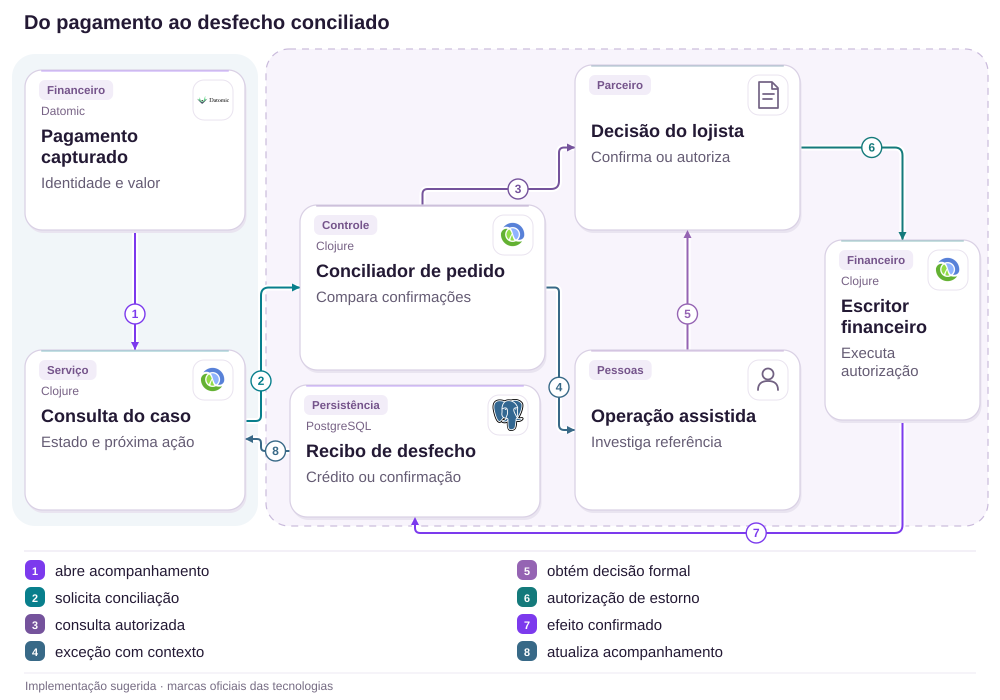

# 20 · NuPay: pagamento confirmado, pedido ausente

Conciliação · Parceiros · Continuidade

[PT reader](https://wesleyvieira99.github.io/nu/#20-1) · [EN reader](https://wesleyvieira99.github.io/nu/en.html#20-1)

[Executable Python lab](../../labs/case_20.py)

## Estorno realizado, espera contestada


Recorte real da fonte pública, capturado em 23/10/2026. O texto abaixo inclui resposta da empresa e desfecho relatado.

Relato 255046021, de 28/07/2026: a consumidora afirmou que uma compra de maio na Cobasi, paga via NuPay, foi cobrada sem pedido processado. Em 03/08, o Nubank informou que acionou a loja, que localizou o pagamento e estornou integralmente em 30/07. Em 04/08, a consumidora marcou Resolvido, mas nota 0 pelo atendimento e demora. O valor e a causa técnica não são públicos; não há perda final comprovada.

A resposta também distingue intermediação de pagamento de decisão de cancelamento da compra. Minha proposta preserva essa autoridade e melhora detecção, acompanhamento e conciliação da lacuna. Não presume perda de webhook nem oferece estorno unilateral como solução para qualquer timeout.

- [Reclame AQUI · 255046021](https://www.reclameaqui.com.br/nubank/pagamento-nupay-aprovado-pedido-nao-processado-e-meu-dinheiro-nao-foi-devo_zWbyC-MKbLgrVXSU/)

## Dois sistemas podem discordar sem mentir

Pagamento capturado e pedido reconhecido são fatos diferentes. Um cliente enxerga uma única compra, mas as autoridades de pagamento e de fulfillment podem confirmar etapas em momentos distintos. A hipótese de projeto é que identificar cedo pagamentos sem confirmação de pedido, com referência compartilhada, reduz tempo até investigação útil. A reclamação não revela em qual etapa a inconsistência nasceu.

Eu começaria pelo contrato com o lojista: identidade de transação, referência do pedido, estados terminais e forma autorizada de consulta. A ausência de pedido no histórico do consumidor não prova ausência no sistema comercial; a conciliação deve buscar evidência nas fontes autorizadas. O app precisa mostrar o que está confirmado e o que está em verificação, sem fazer o cliente arbitrar versões entre empresas.

Também investigaria continuidade de atendimento: quem possuía o caso e qual era a próxima atualização? O desfecho resolvido com nota zero mostra que recuperação financeira e experiência de espera merecem métricas distintas. Não podemos deduzir da nota a duração operacional exata, mas podemos formular um contrato melhor para não deixar investigação sem dono.

## A investigação não cria autoridade de estorno



Arquitetura externa proposta; tecnologias ilustram escolhas, não sistemas internos confirmados.

Uma pendência abre conciliação e, se necessário, investigação assistida. Ambas procuram a decisão autorizada do lojista. Apenas o escritor financeiro aplica o crédito, com recibo e identidade idempotente. A consulta do caso recebe o resultado confirmado para explicar o desfecho ao cliente. Pessoas e empresa parceira não recebem logos de componentes de software.

O desenho trata o ramo de estorno; confirmação de pedido pode encerrar a lacuna sem crédito. O laboratório não envia cancelamento real, não implementa chargeback e não decide direitos do consumidor. Esses caminhos exigem contratos e políticas separados, com auditoria adequada.

## Timeout abre caso, não movimenta dinheiro

```python
    def authorize_refund(self, merchant, payment_id, authorization_id):
        with self.lock:
            for value in (merchant, payment_id, authorization_id):
                identifier(value)
            if merchant != self.p.merchant or payment_id != self.p.payment_id:
                raise PermissionError('merchant/payment scope')
            if not authorization_id:
                raise ValueError('authorization required')
            if self.refund_authority not in (None, authorization_id):
                raise ValueError('conflicting authority')
            self.refund_authority = authorization_id

    def refund(self, actor, authorization_id, key):
        with self.lock:
            identifier(authorization_id)
            identifier(key)
            if actor != 'financial-writer':
                raise PermissionError('financial writer required')
            if not key or not authorization_id:
                raise ValueError('identity required')
            if self.refund_authority != authorization_id:
                raise PermissionError('merchant authorization missing')
            if self.credits:
                old_key, receipt = next(iter(self.credits.items()))
                if old_key != key:
                    raise ValueError('payment already refunded')
                return receipt
            receipt = (self.p.payment_id, self.p.cents, authorization_id)
            self.credits[key] = receipt
            self.state = 'REFUNDED'
            return receipt
```

Trecho literal do laboratório executado; imports e inicialização no arquivo completo.

A autorização de estorno é vinculada ao lojista e pagamento. O escritor financeiro valida sua própria identidade e a autorização antes do efeito. Repetir a mesma chave retorna o recibo; usar outra chave depois do crédito falha. Uma janela sintética de quinze minutos serve apenas para abrir investigação, nunca para criar permissão de devolução.

O modelo implementa estorno integral único, não parcelas ou devoluções parciais. Uma confirmação tardia de pedido depois da autorização de estorno exige conciliação para evitar entrega incompatível com a decisão. No mundo real, a autoridade pode incluir regras adicionais e outros caminhos de disputa; o laboratório delimita somente o fluxo descrito.

- [Laboratório executável do caso no GitHub](https://github.com/wesleyvieira99/nu/blob/main/labs/case_20.py)

## SQL para unicidade e rastreabilidade

```sql
CREATE TABLE refund_receipt (
  merchant_id TEXT NOT NULL,
  payment_id TEXT NOT NULL,
  authorization_id TEXT NOT NULL,
  idempotency_key TEXT NOT NULL,
  amount_cents BIGINT NOT NULL CHECK (amount_cents > 0),
  ledger_receipt_id TEXT NOT NULL,
  PRIMARY KEY (merchant_id, payment_id),
  UNIQUE (merchant_id, idempotency_key)
);

-- Insert must share the financial transaction or a verified ledger command.
-- A uniqueness constraint alone does not make an external credit atomic.
```

SQL ilustrativo não executado; apenas estorno integral único neste modelo.

A restrição protege a identidade do estorno, mas não torna um efeito externo atômico. Eu escolheria uma transação na autoridade financeira ou um comando idempotente cujo recibo possa ser consultado após falha. Inserir a linha e depois chamar um serviço sem contrato de repetição deixaria uma nova lacuna, exatamente o tipo de problema que o projeto pretende reduzir.

A chave comercial inclui o lojista, evitando colisão entre números de pedido iguais em lojas diferentes. A interface de atendimento consulta referências autorizadas, e não SQL direto. O recibo financeiro precisa informar como o crédito aparecerá ao cliente, sem prometer que o histórico comercial será apagado ou reescrito.

## O pedido e o pagamento mantêm identidades

| Identidade | Dono | Regra |
| --- | --- | --- |
| payment_id | Pagamento | Imutável após captura |
| order_ref | Lojista | Vinculada ao pagamento |
| authorization_id | Autoridade comercial | Escopo e prova |
| case_id | Operação | Próxima atualização |

```json
{
  "schema": "order-reconciliation.v1",
  "payment_id": "synthetic-payment",
  "merchant_ref": "synthetic-merchant",
  "order_ref": "synthetic-order",
  "payment_state": "CAPTURED",
  "order_state": "UNCONFIRMED",
  "case_state": "INVESTIGATING",
  "refund_authorization": null
}
```

Contrato sintético proposto, não executado; ausência de autorização não é permissão.

Eu manteria estado financeiro e estado comercial separados, com ocorrência e recebimento datados. Um status genérico falhou pode ocultar pagamento confirmado e incentivar repetição da compra. A API responde com estado, evidência disponível e próxima ação; não atribui culpa ao lojista a partir de silêncio de rede.

A conciliação utiliza valores e referências na zona protegida. Telemetria recebe categoria de divergência, idade e versão, sem conteúdo do carrinho ou dados desnecessários de compra. Retenção e acesso devem permitir investigação e cumprir políticas existentes. Um operador que altera o caso não ganha automaticamente permissão para emitir crédito.

## Provar ausência de crédito indevido

```python
    def test_timeout_is_not_refund_authority(self):
        self.assertEqual(self.r.investigate(1000), 'INVESTIGATING')
        with self.assertRaises(PermissionError):
            self.r.refund('financial-writer', 'invented', 'a')
        self.assertEqual(self.r.credits, {})

    def test_cross_merchant_authority_is_rejected(self):
        with self.assertRaises(PermissionError):
            self.r.authorize_refund('shop-b', 'payment-a', 'grant')
        self.assertIsNone(self.r.refund_authority)

    def test_concurrent_refunds_credit_once(self):
        self.r.authorize_refund('shop-a', 'payment-a', 'grant')
        def refund(_):
            return self.r.refund('financial-writer', 'grant', 'a')
        with ThreadPoolExecutor(max_workers=4) as pool:
            results = list(pool.map(refund, range(20)))
        self.assertEqual(len(set(results)), 1)
        self.assertEqual(sum(v[1] for v in self.r.credits.values()), 5000)
```

Trecho literal dos testes; 13 testes do laboratório passaram localmente.

Os treze testes passaram. A suíte inclui timeout sem autoridade, lojista errado, confirmação tardia, chave alternativa, titular técnico incorreto e relógio inválido. A concorrência repete o mesmo estorno vinte vezes e verifica um único crédito. O teste de pedido confirmado seguido de cancelamento autorizado distingue uma devolução legítima de uma tentativa de criar permissão a partir da ausência de pedido.

No ambiente integrado, eu interromperia o fluxo depois do efeito financeiro e antes do recibo local, para testar recuperação. Também exercitaria autorização duplicada, mudança de referência do lojista e conciliação com fatura. O laboratório não simula a rede comercial nem prova prazo de estorno real; cada integração precisa confirmar suas garantias e limites.

## Resolver o dinheiro e a espera

Baseline desconhecido. A primeira métrica proposta é pagamento sem confirmação comercial após a janela acordada sobre capturas válidas, por lojista e dia. A janela de quinze minutos do laboratório é didática; a produção precisa combinar contrato e comportamento observado. Casos sem resposta continuam no denominador até receber estado confiável, evitando melhorar o indicador apenas por expiração do registro.

Tempo até primeira ação útil conta da detecção à consulta autorizada ou encaminhamento com dono, em coortes semanais. Atualização cumprida mede casos avisados no prazo prometido sobre casos com atualização devida. Estorno conciliado mede créditos confirmados sobre autorizações recebidas, separado de tempo de autorização do lojista. Crédito duplicado por pagamento é a barreira financeira que interrompe expansão.

A avaliação combina cliente, operação e financeiro. Uma queda no estoque de casos obtida por fechar pendências sem evidência não é ganho. Eu proporia comparar lojistas com contratos semelhantes e acompanhar os casos antigos separadamente, porque o envelhecimento pode explicar boa parte do esforço que uma média esconde.

## Capacidade e exposição são dimensões diferentes

Não há valor da compra no relato. Assumo 500 investigações mensais, 25 minutos manuais por caso antes da mudança, R$ 60 por hora carregada, operação de R$ 2.000 por mês e implementação de R$ 60.000. São premissas de planejamento, não baseline medido. O benefício de capacidade é casos × minutos poupados ÷ 60 × custo horário.

| Cenário | Minutos poupados | Horas/mês | Valor líquido/mês |
| --- | --- | --- | --- |
| Conservador | 10 | 83,33 | R$ 3.000 |
| Base | 15 | 125 | R$ 5.500 |
| Ambicioso | 20 | 166,67 | R$ 8.000 |

Equilíbrio operacional exige quatro minutos poupados por caso. Recuperar implementação levaria 20, 10,91 ou 7,5 meses se toda capacidade virasse caixa. Separadamente, assumindo R$ 120 por caso e redução de dois, cinco ou oito dias pendentes, a exposição cai 120.000, 300.000 ou 480.000 reais-dia. Essa unidade mede valor multiplicado pelo tempo de incerteza; não é lucro, saldo recuperado nem benefício somável ao primeiro.

Finanças validaria custo marginal, e Operações demonstraria que os minutos foram realmente removidos sem reduzir qualidade. Não conto valor estornado como receita e não monetizo a insatisfação da nota zero. O projeto precisa justificar sua economia com amostra de trabalho real.

## Um plano conjunto com o lojista

Dias 0–15: Payments e Operações Comerciais identificam contrato, referências e responsáveis pelo parceiro. O Staff descreve estados e autoridade de estorno; Atendimento define próxima atualização. A saída exige conseguir localizar um pagamento e um pedido sintéticos sem pedir ao cliente que transporte comprovantes entre equipes.

Dias 16–30: backend implementa detector em sombra e consulta autorizada; o parceiro valida fixtures e exceções. Dias 31–60: QA testa autorização tardia, captura duplicada, recibo perdido e cobrança conciliada. A saída é uma investigação com dono e um efeito financeiro único, sem depender de uma bandeira manual que qualquer operador possa ligar.

Dias 61–90: o EM coordena piloto com poucos lojistas, capacidade de atendimento reservada e revisão de custo. Payments aceita integridade, parceiro aceita semântica comercial e Atendimento aceita continuidade. O horizonte é proposto; ausência de contrato de consulta ou de autorização impede automação financeira e mantém o caso em rota assistida.

## Operar os casos que envelhecem

O detector em sombra primeiro mede falsos positivos por lojista. Um parceiro que confirma pedidos em lote exige janela diferente de uma confirmação imediata; a regra precisa ser explícita e aprovada. A coorte inicial recebe acompanhamento melhor, e só depois automatização de passos que já possuem autoridade verificável. O volume de casos aberto nunca deve exceder a capacidade combinada de investigação.

O plantão de Payments recebe inconsistência de crédito; Operações Comerciais recebe falta de resposta do parceiro; Atendimento recebe promessa de atualização vencida. Eu exercitaria queda após estorno e chegada posterior de confirmação comercial. O plano de recuperação consulta recibos e impede dupla devolução, enquanto uma pessoa autorizada resolve eventual conflito de entrega.

Rollback suspende detector ou execução nova, preservando casos e recibos. Pendências antigas não desaparecem quando a versão sai de produção. A rotina diária revisa idade, próxima ação e dono; um caso sem novidade ainda pode exigir uma atualização honesta para o cliente, sem fabricar prazo ou atribuir culpa.

## Minha contribuição: fechar a jornada inteira

Como Staff, eu escolheria contratos que conservam identidade entre pagamento, pedido, autorização e recibo. Rejeitaria estornar automaticamente qualquer pagamento sem pedido após timeout: silêncio não cria autoridade e pode produzir crédito duplicado ou entrega gratuita indevida. Também rejeitaria considerar a integração pronta apenas porque a captura funciona; a recuperação faz parte do contrato desde o início.

Como Engineering Manager, eu faria o parceiro e Atendimento participarem da definição de pronto, com dono por próxima ação e capacidade reservada para exceções. A revisão semanal mostraria casos envelhecidos e decisões bloqueadas, não somente entregas técnicas. Eu negociaria escopo para lançar menos lojistas com recuperação verificável antes de expandir uma integração que transfere o custo para o cliente.

Esse caso demonstra o tipo de responsabilidade que proponho assumir: conectar integridade financeira, operação e experiência depois do caminho feliz. Não alego conhecer a causa da reclamação nem ter participado da solução. O valor da proposta está em tornar explícito como um time saberia que a jornada realmente terminou.

## Handoff: acompanhar até o recibo final

Execute python3 labs/case_20.py -v. Comece em Reconciler.investigate: ultrapassar a janela muda somente o estado de investigação. Tente refund sem autorização e confirme que não há crédito. Depois autorize pelo lojista correto, execute em paralelo e verifique um recibo. Envie confirmação comercial tardia e observe a necessidade de conciliação, sem reabrir automaticamente o compromisso.

O aceite inclui isolamento de lojista e pagamento, autorização verificável, escrita idempotente, estados separados, recuperação após resposta perdida e próxima atualização com dono. Ainda faltam persistência, assinatura de integração, ledger real, consulta comercial, fatura, governança de disputas e operação assistida. O SQL e o JSON são contratos ilustrativos não executados, e o modelo limita-se a um estorno integral.

Eu recomendaria avançar se o parceiro consegue fornecer e reconciliar evidência, e se o cliente pode acompanhar o caso sem repetir sua história. Pararia se o plano depende de crédito sem autoridade ou de encerrar pendências para melhorar métricas. Uma compra resolvida precisa de desfecho financeiro confiável e de uma comunicação que a pessoa consiga reconhecer.

- [Laboratório executável do caso no GitHub](https://github.com/wesleyvieira99/nu/blob/main/labs/case_20.py)
